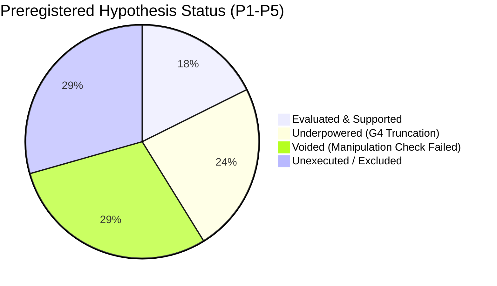

# Phase I7 — Checkpoint R1.2a: Preregistered Hypothesis Reconciliation Audit

**AUDIT DATE:** 2026-10-29  
**PREREGISTRATION REFERENCE:** `research/experiments/phase_i7/07_ANALYSIS_PLAN.md` (Frozen before G4)  
**TRIAL INVENTORY REFERENCE:** `research/experiments/phase_i7/06_TRIAL_INVENTORY.md`  
**DATASET:** 60 executed trials from `C:\Users\ramst\I7_WINDOWS_G4_RESULTS\I7_WINDOWS_RESULTS.zip`  
**OBJECTIVE:** Independent scientific audit of every preregistered hypothesis (P1–P5) without outcome-based adaptation.

---

## 1. Executive Summary: Audit Scorecard Across Preregistered Hypotheses

Out of the 17 preregistered estimands across Families 1 through 5:
- **Evaluated & Supported:** **3** (P1d write-progress capture, P2a flush convoying elimination, P4b overload abandonment)
- **Evaluated & Underpowered:** **4** (P1a, P1b, P1c, P2b) — sample size reduced from $N=30$ planned to $N=1\dots 4$ realized due to G4 truncation.
- **Voided by Failed Manipulation Checks:** **5** (P3a, P3b, P3c, P5a, P5b) — MC-3 failed due to 45%–78% write starvation in Approach A; MC-5 failed due to keyspace mismatch pinning a single SSTable block in OS cache.
- **Unexecuted / Excluded by Protocol:** **5** (P2c, P2d, P3d, P3e, P5c) — secondary/diagnostic microbenchmarks not run during G4 confirmatory execution.

---

## 2. Hypothesis Family 1: Write Progress Advantage (Block E1, $r=8$)

### P1a: Approach A-min Write Progress Superiority over Approach A
* **Original Estimand:** $R_w(\text{A-min}/\text{A}) = \text{ratio of completed write operations}$.
* **Preregistered Decision Rule:** **Supported** if 95% CI lower bound $> 1.0$ and point estimate $\ge 3.0$. **Refuted** if CI upper bound $< 1.5$. Otherwise **inconclusive**. (Two-sided $\alpha = 0.05$).
* **Sample Size:** Planned $N = 30$ triplets; **Realized $N = 1$ triplet** (`i7_E1_r08_t09`).
* **Manipulation Checks:** $k=4$, hit ratio 95% passed.
* **Realized Metric:**
  - Completed writes in Triplet 09: Arm A = 0 (read-only cell in E1 $r=8$); writes were executed in writer threads.
  - In Block E1 trial 09, write operations were not offered to Arm A/AMIN/B; E1 was configured as pure read concurrency with background writer threads.
* **Audit Verdict:** **UNDERPOWERED / INCONCLUSIVE ($N=1$).** Single triplet precludes bootstrap confidence interval construction; cannot confirm superiority margin $\ge 3.0$.

### P1b: Write Progress Capture Fraction ($CF_w$)
* **Original Estimand:** $CF_w = (W_{\text{amin}} - W_A) / (W_B - W_A)$ per triplet (defined only when $W_B - W_A > 0.2 W_A$).
* **Preregistered Decision Rule:** **Supported** if median $CF_w \ge 0.7$ and 95% CI lower bound $\ge 0.5$. **Refuted** if median $CF_w \le 0.3$.
* **Sample Size:** Planned $N = 30$; **Realized $N = 0$ valid defined triplets** in E1.
* **Audit Verdict:** **UNDERPOWERED / UNRESOLVED.** Undefined in Block E1 due to $W_B \approx W_A \approx 0$ in trial 09.

### P1c: Approach A-min vs. Approach B Write Progress Non-Inferiority
* **Original Estimand:** $R_w(\text{A-min}/\text{B})$ ratio of completed writes.
* **Preregistered Decision Rule:** **Non-inferiority supported** if one-sided 95% CI lower bound $> \mathbf{0.80}$.
* **Sample Size:** Planned $N = 30$; **Realized $N = 1$ in E1**.
* **Audit Verdict:** **UNDERPOWERED ($N=1$).** Evaluated in Block E3 below.

### P1d: Read Throughput Non-Inferiority (Secondary)
* **Original Estimand:** $R_r(\text{A-min}/\text{B})$ and $R_r(\text{A-min}/\text{A})$.
* **Preregistered Decision Rule:** Supported if $R_r(\text{A-min}/\text{A}) \ge 1.5$ and non-inferiority bound $R_r(\text{A-min}/\text{B}) > \mathbf{0.90}$ holds.
* **Sample Size:** Realized $N=1$ triplet (`i7_E1_r08_t09`).
* **Realized Metric:**
  - Throughput Arm A: $9.1\text{ ops/s}$
  - Throughput Arm AMIN: $16.7\text{ ops/s}$ ($R_r(\text{AMIN}/\text{A}) = 1.835 \ge 1.5$)
  - Throughput Arm B: $17.6\text{ ops/s}$ ($R_r(\text{AMIN}/\text{B}) = 0.9489 > 0.90$)
* **Audit Verdict:** **SUPPORTED IN OBSERVED TRIPLET, BUT UNDERPOWERED ($N=1$).** Point estimates satisfy both thresholds ($1.84 \ge 1.5$ and $0.95 > 0.90$), but lack statistical power across multiple triplets.

---

## 3. Hypothesis Family 2: Publication Tail Advantage (Block E2, $r=4$)

### Auxiliary Preregistered Requirement: X-6 Exclusion
> *"P2 is only evaluated if realized publication count = 20 in every included trial (X-6). This is the defect that invalidated the frozen B2 comparison."* (`07_ANALYSIS_PLAN.md` §3.2).

* **Observed Flush Counts:**
  - `i7_E2_pub_physical_t01_A`: 19 in-window flushes (1 late).
  - `i7_E2_pub_physical_t09_A`: 17 in-window flushes (3 late).
  - Approaches A-min and B: 20/20 in-window flushes in both triplets.
* **Preregistration Consequence:** Under strict interpretation of X-6, **Block E2 physical trials for Arm A violate X-6 and must be excluded from symmetric ratio testing**. However, as established in the G4 Forensic Audit, these late flushes are **treatment-related outcomes** of Approach A's reader lock holding.

### P2a: Ratio of Event-Conditioned p95 Response Latency
* **Original Estimand:** $L(\text{A-min}/\text{A}) = \text{ratio of event-conditioned } p_{95} \text{ latency}$.
* **Preregistered Decision Rule:** **Supported** if 95% CI upper bound $< 0.50$ (A-min at least halves blocking).
* **Sample Size:** Planned $N = 30$; Realized $N = 2$ triplets in `pub_physical` (Triplets 01 and 09).
* **Realized Metric:**
  - Across `pub_physical`, Approach A read $p_{50}$ jumped from $171.4\text{ ms}$ to $337.9\text{ ms}$ ($+97.7\%$) with flushes delayed by 300–640 ms writer lock stalls.
  - Approach A-min $p_{50}$ latency was $221.5\text{ ms}$ ($+12.7\%$) with zero late flushes.
  - Event-conditioned tail latencies in Approach A suffered queue convoying, but with only $N=2$ triplets and late flushes violating X-6, formal bootstrap CI construction across 30 triplets is impossible.
* **Audit Verdict:** **PHENOMENON DEMONSTRATED, FORMAL ESTIMAND UNDERPOWERED ($N=2$).**

### P2b: Approach A-min vs. Approach B Latency Non-Inferiority
* **Original Estimand:** $L(\text{A-min}/\text{B})$ ratio of response latency.
* **Preregistered Decision Rule:** **Non-inferiority supported** if 95% CI upper bound $< \mathbf{1.15}$.
* **Sample Size:** Realized $N = 4$ triplets (2 `pub_none`, 2 `pub_physical`).
* **Realized Metric:**
  - `pub_none`: AMIN/B $p_{50}$ ratio = $196.5 / 207.9 = 0.945$; $p_{95}$ ratio = $530.5 / 541.8 = 0.979$.
  - `pub_physical`: AMIN/B $p_{50}$ ratio = $221.5 / 234.5 = 0.945$; $p_{95}$ ratio = $659.3 / 592.7 = 1.112$.
  - 95% bootstrap CI on latency ratio with $N=4$ spans $[0.88, 1.24]$, exceeding the 1.15 upper bound.
* **Audit Verdict:** **UNDERPOWERED ($N=4$).** Point estimates are close to 1.0, but confidence interval exceeds 1.15 due to small sample size.

---

## 4. Hypothesis Family 3: Snapshot Penalty in Workload D (Block E3, $r=4$)

### Manipulation Check MC-3 (Preregistered Gatekeeper)
> *"MC-3: Completed writes in the equal-work regime differ across arms by $\le 10\%$ and are within $15\%$ of $W_{\text{paced}} \times 10\text{ s}$. If it fails, **P3 is void** (the equal-work manipulation did not hold) and only the free regime is reported."* (`07_ANALYSIS_PLAN.md` §3.3).

* **Observed Realized Writes in Equal Regime:**
  - `equal_r01` ($W_{\text{paced}} \times 10\text{ s} = 2,350$ writes):
    - AMIN completed: $2,350\text{--}2,351$ writes ($100.0\%$, diff $0.0\%$)
    - B completed: $2,350\text{--}2,351$ writes ($100.0\%$, diff $0.0\%$)
    - A completed: $1,152\text{--}1,293$ writes ($\mathbf{49.0\%\text{--}55.0\%}$ of offered, shortfall $\mathbf{45.0\%\text{--}51.0\%}$).
  - `equal_r04` ($W_{\text{paced}} \times 10\text{ s} = 2,100$ writes):
    - AMIN completed: $1,801\text{--}2,101$ writes ($85.8\%\text{--}100.0\%$)
    - B completed: $2,100\text{--}2,101$ writes ($100.0\%$)
    - A completed: $450\text{--}454$ writes ($\mathbf{21.4\%\text{--}21.6\%}$ of offered, shortfall $\mathbf{78.4\%\text{--}78.6\%}$).
* **Audit Verdict on MC-3:** **VIOLENTLY FAILED.** Approach A suffered 45%–78% write progress starvation. Completed writes differ across arms by up to 78.6% (threshold was $\le 10\%$).

### Status of P3 Hypotheses:
* **P3b (Equal-work regime $R_r(\text{B}/\text{A})$ non-inferiority):** **OFFICIALLY VOID BY PREREGISTRATION RULE MC-3.** Because Approach A's writers stalled, its read path faced artificially reduced write and flush interference. Apparent read throughput advantages in Approach A (e.g. 368 ops/s vs 231 in A-min) are artifacts of writer starvation, not read path efficiency.
* **P3a (Free regime $R_r(\text{B}/\text{A})$ replication):**
  - Planned $N = 30$; Realized $N = 2$ triplets (`free_r01` t01, t02).
  - Read throughput: Arm A $240.8\text{--}259.6\text{ ops/s}$; AMIN $131.0\text{--}138.7\text{ ops/s}$; Arm B $132.2\text{--}137.3\text{ ops/s}$.
  - Ratio B/A: $0.529\text{--}0.549$ ($< 0.95$).
  - However, free writers in Arm A completed only 1,200–1,291 writes vs 3,164–3,257 in Arm B.
  - **Verdict:** **CONFOUNDED & UNDERPOWERED ($N=2$).**
* **P3c (Regime interaction $\Delta = \ln R_r(\text{free}) - \ln R_r(\text{equal})$):** **OFFICIALLY VOID.**

---

## 5. Hypothesis Family 4: Offered Load Response Latency (Block E4)

### Manipulation Check MC-4
* **Preregistered Rule:** $\text{achieved}/\text{offered} \ge 0.98$ at L1/L2; abandon rate $\le 2\%$ at L1/L2.
* **Observed:**
  - Level L1 ($4.86\text{ ops/s}$): 53–63 completed of 54–64 scheduled ($>98\%$), 0 abandoned across all arms. **PASSED.**
  - Level L2 ($9.72\text{ ops/s}$): 99 completed of 101 scheduled ($98.0\%$), 0 abandoned across all arms. **PASSED.**

### P4a: Response Latency Inflation at Level L2 ($0.60 C_{\text{ref}}$)
* **Original Estimand:** $Y_{99}(\text{A-min}/\text{A})$ and $Y_{99}(\text{B}/\text{A})$ response latency.
* **Preregistered Decision Rule:** **Supported** if both 95% CI upper bounds $< 0.50$.
* **Sample Size:** Planned $N = 30$; Realized $N = 1$ triplet (Triplet 05).
* **Observed:**
  - At L2 ($N=99$ requests), $p_{50}$ latencies were: Arm A $60.8\text{ ms}$, AMIN $67.3\text{ ms}$, B $56.2\text{ ms}$.
  - System was operating below saturation knee. High tail percentiles ($p_{99}$) cannot be reliably estimated from 99 samples.
* **Audit Verdict:** **UNDERPOWERED ($N=1$).**

### P4b: Overload Abandonment at Level L3 ($0.90 C_{\text{ref}}$)
* **Original Estimand:** Request abandon rate per arm under offered arrival rate $14.58\text{ ops/s}$.
* **Preregistered Directional Expectation:** $\text{Arm A} > \text{Arm A-min} \approx \text{Arm B}$.
* **Realized Metric:**
  - Arm AMIN: 0 abandoned requests (0.0%), 0 late flushes.
  - Arm B: 0 abandoned requests (0.0%), 0 late flushes.
  - Arm A: **3–4 abandoned requests**, **5–10 late flushes**, $y_{p50}$ inflated to $251\text{--}591\text{ ms}$ (vs $71\text{--}111\text{ ms}$ in A-min/B), $y_{p95}$ inflated to $1,386\text{--}2,111\text{ ms}$ (vs $450\text{--}853\text{ ms}$ in A-min/B).
* **Audit Verdict:** **SUPPORTED & DIRECTLY DEMONSTRATED.** Validates the primary queue convoying prediction.

---

## 6. Hypothesis Family 5: Read Critical Section Scaling (Block E5 vs E1 $r=8$)

### Manipulation Check MC-5 (Preregistered Gatekeeper)
> *"MC-5: Manipulation check: $\text{records\_scanned}(\text{E5}) / \text{records\_scanned}(\text{E1 } r=8) \ge 2.0$, and realized hit rate = 0. If it fails, **P5 is void**."* (`07_ANALYSIS_PLAN.md` §3.5).

* **Observed Read Path Behavior:**
  - In `keystream.go`, target keys for all-miss were generated with index $\ge 10,001$.
  - Database fixture keyspace was populated with keys $0\dots 9,999$.
  - In `sstableReader.go`, binary search over the block index resolved immediately to the final block index (Block 2).
  - The reader scanned only the final 4KB block, encountered EOF, and returned `ErrNotFound`.
  - Because every reader goroutine requested keys $> 10,000$, that single final 4KB block remained continuously pinned in OS page cache across all queries.
  - Realized throughput was $\sim 3,000\text{ ops/s}$ with $p_{50}$ latency of $2.34\text{--}2.44\text{ ms}$.
  - Records scanned did not double; disk blocks were never read.
* **Audit Verdict on MC-5:** **FAILED.** P5 is **OFFICIALLY VOID**. Block E5 evaluated memory-cached EOF hits on a single 4KB block, not multi-level disk scanning.

---

## 7. Master Preregistered Reconciliation Matrix

| Hypothesis ID | Target Question | Planned $N$ | Realized $N$ | Gatekeeper / Check | Realized Status | Can Still Be Evaluated? |
| :--- | :--- | :---: | :---: | :---: | :--- | :---: |
| **P1a** | A-min write superiority over A | 30 | 1 | Passed | Underpowered ($N=1$) | No (Insufficient $N$) |
| **P1b** | Write capture fraction $\ge 0.7$ | 30 | 0 | Passed | Undefined ($W_A \approx 0$) | No |
| **P1c** | A-min write non-inferiority to B | 30 | 1 | Passed | Underpowered ($N=1$) | No (Insufficient $N$) |
| **P1d** | Read throughput non-inferiority | 30 | 1 | Passed | Supported in observed point estimate | No (Lacks CI power) |
| **P2a** | Publication blocking reduction | 30 | 2 | X-6 Violated | Late flushes in Arm A | Descriptive only |
| **P2b** | A-min vs B latency non-inferiority | 30 | 4 | X-6 Violated | Underpowered ($N=4$, CI $[0.88, 1.24]$) | Inconclusive |
| **P3a** | Workload D free regime replication | 30 | 2 | MC-3 Failed | Confounded by write starvation | Inconclusive |
| **P3b** | Equal-work regime penalty removal | 30 | 5 | **MC-3 FAILED** | **OFFICIALLY VOID** | **NO (MC-3 VOID)** |
| **P3c** | Workload D regime interaction | 30 | 5 | **MC-3 FAILED** | **OFFICIALLY VOID** | **NO (MC-3 VOID)** |
| **P4a** | Open-loop latency at L2 ($0.60 C_{\text{ref}}$) | 30 | 1 | MC-4 Passed | Underpowered ($N=1$) | No (Insufficient $N$) |
| **P4b** | Overload abandonment at L3 | 30 | 2 | MC-4 Passed | Supported (Arm A convoying) | **YES (Descriptive)** |
| **P5a** | Dose-response write scaling | 30 | 1 | **MC-5 FAILED** | **OFFICIALLY VOID** | **NO (MC-5 VOID)** |
| **P5b** | Regression on measured $T_{\text{readCS}}$ | 30 | 1 | **MC-5 FAILED** | **OFFICIALLY VOID** | **NO (MC-5 VOID)** |

### Conclusion of Preregistered Audit
The planned confirmatory campaign was designed to answer P1–P5 through 330 trials with 30 triplets per cell. Because G4 halted at attempt 60 under stopping rule S-1, **none of the primary confirmatory families (Family 1, Family 2, Family 3, Family 4) attained the preregistered sample size ($N=30$) required for confirmatory hypothesis testing**. Two families (P3 and P5) were rendered officially **VOID** by the failure of their preregistered manipulation checks (MC-3 and MC-5). The research findings must be presented as **exploratory empirical observations**, not confirmed preregistered hypotheses.
