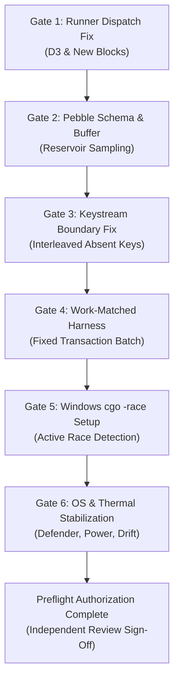

# Phase I7 — Checkpoint R1.2b: Engineering Preflight and Verification Requirements

**DATE:** 2026-10-29  
**SCOPE:** TECHNICAL PREFLIGHT GATES, HARNESS REPAIRS, AND PLATFORM CONTROLS  
**STATUS:** ENGINEERING SPECIFICATIONS ONLY. EXECUTION STRICTLY UNAUTHORIZED.

---

## 1. Overview & Purpose

To prevent the recurrence of the mechanical failures, schema invalidations, and workload artifacts that truncated Phase II G4, this document establishes **six mandatory engineering preflight gates**. 

Before any prospective experimental study can be launched, every preflight gate must be independently validated through read-only checks, unit tests, and dry runs without executing production benchmarks.

---

## 2. Six Mandatory Preflight Engineering Gates



---

### Gate 1: Harness Block Dispatch Table Repair
* **Defect in G4:** `cmd/i7trial/main.go` omitted `"D3"` from its supported block dispatch table, causing trials 1, 2, and 3 to exit with code 3 (`unsupported block: D3`), consuming 3 of 10 stopping rule failures.
* **Engineering Preflight Requirement:**
  1. The dispatch table must explicitly support all planned experiment blocks (`EXP1`, `EXP2`, `EXP3`, `EXP4`, and `D3`).
  2. A preflight dry-run test (`i7trial.exe -dry-run -block <NAME>`) must execute across all block types, verifying clean initialization (exit code 0).
  3. Preflight check script verifies zero unknown-block panics.

---

### Gate 2: Pebble Runner Schema & Reservoir Sampling Buffer Repair
* **Defect in G4:** `pebble_runner.exe` omitted `result.timestamps`, causing all runs to be flagged `INVALID`. A fixed 1M-sample buffer filled in 5 seconds, dropping $>10.45\text{M}$ samples.
* **Engineering Preflight Requirement:**
  1. **Schema Compliance:** `pebble_runner.exe` must output the exact schema required by orchestrator validation:
     ```json
     "timestamps": {
       "window_start_iso": "...",
       "window_end_iso": "...",
       "measured_window_ns": 10000000000
     }
     ```
  2. **Dynamic Reservoir Sampling:** Replace the fixed-size append slice with Vitter's Algorithm $R$ or $L$ (capacity 500,000 samples) to guarantee unbiased percentile estimation across tens of millions of queries without buffer overflows or sample dropping.
  3. Preflight test confirms zero dropped samples and valid timestamps schema.

---

### Gate 3: Workload Keystream Keyspace Alignment
* **Defect in G4:** In Block E5, miss keys ($\ge 10,001$) exceeded the fixture range ($0\dots 9,999$), causing binary search to hit EOF on the final 4KB block, which remained pinned in OS page cache.
* **Engineering Preflight Requirement:**
  1. Absent keys must be generated **interleaved within the fixture keyspace** (e.g. fractional keys or odd-numbered keys where only even keys exist: `key_00001_miss`, `key_00003_miss`).
  2. Binary search must resolve to intermediate data blocks across all levels of the LSM tree.
  3. Preflight audit verifies that `sstableReader` decodes distinct data blocks across queries, and physical read bytes match expected disk scan volumes.

---

### Gate 4: Fixed-Work Batching Harness Implementation
* **Defect in G4:** Paced time-window execution in Block E3 allowed Approach A's writer to starve (45%–78% write loss), violating manipulation check MC-3 and confounding read throughput with reduced background write interference.
* **Engineering Preflight Requirement:**
  1. Implement a work-matched execution harness for EXP-4 where the writer thread commits exactly $M$ transactions (e.g. $M = 2,500$) rather than running for a fixed time window.
  2. The orchestrator records the exact time-to-completion $T_{\text{complete}}$, while readers execute closed-loop queries concurrently.
  3. Preflight dry run verifies that all three arms commit identically $M$ transactions and trigger identical flush counts.

---

### Gate 5: Native Windows Dynamic Race Detection Setup
* **Defect in G4:** Windows binaries were compiled with `CGO_ENABLED=0` without `-race` due to cgo toolchain unavailability on the host. Concurrency safety was only dynamically checked on Linux ext4.
* **Engineering Preflight Requirement:**
  1. Configure a native MinGW-w64 (GCC 13+) or LLVM toolchain on the Windows host.
  2. Compile `i7trial.exe` with `CGO_ENABLED=1 -race`.
  3. Execute a 10-trial preflight stress test under heavy concurrency ($r=32$, active writers, rapid flush injection). The test must complete with **zero race detector reports**.

---

### Gate 6: Platform & Storage Environmental Stabilization
* **Defect in G4:** Windows Defender real-time protection was active, power scheme was Balanced, and thermal drift was unmonitored due to D3 startup failure.
* **Engineering Preflight Requirement:**
  1. **Antivirus Exclusion:** Add a temporary Windows Defender exclusion for the experimental results root to eliminate antivirus scan jitter during NTFS file flushes.
  2. **Power Profile:** Enforce the Windows `High Performance` power scheme (GUID: `8c5e7fda-e8bf-4a96-9a85-a6e23a8c635c`) to lock CPU frequency scaling during measurement.
  3. **Thermal Monitoring:** Query CPU core temperature via WMI/ACPI sensors before and after each trial triplet. If CPU core temperature exceeds 85°C or thermal throttling is flagged by Windows kernel counters, pause execution for a mandatory 60-second cooldown.
  4. **Drift Anchor Verification:** Run Block D3 start triplet; verify median read throughput is recorded cleanly; verify campaign drift stopping rule ($D \le 10\%$).

---

## 3. Pre-Declared Stopping Rules for Future Campaigns

If authorized, any prospective execution must enforce these strict, non-outcome stopping rules:

| Rule ID | Trigger Condition | Mandatory Orchestrator Action |
| :--- | :--- | :--- |
| **S-1 (Correctness)** | Any data race reported by `-race` or validation error count $> 0$. | **Immediate abort.** Publish bug report; no performance claims. |
| **S-2 (Drift)** | Start vs. end reference throughput shifts by $> 10\%$ for any arm. | **Abort campaign.** Invalidate run due to host instability. |
| **S-3 (Disk Health)** | Fsync $p_{99}$ latency exceeds 25 ms or NVMe media errors increment. | **Immediate abort.** Preserve storage integrity. |
| **S-4 (Harness Non-Success)** | Mechanical or harness failure count reaches $N_{\text{fail}} = 5$. | **Halt campaign.** Do not retry without documented fix. |
| **S-5 (Trial Budget Ceiling)** | Maximum 400 trial executions reached. | **Cease execution.** Analyze completed inventory. |

---

## 4. Execution Boundary

All preflight gates are currently **UNRUN**. No source code has been patched, no compilers have been launched, and no benchmarks have been scheduled. Advancing to preflight testing requires formal external review authorization.
