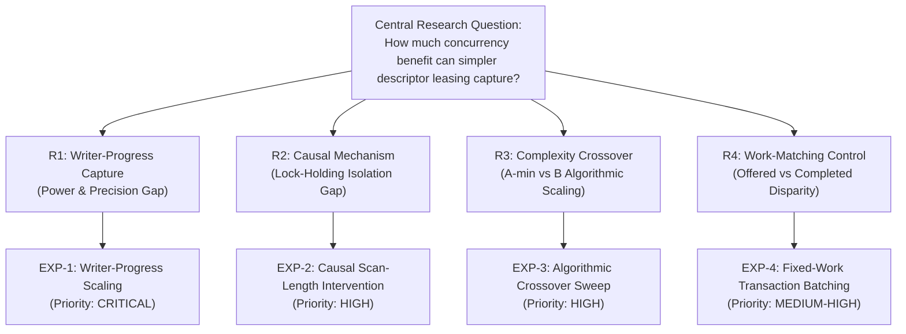

# Phase I7 — Checkpoint R1.2b: Research Gap Prioritization and Decision Matrix

**DATE:** 2026-10-29  
**RESEARCH FOCUS:** LSM-TREE SYNCHRONIZATION ARCHITECTURAL TRADEOFFS  
**OBJECTIVE:** SCIENTIFIC GAP ANALYSIS & EXPERIMENTAL PRIORITIZATION (DESIGN-ONLY)  
**STATUS:** PROSPECTIVE RESEARCH PLANNING. NO EXPERIMENTS RUN.

---

## 1. Central Scientific Objective

The overarching research question of this investigation is:

> *"How much of the concurrency benefit attributed to immutable reader snapshots can be obtained by shortening the manager-lock critical section using simpler reader-lifetime management?"*

Existing research (LevelDB, RocksDB, Pebble) treats **immutable snapshot isolation** as the gold standard for high-concurrency LSM storage engines. However, snapshots incur non-trivial structural costs: atomic pointer swaps, reference counting, epoch-based reclamation, and snapshot descriptor pinning.

Phase I7 introduced **Approach A-min (Descriptor Leasing)** as a minimal alternative: rather than creating immutable snapshots of the entire database state, readers acquire short-lived leases on active table descriptors under a microsecond mutex, releasing the manager lock before performing any SSTable or memtable I/O.

To establish the scientific validity of this architectural choice, four fundamental research gaps must be resolved through independent prospective experiments.

---

## 2. Granular Research Gap Analysis (R1–R4)

---

### Gap R1: Writer-Progress Capture Under Concurrency
* **Core Question:** Can Approach A-min reliably capture the writer-progress improvement demonstrated by Approach B over Approach A across varying reader concurrency levels?
* **Current Evidence Status:**
  - In Block E1 ($r=8$, trial 09), Approach A completed only **5 writes** ($0.50\text{ writes/s}$) due to writer starvation, while Approach A-min completed **2,671 writes** ($267.1\text{ writes/s}$) and Approach B completed **2,657 writes** ($265.6\text{ writes/s}$).
  - Capture fraction is $CF_w = 1.0053$, indicating $>100\%$ progress capture.
* **Remaining Scientific Uncertainty:**
  - Sample size is **$N = 1$**. Run-level variance, inter-trial jitter, and 95% bootstrap confidence intervals are completely unquantified.
  - Concurrency scaling across reader counts ($r = 1, 2, 4, 8, 16, 32$) is unobserved.
* **Scientific Priority:** **CRITICAL (PRIMARY CONTRIBUTION).** Resolving this gap establishes the primary empirical claim that versioning is not necessary to prevent writer starvation.

---

### Gap R2: Causal Isolation of the Read Critical-Section Mechanism
* **Core Question:** Can we prove causally that Approach A's writer convoying is strictly driven by the duration of holding `RLock` during physical SSTable reads, rather than secondary artifacts (e.g. Go runtime scheduling, page cache writeback, memory allocation)?
* **Current Evidence Status:**
  - Approach A's writer stalls (300–640 ms) correlate with 16 readers executing queries.
  - Block E5 attempted to manipulate scan length via an all-miss workload, but **failed manipulation check MC-5** because target keys ($\ge 10,001$) hit EOF on the final block, which stayed cached in OS memory.
* **Remaining Scientific Uncertainty:**
  - The dose-response relationship between read critical-section duration ($T_{\text{readCS}}$) and writer queue delay has not been demonstrated with an experimentally verified manipulation.
  - Competing explanations (disk I/O serialization, thread preemption) have not been formally ruled out.
* **Scientific Priority:** **HIGH (MECHANISTIC EXPLANATION).** Essential to elevate the paper from a purely descriptive benchmark to an explanatory systems study.

---

### Gap R3: Complexity Crossover Between Approach A-min and Approach B
* **Core Question:** Under what operational parameters does Approach A-min's lightweight atomic leasing outperform Approach B's immutable snapshot isolation, and where does the performance crossover occur?
* **Theoretical Dilemma:**
  - **Approach A-min** acquires a descriptor lease under a short mutex lock. Under high reader churn (rapid lease acquisition/release) or large SSTable cardinality ($k$), leasing incurs lock contention and reference tracking overhead.
  - **Approach B** performs an atomic pointer load without locking, but incurs epoch/refcount management, snapshot descriptor allocation, and cleanup overhead during compactions.
* **Current Evidence Status:**
  - Phase I historical data showed Approach B degrading by 26%–37% under rapid reader churn on WSL2 ext4.
  - Approach A-min was **never tested under rapid reader churn**, nor across varying SSTable set sizes ($k$).
  - G4 confirmatory data only evaluated static reader sets with $k=4\dots 24$.
* **Scientific Priority:** **HIGH (THEORETICAL AND PRACTICAL GENERALITY).** Identifies the architectural trade-off boundary, guiding practitioners on when to choose leasing over snapshot isolation.

---

### Gap R4: Equal-Work versus Equal-Offered-Work Interpretation
* **Core Question:** How does reader-writer synchronization perform when systems commit identical realized write work, rather than merely facing identical offered rates?
* **Current Evidence Status:**
  - In Block E3, paced write rates were offered, but Approach A suffered 45%–78% write starvation, violating manipulation check MC-3.
  - Comparing read throughput when one system did 450 writes and the other did 2,100 writes confounded read path efficiency with background write/flush interference.
* **Remaining Scientific Uncertainty:**
  - What is the true latency and throughput profile of Approach A when forced to execute the exact same number of disk writes and memtable flushes as Approach B?
  - Does Approach A-min maintain parity when write backpressure is actively applied?
* **Scientific Priority:** **MEDIUM-HIGH (METHODOLOGICAL RIGOR).** Resolves the major reviewer criticism regarding Workload D comparability.

---

## 3. Decision Matrix: Mapping Research Gaps to Prospective Experiments

| Research Gap | Proposed Experiment | Primary Estimand | Scientific Hypothesis | Falsification Criterion | Expected Scientific Payoff |
| :--- | :--- | :--- | :--- | :--- | :--- |
| **R1: Writer-Progress** | **EXP-1: Writer-Progress Scaling** | Completed writes ratio $R_w(\text{A-min}/\text{A})$ and capture fraction $CF_w$ across $r \in \{1, 4, 8, 16, 32\}$ | A-min reliably achieves $R_w(\text{A-min}/\text{A}) \ge 3.0$ and $CF_w \ge 0.70$ across all $r \ge 4$. | $CF_w < 0.50$ or CI lower bound of $R_w(\text{A-min}/\text{B}) \le 0.80$. | **Proves versioning is unnecessary for writer progress.** |
| **R2: Causal Mechanism** | **EXP-2: Controlled Critical-Section Intervention** | Writer lock-wait time $\Delta t_{\text{wait}}$ and flush duration vs. injected scan length $T_{\text{readCS}}$ | In Arm A, writer wait time scales linearly with $r \times T_{\text{readCS}}$; in A-min and B, writer wait time is invariant ($\approx 0$). | Arm A writer delay fails to correlate with injected $T_{\text{readCS}}$ (slope not significantly $> 0$). | **Isolates the exact causal mechanism of lock convoying.** |
| **R3: Complexity Crossover** | **EXP-3: Algorithmic Crossover Sweep** | Per-read service latency and throughput ratio $R_r(\text{A-min}/\text{B})$ across $k \in \{4, 16, 64, 256\}$ and churn rate | A-min dominates under high churn with low $k$; B dominates under persistent readers with high $k$. | No measurable crossover region exists across the full $4\times 4$ parameter matrix. | **Defines the formal architectural boundary between leasing and snapshots.** |
| **R4: Work Matching** | **EXP-4: Fixed-Work Transaction Batching** | Time-to-completion $T_{\text{complete}}$ for fixed write batch $M = 2,000$ and concurrent read latency | A-min matches B's completion time ($T_{\text{AMIN}} \approx T_B$), while A exhibits queue explosion ($T_A \gg T_B$). | A-min completion time exceeds B by $> 20\%$ under matched write volume. | **Eliminates offered-rate confounding without violating equal-work rules.** |

---

## 4. Prioritization and Execution Phasing

For maximum scientific efficiency and risk control, the prospective study is divided into two sequential phases:

1. **Phase 1 (Core Empirical Foundation — EXP-1 & EXP-2):**
   - Directly resolves the central research question: establishes whether A-min captures B's writer progress across reader concurrency ($r=1\dots 32$), and proves the causal mechanism via controlled critical-section duration intervention.
2. **Phase 2 (Architectural Boundary & Methodology — EXP-3 & EXP-4):**
   - Generalizes the finding: maps the complexity crossover surface (SSTable cardinality $k$ vs reader churn) and provides a rigorous work-matched validation.

**Checkpoint Recommendation:** Authorization of the prospective study should proceed to experimental preflight only after independent review of the detailed statistical power plan and engineering specifications.
