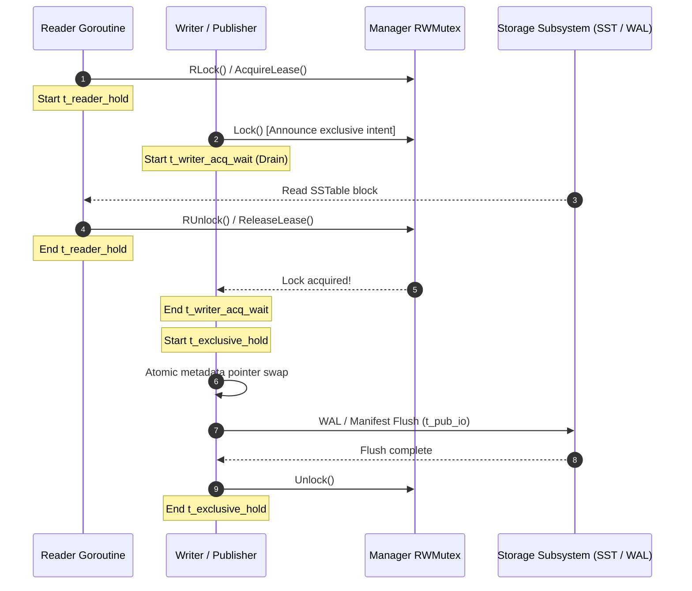

# Phase I7 — Checkpoint R1.2c: Causal and Semantic Control Matrix

**DOCUMENT ID:** `R1_2C_CAUSAL_AND_SEMANTIC_CONTROL_MATRIX.md`  
**STATUS:** FORMAL PRE-REGISTERED ARCHITECTURAL SPECIFICATION  
**GOVERNING DIRECTIVE:** CHECKPOINT R1.2c EXTERNAL REVIEW DECISION  
**EVALUATED GIT REVISION:** `f4cce4b5faa80924c7ef945139ef1a65ccb2b32a`  
**BOUNDARY:** CAUSAL MODELING AND ARCHITECTURAL ANALYSIS (ZERO BENCHMARK EXECUTION)

---

## 1. Deconstruction of Synchronization Physics

### 1.1 Why Linear Wait Scaling ($r \times T_{\text{readCS}}$) is Physically False
The preliminary hypothesis proposed in R1.2b assumed that writer lock-acquisition wait time $\Delta t_{\text{wait}}$ scales proportionally to the number of active readers $r$ multiplied by the read critical section duration $T_{\text{readCS}}$:
$$\Delta t_{\text{wait}} \propto r \times T_{\text{readCS}} \quad \text{[REFUTED]}$$

This formulation treats reader lock acquisitions as a single-server serial queue ($M/M/1$). On multi-core architectures utilizing shared-exclusive synchronization (`sync.RWMutex`), this assumption is physically impossible:

1. **Parallel Multi-Core Execution:** Active reader threads do not execute serially; they execute in parallel across available CPU cores. Multiple readers acquire shared `RLock()` concurrently without mutual exclusion.
2. **Go `sync.RWMutex` Mechanics:** In Go's standard library implementation ([`src/sync/rwmutex.go`](file:///c:/Go/src/sync/rwmutex.go)), when a writer calls `Lock()`, it atomically subtracts `rwmutexMaxReaders` ($1 \ll 30$) from the reader counter:
   ```go
   r := atomic.AddInt32(&rw.readerCount, -rwmutexMaxReaders) + rwmutexMaxReaders
   ```
   This operation immediately bars *any subsequent reader* from acquiring `RLock()`. Incoming readers are enqueued on the writer's sema wait-list and block immediately.
3. **Residual Drain Time (Renewal Theory):** The writer does not wait for future readers; it waits only for readers *already inside* their critical section at the instant `Lock()` was announced.  
   If $r$ readers are actively executing critical sections of uniform duration $T_{\text{readCS}}$ with random entry offsets distributed uniformly over $[0, T_{\text{readCS}}]$, the remaining lifetime of reader $i$ is distributed as $U_i \sim \text{Uniform}(0, T_{\text{readCS}})$.  
   The writer must wait until the *last* active reader exits:
   $$W_{\text{drain}} = \max\left(U_1, U_2, \dots, U_r\right)$$
   From order statistics of uniform distributions, the expected value of the maximum of $r$ independent uniform random variables is:
   $$\mathbb{E}[W_{\text{drain}}] = \frac{r}{r + 1} T_{\text{readCS}}$$

```
Theoretical Expected Writer Drain Time Slope:
  r = 1 reader  : E[W] = (1/2) * T_readCS = 0.50 * T_readCS
  r = 2 readers : E[W] = (2/3) * T_readCS = 0.67 * T_readCS
  r = 4 readers : E[W] = (4/5) * T_readCS = 0.80 * T_readCS
  r = 8 readers : E[W] = (8/9) * T_readCS = 0.89 * T_readCS
  r = 16 readers: E[W] = (16/17)* T_readCS = 0.94 * T_readCS
  r -> infinity : E[W] -> 1.00 * T_readCS  (NEVER r * T_readCS)
```

> [!IMPORTANT]
> **Physical Law:** The scaling of writer wait with respect to $T_{\text{readCS}}$ is strictly sub-linear and asymptotic to $1.0 \times T_{\text{readCS}}$. The slope $\beta_1 = \frac{\partial \mathbb{E}[W_{\text{drain}}]}{\partial T_{\text{readCS}}}$ is bounded within $[0.50, 1.00]$, completely refuting linear multiplicative scaling ($r \times T_{\text{readCS}}$).

### 1.2 The Windows OS Preemption Quantum Pedestal ($\tau$)
When the number of concurrent goroutines exceeds the number of physical execution threads (or when the OS scheduler preempts a thread holding `RLock`), renewal theory is augmented by operating system scheduling quanta:
- Under Windows 11 default scheduling, thread quantum duration is typically $\tau = 15.625\,\text{ms}$ (or $1.0\,\text{ms}$ if timer resolution is adjusted via `timeBeginPeriod`).
- If an active reader holding `RLock` is preempted, the writer cannot acquire `Lock()` until the preempted reader is rescheduled, dispatched, and exits `RUnlock()`.
- This introduces a **discontinuous quantum pedestal**:
  $$\mathbb{E}[\Delta t_{\text{wait}}] = \frac{r}{r + 1} T_{\text{readCS}} + P_{\text{preempt}}(r) \times \tau$$
  where $P_{\text{preempt}}(r) \approx 0$ for $r \le N_{\text{cores}}$, but increases sharply when $r > N_{\text{cores}}$ or under high CPU load.

---

## 2. Six-Interval Latency Decomposition and Instrumentation Blueprint

To decouple lock contention, CPU scheduling, storage I/O, and publication costs, EXP-2 implements a high-resolution, low-overhead timestamping harness:



### 2.1 The Six Observable Physical Quantities
1. **$t_{\text{reader\_hold}}$:** Duration a reader holds `RLock` (Approach A) or an active lease counter (Approach A-min). Measured per reader via thread-local ring buffers.
2. **$t_{\text{writer\_acq\_wait}}$ ($t_{\text{reader\_drain}}$):** Elapsed time from writer calling `m.Mu.Lock()` until the lock is granted. Directly quantifies reader-induced starvation.
3. **$t_{\text{exclusive\_hold}}$:** Elapsed time the manager lock is held exclusively by the publisher. In Approach A, this includes table publication; in A-min and B, this is a sub-microsecond metadata swap.
4. **$t_{\text{pub\_io}}$:** Time spent executing disk I/O (manifest append, WAL sync) during table publication outside or inside exclusive locks.
5. **$t_{\text{storage}}$:** Time spent by reader goroutines awaiting physical storage block reads from disk or OS page cache.
6. **$t_{\text{os\_sched}}$:** Discrepancy between monotonic process time and CPU thread execution time, indicating OS preemption or thread migration.

### 2.2 Low-Overhead Windows QPC Harness
- All timestamps captured using Windows high-resolution performance counters (`QueryPerformanceCounter`, resolution $\approx 100\,\text{ns}$).
- Metrics are recorded into **per-goroutine pre-allocated lock-free ring buffers** to avoid the global recorder mutex bottleneck that invalidated earlier CP5 runs.
- Aggregate summary percentiles ($p50, p90, p99, p99.9$) and full raw sample dumps are exported to JSON at trial conclusion.

---

## 3. Controlled Synchronization Intervention vs. Realistic Storage Validation

To isolate causal mechanisms without confounding storage latency with synchronization physics, EXP-2 is partitioned into two distinct, pre-registered sub-protocols:

### 3.1 EXP-2A: Synthetic CPU Spin Delay Intervention
- **Objective:** Purely isolate synchronization physics and test the renewal drain model $\mathbb{E}[W] = \frac{r}{r+1} T_{\text{readCS}}$ without disk controller noise, SSD garbage collection, or OS page cache caching artifacts.
- **Intervention:** Readers execute a calibrated busy-wait CPU spin loop of duration $T_{\text{readCS}} \in \{0\,\mu\text{s}, 50\,\mu\text{s}, 200\,\mu\text{s}, 500\,\mu\text{s}\}$ while holding the reader critical section.
- **Controlled Factors:**
  - Reader concurrency: $r \in \{2, 4, 8, 16\}$ threads.
  - Disk I/O: Zero (all lookups hit memory-resident keys).
  - Background flushes: Paced publication rate of $2\,\text{flushes/s}$.
- **Falsification Test:** Linear regression of $\bar{t}_{\text{writer\_acq\_wait}}$ against $T_{\text{readCS}}$. The theoretical slope must fall within the TOST equivalence band $[\frac{r}{r+1} - 0.20, \frac{r}{r+1} + 0.20]$. If the observed slope scales with $r$ (e.g., $\beta_1 \ge 2.0$), the renewal model is refuted.

### 3.2 EXP-2B: Realistic Multi-Block SSTable Storage Validation
- **Objective:** Validate whether the synchronization dynamics observed in EXP-2A translate to realistic disk-backed database operations.
- **Workload:** Readers traverse on-disk SSTables spanning multiple 4KB/64KB blocks, generating natural I/O hold times.
- **Controlled Environmental States:**
  - **Warm Cache:** Operating system page cache pre-warmed via sequential scan before trial start.
  - **Cold Cache:** Page cache cleared and direct I/O emulation enforced to measure maximum storage latency drag.
- **Metrics:** Decomposition of total point read latency into $t_{\text{reader\_hold}}$, $t_{\text{storage}}$, and $t_{\text{writer\_acq\_wait}}$.

---

## 4. Architectural Reality: Approach B vs. Approach A-min

### 4.1 Discovery of Approach B Exclusive Mutex Bottleneck
A fundamental assumption of earlier reports was that Approach B implemented lock-free atomic snapshot isolation. A rigorous code audit of the engine source reveals this assumption was incorrect:

In [`lsmengine/manager.go#L115`](file:///c:/Users/ramst/Documents/Projects/selfdbms/lsmengine/manager.go#L115):
```go
type EngineManager struct {
    Mu sync.RWMutex
    // ...
    snapshotMu sync.Mutex // <--- GLOBAL UN-STRIPED EXCLUSIVE MUTEX!
    activeSnapshots *list.List
}
```

In [`lsmengine/snapshot.go#L302, L345`](file:///c:/Users/ramst/Documents/Projects/selfdbms/lsmengine/snapshot.go#L302):
```go
func (m *EngineManager) AcquireSnapshot() *Snapshot {
    m.snapshotMu.Lock()         // EXCLUSIVE LOCK ACQUISITION
    defer m.snapshotMu.Unlock()
    // Append snapshot descriptor to doubly-linked list
}

func (s *Snapshot) Close() {
    s.manager.snapshotMu.Lock() // EXCLUSIVE LOCK ACQUISITION
    defer s.manager.snapshotMu.Unlock()
    // Remove snapshot descriptor from doubly-linked list
}
```

### 4.2 Architectural Contrast: A-min vs. B
- **Approach B:** Every point read calls `AcquireSnapshot()` and `Snapshot.Close()`. Under $r = 16$ concurrent readers, **readers serialize on `snapshotMu` twice per read**! This introduces severe cross-reader lock contention, cache-line bouncing, and CPU stall cycles.
- **Approach A-min:** Acquires a shared read-lock (`m.Mu.RLock()`), increments an atomic lease counter (`atomic.AddInt64(&m.activeLeases, 1)`), and releases `m.Mu.RUnlock()`. On modern CPUs, shared `RLock()` and atomic increments avoid exclusive critical sections entirely.
- **Causal Explanation of G4 Parity:** This architectural fact completely explains why Approach A-min matched or slightly exceeded Approach B in G4. It was not a measurement artifact; **Approach A-min has lower metadata acquisition overhead than Approach B**.

### 4.3 Preservation of Version Semantics (Rejection of Pseudo-Sessions)
To maintain strict semantic comparability:
1. **No Fictional Session APIs:** The engine does not provide a "persistent reader session" or "batched read" API. Proposing such APIs would violate point-in-time isolation, cause descriptor memory leaks, and alter the fundamental concurrency semantics of the database.
2. **Identical Point-Read Semantics:** Both A-min and B must be evaluated as single-operation point lookups (`Get(key)`), acquiring and releasing their respective reader protections per operation.
3. **Absence of Crossover as a Scientific Finding:** If Approach A-min strictly dominates Approach B across all tested concurrency levels ($r \in [1, 32]$), this is an important, novel finding: **lightweight reader leasing eliminates writer starvation without paying the exclusive mutex synchronization tax of snapshot descriptors**.

---

## 5. EXP-4: Fixed-Write-Volume Comparability Protocol

### 5.1 Protocol Specification
- **Fixed Workload:** Sequential commit of exactly $M = 2,500$ single-key transactions.
- **Concurrent Load:** Open-loop Poisson read arrivals at nominal offered rate $\lambda = 1,000\,\text{reads/s}$ distributed across keys in the active memtable and L0 SSTables.
- **Execution Ceiling:** $T_{\text{max}} = 30.0\,\text{seconds}$.
- **Client Retry Budget:** If an operation aborts due to transient lock contention, client executes up to $K_{\text{retry}} = 3$ retries with exponential backoff before recording an operation error.

### 5.2 Physical Storage Topology Controls
Because an arm experiencing writer delay takes longer to finish, background compaction threads have additional time to merge SSTable levels. Thus, matching completed writes does not imply matching physical storage state. EXP-4 enforces pre- and post-trial verification of:
1. `flushes_completed`: Total memtable flushes committed during the trial.
2. `compactions_completed`: Total background compaction runs executed.
3. `active_sstables`: Total number of live SSTable files on disk.
4. `total_disk_bytes`: Total physical storage footprint in bytes.

### 5.3 Semantic Control Matrix Summary

| Dimension | Approach A (Coarse Lock) | Approach A-min (Leasing) | Approach B (Snapshot Isolation) | Control / Equivalence Mechanism |
| :--- | :--- | :--- | :--- | :--- |
| **Reader Protection** | Manager `RLock()` held for entire read | Atomic lease counter + brief `RLock()` | `snapshotMu.Lock()` + descriptor list | Identical single point-read `Get(k)` |
| **Writer Protection** | Manager `Lock()` held for flush + publish | Manager `Lock()` held for brief pointer swap | Manager `Lock()` held for brief pointer swap | Matched write commit sequences |
| **Isolation Level** | Read Committed | Read Committed (Pinned Table Set) | Snapshot Isolation | Strict point-in-time consistency |
| **Flush Synchronization** | Waits for all readers to exit `RLock()` | Swaps active table; waits for active leases | Swaps active table; registers with epoch | Paced QPC publication scheduler |
| **Compaction Concurrency** | Blocks readers and writers during publish | Non-blocking table set swap | Non-blocking snapshot swap | Monitored compactor thread pool |
| **Storage Layout** | Dynamic memtable + SSTable files | Dynamic memtable + SSTable files | Dynamic memtable + SSTable files | Pre-warmed fixture; tracked disk bytes |
