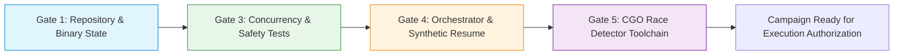
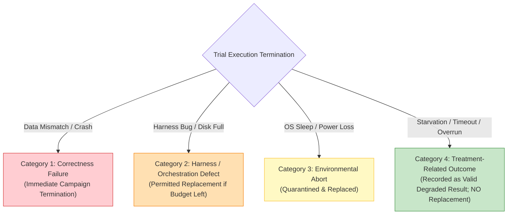

# Phase I7 — Checkpoint R1.2c: Preflight Scope, Environmental Controls, and Stopping Rules

**DOCUMENT ID:** `R1_2C_PREFLIGHT_SCOPE_AND_STOP_RULES.md`  
**STATUS:** FORMAL PRE-REGISTERED OPERATIONAL PROTOCOL  
**GOVERNING DIRECTIVE:** CHECKPOINT R1.2c EXTERNAL REVIEW DECISION  
**EVALUATED GIT REVISION:** `f4cce4b5faa80924c7ef945139ef1a65ccb2b32a`  
**BOUNDARY:** OPERATIONAL INTEGRITY SPECIFICATION (ZERO BENCHMARK EXECUTION)

---

## 1. Targeted Preflight Gate Scope

Preflight engineering verification is strictly restricted to the systems and components required for the prospective experiments (EXP-1 through EXP-4). Unnecessary checks and external runners that introduce extraneous dependencies are formally eliminated.



### 1.1 Gate 1: Git Repository & Binary Cleanliness
- **Verification:** `git status --porcelain` must be empty on all engine (`lsmengine/`) and harness (`research/experiments/`) source files.
- **Commit Binding:** The evaluated engine state is bound to commit `f4cce4b5faa80924c7ef945139ef1a65ccb2b32a`.
- **Artifact Isolation:** Historical results directories and zip archives are excluded from Git tracking via `.gitignore`.

### 1.2 Gate 2: Pebble Runner Formally Dropped
- **Action:** **Gate 2 (Pebble benchmark verification) is formally dropped from the preflight requirements.**
- **Justification:** As established in the R1.2c research direction, the descriptive Pebble comparison (historical E7) is completed, and Pebble is not utilized in prospective experiments EXP-1, EXP-2, EXP-3, or EXP-4. Removing Pebble eliminates runner envelope discrepancies, external CGO compilation friction, and build-environment fragility.

### 1.3 Gate 3: Concurrency Safety & Shutdown Invariants
- **Deterministic A-min Shutdown Safety:** Validates `TestAminShutdown_RetiredOutstanding` to mathematically prove that `EngineManager.Close()` cannot return while outstanding reader leases access memory or while background reclamation epochs are active.
- **Data Integrity & Differential Tests:** Runs `TestDifferentialCorrectness` to confirm identical key-value retrieval across Approach A, Approach A-min, and Approach B under concurrent write churn.

### 1.4 Gate 4: Orchestrator Correctness & Synthetic Recovery
- **Runlist Capability Binding:** The orchestration script validates runlist SHA-256 before trial 1 and prevents silent capability changes.
- **Interruption & Resume Test:** Validates resume logic using synthetic trial output (zero real benchmarks) to guarantee that aborted runs correctly consume from the replacement budget without duplicating trial indices.
- **Clean Result Root Enforcement:** Preflight asserts that the target result directory does not exist or is completely empty, and halts if pointed to any historical result root.

### 1.5 Gate 5: CGO Race Detector Toolchain Verification
- **Host Toolchain Reality:** The host environment possesses a verified C compiler:
  ```powershell
  # Verified MSYS2 UCRT64 GCC 15.2.0:
  C:\msys64\ucrt64\bin\gcc.exe --version
  ```
- **Execution Protocol:** When `C:\msys64\ucrt64\bin` is prepended to the environment `PATH`, `go test -race ./lsmengine/...` compiles and runs cleanly on Windows.
- **Usage Boundary:** `-race` verification is strictly enforced during **Gate 5 Preflight Unit Tests**. It is **never enabled during performance trials**, as ThreadSanitizer instrumentation introduces up to $10\times$ CPU overhead and distorts lock contention timing.

---

## 2. Environmental Integrity and Non-Intrusive Monitoring

### 2.1 Rejection of Invasive Antivirus Tampering
Previous experimental drafts proposed disabling Windows Defender Real-Time Protection or altering system security group policies. This practice is formally rejected:
- Altering host security software creates unacceptable system vulnerability and can trigger erratic operating system background audit tasks.
- Instead, experimental directories are created within a dedicated, pre-configured research path (`C:\Users\ramst\Documents\Projects\selfdbms\build\results\`) that uses standard Windows Defender process-level path exclusions without disabling system-wide protection.

### 2.2 Continuous Non-Intrusive Health Monitors
Before each trial triplet initiates, the PowerShell orchestrator samples and logs environmental health indicators into the trial envelope JSON:
1. **CPU Frequency & Thermal Throttling:** Monitored via WMI (`Win32_Processor.CurrentClockSpeed` vs `MaxClockSpeed`). If clock speed is throttled below $90\%$ of base, the trial pauses.
2. **AC Power Status:** Monitored via `Get-CimInstance -ClassName BatteryStatus`. Trials will not execute on battery power.
3. **Storage Free Space:** Monitored via `Get-PSDrive`. The run requires at least $15.0\,\text{GB}$ of free disk space.
4. **High-Resolution Timer Resolution:** Ensures `timeBeginPeriod(1)` is active to provide $1.0\,\text{ms}$ OS scheduler resolution.

---

## 3. Four-Way Trial Failure Taxonomy

To resolve the historical confusion between mechanical harness errors and treatment-induced performance outcomes (such as Approach A deadline overruns), all trial terminations shall be categorized using the following mutually exclusive 4-way taxonomy:



### Category 1: Correctness Failures (Safety Invariant Violations)
- **Examples:** Uncommitted dirty read visible to client, data corruption on restart, panics inside `lsmengine`, or active lease counter leak after shutdown.
- **Handling:** **Immediate campaign abort.** The trial is marked `FATAL_CORRECTNESS_BUG`. No replacement permitted. The bug must be isolated and repaired before any future protocol design.

### Category 2: Harness / Orchestration Defects
- **Examples:** Malformed JSON output, JSON parse failure, disk out-of-space, or premature runner process termination by user interrupt.
- **Handling:** Evaluated against the Replacement Budget. If budget permits ($k \le 16$), the stale attempt directory is archived as `.corrupt` and replaced with an identical seed attempt.

### Category 3: Environmental Aborts
- **Examples:** Operating system sleep/hibernation, AC power disconnection, thermal throttling trigger, or external background CPU spike $> 20\%$.
- **Handling:** The trial is quarantined as `ENVIRONMENTAL_ABORT` and re-attempted once system stability is verified.

### Category 4: Genuine Treatment-Related Performance Outcomes
- **Examples:**
  - Approach A flushes taking $> 300\,\text{ms}$ due to reader drain, causing missed publication deadlines.
  - Approach A completing only $5$ writes in 10 seconds under concurrent reader pressure.
  - Approach A timing out at $T_{\text{max}} = 30.0\,\text{s}$ under fixed-volume load in EXP-4.
- **Mandatory Handling:** **These are primary scientific results, NOT failures.**
  - They shall **never be discarded, retried, or counted against the replacement budget**.
  - They are preserved with status `SUCCESS` (or `RIGHT_CENSORED`), recording exact in-window completions, late completions, and realized flush times in the analysis ledger.

---

## 4. Pre-Registered Stopping Rules (S-1 through S-5)

The automated orchestrator shall immediately halt execution upon encountering any of the following pre-registered conditions:

### Rule S-1: Repeated Harness Failure Threshold
- **Condition:** Encountering three (3) consecutive Category 2 harness defects, or exceeding the global campaign replacement ceiling ($16$ replacements across 396 runs).
- **Action:** Clean execution abort; preserve all logs; alert operator to inspect filesystem permissions or disk health.

### Rule S-2: Correctness Invariant Violation
- **Condition:** Any single occurrence of a Category 1 Correctness Failure (corrupt key, missing committed value, lease counter underflow/overflow).
- **Action:** Immediate halt; preserve raw database directory without cleanup; generate crash report.

### Rule S-3: Disk Storage Exhaustion Threshold
- **Condition:** Available disk space on the results volume drops below $10.0\,\text{GB}$.
- **Action:** Gracefully finish the current triplet, flush result JSON, and halt execution to prevent corrupted partial writes.

### Rule S-4: System Calibration & Thermal Drift Threshold
- **Condition:** Anchored D3 drift controls exhibit throughput drift exceeding $\pm 5.0\%$ relative to the campaign opening baseline, or sustained CPU thermal throttling is detected.
- **Action:** Execution is suspended for a mandatory 15-minute cooling and system stabilization period before re-evaluating baseline drift.

### Rule S-5: Non-Outcome Stopping Exemption
- **Condition:** Occurrence of treatment-induced deadline overruns, high latency percentiles, or write starvation in Approach A.
- **Action:** Execution **shall not stop**. The orchestrator records the degraded performance metrics, right-censoring flags, and error codes as legitimate evidence, proceeding immediately to the next scheduled trial.

---

## 5. Retention and Immutability of Historical Artifacts

To prevent retrospective data contamination:
1. **Historical G4 Archive Immutability:** The historical G4 dataset (`I7_WINDOWS_RESULTS.zip`, SHA-256: `52c52ad137acac08035b0e508acb2707f2abaaa506478f171d32c829fab2723b`) and its constituent 60 trial records remain permanently locked and read-only.
2. **Dedicated Fresh Results Root:** All prospective campaign trials shall write exclusively to:
   `research/experiments/results/campaign_r1_2c_c1/`
3. **No Retrospective Merging:** Prospective trials from Campaign 1 shall never be merged into historical G4 summaries or claimed as "resumptions" of G4. They constitute a distinct, prospective confirmatory study designed under Checkpoint R1.2c.
