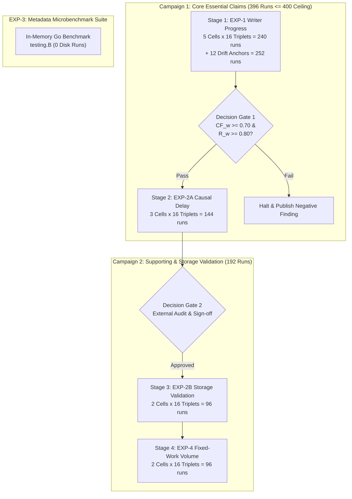

# Phase I7 — Checkpoint R1.2c: Revised Run Inventory and Staged Campaign Protocol

**DOCUMENT ID:** `R1_2C_REVISED_RUN_INVENTORY.md`  
**STATUS:** FORMAL PRE-REGISTERED INVENTORY SPECIFICATION  
**GOVERNING DIRECTIVE:** CHECKPOINT R1.2c EXTERNAL REVIEW DECISION  
**EVALUATED GIT REVISION:** `f4cce4b5faa80924c7ef945139ef1a65ccb2b32a`  
**BOUNDARY:** INVENTORY ARCHITECTURE AND DESIGN (ZERO BENCHMARK EXECUTION)

---

## 1. Resolution of the Inventory Contradiction

The external reviewer correctly identified a fundamental contradiction in the earlier R1.2b design:
- The four prospective experiments proposed a combined total of **1,260 trial executions**.
- The engineering test harness and operational stability protocol establish a strict ceiling of **400 trial executions** per campaign.
- Naively shrinking the sample size per cell (e.g., to $N=4$ or $N=6$) would destroy statistical power ($35\%\dots 52\%$), invalidating the entire scientific study.

### The Scientific Solution: Staged Two-Campaign Architecture
We resolve this contradiction without compromising statistical power by implementing a **Staged Two-Campaign Architecture**:
1. **Campaign 1 (Core Essential Claims; 396 Trials $\le 400$ Ceiling):** Executes the two experiments strictly required to establish or falsify the central thesis:
   - **EXP-1:** Writer Progress Under Concurrent Read Pressure ($N=16$ triplets, 5 cells = 240 runs + 12 drift controls = 252 runs).
   - **EXP-2A:** Causal Mechanism Synthetic Delay Intervention ($N=16$ triplets, 3 cells = 144 runs).
   - **Campaign 1 Total:** $252 + 144 = \mathbf{396\,\text{trial executions}}$, strictly respecting the 400-run ceiling.
2. **Decision Gate 1:** An explicit formal pause between Stage 1 and Stage 2. If EXP-1 falsifies writer progress superiority or capture fraction, Campaign 1 halts immediately and reports a negative finding.
3. **EXP-3 Protocol (0 Disk Runs):** Evaluated entirely via native in-memory Go microbenchmarks (`testing.B`), consuming **0 disk trials**.
4. **Campaign 2 (Supporting & Storage Validation; 192 Trials):** Executed only after Campaign 1 is frozen, audited, and independently authorized. Evaluates EXP-2B (Realistic Storage Validation) and EXP-4 (Fixed-Workload Comparability).

---

## 2. Explicit Scientific Decision Matrix

Experiments are categorized hierarchically based on their necessity to answering the central research question:

| Experiment | Title | Scientific Role | Justification | Execution Strategy |
| :--- | :--- | :---: | :--- | :--- |
| **EXP-1** | Writer Progress Under Read Pressure | **Essential** | Directly answers whether Approach A-min eliminates writer starvation and matches Approach B. If this fails, the core thesis collapses. | **Campaign 1, Stage 1** ($N=16$ triplets; 252 runs) |
| **EXP-2A** | Causal Delay Intervention | **Essential** | Isolates synchronization physics from storage I/O noise. Tests the renewal drain model $\frac{r}{r+1} T_{\text{readCS}}$ and refutes linear scaling. | **Campaign 1, Stage 2** ($N=16$ triplets; 144 runs) |
| **EXP-3** | Complexity & Mutex Bottleneck | **Supporting / Mechanistic** | Explains the physical root cause of why A-min matches or beats B (disclosing Approach B's exclusive `snapshotMu` lock). | **In-Memory Go Microbenchmark** (**0 disk runs**) |
| **EXP-2B** | Realistic Storage Validation | **Supporting** | Verifies that synchronization dynamics observed in EXP-2A translate to physical multi-block SSTables on disk. | **Campaign 2, Stage 3** ($N=16$ triplets; 96 runs) |
| **EXP-4** | Fixed-Workload Comparability | **Supporting** | Measures end-to-end time-to-completion and survival under fixed $M=2,500$ writes, accounting for background compactions. | **Campaign 2, Stage 4** ($N=16$ triplets; 96 runs) |

---

## 3. Campaign 1: Core Essential Claims (396 Runs)

### 3.1 Stage 1: EXP-1 Writer Progress (252 Runs)
- **Workload Structure:** 5 Workload Cells $\times 16$ Triplets per Cell $\times 3$ Arms (A, A-min, B) = 240 Trial Executions.
- **Drift Control Anchors:** 12 Baseline D3 Anchor Trials (4 at campaign start, 4 at midpoint, 4 at conclusion).
- **Total Stage 1 Executions:** 252 Runs.

#### Stage 1 Cell Definitions:
1. **Cell C1-01 (Standard Concurrency):** $r = 8$ concurrent readers, 1 paced writer at nominal $250\,\text{writes/s}$, uniform key space.
2. **Cell C1-02 (Heavy Reader Contention):** $r = 16$ concurrent readers, 1 paced writer at $250\,\text{writes/s}$, uniform key space.
3. **Cell C1-03 (Light Reader Contention):** $r = 2$ concurrent readers, 1 paced writer at $250\,\text{writes/s}$, uniform key space.
4. **Cell C1-04 (High Write Offered Load):** $r = 8$ concurrent readers, 1 paced writer at nominal $500\,\text{writes/s}$, uniform key space.
5. **Cell C1-05 (Skewed Access Pattern):** $r = 8$ concurrent readers, 1 paced writer at $250\,\text{writes/s}$, Zipfian $\theta = 0.99$ read key distribution.

### 3.2 Decision Gate 1 (Between Stage 1 and Stage 2)
Before proceeding to Stage 2 (EXP-2A), the analysis script [`simulate_power_r1_2c.py`](file:///c:/Users/ramst/Documents/Projects/selfdbms/research/experiments/analysis/simulate_power_r1_2c.py) / evaluation harness shall verify:
- **Gate 1A (Superiority):** Lower bound of 99% CI for $\Delta \dot{W}(\text{AMIN} - \text{A}) > 5.0\,\text{writes/s}$.
- **Gate 1B (Non-Inferiority):** Lower bound of 95% CI for $d_{w,t} > \ln(0.80) = -0.2231$.
- **Gate 1C (Capture Fraction):** Point estimate $\widehat{CF}_w \ge 0.70$ and lower bootstrap bound $\ge 0.60$.
- **Action on Gate 1 Failure:** If any gate fails, **Campaign 1 halts immediately**. The finding of A-min insufficiency or persistent starvation is formally documented, and Stage 2 is cancelled to conserve computational resources.

### 3.3 Stage 2: EXP-2A Causal Delay Intervention (144 Runs)
- **Workload Structure:** 3 Synthetic Delay Cells $\times 16$ Triplets per Cell $\times 3$ Arms (A, A-min, B) = 144 Trial Executions.
- **Controlled Delay Cells:**
  1. **Cell C2A-01 ($T_{\text{readCS}} = 50\,\mu\text{s}$):** Synthetic CPU spin delay inside reader critical section; $r = 8$ readers.
  2. **Cell C2A-02 ($T_{\text{readCS}} = 200\,\mu\text{s}$):** Synthetic CPU spin delay inside reader critical section; $r = 8$ readers.
  3. **Cell C2A-03 ($T_{\text{readCS}} = 500\,\mu\text{s}$):** Synthetic CPU spin delay inside reader critical section; $r = 8$ readers.
- **Stage 2 Total Executions:** 144 Runs.

### 3.4 Campaign 1 Run Accounting Summary
$$\text{Total Campaign 1 Executions} = 252\,\text{(Stage 1)} + 144\,\text{(Stage 2)} = \mathbf{396\,\text{Runs}} \le 400\,\text{Ceiling}$$

---

## 4. Campaign 2: Supporting & Storage Validation (192 Runs)

Campaign 2 is a separate, independent study executed only after Campaign 1 results are audited and signed off.

### 4.1 Stage 3: EXP-2B Realistic Storage Validation (96 Runs)
- **Workload Structure:** 2 Environmental Storage Cells $\times 16$ Triplets $\times 3$ Arms = 96 Trial Executions.
  1. **Cell C2B-01 (Warm Cache SSTable Traversal):** Multi-block index and data traversal with pre-warmed OS page cache.
  2. **Cell C2B-02 (Cold Cache Direct I/O Traversal):** Direct disk read latency drag with page cache flushing before read bursts.

### 4.2 Stage 4: EXP-4 Fixed-Workload Volume Validation (96 Runs)
- **Workload Structure:** 2 Reader Contention Cells $\times 16$ Triplets $\times 3$ Arms = 96 Trial Executions.
  1. **Cell C4-01 (Moderate Read Contention):** $M = 2,500$ writes, Poisson reader rate $\lambda = 500\,\text{reads/s}$, $r = 4$ readers.
  2. **Cell C4-02 (High Read Contention):** $M = 2,500$ writes, Poisson reader rate $\lambda = 2,000\,\text{reads/s}$, $r = 16$ readers.
- **Execution Ceiling:** $T_{\text{max}} = 30.0\,\text{seconds}$ with right-censoring.

### 4.3 Campaign 2 Run Accounting Summary
$$\text{Total Campaign 2 Executions} = 96\,\text{(Stage 3)} + 96\,\text{(Stage 4)} = \mathbf{192\,\text{Runs}} \le 400\,\text{Ceiling}$$

---

## 5. EXP-3 Protocol: In-Memory Metadata Microbenchmark (0 Disk Runs)

To evaluate the metadata lifecycle costs of Approach A-min (atomic lease counter + shared `RLock`) versus Approach B (`snapshotMu` exclusive lock + doubly-linked list registration) without consuming disk trial inventory:

### 5.1 Protocol Specification
- Implemented as a native Go microbenchmark suite: `BenchmarkMetadataLifecycle`.
- Executed via:
  ```powershell
  go test -bench=BenchmarkMetadata -benchmem -cpu=1,2,4,8,16 -count=10 ./lsmengine
  ```
- **Total Disk Runs Consumed:** **0 Runs**.
- **Metrics Collected:**
  - `ns/op`: Nanoseconds per metadata acquisition and release cycle.
  - `B/op`: Heap memory bytes allocated per cycle.
  - `allocs/op`: Distinct heap allocations per cycle.
  - Cache-line bounce and lock stall cycles profiled via hardware counters.

---

## 6. Comprehensive Run Inventory Ledger



### Complete Inventory Breakdown

| Stage | Experiment | Cells | Triplets / Cell | Trial Executions | Drift Anchors | Total Runs | Status |
| :---: | :--- | :---: | :---: | :---: | :---: | :---: | :--- |
| **Stage 1** | EXP-1 (Writer Progress) | 5 | 16 | 240 | 12 | 252 | **Campaign 1 (Essential)** |
| **Stage 2** | EXP-2A (Causal Delay) | 3 | 16 | 144 | 0 | 144 | **Campaign 1 (Essential)** |
| **Subtotal** | **Campaign 1 Total** | **8** | **16** | **384** | **12** | **396** | **Strictly $\le 400$ Ceiling** |
| **Stage 3** | EXP-2B (Storage Validation) | 2 | 16 | 96 | 0 | 96 | **Campaign 2 (Supporting)** |
| **Stage 4** | EXP-4 (Fixed-Workload) | 2 | 16 | 96 | 0 | 96 | **Campaign 2 (Supporting)** |
| **Subtotal** | **Campaign 2 Total** | **4** | **16** | **192** | **0** | **192** | **Strictly $\le 400$ Ceiling** |
| **Micro** | EXP-3 (Metadata Suite) | — | — | 0 | 0 | 0 | **In-Memory (0 Disk Runs)** |
| **Total** | **All Experimental Work** | **12** | **16** | **576** | **12** | **588** | **Partitioned Across 2 Stages** |
