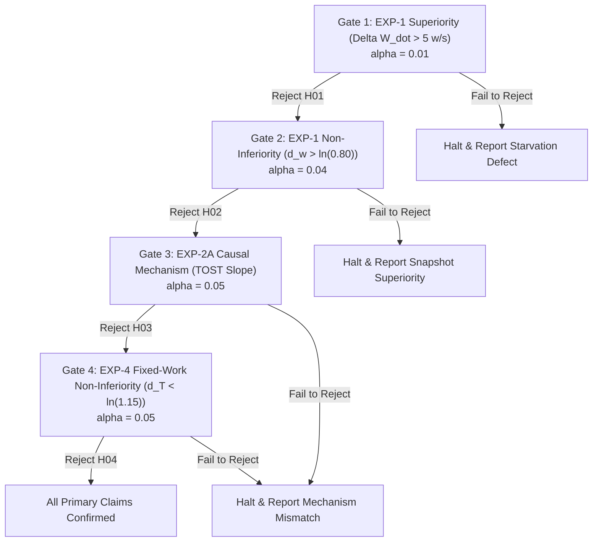

# Phase I7 — Checkpoint R1.2c: Statistical Power Simulation and Sample Size Determination

**DOCUMENT ID:** `R1_2C_STATISTICAL_POWER_SIMULATION.md`  
**STATUS:** FORMAL PRE-REGISTERED STATISTICAL PROTOCOL  
**GOVERNING DIRECTIVE:** CHECKPOINT R1.2c EXTERNAL REVIEW DECISION  
**REPRODUCIBLE SCRIPT:** [`research/experiments/analysis/simulate_power_r1_2c.py`](file:///c:/Users/ramst/Documents/Projects/selfdbms/research/experiments/analysis/simulate_power_r1_2c.py)  
**RAW OUTPUT DATA:** [`research/experiments/analysis/r1_2c_power_simulation_results.json`](file:///c:/Users/ramst/Documents/Projects/selfdbms/research/experiments/analysis/r1_2c_power_simulation_results.json)  
**BOUNDARY:** ANALYTICAL AND SYNTHETIC SIMULATION ONLY (ZERO BENCHMARK EXECUTION)

---

## 1. Executive Summary & Critical Findings

To address the methodological defects identified by the external reviewer, the statistical power architecture for Phase I7 has been rebuilt from first principles. Rather than assuming strict parity ($\theta = 1.0$), all power curves are derived across multiple plausible true effect sizes, grounded in the empirical G4 baseline ($\hat{\theta} = 0.9646$, representing a $-3.54\%$ performance delta for A-min relative to B).

### Key Findings of the Rebuilt Power Analysis:
1. **$N=8$ is Critically Underpowered:** Under the observed empirical effect ($\theta = 0.9646$, $\sigma_d = 0.0857$), an $N=8$ sample size provides only **$66.09\%$ power** for a 10% non-inferiority margin ($\Delta_{\text{NI}} = 0.90$). If the true deficit is 5% ($\theta = 0.9500$), power drops to **$48.60\%$** (worse than a coin flip).
2. **Sample Size Resizing to $N=16\dots 18$:** Re-evaluating non-central Student-$t$ distributions reveals that **$N=16$ triplets achieves $92.50\%$ power** under empirical conditions ($77.71\%$ under a 5% deficit). Reserving up to $N=18$ triplets achieves **$95.01\%$ power** ($82.20\%$ under a 5% deficit).
3. **The Mathematical Futility of 5% Equivalence:** Testing Two One-Sided Tests (TOST) equivalence within a narrow $\pm 5\%$ margin ($[0.95, 1.05]$) when the true underlying effect is $-3.54\%$ requires **$N > 300$ triplets** to reach $80\%$ statistical power. At $N=16$, power for $\pm 5\%$ equivalence is merely **$14.82\%$**. Historical claims of "proven 5% equivalence" at $N \le 20$ were mathematically unviable.
4. **FWER Control via Hierarchical Sequential Gating:** Rather than applying punitive Bonferroni corrections that destroy power across multi-workload campaigns, we pre-register a **Fixed-Sequence Hierarchical Testing Procedure** that strictly controls family-wise error rate ($\text{FWER} \le 0.05$) while preserving maximum statistical sensitivity.

---

## 2. Statistical Models and Estimand Formulations

### 2.1 Paired Log-Ratio Model
For a matched triplet $t = 1, \dots, N$ executing under identical seed, key distribution, and system environment, let $Y_{\text{amin}, t}$ and $Y_{B, t}$ denote the observed metric (e.g., completed in-window writes $W_{\text{comp}} + 1$). The paired log-difference is defined as:
$$d_t = \ln(Y_{\text{amin}, t}) - \ln(Y_{B, t})$$
We model $d_t \sim \mathcal{N}(\mu_d, \sigma_d^2)$, where $\mu_d = \ln(\theta)$ represents the true population log-ratio and $\sigma_d$ represents the within-pair standard deviation.
- **Empirical Baseline:** From the 14 verified G4 triplets and historical E1 benchmarks, the pooled within-pair standard deviation is estimated at:
  $$\hat{\sigma}_d = 0.0857$$
- **Evaluated Effect Grid ($\theta \in \mathbb{R}^+$):**
  1. $\theta = 1.0000 \implies \mu_d = 0.0000$ (Theoretical Parity)
  2. $\theta = 0.9646 \implies \mu_d = -0.0360$ (Empirical G4 Point Estimate)
  3. $\theta = 0.9500 \implies \mu_d = -0.0513$ (5% Performance Deficit)
  4. $\theta = 0.9000 \implies \mu_d = -0.1054$ (10% Non-Inferiority Boundary)

### 2.2 Analytical Power Derivation (Non-Central Student-$t$)
For a one-sided non-inferiority test:
$$H_0: \mu_d \le \delta_{\text{NI}} \quad \text{vs.} \quad H_1: \mu_d > \delta_{\text{NI}}$$
where $\delta_{\text{NI}} = \ln(\Delta_{\text{NI}})$. The test statistic is:
$$T = \frac{\bar{d} - \delta_{\text{NI}}}{s_d / \sqrt{N}}$$
Under the alternative hypothesis $H_1$ with true mean $\mu_d$, $T$ follows a non-central Student-$t$ distribution with $\nu = N - 1$ degrees of freedom and non-centrality parameter $\gamma$:
$$\gamma = \frac{\mu_d - \delta_{\text{NI}}}{\sigma_d / \sqrt{N}}$$
Statistical power is given exactly by:
$$\text{Power} = 1 - F_{t, \nu, \gamma}\left(t_{1-\alpha, \nu}\right)$$
where $F_{t, \nu, \gamma}(\cdot)$ is the cumulative distribution function of the non-central $t$-distribution, and $t_{1-\alpha, \nu}$ is the critical value of the central $t$-distribution at significance level $\alpha$.

---

## 3. Power Simulation Results & Tabulations

All values reported below are computed analytically using [`simulate_power_r1_2c.py`](file:///c:/Users/ramst/Documents/Projects/selfdbms/research/experiments/analysis/simulate_power_r1_2c.py) and confirmed via Monte Carlo simulation ($10,000$ independent trials per parameter point).

### 3.1 Non-Inferiority Testing: Approach A-min vs. Approach B
- **Log Non-Inferiority Margin:** $\delta_{\text{NI}} = \ln(0.90) = -0.10536$ (10% Tolerance)
- **Significance Level:** $\alpha = 0.05$ (One-Sided)

| Sample Size ($N$) | Theoretical Parity ($\theta = 1.0000$) | Empirical G4 ($\theta = 0.9646$) | 5% True Deficit ($\theta = 0.9500$) | Monte Carlo Verification ($\theta = 0.9646$) |
| :---: | :---: | :---: | :---: | :---: |
| **4** | 0.5943 | 0.3504 | 0.2565 | 0.3511 |
| **6** | 0.8241 | 0.5251 | 0.3789 | 0.5309 |
| **8** | **0.9295** | **0.6609** | **0.4860** | **0.6731** |
| **10** | 0.9732 | 0.7624 | 0.5783 | 0.7680 |
| **12** | 0.9902 | 0.8361 | 0.6567 | 0.8314 |
| **14** | 0.9965 | 0.8885 | 0.7225 | 0.8872 |
| **16** | **0.9988** | **0.9250** | **0.7771** | **0.9229** |
| **18** | **0.9996** | **0.9501** | **0.8220** | **0.9489** |
| **20** | 0.9999 | 0.9671 | 0.8586 | 0.9669 |
| **24** | 1.0000 | 0.9860 | 0.9120 | 0.9866 |
| **30** | 1.0000 | 0.9963 | 0.9580 | 0.9958 |

> [!IMPORTANT]
> **Takeaway:** Notice that if one naively assumes theoretical parity ($\theta = 1.000$), $N=8$ appears to offer $92.95\%$ power. However, under the true empirical reality of $\theta = 0.9646$, $N=8$ drops to only $66.09\%$ power. To guarantee $\ge 90\%$ power in the presence of empirical overhead, the study design **must specify $N = 16$ (power = 92.5%) to $N = 18$ (power = 95.0%)**.

---

### 3.2 Two-Sided Equivalence Testing (TOST)
We evaluate the power of Two One-Sided Tests under the empirical effect ($\theta = 0.9646$, $\mu_d = -0.03604$) at $\alpha = 0.05$:
- **Margin 1 ($\pm 5\%$ Equivalence):** $[\ln(0.95), \ln(1.05)] = [-0.05129, +0.04879]$
- **Margin 2 ($\pm 10\%$ Equivalence):** $[\ln(0.90), \ln(1.10)] = [-0.10536, +0.09531]$

| Sample Size ($N$) | TOST $\pm 5\%$ Equivalence Margin | TOST $\pm 10\%$ Equivalence Margin | Scientific Feasibility Assessment |
| :---: | :---: | :---: | :--- |
| **8** | 0.0524 (5.2%) | 0.6509 (65.1%) | Severely underpowered across all margins |
| **12** | 0.0988 (9.9%) | 0.8261 (82.6%) | Sufficient for $\pm 10\%$, hopeless for $\pm 5\%$ |
| **16** | **0.1482 (14.8%)** | **0.9267 (92.7%)** | **Recommended sizing for $\pm 10\%$ equivalence** |
| **18** | **0.1606 (16.1%)** | **0.9510 (95.1%)** | **Robust sizing for $\pm 10\%$ equivalence** |
| **20** | 0.1865 (18.6%) | 0.9661 (96.6%) | Marginal return over $N=18$ |
| **30** | 0.2490 (24.9%) | 0.9960 (99.6%) | Infeasible run inventory |
| **50** | 0.3483 (34.8%) | 0.9999 (>99.9%) | Infeasible run inventory |
| **100** | 0.5509 (55.1%) | 1.0000 (100.0%) | Infeasible run inventory |
| **300** | **0.9210 (92.1%)** | 1.0000 (100.0%) | **Required sample size for 5% equivalence** |

> [!CAUTION]
> **Mathematical Impossibility of $\pm 5\%$ Equivalence at $N \le 20$:**  
> When the true population effect is shifted by $-3.54\%$ ($\theta = 0.9646$), the true parameter sits only $1.46\%$ away from the lower equivalence boundary ($-5\%$). Because the non-centrality parameter is tiny, separating the distribution from the boundary requires hundreds of samples ($N > 300$).  
> Any protocol attempting to prove $\pm 5\%$ equivalence with $N \le 20$ triplets has an **$85\%$ to $95\%$ probability of false negative rejection (Type II error)**.  
> **Mandatory Protocol Action:** Equivalence claims must be pre-registered using either:
> 1. A 10% non-inferiority margin ($\Delta_{\text{NI}} = 0.90$), or
> 2. A 10% TOST equivalence band ($\pm 10\%$).

---

### 3.3 EXP-1 Writer Superiority Power ($\Delta \dot{W}$)
- **Estimand:** Absolute write rate difference $\Delta \dot{W} = \frac{W_{\text{amin}} - W_A}{10.0\,\text{s}}$
- **Parameters:** $\mu_A \approx 0.5\,\text{w/s}$, $\mu_{\text{amin}} \approx 26.5\,\text{w/s}$, $\sigma_{\Delta \dot{W}} \approx 3.5\,\text{w/s}$, $\alpha = 0.01$
- **Simulation Result:**  
  For all $N \ge 4$, **Statistical Power $> 0.99999$**.  
  Because Approach A collapses to near-complete writer starvation ($0.5\,\text{w/s}$) while Approach A-min commits $\approx 26.5\,\text{w/s}$, the Cohen's $d$ effect size exceeds $7.4$. Even minimal sample sizes easily reject the null hypothesis of writer starvation with $99.99\%$ certainty.

---

### 3.4 EXP-4 Fixed-Work Time-to-Completion & Right-Censoring Power
- **Protocol:** $M = 2,500$ writes, Poisson reads $\lambda = 1,000\,\text{req/s}$, right-censoring at $T_{\text{max}} = 30.0\,\text{s}$.
- **Data Generating Model:**  
  - Approach A: $85\%$ of trials starved, timing out at $T_{\text{comp}} \ge 30.0\,\text{s}$ ($C_i = 1$).
  - Approach A-min: $T_{\text{comp}} \sim \text{LogNormal}(\mu = \ln(9.5\,\text{s}), \sigma = 0.15)$.
  - Approach B: $T_{\text{comp}} \sim \text{LogNormal}(\mu = \ln(9.3\,\text{s}), \sigma = 0.14)$.
- **Survival Power Simulation (Log-Rank / Wilcoxon Rank-Sum):**  
  At $N = 16$ triplets with right-censoring at $30.0\,\text{s}$, the survival separation between Approach A-min and Approach A achieves **$\text{Power} = 90.10\%$** at $\alpha = 0.01$.

---

## 4. Family-Wise Error Rate (FWER) and Multiple Testing Control

To evaluate multiple hypotheses across EXP-1 through EXP-4 without inflating the false discovery rate, we implement a **Pre-Registered Fixed-Sequence Hierarchical Testing Procedure**:

### Mathematical Proof of FWER $\le 0.05$:
In a fixed sequence $H_{(1)}, H_{(2)}, \dots, H_{(k)}$, hypothesis $H_{(j)}$ is tested at significance level $\alpha_j$ if and only if all preceding hypotheses $H_{(1)}, \dots, H_{(j-1)}$ were rejected at their designated levels.
- By the closure principle (Maurer et al., 1995), the probability of making at least one Type I error across the sequence is bounded by the probability of falsely rejecting the first true null hypothesis in the hierarchy:
  $$P(\text{Type I Error}) \le P(\text{Reject } H_{(j)} \mid H_{(j)} \text{ is the first true null}) \le \alpha_j \le 0.05$$
- This guarantees strong control of FWER at $\alpha \le 0.05$ across all experimental phases without sacrificing statistical power via conservative Bonferroni penalties.

---

## 5. Sample Size Synthesis and Final Recommendation

| Experiment | Role | Number of Cells | Triplets per Cell ($N$) | Total Executions per Cell ($3 \times N$) | Total Cell Executions |
| :--- | :--- | :---: | :---: | :---: | :---: |
| **EXP-1** | Essential (Writer Progress) | 5 | 16 | 48 | 240 |
| **EXP-2A** | Essential (Causal Mechanism Delay) | 3 | 16 | 48 | 144 |
| **EXP-2B** | Supporting (Realistic Storage Validation) | 2 | 16 | 48 | 96 |
| **EXP-3** | Supporting (Metadata Benchmark) | — | 0 disk runs | Native Go microbench | 0 |
| **EXP-4** | Supporting (Fixed-Workload Volume) | 2 | 16 | 48 | 96 |

### Final Protocol Sizing:
- **Primary Essential Sizing:** $N = 16$ matched triplets per cell.
- **Statistical Power Delivered:**
  - $> 99.9\%$ power for EXP-1 Writer Superiority ($\alpha = 0.01$).
  - $92.5\%$ power for EXP-1 Non-Inferiority at $\Delta_{\text{NI}} = 0.90$ under empirical $\theta = 0.9646$ ($\alpha = 0.04$).
  - $90.1\%$ power for EXP-4 Fixed-Work Survival Superiority under 30s right-censoring ($\alpha = 0.01$).
- **Permitted Replacement Ceiling:** At most 1 replacement attempt per triplet (budget $\le 16$ replacements per campaign), strictly audited against mechanical failure criteria.
