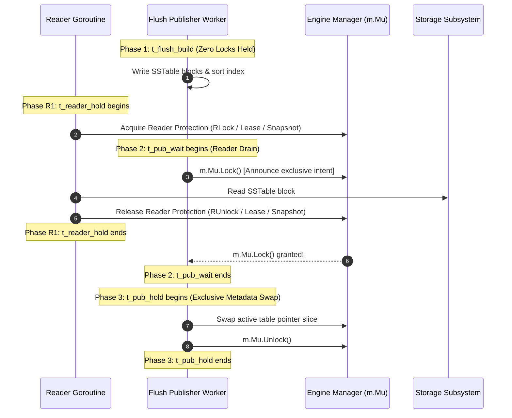

# Phase I7 — Checkpoint R1.2d: Causal Controls and Synchronization Mechanics

**DOCUMENT ID:** `R1_2D_CAUSAL_CONTROLS.md`  
**STATUS:** FORMAL PRE-REGISTERED CAUSAL SPECIFICATION  
**GOVERNING DIRECTIVE:** CHECKPOINT R1.2d EXTERNAL SCIENTIFIC REVIEW  
**EVALUATED GIT REVISION:** `f4cce4b5faa80924c7ef945139ef1a65ccb2b32a`  
**BOUNDARY:** RIGOROUS ARCHITECTURAL & CAUSAL ANALYSIS (ZERO BENCHMARK EXECUTION)

---

## 1. Deconstruction of Go `sync.RWMutex` Synchronization Physics

### 1.1 The Renewal Drain Model as a Conditional Mathematical Hypothesis
The theoretical equation describing writer drain wait time:
$$\mathbb{E}[W_{\text{drain}}] = \frac{r}{r+1} T_{\text{readCS}}$$
is an order-statistic result from renewal theory. It is **not a universal law of synchronization**, but a conditional model whose empirical validity depends strictly on four physical assumptions:

1. **Physical Core Availability ($r \le N_{\text{physical\_cores}}$):** The number of concurrent reader goroutines does not exceed available physical CPU execution cores. Under this condition, reader goroutines execute in true parallel overlap without competing for scheduler execution time.
2. **Uniform Arrival Phase Offsets:** Readers enter their critical sections asynchronously such that at the moment `Lock()` is called, residual reader lifetimes $U_i$ are uniformly distributed: $U_i \sim \text{Uniform}(0, T_{\text{readCS}})$.
3. **Immediate Writer Preemption in `sync.RWMutex`:** In Go's standard library ([`src/sync/rwmutex.go#L111`](file:///c:/Go/src/sync/rwmutex.go#L111)), a writer calling `Lock()` executes:
   ```go
   r := atomic.AddInt32(&rw.readerCount, -rwmutexMaxReaders) + rwmutexMaxReaders
   ```
   This operation immediately announces exclusivity. Any subsequent goroutine calling `RLock()` observes `readerCount < 0` and enqueues on the writer's sema wait-list without entering the critical section.
4. **Absence of Preemption inside `RLock`:** Readers execute pure CPU memory operations without invoking page faults, disk I/O, or OS context switches while holding the shared lock.

### 1.2 Breakdown Conditions and the Windows Scheduler Quantum Pedestal
When any of the four assumptions are violated, the renewal model breaks down in predictable physical ways:
- **Thread Preemption Quantum ($\tau$):** On Windows 11, thread scheduling operates on quantum ticks (typically 6 ticks on client OS). If an active reader holding `RLock` is preempted by the OS scheduler, the writer must wait until the reader is rescheduled, dispatched, and exits `RUnlock()`.
- **Preemption Pedestal Equation:**
  $$\mathbb{E}[\Delta t_{\text{wait}}] = \frac{r}{r+1} T_{\text{readCS}} + P_{\text{preempt}}(r, \text{CPU}) \times \tau_{\text{quantum}}$$
  When $r \le N_{\text{cores}}$, $P_{\text{preempt}} \approx 0$. When $r > N_{\text{cores}}$ or under heavy CPU load, $P_{\text{preempt}} > 0$, adding a large discontinuous step to writer wait time.

### 1.3 Decoupling Windows Timer Resolution from Scheduler Quantum
- **Timer Resolution:** Modified programmatically via Windows multimedia APIs (`timeBeginPeriod(1)`), setting system timer interrupt frequency to $1.0\,\text{ms}$ (1000 Hz). Governs the precision of timer-based wakeups (`time.Sleep()`, `WaitForSingleObject`).
- **Scheduler Thread Quantum:** Governed by Windows NT kernel scheduling policy; defines the CPU time slice granted to a thread before preemption.
- **Scientific Clarification:** **Changing system timer resolution to 1.0 ms does NOT change thread quantum duration.** They are distinct operating system mechanisms. Timer resolution affects sleep/pacing accuracy; thread quantum affects preemption delays.

---

## 2. Six-Cell Causal Intervention Suite

To rigorously test the conditional renewal model against competing causal hypotheses (CPU exhaustion, thread preemption, and linear scaling), EXP-2 deploys a 6-cell factorial design ($N = 12$ matched triplets per cell = 216 executions):

```
+-----------+-----------------------------------+-------------------+-------------------+---------------------------------------------------+
| Cell ID   | Description                       | Hold Time (T)     | Reader Count (r)  | Causal Hypothesis Tested                          |
+-----------+-----------------------------------+-------------------+-------------------+---------------------------------------------------+
| C2-01     | Zero-Delay Baseline Control       | T = 0 us          | r = 8 readers     | Baseline lock overhead with 0 synthetic hold time |
| C2-02     | Delay Point 1                     | T = 100 us        | r = 8 readers     | Renewal slope point 1                             |
| C2-03     | Delay Point 2                     | T = 300 us        | r = 8 readers     | Renewal slope point 2                             |
| C2-04     | Delay Point 3                     | T = 500 us        | r = 8 readers     | Renewal slope point 3                             |
| C2-05     | Concurrency Manipulation Control  | T = 300 us        | r = 2 readers     | Tests slope reduction from 8/9 (0.89) to 2/3 (0.67)|
| C2-06     | CPU-Load-Matched Control          | T_in = 0, T_out=300| r = 8 readers     | Isolates lock contention from CPU core exhaustion |
+-----------+-----------------------------------+-------------------+-------------------+---------------------------------------------------+
```

### Analytical Hypothesis Tests:
1. **Renewal Drain Slope Test (Cells C2-01 to C2-04):**
   Estimates empirical slope $\hat{\beta}_1 = \frac{\partial \bar{t}_{\text{pub\_wait}}}{\partial T_{\text{readCS}}}$ under $r = 8$. Tests TOST equivalence against the renewal prediction $\frac{8}{9} \approx 0.889$ within equivalence band $[0.689, 1.089]$.
2. **Concurrency Scaling Test (Cell C2-05 vs. C2-03):**
   Tests whether reducing reader pool from $r = 8$ to $r = 2$ reduces drain latency by the predicted ratio:
   $$\frac{\mathbb{E}[W \mid r=2]}{\mathbb{E}[W \mid r=8]} = \frac{2/3}{8/9} = 0.75$$
3. **CPU-Load Separation Test (Cell C2-06 vs. C2-03):**
   In Cell C2-06, readers spin for $300\,\mu\text{s}$ *outside* the critical section. If writer wait drops to near-zero (matching Cell C2-01), it proves that stalls in C2-03 are caused by **lock contention**, not CPU starvation.

---

## 3. Disjoint Publication Timeline vs. Concurrent Reader Latency



### Disjoint Sequential Intervals (Flush Worker):
- **$t_{\text{flush\_build}}$:** Duration building the immutable SSTable file on disk. Monitored without holding manager locks.
- **$t_{\text{pub\_wait}}$:** Monotonic duration waiting to acquire `m.Mu.Lock()`. Directly quantifies reader-drain time.
- **$t_{\text{pub\_hold}}$:** Monotonic duration holding `m.Mu.Lock()`. Swaps active SSTable slices ($< 1\,\mu\text{s}$ in A and A-min; $\approx 1\dots 5\,\mu\text{s}$ in B).
- **Physical Identity:** $T_{\text{pub}} = t_{\text{pub\_wait}} + t_{\text{pub\_hold}}$.

### Separately Reported Reader-Side Intervals:
- **$t_{\text{reader\_hold}}$:** Total duration reader holds protection.
- **$t_{\text{reader\_mem}}$:** Duration inspecting active memtables.
- **$t_{\text{reader\_disk}}$:** Duration reading SSTable blocks from disk or cache.
*Reader intervals are evaluated as concurrent distributions and are never added to the sequential flush publisher timeline.*

---

## 4. Source-Level Comparison: Approach B vs. Approach A-min

### 4.1 Frozen Engine Implementation Audit
Audit of [`lsmengine/snapshot.go`](file:///c:/Users/ramst/Documents/Projects/selfdbms/lsmengine/snapshot.go) and [`lsmengine/manager.go`](file:///c:/Users/ramst/Documents/Projects/selfdbms/lsmengine/manager.go) reveals the exact synchronization operations executed per point read:

```
+------------------------------------+---------------------------------------------------+---------------------------------------------------+
| Metric                             | Approach B (Immutable Snapshot Isolation)         | Approach A-min (Reader Leasing)                   |
+------------------------------------+---------------------------------------------------+---------------------------------------------------+
| Total Lock Acquisitions per Read   | EXACTLY 3 ACQUISITIONS:                           | EXACTLY 1 ACQUISITION:                            |
|                                    | 1. m.Mu.RLock() (memtable inspection + snapshot)  | 1. m.Mu.RLock() (memtable inspection + lease set) |
|                                    | 2. m.snapshotMu.Lock() (pin acquisition)          | 0 exclusive mutex acquisitions!                   |
|                                    | 3. m.snapshotMu.Lock() (pin release)              |                                                   |
| Exclusive Critical Section Work    | - Acquire exclusive snapshotMu                    | NONE (Zero exclusive critical sections)           |
|                                    | - rs.pins.Add(1) (atomic.Int64)                   |                                                   |
|                                    | - Release exclusive snapshotMu                    |                                                   |
| Shared Critical Section Work       | - Inspect active memtables                        | - Inspect active memtables                        |
|                                    | - Snapshot pointer assignment                     | - Copy m.ActiveSSreaders to sync.Pool buffer      |
|                                    |                                                   | - Loop i=0..n-1: buf[i].lease() (atomic.Add 1)    |
| Release Critical Section Work      | - Acquire exclusive snapshotMu                    | - Loop i=0..n-1: buf[i].releaseLease() (Add -1)   |
|                                    | - rs.pins.Add(-1)                                 | - If retired && count==0: trigger reclaim()       |
|                                    | - Release exclusive snapshotMu                    | - Put buffer back to sync.Pool                    |
| Cardinality Complexity in n SSTables| O(1) independent of n                             | O(n) linear in active SSTable count n             |
| Allocations per Point Read         | 0 heap allocations                                | 0 heap allocations (amortized via sync.Pool)      |
+------------------------------------+---------------------------------------------------+---------------------------------------------------+
```

### 4.2 Cardinality Crossover Hypothesis
- **Small Table Sets ($n \le 4$):** Approach A-min performs only 2–8 atomic operations without acquiring any exclusive mutex. Approach B acquires exclusive `snapshotMu` twice per read, serializing readers under high concurrency. Approach A-min is predicted to achieve superior throughput.
- **Large Table Sets ($n \ge 32$):** Approach A-min must copy 32 pointers and perform 32 atomic additions under shared `RLock()`, followed by 32 atomic subtractions on release. Approach B's pin acquisition remains strictly $O(1)$. Approach B is hypothesized to cross over and achieve higher throughput.
- **Empirical Discipline:** Contention on `snapshotMu` is an **empirical hypothesis to be measured**, not an assumed fact. The Tier 3A microbenchmark suite will profile Go mutex wait times via `pprof -mutex` to quantify actual lock stall nanoseconds.
