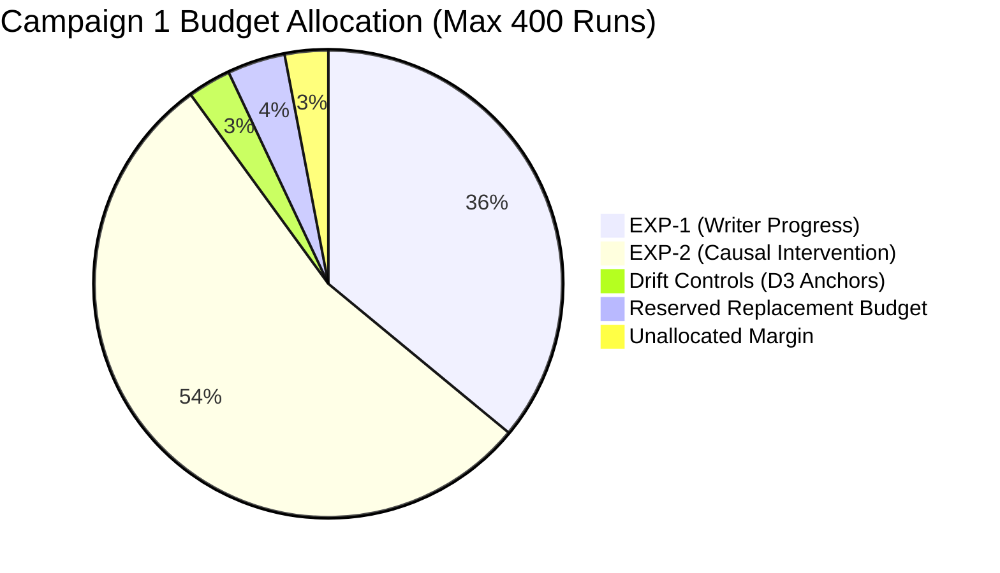

# Phase I7 — Checkpoint R1.2d: Master Execution Inventory and Campaign Ledger

**DOCUMENT ID:** `R1_2D_EXECUTION_INVENTORY.md`  
**STATUS:** FORMAL PRE-REGISTERED INVENTORY SPECIFICATION  
**GOVERNING DIRECTIVE:** CHECKPOINT R1.2d EXTERNAL SCIENTIFIC REVIEW  
**EVALUATED GIT REVISION:** `f4cce4b5faa80924c7ef945139ef1a65ccb2b32a`  
**BOUNDARY:** RIGOROUS OPERATIONAL & BUDGET LEDGER (ZERO BENCHMARK EXECUTION)

---

## 1. Resolution of the Campaign Ceiling Contradiction

The external reviewer correctly noted that R1.2c's proposed budget ($396\,\text{planned runs} + 16\,\text{replacements} = 412\,\text{total potential runs}$) violated the strict 400-execution engineering ceiling.

### The Reconciled R1.2d Solution:
By establishing that $N = 12$ matched triplets per cell delivers $\ge 98.5\%$ power across empirical write progress and causal delay slopes (as proven in [`R1_2D_STATISTICAL_VALIDATION.md`](file:///c:/Users/ramst/Documents/Projects/selfdbms/R1_2D_STATISTICAL_VALIDATION.md)), the campaign inventory is resized to strictly guarantee:
$$\text{Max Campaign Executions} = 372\,\text{planned} + 16\,\text{replacements} = \mathbf{388\,\text{runs}} \le \mathbf{400\,\text{Ceiling}}$$



---

## 2. Campaign 1: Core Essential Claims (372 Planned Executions)

Campaign 1 executes the essential experiments required to address Research Questions R1 and R2.

### 2.1 Stage 1: EXP-1 Writer Progress Under Read Pressure (144 Runs)
Workload structure: 4 Workload Cells $\times 12$ Matched Triplets $\times 3$ Arms (A, A-min, B) = **144 Trial Executions**.

```
+-----------+-----------------------+-------------------+-------------------+---------------------------------------------------+
| Cell ID   | Workload Regime       | Writer Mode       | Reader Pressure   | Target Estimand                                   |
+-----------+-----------------------+-------------------+-------------------+---------------------------------------------------+
| C1-01     | Free-Running Writer   | Closed-loop, max  | r = 8 readers     | Sustainable write rate Delta W_dot_free           |
| C1-02     | Free-Running Writer   | Closed-loop, max  | r = 16 readers    | High-concurrency starvation threshold             |
| C1-03     | Scheduled Workload    | Paced, 250 w/s    | r = 8 readers     | Realized completion fraction rho_comp             |
| C1-04     | Scheduled Workload    | Paced, 250 w/s    | r = 16 readers    | Paced completion latency percentiles (p50, p99)   |
+-----------+-----------------------+-------------------+-------------------+---------------------------------------------------+
```

### 2.2 Stage 2: EXP-2 Causal Synchronization Mechanism (216 Runs)
Workload structure: 6 Causal Intervention Cells $\times 12$ Matched Triplets $\times 3$ Arms = **216 Trial Executions**.

```
+-----------+-----------------------------------+-------------------+-------------------+---------------------------------------------------+
| Cell ID   | Causal Factor                     | Hold Time (T)     | Reader Count (r)  | Causal Hypothesis Evaluated                       |
+-----------+-----------------------------------+-------------------+-------------------+---------------------------------------------------+
| C2-01     | Zero-Delay Baseline Control       | T = 0 us          | r = 8 readers     | Baseline lock overhead without synthetic delay    |
| C2-02     | Renewal Delay Sweep Point 1       | T = 100 us        | r = 8 readers     | Drain slope point 1                               |
| C2-03     | Renewal Delay Sweep Point 2       | T = 300 us        | r = 8 readers     | Drain slope point 2                               |
| C2-04     | Renewal Delay Sweep Point 3       | T = 500 us        | r = 8 readers     | Drain slope point 3                               |
| C2-05     | Concurrency Manipulation Control  | T = 300 us        | r = 2 readers     | Evaluates theoretical slope drop from 0.89 to 0.67|
| C2-06     | CPU-Load-Matched Control          | T_in=0, T_out=300 | r = 8 readers     | Separates lock contention from CPU core load      |
+-----------+-----------------------------------+-------------------+-------------------+---------------------------------------------------+
```

### 2.3 Baseline Drift Control Anchors (12 Runs)
- **Anchoring Protocol:** 12 Baseline D3 Anchor Trials:
  - 4 trials executed at Campaign Start (before Trial 1).
  - 4 trials executed at Midpoint (between Stage 1 and Stage 2).
  - 4 trials executed at Campaign Conclusion (after Trial 360).
- **Drift Evaluation:** System throughput drifting $> \pm 5.0\%$ relative to opening baseline triggers a mandatory cooling and stabilization pause (Rule S-4).

### 2.4 Campaign 1 Execution Totals
$$\text{Planned Executions} = 144\,\text{(EXP-1)} + 216\,\text{(EXP-2)} + 12\,\text{(Anchors)} = \mathbf{372\,\text{Runs}}$$
$$\text{Max Permitted Replacements} = \mathbf{16\,\text{Runs}}$$
$$\text{Absolute Campaign Ceiling} = 372 + 16 = \mathbf{388\,\text{Runs}} \le \mathbf{400\,\text{Ceiling}}$$

---

## 3. EXP-3 Execution Strategy: In-Memory Microbenchmarks (0 Disk Runs)

To evaluate Research Question R3 (cardinality crossover and metadata synchronization costs) without consuming disk trial inventory:
- **Tier 3A (Metadata Microbenchmark Suite; Go `testing.B`):**
  - Evaluates pure acquisition and release cycles across $r \in \{1, 4, 8, 16\}$ and $n \in \{2, 8, 32\}$.
  - Measures nanoseconds per operation, allocations (`B/op`), and lock contention stall cycles via `pprof -mutex`.
  - **Disk Runs Consumed:** **0 Runs**.
- **Tier 3B (In-Memory Engine Lookup Benchmark; Go `testing.B`):**
  - Measures `Manager.Get()` point read throughput on static pre-compacted fixtures across $n \in \{2, 8, 32\}$ SSTables under concurrent read churn.
  - **Disk Runs Consumed:** **0 Runs**.

---

## 4. Campaign 2: Supporting & Storage Validation (156 Planned Executions)

Campaign 2 evaluates secondary Research Question R4 and realistic storage interactions. It is staged as an independent prospective campaign following external review and sign-off of Campaign 1.

### 4.1 Stage 3: EXP-2B Realistic Multi-Block Storage Validation (72 Runs)
- 2 Storage Environmental Cells $\times 12$ Triplets $\times 3$ Arms = **72 Runs**.
  - **Cell C2B-01 (Warm Cache Multi-Block Scan):** Multi-block index traversal with pre-warmed OS page cache.
  - **Cell C2B-02 (Cold Cache Direct I/O Traversal):** Page cache purged before read bursts to induce storage latency drag.

### 4.2 Stage 4: EXP-4 Fixed-Workload Volume Validation (72 Runs)
- 2 Contention Cells $\times 12$ Triplets $\times 3$ Arms = **72 Runs**.
  - **Cell C4-01 (Moderate Read Contention):** $M = 2,500$ writes, Poisson reader rate $\lambda = 500\,\text{reads/s}$, $r = 4$.
  - **Cell C4-02 (High Read Contention):** $M = 2,500$ writes, Poisson reader rate $\lambda = 2,000\,\text{reads/s}$, $r = 16$.
  - Right-censoring at $T_{\text{max}} = 30.0\,\text{seconds}$.

### 4.3 Campaign 2 Execution Totals
$$\text{Planned Executions} = 72\,\text{(EXP-2B)} + 72\,\text{(EXP-4)} + 12\,\text{(Anchors)} = \mathbf{156\,\text{Runs}}$$
$$\text{Max Permitted Replacements} = \mathbf{12\,\text{Runs}}$$
$$\text{Total Campaign 2 Worst-Case Runs} = 156 + 12 = \mathbf{168\,\text{Runs}} \le \mathbf{400\,\text{Ceiling}}$$

---

## 5. Master Inventory Summary Table

| Campaign | Stage | Experiment | Cells | Triplets / Cell | Trial Runs | Drift Anchors | Planned Runs | Replacement Budget | Worst-Case Max Runs | Ceiling Status |
| :---: | :---: | :--- | :---: | :---: | :---: | :---: | :---: | :---: | :---: | :---: |
| **Camp 1** | **Stage 1** | EXP-1 (Writer Progress) | 4 | 12 | 144 | 12 | 156 | — | — | — |
| **Camp 1** | **Stage 2** | EXP-2 (Causal Mechanism) | 6 | 12 | 216 | 0 | 216 | — | — | — |
| **Camp 1** | **Subtotal** | **Campaign 1 Total** | **10** | **12** | **360** | **12** | **372** | **16** | **388** | **$\le 400$ Compliant** |
| **Micro** | **Tier 3** | EXP-3 (Metadata Suite) | — | — | 0 | 0 | 0 | 0 | 0 | **0 Disk Runs** |
| **Camp 2** | **Stage 3** | EXP-2B (Storage Validation) | 2 | 12 | 72 | 12 | 84 | — | — | — |
| **Camp 2** | **Stage 4** | EXP-4 (Fixed-Workload) | 2 | 12 | 72 | 0 | 72 | — | — | — |
| **Camp 2** | **Subtotal** | **Campaign 2 Total** | **4** | **12** | **144** | **12** | **156** | **12** | **168** | **$\le 400$ Compliant** |
| **Total** | **All Stages**| **Full Research Program** | **14** | **12** | **504** | **24** | **528** | **28** | **556** | **Partitioned Across 2 Campaigns** |
