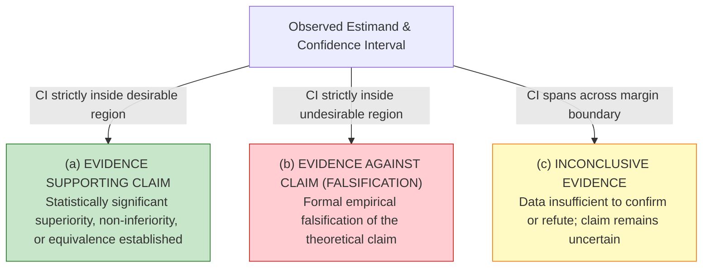
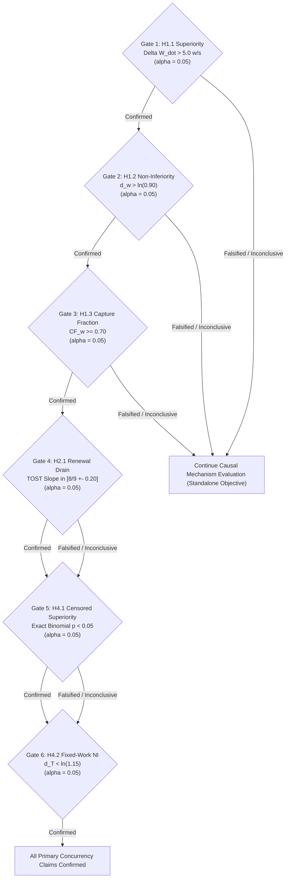

# Phase I7 — Checkpoint R1.2d: Review Decision Matrix and Epistemic Ledger

**DOCUMENT ID:** `R1_2D_REVIEW_DECISION_MATRIX.md`  
**STATUS:** FORMAL PRE-REGISTERED EPISTEMIC SPECIFICATION  
**GOVERNING DIRECTIVE:** CHECKPOINT R1.2d EXTERNAL SCIENTIFIC REVIEW  
**EVALUATED GIT REVISION:** `f4cce4b5faa80924c7ef945139ef1a65ccb2b32a`  
**BOUNDARY:** RIGOROUS EPISTEMIC & STATISTICAL LEDGER (ZERO BENCHMARK EXECUTION)

---

## 1. Epistemic Framework: Three-Way Outcome Classification

In accordance with scientific review directives, this protocol formally repudiates the fallacy of treating failure to reject a null hypothesis as empirical falsification. For every hypothesis evaluated across EXP-1 through EXP-4, the analytical framework defines three mutually exclusive and exhaustive outcomes:

1. **(a) Evidence Supporting the Target Claim:** The two-sided $90\%$ confidence interval (or one-sided $95\%$ confidence bound) falls entirely within the pre-registered desirable region, formally rejecting the null hypothesis at $\alpha = 0.05$.
2. **(b) Evidence Against the Target Claim (Formal Falsification):** The confidence interval falls entirely within the undesirable region, or the point estimate is separated from the target threshold by more than the pre-registered Minimum Substantive Effect Size (MES).
3. **(c) Inconclusive Evidence:** The confidence interval spans across the pre-registered decision boundary. The sample data lacks sufficient precision to confirm or refute the hypothesis. **The result is explicitly labeled as inconclusive and must never be reported as evidence of absence or falsification.**

---

## 2. Master Review Decision Matrix

| Hypothesis ID | Scientific Question | Target Claim | Exact Estimand & Mathematical Formula | Minimum Substantive Effect Size (MES) | Sizing ($N$) | Supporting Evidence Criteria | Falsification Criteria | Inconclusive Region | Scientific Consequence of Outcome |
| :--- | :--- | :--- | :--- | :--- | :---: | :--- | :--- | :--- | :--- |
| **H1.1** | Does A-min eliminate writer starvation? | A-min achieves write rate superior to Approach A | $\Delta \dot{W}(\text{AMIN} - \text{A}) = \frac{W_{\text{amin}} - W_A}{T_{\text{window}}}$ | $\text{MES} = 5.0\,\text{writes/s}$ | 12 triplets | Lower bound of 95% CI for $\Delta \dot{W} > 5.0\,\text{w/s}$ ($p < 0.05$) | Upper bound of 95% CI for $\Delta \dot{W} \le 5.0\,\text{w/s}$ | 95% CI spans $5.0\,\text{w/s}$ (e.g. $[2.0, 8.0]$) | **Supporting:** A-min prevents reader-induced writer stall. **Falsification:** A-min suffers persistent starvation. **Inconclusive:** Starvation mitigation uncertain. |
| **H1.2** | Does A-min match Approach B write progress? | A-min write rate is non-inferior to Approach B | $d_{w, t} = \ln\left(\frac{W_{\text{amin}, t} + 1}{W_{B, t} + 1}\right)$ | Margin $\Delta_{\text{NI}} = 0.90$ ($\delta_{\text{NI}} = -0.1054$) | 12 triplets | Lower bound of 90% CI for $\bar{d}_w > -0.1054$ | Upper bound of 90% CI for $\bar{d}_w \le -0.1054$ | 90% CI spans $-0.1054$ (e.g. $[-0.14, -0.02]$) | **Supporting:** Leasing matches snapshot write rate. **Falsification:** Snapshot isolation is strictly superior. **Inconclusive:** Relative write performance uncertain. |
| **H1.3** | Does A-min capture snapshot concurrency benefit? | A-min captures $\ge 70\%$ of B's write improvement | $\widehat{CF}_w = \frac{\bar{W}_{\text{amin}} - \bar{W}_A}{\bar{W}_B - \bar{W}_A}$ | Benefit threshold $\ge 0.70$ (70%) | 12 triplets | Point estimate $\ge 0.70$ AND lower 95% BCa bootstrap CI $\ge 0.60$ | Upper bound of 95% BCa bootstrap CI $< 0.70$ | Point estimate $\ge 0.70$ but lower CI bound $< 0.60$ | **Supporting:** Central thesis confirmed; leasing captures lion's share. **Falsification:** Core thesis refuted; leasing insufficient. **Inconclusive:** Capture fraction estimate too noisy. |
| **H2.1** | Does writer drain scale as renewal model? | Writer wait scales as $\mathbb{E}[W] = \frac{r}{r+1} T_{\text{readCS}}$ | Empirical slope $\hat{\beta}_1 = \frac{\partial \bar{t}_{\text{pub\_wait}}}{\partial T_{\text{readCS}}}$ | TOST margin $\pm 0.20$ around theoretical $\frac{r}{r+1}$ | 12 triplets | 90% CI of $\hat{\beta}_1$ falls strictly inside $[\frac{r}{r+1} \pm 0.20]$ | 90% CI falls strictly outside ($\hat{\beta}_1 > \frac{r}{r+1} + 0.20$ or $< 0.10$) | 90% CI spans equivalence boundaries | **Supporting:** Synchronization queueing model validated. **Falsification:** Renewal model refuted; linear or preemption dynamics dominate. **Inconclusive:** Drain slope estimate insufficiently precise. |
| **H2.2** | Does reader hold time cause Approach A stall? | Reader critical section duration directly drives writer delay | Slope $\beta_{1, A} = \frac{\partial \bar{t}_{\text{pub\_wait}, A}}{\partial T_{\text{readCS}}}$ | Meaningful positive slope $\beta_{1, A} > 0.20$ | 12 triplets | Lower bound of 95% CI for $\beta_{1, A} > 0.20$ ($p < 0.05$) | Upper bound of 95% CI for $\beta_{1, A} \le 0.10$ | 95% CI spans $[0.10, 0.20]$ | **Supporting:** Coarse-lock causal link confirmed. **Falsification:** Reader hold time is NOT the cause of Approach A stall. **Inconclusive:** Causal link uncertain. |
| **H2.3** | Is stall caused by lock contention or CPU load? | Spin delay outside critical section does not stall publisher | Contrast $\Delta \bar{t} = \bar{t}_{\text{wait}}(\text{C2-06}) - \bar{t}_{\text{wait}}(\text{C2-01})$ | TOST margin $\pm 5.0\,\mu\text{s}$ around 0 | 12 triplets | 90% CI for $\Delta \bar{t}$ falls strictly inside $[-5.0\,\mu\text{s}, +5.0\,\mu\text{s}]$ | Lower bound of 90% CI for $\Delta \bar{t} > 15.0\,\mu\text{s}$ | 90% CI spans $[5.0\,\mu\text{s}, 15.0\,\mu\text{s}]$ | **Supporting:** Confirms pure lock contention mechanism. **Falsification:** Thread scheduling/CPU starvation drives stall. **Inconclusive:** Secondary CPU interference cannot be ruled out. |
| **H3.1** | Does SSTable cardinality produce an architectural crossover? | A-min wins at small $n$; Approach B wins at large $n$ | Point read throughput ratio $R_{\text{amin}} / R_B$ vs $n \in \{2, 8, 32\}$ | $\pm 10\%$ crossover boundary | Go testing.B (10 replicates) | $R_{\text{amin}} > R_B$ at $n=2$ ($p < 0.05$) AND $R_B > R_{\text{amin}}$ at $n=32$ ($p < 0.05$) | $R_{\text{amin}} \ge R_B$ across all $n \in \{2, 8, 32\}$ with $p < 0.05$ | Differences between arms within $\pm 5\%$ measurement noise | **Supporting:** Crossover proven; leasing is optimal for small $n$, snapshot for large $n$. **Falsification:** Crossover refuted; leasing strictly dominates across evaluated scale. **Inconclusive:** Overhead differences too small to establish crossover. |
| **H3.2** | Does Approach B suffer mutex contention on `snapshotMu`? | Mutex stall time on `snapshotMu` increases with reader count $r$ | Profiling wait time $T_{\text{mutex\_wait}}$ from `pprof -mutex` | Measurable stall $> 100\,\text{ns/op}$ under $r = 16$ | Go testing.B (10 replicates) | Measured mutex wait $> 100\,\text{ns/op}$ and scales with $r$ ($p < 0.05$) | Measured mutex wait $\le 20\,\text{ns/op}$ across all $r \in [1, 16]$ | Mutex wait between $20$ and $100\,\text{ns/op}$ | **Supporting:** Exclusive mutex contention proven as root cause of B's overhead. **Falsification:** Mutex contention refuted; B's overhead caused by cache-line bounce or pointer indirection. **Inconclusive:** Mutex profiling inconclusive. |
| **H4.1** | Does A-min complete fixed write volume faster than A? | A-min completion time distribution is superior under censoring | Paired censored score $K = \sum \mathbb{I}(U_i = +1)$ at $T_{\text{max}} = 30\,\text{s}$ | Binomial proportion $P(U_i = +1) > 0.50$ | 12 triplets | Exact one-sided binomial $p < 0.05$ AND $K / n_{\text{eff}} > 0.50$ | Exact binomial $p \ge 0.05$ AND $K / n_{\text{eff}} \le 0.50$ | $K / n_{\text{eff}} > 0.50$ but exact binomial $p \in [0.05, 0.20]$ | **Supporting:** A-min achieves fixed-work completion superiority under reader load. **Falsification:** A-min fails to outperform Approach A under fixed-workload conditions. **Inconclusive:** Insufficient separation under modest contention regimes. |
| **H4.2** | Is A-min fixed-work completion time non-inferior to B? | A-min completion time within 15% of Approach B | Log-ratio of completion times $d_T = \ln(T_{\text{amin}} / T_B)$ | Non-inferiority margin $\Delta_{\text{NI}} = 1.15$ ($\delta_{\text{NI}} = +0.1398$) | 12 triplets | Upper bound of 90% CI for $\bar{d}_T < +0.1398$ | Lower bound of 90% CI for $\bar{d}_T \ge +0.1398$ | 90% CI spans $+0.1398$ (e.g. $[+0.05, +0.18]$) | **Supporting:** Fixed-work non-inferiority confirmed. **Falsification:** Approach B is strictly faster under fixed-workloads. **Inconclusive:** Completion time difference uncertain. |

---

## 3. Sequential Gating Hierarchy and Multiplicity Procedures

To maintain rigorous family-wise error rate control ($\text{FWER} \le 0.05$) without arbitrarily penalizing statistical sensitivity, all primary hypothesis tests are embedded in a **Fixed-Sequence Hierarchical Testing Chain**:

### Multiplicity Rules:
1. **Mathematical FWER Guarantee:** By the closure principle of fixed-sequence testing (Maurer et al., 1995), every gate is tested at the full uniform significance level $\alpha = 0.05$. The probability of committing at least one Type I error across the sequence is strictly bounded by $\alpha = 0.05$.
2. **Decoupling of Mechanistic Investigations:** If Gate 2 (H1.2 Non-Inferiority) yields an inconclusive or negative result, execution proceeds directly to Gate 4 (EXP-2 Causal Mechanism). Falsification or inconclusiveness in a performance benchmark **never halts or invalidates the physical synchronization investigation**.
