# Checkpoint CP1.3: Reader Lifetime, Concurrency Hazards & Safe Retirement (Approach A)

**Milestone:** Checkpoint CP1.3  
**Sub-phases Executed:** I1.3.0, I1.3.0a, I1.3.1, I1.3.2, I1.3.3, I1.3.4, I1.3.5  
**Governing Architecture:** Approach A (Manager-wide Mutex Baseline)  
**Date:** 2026-10-16  
**Status:** COMPLETE — STOPPED FOR EXTERNAL REVIEW  

---

## 1. Executive Summary

In Sub-phase I1.3, we investigated SSTable reader ownership, lifecycle boundaries, and reclamation hazards under Approach A (Manager-wide Mutex baseline).

Key milestones accomplished:
1. **Defect E-005 Resolution (INV-COMPACT-1)**: Formally adopted `INV-COMPACT-1` prohibiting noncontiguous compaction input selection in flat-slice architectures. Added defensive validation in `replaceCompactedReaders` enforcing full-prefix contiguity starting at index 0, duplicate freedom, and active status. Converted the failing counterexample into a passing regression test suite (4 tests).
2. **Reader Ownership & Containment Audit (I1.3.0 / I1.3.1)**: Re-examined reader reference escape. Confirmed that while point reads (`Get`) and commits retain references strictly within `Manager.Mu`, `CompactAll` borrows active readers and merges them **outside `Manager.Mu`**, exposing readers to overlapping compactions and shutdown invalidation.
3. **Defect E-006 Resolution (INV-LIFETIME-4)**: Identified and repaired overlapping compaction races and shutdown reader invalidation. Implemented dedicated `m.compactionMu sync.Mutex` and `m.isClosed bool` under strict lock order `compactionMu -> Manager.Mu -> Wal.mu`, serializing compaction lifetimes and coordinating cleanly with `Manager.Close()`.
4. **Deterministic Lifetime Test Suite (I1.3.2)**: Implemented 4 deterministic concurrency tests using channel barrier hooks:
   - Case A: Overlapping compactions safely serialized without reader conflicts or data loss.
   - Case B: Shutdown safely coordinated with in-flight compactions without premature reader closure.
   - Case C: Point reads holding `RLock` complete before reader retirement and unlinking.
   - Case D: Controlled iterator/build failure safely aborts without mutating or leaking active readers.
5. **Filesystem Cleanup & Windows NTFS Verification (I1.3.4)**: Verified close-before-delete, absence of `ERROR_SHARING_VIOLATION`, cleanup of aborted compaction temporary files, preservation of active concurrent flushes, and zero handle leaks upon shutdown across both Windows NTFS and WSL2 Linux.
6. **Full Verification (I1.3.5)**: 32 / 32 unit tests PASS on Windows native (1.83s), 32 / 32 PASS under WSL2 Linux amd64 with `-race` (2.95s) with **zero data races**.

---

## 2. Invariant & Issue Summary

### Invariants Codified & Enforced
| Invariant ID | Name | Core Mandate | Status |
| :--- | :--- | :--- | :--- |
| **`INV-ORDER-1`** | Chronological Reader Ordering | `ActiveSSreaders` must be chronologically ordered oldest (index 0) to newest (index `len-1`). | **Verified** |
| **`INV-COMPACT-1`** | Compaction Input Contiguity | Compaction inputs must form a strictly contiguous prefix starting at index 0. Noncontiguous selection is prohibited. | **Verified (I1.3.0a)** |
| **`INV-LIFETIME-2`** | Safe Reader Retirement | Retired SSTables must not be closed or unlinked while referenced by in-flight point reads. | **Verified (I1.3.2)** |
| **`INV-LIFETIME-4`** | Compaction Serialization & Shutdown Safety | Compaction lifetimes are serialized via `compactionMu`. `Manager.Close()` coordinates via `compactionMu` and `isClosed`. | **Verified (I1.3.3)** |
| **`INV-SYNC-3`** | Hierarchical Lock Order | Strict acquisition: `m.compactionMu` $\to$ `Manager.Mu` $\to$ `Wal.mu`. | **Verified** |

### Issues Identified & Resolved
| Issue ID | Severity | Problem Description | Resolution / Status |
| :--- | :--- | :--- | :--- |
| **E-005** | P1 (Ordering) | Noncontiguous compaction input selection causes unselected intermediate tables to mask newer compacted versions in `Manager.Get`. | **FIXED**: Enforced `INV-COMPACT-1` and contiguous-prefix validation in `replaceCompactedReaders`. |
| **E-006** | P1 (Lifecycle) | Concurrent compactions race on active reader sets; `Manager.Close()` closes readers while in-flight compaction merges outside lock. | **FIXED**: Implemented `compactionMu` and `isClosed` flag under lock hierarchy `compactionMu -> Manager.Mu -> Wal.mu`. |

---

## 3. Reader Ownership & Lifetime State Diagram

```mermaid
stateDiagram-v2
    [*] --> Constructing: Background Flush or Compaction
    Constructing --> PrivateReady: NewSSTableReader() succeeds
    Constructing --> AbortedCleaned: Error -> os.Remove(tempFile)
    AbortedCleaned --> [*]

    PrivateReady --> Active: Published in m.ActiveSSreaders under m.Mu.Lock()
    
    state Active {
        [*] --> ServingReads: Point Read Borrow (m.Mu.RLock)
        ServingReads --> ServingReads: latestValueLocked
    }

    Active --> CompactingLease: CompactAll captures contiguous prefix under compactionMu & m.Mu.Lock()
    
    state CompactingLease {
        [*] --> MergingOutsideLock: K-Way Merge & Builder Add
        MergingOutsideLock --> IterationError: I/O Error -> Close iterators & abort
        MergingOutsideLock --> PublicationReady: Temp SSTable built & verified
    }

    IterationError --> Active: Readers remain active; temp files deleted
    PublicationReady --> Replaced: In-place prefix swap under m.Mu.Lock()
    Replaced --> Drained: Active RLock holders complete lookup
    Drained --> Closed: r.Close() (all handles closed)
    Closed --> Unlinked: os.Remove(r.File.Name())
    Unlinked --> [*]
```

---

## 4. Test Matrix Summary (32 / 32 Tests Passing)

| Test Category | Windows 11 Native (NTFS) | WSL2 Linux amd64 (`-race`) | Coverage Focus |
| :--- | :--- | :--- | :--- |
| **Compaction Publication Concurrency (4 tests)** | PASS (0.23s) | PASS (0.36s) | Concurrent flush overlap, newer versions, tombstones, aborted publication |
| **Cross-Tier Conflict Detection (3 tests)** | PASS (0.05s) | PASS (0.13s) | Flushed SSTable puts, tombstones, non-conflicting commits |
| **SkipList & Engine Baseline (5 tests)** | PASS (0.12s) | PASS (0.29s) | Level distribution, basic put/get, tombstone, WAL recovery, memtable conflict |
| **Invariant Verification (8 tests)** | PASS (0.14s) | PASS (0.32s) | 56-bit math, multi-version, tombstone+put, 3-block index, I/O distinction, E-004 fix, ordering audit |
| **Compaction Ordering & E-005 Safeguards (4 tests)** | PASS (0.10s) | PASS (0.21s) | Noncontiguous rejection, non-prefix rejection, duplicate rejection, valid prefix MVCC visibility |
| **Reader Lifetime & Concurrency (4 tests)** | PASS (0.36s) | PASS (0.40s) | Read during retirement (Case C), failure paths (Case D), overlapping compactions (Case A), shutdown coordination (Case B) |
| **Filesystem & Handle Cleanup (4 tests)** | PASS (0.05s) | PASS (0.23s) | Close-before-delete, aborted temp cleanup, active preservation, shutdown handle release |
| **Total Test Suite (32 tests)** | **PASS (1.83s)** | **PASS (2.95s)** | **Zero Data Races Across Entire Engine** |

---

## 5. Performance & Architectural Trade-offs (Approach A)

1. **Compaction Serialization (`m.compactionMu`)**:
   - Compactions are serialized globally. This eliminates concurrency races on reader sets and prevents disk I/O thrashing on a single storage volume.
   - Point reads (`Manager.Get`), transactions (`Commit`), and background memtable flushes (`flushToDisk`) do **not** acquire `compactionMu` and remain completely concurrent.
2. **Global Mutex Overhead (`Manager.Mu`)**:
   - In Approach A, readers must hold `m.Mu.RLock()` for the entire duration of index seeking and block reading to guarantee that the underlying file descriptor is not closed by a retiring compaction.
   - Under heavy read concurrency, long disk reads hold shared locks that stall `Transaction.Commit` and compaction publication (both requiring `m.Mu.Lock()`).
   - This architectural contention confirms the exact motivation for **Approach B** (immutable reader snapshots with safe reclamation), which will allow readers to execute lock-free without blocking compaction publication.

---

## 6. Remaining Correctness and MVCC Risks

1. **Flat-Slice Compaction Scope**: Compaction is strictly restricted to a contiguous prefix `[0..k]`. Selective middle-tier compaction cannot be implemented without migrating to a multi-level tiered LSM architecture (e.g., LevelDB/RocksDB L0 $\to$ L1).
2. **Crash-Consistency on Multiple WAL Rotations**: While single-WAL recovery is verified, recovery across multiple rotated log files (`wal_<timestamp>.log`) requires a persistent manifest or log catalog.
3. **Approach A Read Contention**: Point reads holding `RLock` during slow disk I/O will delay writer commits and compaction swaps.

---

**STATUS: CHECKPOINT CP1.3 COMPLETE. AWAITING EXTERNAL REVIEW APPROVAL.**
