# Checkpoint CP2 External Reviewer Packet: Approach B Immutable Snapshot Protocol

## 1. Exact Starting Commit and Branch
- **Baseline Git Tag (Historical Reference)**: `baseline-approach-a` at commit `d6909a75ea8d4015e2f19c3b35465dd78e0f4dfc`
- **Verified Experimental Baseline Tag**: `baseline-approach-a-verified` at commit `ae8c034c438d56abbe6664e6472f7a0c1278797f`
- **Current Active Development Branch**: `research/approach-b-snapshots`
- **Current Working Tree**: Clean, all baseline tests passing.

---

## 2. Reader-Set Lifecycle State Diagram

```mermaid
stateDiagram-v2
    [*] --> Constructing: Flush/Compaction creates new snapshot
    Constructing --> Published: Atomically installed into Manager.currentSnapshot
    Published --> Pinned: Reader calls AcquireSnapshot (pins > 0)
    Pinned --> Published: Reader calls ReleaseSnapshot (pins == 0, still current)
    Published --> Retired: Newer snapshot published (pins == 0)
    Pinned --> Retired: Newer snapshot published while pins > 0
    Retired --> Drained: Final active reader calls ReleaseSnapshot (pins == 0)
    Drained --> Closed: SharedReader refCounts decremented; obsolete handles closed
    Closed --> Reclaimed: Files unlinked from disk; memory reclaimed
    Reclaimed --> [*]
```



### State Definitions:
1. **`Constructing`**: Private to creator (compaction or flush worker). Assembles immutable `[]*SharedReader` slice in chronological order (newest to oldest). Refcounts of surviving shared readers are incremented.
2. **`Published`**: Installed as `Manager.currentSnapshot` under `snapshotMu`. Discoverable by incoming reader queries. May have `pins == 0` or `pins > 0`.
3. **`Pinned`**: One or more concurrent queries hold active pins (`pins > 0`). Readers perform concurrent index searches and disk block I/O with zero global locks held.
4. **`Retired`**: Unseated from `Manager.currentSnapshot` by publication of a newer snapshot. Moved to `Manager.retiredSnapshots`. No new pins granted. Existing pinned readers finish safely.
5. **`Drained`**: Pin count on a retired snapshot drops to 0. Snapshot transitions from `Retired` to `Drained`.
6. **`Closed`**: Drained snapshot iterates constituent `SharedReader`s and decrements their `refCount`. If `refCount == 0` and `obsolete == true`, `reader.Close()` is invoked.
7. **`Reclaimed`**: Obsolete closed SSTables are unlinked from disk (`os.Remove`), and snapshot memory structures are reclaimed by the GC.

---

## 3. Reference Ownership Strategy and Rejected Alternatives

### 3.1 Evaluated Alternatives

1. **Model A: Entire Immutable Snapshot Ownership (Rejected)**:
   - *Design*: The snapshot directly owns its `SSTableReader` instances. When the snapshot drains, it closes all its readers.
   - *Fatal Flaw*: In LSM architectures, frequent flushes and partial compactions leave older uncompacted SSTables untouched. Newer snapshots share these identical readers! If Snapshot 1 retires and drains, closing its readers destroys active file descriptors in Snapshot 2, causing fatal `use-after-close` panics or Windows file-sharing violations (`Access is denied`).
2. **Model B: Individual Reader Atomic Refcounting by Queries (Rejected)**:
   - *Design*: No snapshot object; queries atomically increment refcounts on individual `SSTableReader`s during traversal.
   - *Flaw*: High per-query CPU overhead (atomic loops over $N$ readers on every read); vulnerable to reader-set drift between key existence checks and block reads; fails to provide a cohesive point-in-time snapshot view across the entire SSTable tier.
3. **Model C: Two-Tier Reference Ownership (Selected — Decision D-020)**:
   - *Design*:
     - **Tier 1 (Snapshot Query Lifetime)**: `ReaderSnapshot` tracks active query readers via `pins int64` under `snapshotMu`.
     - **Tier 2 (Physical Reader & File Handle Lifetime)**: `SharedReader` wraps `SSTableReader` with an independent `atomic.Int64` `refCount`, an `atomic.Bool` `obsolete` flag, and a `sync.Once` safe closure guard.
   - *Why Model C is Optimal*:
     - Decouples point-in-time query lifetimes from physical file lifetimes.
     - Multiple snapshots increment `refCount` on shared uncompacted tables.
     - Draining an older snapshot only decrements the shared reader refcount; shared readers remain open for newer snapshots as long as `refCount >= 1`.
     - Query acquisition fast path is $O(1)$: increments a single snapshot `pins` counter; zero counter manipulation per constituent SSTable.

---

## 4. Shared SSTable Reader/File Ownership Protocol

```go
type SharedReader struct {
    Reader    *SSTableReader
    Path      string
    refCount  atomic.Int64
    obsolete  atomic.Bool // Set true by compaction when table is superseded
    closeOnce sync.Once
    closeErr  error
}
```

### Prevention of Concurrency and Lifecycle Defects:
- **Double-Close Prevention**: `closeOnce.Do(...)` guarantees that `Reader.Close()` executes exactly once, even if multiple code paths attempt reclamation.
- **Premature Unlink Prevention**: A file path is passed to `os.Remove(Path)` if and only if `refCount.Load() == 0` AND `obsolete.Load() == true`. Uncompacted shared tables never have `obsolete == true`.
- **Use-After-Close Prevention**: Pinned queries hold a snapshot pin. A snapshot cannot drain while `pins > 0`. While a snapshot has not drained, each constituent `SharedReader.refCount >= 1`. Therefore, no active reader handle can be closed while any query is reading it.
- **Leaked Reader Prevention**: Every snapshot that is retired is tracked in `m.retiredSnapshots`. When its pins reach zero, it is deterministically drained and constituent refcounts decremented. On engine shutdown (`Manager.Close`), all snapshots are drained before termination.
- **Windows NTFS Safety**: Windows forbids deleting files with open OS handles. The protocol guarantees that `reader.Close()` completes and returns cleanly before `os.Remove(path)` is called.

---

## 5. Pin Acquisition and Release Pseudocode

```go
// AcquireSnapshot obtains an active pin on the currently published reader snapshot.
// Fast path critical section duration: ~10-20ns.
func (m *Manager) AcquireSnapshot() (*ReaderSnapshot, error) {
    m.snapshotMu.Lock()
    defer m.snapshotMu.Unlock()

    if m.isClosed || m.state != EngineOpen {
        return nil, ErrClosed
    }

    snap := m.currentSnapshot
    if snap != nil {
        snap.pins++
        if snap.state == SnapshotPublished && snap.pins == 1 {
            snap.state = SnapshotPinned
        }
    }
    return snap, nil
}

// ReleaseSnapshot releases an active pin on the specified snapshot.
// Defensively panics on pin underflow (INV-SNAP-4).
func (m *Manager) ReleaseSnapshot(snap *ReaderSnapshot) {
    if snap == nil {
        return
    }

    m.snapshotMu.Lock()
    defer m.snapshotMu.Unlock()

    if snap.pins <= 0 {
        panic("FATAL: snapshot pin underflow detected")
    }
    snap.pins--

    if snap.pins == 0 {
        if snap.state == SnapshotPinned {
            snap.state = SnapshotPublished
        } else if snap.state == SnapshotRetired {
            snap.state = SnapshotDrained
            m.reclaimRetiredLocked(snap)
        }
    }
}
```

---

## 6. Publish-and-Retire Pseudocode

```go
// PublishSnapshot atomically swings m.currentSnapshot and retires the old snapshot.
func (m *Manager) PublishSnapshot(newSnap *ReaderSnapshot) error {
    m.snapshotMu.Lock()
    defer m.snapshotMu.Unlock()

    if m.isClosed || m.state != EngineOpen {
        return ErrClosed
    }

    newSnap.state = SnapshotPublished
    oldSnap := m.currentSnapshot
    m.currentSnapshot = newSnap

    if oldSnap != nil {
        m.retireSnapshotLocked(oldSnap)
    }
    return nil
}

func (m *Manager) retireSnapshotLocked(oldSnap *ReaderSnapshot) {
    oldSnap.state = SnapshotRetired
    oldSnap.retiredAt = time.Now()

    if oldSnap.pins == 0 {
        oldSnap.state = SnapshotDrained
        m.reclaimRetiredLocked(oldSnap)
    } else {
        m.retiredSnapshots = append(m.retiredSnapshots, oldSnap)
    }
}
```

---

## 7. Snapshot Reclamation and Shutdown Design

```go
// reclaimRetiredLocked processes drained snapshots and queues obsolete readers for closure.
func (m *Manager) reclaimRetiredLocked(snap *ReaderSnapshot) {
    // 1. Remove from retiredSnapshots slice
    for i, s := range m.retiredSnapshots {
        if s == snap {
            m.retiredSnapshots = append(m.retiredSnapshots[:i], m.retiredSnapshots[i+1:]...)
            break
        }
    }

    // 2. Decrement refCount for all constituent shared readers
    for _, sr := range snap.readers {
        newRef := sr.refCount.Add(-1)
        if newRef < 0 {
            panic("FATAL: shared reader refCount underflow")
        }
        if newRef == 0 && sr.obsolete.Load() {
            m.pendingCleanupReaders = append(m.pendingCleanupReaders, sr)
        }
    }

    snap.state = SnapshotReclaimed
    snap.readers = nil

    // 3. Notify shutdown drain condvar if retired queue is empty
    if len(m.retiredSnapshots) == 0 && m.snapshotDrainCond != nil {
        m.snapshotDrainCond.Broadcast()
    }
}
```

### Shutdown with Outstanding Pins:
1. `Manager.Close()` sets `m.state = EngineClosing` under `m.Mu.Lock()`.
2. Any subsequent `AcquireSnapshot` calls fail immediately with `ErrClosed`.
3. In-flight readers complete their current queries and execute `defer ReleaseSnapshot(snap)`.
4. When `snap.pins` reaches 0, `reclaimRetiredLocked` decrements reader refcounts.
5. `Manager.Close()` drains pending cleanup readers outside locks via `drainPendingCleanups()`.
6. Zero file descriptors or memory handles are leaked.

---

## 8. Full Lock Hierarchy and Possible Lock Inversions

```
Level 1: compactionMu     (Mutex: serializes background compaction routines)
Level 2: Manager.Mu       (RWMutex: serializes engine state, active Memtable, Frozenmem)
Level 3: snapshotMu       (Mutex: leaf guard for snapshot pointer, pin counters, retired list)
Level 4: flushQueueMu     (Mutex: leaf guard for FIFO flush queue and condvar)
```

### Deadlock Freedom Proof:
- **Strict Ascending Hierarchy**: Any goroutine acquiring multiple locks MUST acquire them in order: `compactionMu` $\to$ `Manager.Mu` $\to$ `snapshotMu` $\to$ `flushQueueMu`.
- **Leaf Invariant**: `snapshotMu` is an ultra-short leaf mutex (~10–20ns). It NEVER acquires `Manager.Mu`, `compactionMu`, or performs disk I/O, channel sends, or system calls.
- **Disk I/O Invariant**: Slow disk reads (`io.NewSectionReader`), block decodes, and file unlinks (`os.Remove`) are executed with ZERO locks held (`compactionMu`, `Manager.Mu`, and `snapshotMu` are all released).
- **Result**: Circular wait is mathematically impossible.

---

## 9. Memtable / MVCC Consistency Analysis

### 9.1 Point Read vs Transactional Snapshot Isolation
- **Point Read Consistency**: `Manager.Get(key, readTs)` guarantees that the caller sees the latest committed version $\le readTs$ across all tiers.
- **MVCC Version Selection**: Internal key format `key:version:type` is ordered descending by version. First-matching entry $\le readTs$ determines the result.

### 9.2 Memory-Tier Read Coupled with Snapshot Pinning (Decision D-022)
To eliminate any visibility gap during concurrent Memtable flushes (`INV-HANDOFF-1`):
```go
func (m *Manager) Get(key string, readTs uint64) (string, error) {
    byteKey := []byte(key)
    
    // 1. Inspect memory tiers and acquire disk snapshot pin under short RLock
    m.Mu.RLock()
    if m.state == EngineClosed {
        m.Mu.RUnlock()
        return "", ErrClosed
    }
    
    // Check active Memtable
    val, err := m.Mem.Get(byteKey, readTs)
    if err == nil {
        m.Mu.RUnlock()
        return val, nil
    } else if err == ErrKeyDeleted {
        m.Mu.RUnlock()
        return "", ErrKeyDeleted
    }
    
    // Check frozen Memtables (newest to oldest)
    for i := len(m.Frozenmem) - 1; i >= 0; i-- {
        val, err := m.Frozenmem[i].Get(byteKey, readTs)
        if err == nil {
            m.Mu.RUnlock()
            return val, nil
        } else if err == ErrKeyDeleted {
            m.Mu.RUnlock()
            return "", ErrKeyDeleted
        }
    }
    
    // Key not in memory; pin disk snapshot BEFORE releasing m.Mu
    snap, snapErr := m.acquireSnapshotLocked()
    m.Mu.RUnlock() // <--- Manager lock released here!
    
    if snapErr != nil {
        return "", snapErr
    }
    defer m.ReleaseSnapshot(snap)
    
    // 2. Perform SSTable binary search and disk I/O with ZERO locks held
    return snap.Get(byteKey, readTs)
}
```

### Analysis of the 5 Concurrent Interleaving Scenarios:
1. **Scenario A (Active Memtable Freezing)**: Freezing requires `m.Mu.Lock()`. Either reader runs before freeze (finds key in `m.Mem`) or after freeze (finds key in `m.Frozenmem[0]`). Zero visibility loss.
2. **Scenario B (Frozen Memtable Flush Publication)**: Flush worker requires `m.Mu.Lock()` to remove `Frozenmem[tail]` and publish SSTable. Because the reader holds `m.Mu.RLock()` across both `Frozenmem` inspection and snapshot pinning, flush publication cannot interleave between them. Zero visibility gap.
3. **Scenario C (Compaction Snapshot Replacement)**: Compaction publishes new snapshot; old snapshot transitions to `Retired`. Pinned reader continues reading old snapshot safely.
4. **Scenario D (Retirement of Previously Published Sets)**: Multiple rapid flushes retire intermediate snapshots. Each retired snapshot tracks its own pins and drains independently.
5. **Scenario E (Engine Shutdown)**: `Close()` marks `EngineClosing`. New pins rejected with `ErrClosed`. Outstanding pinned queries complete and release pins cleanly.

---

## 10. Deterministic Test Plan for Phase I3

The following 10 deterministic tests will be implemented in Phase I3 to certify Approach B:

1. **`TestApproachB_SnapshotLifecycle_LinearProgression`**:
   Verify complete state machine progression from `Constructing` $\to$ `Published` $\to$ `Pinned` $\to$ `Retired` $\to$ `Drained` $\to$ `Closed` $\to$ `Reclaimed`.
2. **`TestApproachB_PinningUnderflowPanic`**:
   Simulate duplicate `ReleaseSnapshot` call; assert that runtime panics with expected underflow message (`INV-SNAP-4`).
3. **`TestApproachB_ConcurrentReadersOverlappingCompaction`**:
   Launch 32 concurrent reader goroutines against 10 SSTables while background compaction replaces all 10 tables with 1 compacted table. Assert zero data races, zero read errors, and correct key retrieval.
4. **`TestApproachB_SharedReader_MultiSnapshotRetention`**:
   Create Snapshot 1 with $[S_1, S_2]$, Snapshot 2 with $[S_3, S_2, S_1]$. Retire and drain Snapshot 1. Assert that $S_2$ and $S_1$ remain open and queryable in Snapshot 2 (`INV-SNAP-3`).
5. **`TestApproachB_WindowsNTFS_CloseBeforeRemove`**:
   Verify on Windows NTFS that compacted SSTables are never unlinked while open handles exist, ensuring zero `ERROR_SHARING_VIOLATION` errors.
6. **`TestApproachB_MemtableHandoff_ZeroVisibilityGap`**:
   Interleave rapid active Memtable flushes while reader loops over keys; assert key is never missed across the memory $\to$ snapshot transition (`INV-HANDOFF-1`, `INV-SNAP-5`).
7. **`TestApproachB_MultipleRetiredSnapshotsQueued`**:
   Pin snapshot $S_0$, trigger 5 consecutive flushes generating $S_1 \dots S_5$. Assert 5 snapshots queued in `retiredSnapshots`. Release $S_0$ and assert all 5 snapshots drain and reclaim cleanly.
8. **`TestApproachB_Shutdown_DrainWithOutstandingPins`**:
   Hold an active pin, initiate `Manager.Close()`. Assert `Close()` blocks or defers handle release until pin is released, preventing use-after-close.
9. **`TestApproachB_ErrorDuringLookup_ExactOnceRelease`**:
   Simulate block I/O failure during read. Assert `defer ReleaseSnapshot` executes and restores pin count to exact previous value.
10. **`TestApproachB_TombstonePrecedenceAcrossPinnedSnapshot`**:
    Verify that an active Memtable tombstone correctly masks older values in a pinned SSTable snapshot.

---

## 11. Minimal Scaffolding Diff

Minimal scaffolding types were introduced in [`lsmengine/snapshot.go`](file:///c:/Users/ramst/Documents/Projects/selfdbms/lsmengine/snapshot.go) without modifying any existing Approach A behavior:

```go
package lsmengine

import (
	"sync"
	"sync/atomic"
	"time"
)

type SnapshotState int

const (
	SnapshotConstructing SnapshotState = iota
	SnapshotPublished
	SnapshotPinned
	SnapshotRetired
	SnapshotDrained
	SnapshotClosed
	SnapshotReclaimed
)

func (s SnapshotState) String() string { ... }

type SharedReader struct {
	Reader    *SSTableReader
	Path      string
	refCount  atomic.Int64
	obsolete  atomic.Bool
	closeOnce sync.Once
	closeErr  error
}

func (sr *SharedReader) Ref() { sr.refCount.Add(1) }
func (sr *SharedReader) RefCount() int64 { return sr.refCount.Load() }

type ReaderSnapshot struct {
	id        uint64
	state     SnapshotState
	readers   []*SharedReader
	pins      int64
	retiredAt time.Time
}

func (rs *ReaderSnapshot) State() SnapshotState { return rs.state }
func (rs *ReaderSnapshot) Pins() int64 { return rs.pins }

type ReaderSyncStrategy interface {
	Name() string
	Mode() SyncMode
}
```

Tested by [`lsmengine/snapshot_scaffolding_test.go`](file:///c:/Users/ramst/Documents/Projects/selfdbms/lsmengine/snapshot_scaffolding_test.go):
- Confirms all 7 states string format correctly.
- Confirms `SharedReader.Ref()` atomic behavior.
- Confirms `CreateManagerWithConfig(Config{Mode: SyncModeApproachB})` continues to return `ErrUnsupportedSyncMode`.

---

## 12. Windows and WSL2 Approach A Regression Results

All 104 unit tests pass cleanly with zero regressions:
- **Windows 11 NTFS native (`go1.26.3 windows/amd64`)**:
  ```
  ok  	owndbms/lsmengine	5.041s
  ```
- **WSL2 Ubuntu Linux (`go1.27.1 linux/amd64` with `-race`)**:
  ```
  ok  	owndbms/lsmengine	12.338s
  ```
- **Data Races**: 0
- **Deadlocks**: 0
- **`go vet ./...`**: 100% clean in both environments.

---

## 13. Open Risks and Design Assumptions

1. **Unbounded Flush-Memory Growth (`RISK-001`)**:
   Under sustained write bursts exceeding disk I/O flush rate, `m.flushQueue` can grow indefinitely in RAM. Approach B does not introduce write throttling; this is deferred to future flow-control work.
2. **Single-File WAL Recovery Limitation (`RISK-002`, `INV-DUR-2`)**:
   `RecoverFromWAL` replays a single specified log path; recovery across rotated multi-segment WAL files remains an open boundary.
3. **RAM Volatility of Failed-Flush Memtables (`RISK-003`)**:
   When a flush fails, fail-stop preserves unflushed Memtables in RAM. If the engine process crashes before clean shutdown, durability relies entirely on WAL replay.
4. **Delayed Disk Space Reclamation on Long-Running Queries**:
   If a long-running reader holds a pin on an older snapshot, obsolete SSTables referenced by that snapshot cannot be deleted from disk until the query finishes. This is standard for snapshot isolation and will be evaluated in Phase I4/I5.

---

## 14. Git Commits and Research Evidence Locations

- **Historical Baseline**: tag `baseline-approach-a` (`d6909a7`)
- **Verified Baseline**: tag `baseline-approach-a-verified` (`ae8c034`)
- **Development Branch**: `research/approach-b-snapshots`
- **Design Specification**: [`research/design/alternatives.md`](file:///c:/Users/ramst/Documents/Projects/selfdbms/research/design/alternatives.md)
- **Architecture Updates**: [`research/design/architecture.md`](file:///c:/Users/ramst/Documents/Projects/selfdbms/research/design/architecture.md)
- **Invariants Added**: [`research/design/invariants.md`](file:///c:/Users/ramst/Documents/Projects/selfdbms/research/design/invariants.md) (`INV-SNAP-1` through `INV-SNAP-5`)
- **Decision Records**: [`research/logs/DECISIONS.md`](file:///c:/Users/ramst/Documents/Projects/selfdbms/research/logs/DECISIONS.md) (`D-020`, `D-021`, `D-022`)
- **Scaffolding Code**: [`lsmengine/snapshot.go`](file:///c:/Users/ramst/Documents/Projects/selfdbms/lsmengine/snapshot.go), [`lsmengine/snapshot_scaffolding_test.go`](file:///c:/Users/ramst/Documents/Projects/selfdbms/lsmengine/snapshot_scaffolding_test.go)
- **Checkpoint CP2 Report**: [`research/checkpoints/CP2.md`](file:///c:/Users/ramst/Documents/Projects/selfdbms/research/checkpoints/CP2.md)

---

## 15. Explicit Request for Authorization to Implement Approach B

Phase I2 has satisfied all design, lifecycle modeling, reference ownership proofs, and minimal scaffolding mandates. 

The design is certified:
- Zero data races or deadlocks across both Windows 11 NTFS native and WSL2 Linux `-race`.
- 104/104 unit tests passing.
- Complete backward compatibility with the verified Approach A baseline.

We formally request authorization from the external reviewer to proceed to:
**Phase I3 — Implement and Validate Approach B (Immutable Reader-Set Snapshots)**.

---

EXTERNAL REVIEW REQUIRED — CP2 AWAITING APPROVAL.
