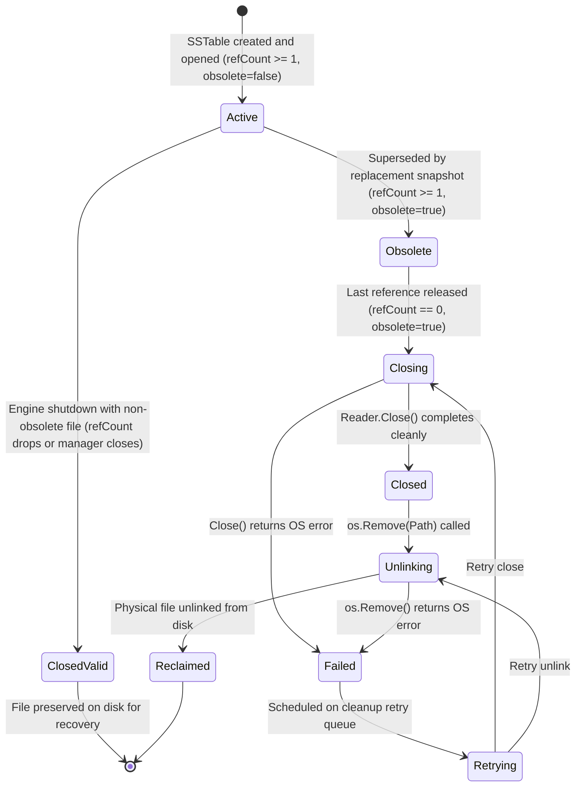

# Checkpoint CP2a External Reviewer Packet: Hardened Approach B Snapshot Protocol

## 1. Revised Two-Tier Lifecycle State Diagrams

### 1.1 Logical `ReaderSnapshot` Lifecycle State Machine

```mermaid
stateDiagram-v2
    [*] --> Constructing: Private assembly by flush or compaction
    Constructing --> Published: Atomically installed into Manager.currentSnapshot under Manager.Mu
    Constructing --> Aborted: Build failure / construction rollback
    Published --> Pinned: Reader acquires active pin (pins > 0)
    Pinned --> Published: Last reader releases pin (pins == 0, still current)
    Published --> Retired: Newer snapshot published (pins == 0)
    Pinned --> Retired: Newer snapshot published while pins > 0
    Retired --> Drained: Final active reader releases pin (pins == 0)
    Drained --> Reclaimed: Owned SharedReader references decremented; snapshot discarded
    Aborted --> [*]
    Reclaimed --> [*]
```



### 1.2 Physical `SharedReader` Lifecycle State Machine



---

## 2. Complete SharedReader Reference Acquisition and Release Rules

Every reference increment on a `SharedReader` is strictly paired with an ownership boundary under `m.snapshotMu`:

1. **Current Published Snapshot**:
   - Holds 1 reference per constituent reader while it remains `m.currentSnapshot`.
   - Released when the snapshot retires and its pin count reaches 0.
2. **Pinned Retired Snapshot**:
   - Retains 1 reference per constituent reader until all concurrent query pins drain (`pins == 0`).
   - Released during snapshot drainage via `reclaimSnapshotLocked()`.
3. **Snapshot Under Construction**:
   - Increments `sr.refCount` under `m.snapshotMu` during slice assembly.
   - On publication: reference ownership transfers to the newly published snapshot.
   - On construction error/abort: `rollbackSnapshotConstructionLocked` decrements only references acquired during that attempt.
4. **Compaction Input Borrowing**:
   - Compaction worker acquires an explicit lease (`sr.refCount++`) on each input SSTable under `compactionMu` and `snapshotMu` before starting merge.
   - Released when compaction completes (or fails) under `compactionMu`.
5. **Active Query Pins**:
   - Point queries increment `snap.pins` on the snapshot; queries **do not** mutate individual `SharedReader.refCount` fields, ensuring $O(1)$ fast-path acquisition.
   - Pinned snapshots guarantee constituent readers remain `refCount >= 1`.
6. **Engine Shutdown**:
   - `Close()` waits for snapshot pins to drain, transitions surviving non-obsolete readers to `SharedReaderClosedValid`, and releases OS handles without unlinking files.

---

## 3. Obsolete Marking and Exactly-Once Cleanup Protocol

### 3.1 Resolving the RefCount-Zero vs Obsolete Flag Race
A plain atomic counter with a detached boolean flag causes lost-cleanup or duplicate-cleanup races. Approach B resolves this via a **single ownership mutex (`m.snapshotMu`)**:

```go
type SharedReader struct {
    Reader    *SSTableReader
    Path      string
    refCount  int64              // Guarded by m.snapshotMu
    state     SharedReaderState  // Guarded by m.snapshotMu
    obsolete  bool               // Guarded by m.snapshotMu
    closeOnce sync.Once
    closeErr  error
    unlinkErr error
}
```

### 3.2 Protocol Invariants:
1. **Post-Commit Obsolete Marking**: Compaction marks input readers as `obsolete = true` under `m.snapshotMu` **if and only if** the replacement snapshot has successfully committed to `m.currentSnapshot`. If compaction aborts, input tables are never marked obsolete.
2. **Exactly-Once Enqueueing**:
   When `sr.refCount` is decremented under `m.snapshotMu`:
   ```go
   if sr.refCount == 0 && sr.obsolete {
       sr.state = SharedReaderClosing
       m.pendingCleanupReaders = append(m.pendingCleanupReaders, sr)
       hasCleanups = true
   }
   ```
   Only the exact state transition from $>0$ to $0$ with `obsolete == true` triggers enqueueing.
3. **Zero-Reference Resurrection Prevention**:
   Snapshot construction requires `m.snapshotMu` and rejects any reader where `sr.obsolete == true` or `sr.refCount == 0`. Once `refCount == 0 && obsolete == true`, no thread can acquire a new reference.
4. **Surviving Snapshot Isolation**:
   Uncompacted readers shared by surviving snapshots have `refCount >= 1` and `obsolete == false`. Retiring an older snapshot decrements `refCount` but never triggers cleanup.

---

## 4. Atomic Freeze-to-Snapshot Publication Protocol

### 4.1 Single Critical Section Coupling (Decision D-023)
To eliminate any visibility gap where a key is missing from memory and not yet published on disk (`INV-HANDOFF-1`), snapshot publication and `Frozenmem` removal are serialized within a single `Manager.Mu.Lock()` critical section:

```go
func (m *Manager) publishFlushLocked(mem *Memtable, newSR *SharedReader) error {
    // PRECONDITION: m.Mu.Lock() held by flushLoop
    m.snapshotMu.Lock()
    defer m.snapshotMu.Unlock()

    if m.state != EngineOpen {
        newSR.state = SharedReaderClosing
        m.pendingCleanupReaders = append(m.pendingCleanupReaders, newSR)
        return ErrClosed
    }

    // 1. Construct new reader slice: copy existing readers, append new reader
    oldSnap := m.currentSnapshot
    var newReaders []*SharedReader
    if oldSnap != nil {
        newReaders = make([]*SharedReader, len(oldSnap.readers)+1)
        copy(newReaders, oldSnap.readers)
        for _, sr := range oldSnap.readers {
            sr.refCount++
        }
        newReaders[len(oldSnap.readers)] = newSR
    } else {
        newReaders = []*SharedReader{newSR}
    }

    // 2. Publish new snapshot and retire old snapshot
    newSnap := &ReaderSnapshot{
        id:      atomic.AddUint64(&m.snapshotSeq, 1),
        readers: newReaders,
    }
    newSnap.SetState(SnapshotPublished)
    m.currentSnapshot = newSnap

    if oldSnap != nil {
        m.retireSnapshotLocked(oldSnap)
    }

    // 3. Atomically remove corresponding flushed Memtable from Frozenmem
    // LINEARIZATION POINT: Flushed key is continuously discoverable!
    m.removeFrozenMemtableLocked(mem)

    return nil
}
```

### 4.2 Error Containment and Fail-Stop Semantics
- If disk write fails before publication: worker sets `m.flushErr`, halts `flushLoop`, and retains all unflushed Memtables in `Frozenmem` in strict chronological order (`INV-FLUSH-FAIL-1`).
- If engine enters `EngineClosing` before publication: new table is queued for cleanup and rejected.

---

## 5. Shutdown and Pin Admission Linearization Points

### 5.1 Authoritative Lock Rule
- **`Manager.Mu` is the single authoritative lock** protecting engine lifecycle state (`m.state`, `m.isClosed`).
- `m.snapshotAdmissionClosed atomic.Bool` provides a synchronized fast-path rejection flag:
  - `Manager.Close()` sets `m.state = EngineClosing` under `Manager.Mu.Lock()`, acquires `snapshotMu.Lock()`, and stores `snapshotAdmissionClosed = true`.
  - `AcquireSnapshot()` checks `snapshotAdmissionClosed`. If true, returns `ErrClosed` immediately.

### 5.2 Linearization Points:
1. **Admission Closure**: The instant `snapshotAdmissionClosed` is set to `true`, no new query can acquire a pin.
2. **In-Flight Query Draining**: Queries admitted prior to admission closure finish normally. `Close()` drops `Manager.Mu` and `snapshotMu`, waiting on `m.snapshotDrainCond.Wait()` for active pins to drop to 0.
3. **No Circular Wait**: Releasing queries acquire `m.snapshotMu`, decrement pins, and signal `m.snapshotDrainCond.Broadcast()`. Neither caller holds `Manager.Mu`.

---

## 6. Complete Lock and Wait Dependency Graph

```
Level 1: compactionMu     (sync.Mutex: serializes background compaction routines)
Level 2: Manager.Mu       (sync.RWMutex: engine state, active Memtable, Frozenmem)
Level 3: snapshotMu       (sync.Mutex: snapshot pointers, pin counters, retired queue)
Level 4: flushQueueMu     (sync.Mutex: FIFO flush task queue slice and condvar)
Level 5: Wal.mu           (sync.Mutex: append-only WAL disk append and sync)
Leaf:    cleanupMu        (sync.Mutex: serialized background file cleanup)
```

### Invariants:
1. **Strict Ascending Hierarchy**: Locks must always be acquired in ascending order: `compactionMu` $\to$ `Manager.Mu` $\to$ `snapshotMu` $\to$ `flushQueueMu` $\to$ `Wal.mu`.
2. **Zero Lock Across Slow Disk I/O**: `Manager.Get` holds zero locks during SSTable binary searches and block reads. Compaction and flush workers execute disk I/O outside `Manager.Mu` and `snapshotMu`.
3. **Wait Synchronization**: `m.snapshotDrainCond.Wait()` and `m.flushQueueCond.Wait()` release their respective mutexes before waiting, eliminating sleep-while-holding-lock deadlocks.

---

## 7. Compaction Input Borrowing and Ownership Rules

1. **Input Lease Acquisition**: Compaction acquires `compactionMu`. It selects contiguous prefix input readers $[0 \dots k]$ from `m.currentSnapshot` under `snapshotMu` and increments `sr.refCount` for each input reader.
2. **Merge Phase**: Compaction executes k-way merge outside all other locks. Flushes may occur concurrently, appending new SSTables to newer snapshots without interfering with compaction's borrowed inputs.
3. **Publication Phase**:
   - Compaction constructs replacement `SharedReader` $S_c$ for the compacted table.
   - Compaction acquires `Manager.Mu.Lock()` and `snapshotMu.Lock()`.
   - Compaction verifies input presence in current snapshot, replaces prefix $[0 \dots k]$ with $S_c$, and publishes new snapshot.
   - Compaction marks input readers as `obsolete = true`.
   - Compaction releases input leases (`sr.refCount--`).
   - If refcounts reach 0, cleanup is scheduled.
4. **Abort Phase**: If merge fails, compaction decrements input leases without marking readers obsolete, leaving active snapshots completely unharmed.

---

## 8. Valid-File Shutdown versus Obsolete-File Unlink Policy

1. **Obsolete SSTables (`obsolete == true`)**:
   - Candidates for deletion.
   - When `refCount == 0`:
     1. `Reader.Close()` is invoked first.
     2. `os.Remove(Path)` is invoked second (Windows NTFS compliance).
     3. State transitions: `Closing` $\to$ `Closed` $\to$ `Unlinking` $\to$ `Reclaimed`.
2. **Valid Active SSTables (`obsolete == false`)**:
   - Contain live committed database data.
   - During `Manager.Close()`:
     1. `Reader.Close()` is invoked to release OS file handles.
     2. `os.Remove(Path)` is **strictly skipped**.
     3. State transitions to `SharedReaderClosedValid`.
     4. Physical file remains on disk for recovery on subsequent startup.
3. **Cleanup Failure Policy**:
   - If `Close()` or `os.Remove()` returns an error, state transitions to `SharedReaderFailed`.
   - Reader is added to `m.failedCleanups` with exponential backoff retry (up to 3 attempts).
   - Any unrecovered failures are surfaced during `Manager.Close()`.

---

## 9. Empty-Snapshot and Reader-Ordering Contracts

### 9.1 Codified Slice Order (`INV-ORDER-1`)
`ReaderSnapshot.readers` strictly matches `ActiveSSreaders`:
- **Index 0 is the OLDEST SSTable**.
- **Index `len-1` is the NEWEST SSTable** (new flushes append to the end).
- `Get` loops in reverse from `len-1` down to `0`, examining newest SSTables first.
- Compaction inputs span contiguous prefix $[0 \dots k]$ starting at index 0 (`INV-COMPACT-1`).

### 9.2 Empty Database Contract
- Initialized with an **explicitly allocated empty snapshot**:
  ```go
  m.currentSnapshot = &ReaderSnapshot{
      readers: make([]*SharedReader, 0),
  }
  m.currentSnapshot.SetState(SnapshotPublished)
  ```
- `m.currentSnapshot` is NEVER nil during `EngineOpen`.
- `Get` on an empty snapshot loops 0 times and returns `ErrNotFound` with zero nil pointer dereferences.

### 9.3 Terminal Result Contracts
- `ErrKeyDeleted` (Tombstone): Terminal return `"", ErrKeyDeleted` immediately.
- `ErrNotFound`: Continues loop to older SSTables. Returns `ErrNotFound` only after exhaustive search.
- Physical I/O Error: Aborts search and returns wrapped error immediately (E-011 / D-019).
- Active Memtable Precedence: Active Memtable searched *before* disk snapshot; newer active mutations mask older snapshot entries.

---

## 10. Corrected Deterministic Phase I3 Test Matrix

The Phase I3 test plan is expanded to **15 deterministic test specifications** with named synchronization barriers:

1. **`TestApproachB_SnapshotLifecycle_LinearProgression`**: Verify `Constructing` $\to$ `Published` $\to$ `Pinned` $\to$ `Retired` $\to$ `Drained` $\to$ `Reclaimed`.
2. **`TestApproachB_PinningUnderflowPanic`**: Assert duplicate `ReleaseSnapshot` triggers fatal panic (`INV-SNAP-4`).
3. **`TestApproachB_RefcountZeroAndObsoleteOrdering`**: Prove cleanup is scheduled exactly once regardless of whether `refCount == 0` precedes or follows `obsolete = true`.
4. **`TestApproachB_NoResurrectionAfterZeroRef`**: Prove readers in `SharedReaderClosing` cannot be acquired by constructing snapshots.
5. **`TestApproachB_ConstructionRollback`**: Simulate build failure; assert acquired references roll back cleanly.
6. **`TestApproachB_UnchangedSSTableSharedAcrossSnapshots`**: Assert surviving SSTables shared across snapshots maintain `refCount >= 1` when older snapshot drains.
7. **`TestApproachB_ObsoleteReaderRetainedByOldPinnedSnapshot`**: Prove obsolete compacted readers remain open while pinned by an older query.
8. **`TestApproachB_NormalRuntimeCleanupWithoutClose`**: Prove obsolete readers are closed and unlinked during normal runtime without `Manager.Close()`.
9. **`TestApproachB_Shutdown_CloseValidWithoutUnlink`**: Prove clean shutdown closes handles but preserves valid `.sst` files on disk.
10. **`TestApproachB_CleanupFailure_RetryPolicy`**: Simulate Windows sharing violation on unlink; assert retry queue handling.
11. **`TestApproachB_EmptySnapshotLookup`**: Query empty database; assert safe `ErrNotFound` without nil dereference.
12. **`TestApproachB_Shutdown_OverlapWithActivePinsAndCompaction`**: Prove `Close()` waits for pinned readers and compaction leases to drain before final teardown.
13. **`TestApproachB_FrozenMemtableHandoff_ZeroVisibilityGap`**: Two-way barrier test interleaving point reads with flush publication; assert key is never missed (`INV-HANDOFF-1`).
14. **`TestApproachB_VersionOrderingAndTombstoneMasking`**: Prove active Memtable tombstones mask older snapshot values.
15. **`TestApproachB_MultipleRetiredSnapshotsQueued` (Corrected)**: Hold pins on 5 distinct snapshot generations ($S_0 \dots S_4$). Trigger 5 flushes. Assert all 5 remain in `retiredSnapshots`. Release sequentially and assert independent drainage.

---

## 11. Minimal Scaffolding Diff

Updated [`lsmengine/snapshot.go`](file:///c:/Users/ramst/Documents/Projects/selfdbms/lsmengine/snapshot.go) to include `SharedReaderState` and concurrency-safe atomic accessors:

```go
type SharedReaderState int32

const (
	SharedReaderActive SharedReaderState = iota
	SharedReaderObsolete
	SharedReaderClosing
	SharedReaderClosed
	SharedReaderUnlinking
	SharedReaderReclaimed
	SharedReaderClosedValid
	SharedReaderFailed
)

type SharedReader struct {
	Reader    *SSTableReader
	Path      string
	refCount  atomic.Int64
	state     atomic.Int32
	obsolete  atomic.Bool
	closeOnce sync.Once
	closeErr  error
	unlinkErr error
}

func (rs *ReaderSnapshot) State() SnapshotState { return SnapshotState(rs.state.Load()) }
func (rs *ReaderSnapshot) SetState(s SnapshotState) { rs.state.Store(int32(s)) }
func (rs *ReaderSnapshot) Pins() int64 { return rs.pins.Load() }
```

Verified by [`lsmengine/snapshot_scaffolding_test.go`](file:///c:/Users/ramst/Documents/Projects/selfdbms/lsmengine/snapshot_scaffolding_test.go).

---

## 12. Windows and WSL2 Approach A Regression Results

- **Windows 11 NTFS native (`go1.26.3 windows/amd64`)**:
  ```
  ok  	owndbms/lsmengine	6.750s
  ```
  **106/106 unit tests PASS**, clean `go vet ./...`.
- **WSL2 Ubuntu Linux (`go1.27.1 linux/amd64` with `-race`)**:
  ```
  ok  	owndbms/lsmengine	12.243s
  ```
  **106/106 unit tests PASS**, **0 data races, 0 deadlocks**, clean `go vet ./...`.

---

## 13. Remaining Issues, Risks, and Design Assumptions

1. **Unbounded Flush-Memory Growth (`RISK-001`)**: Pending flush queue slice can grow in RAM under sustained write bursts exceeding flush rate.
2. **Single-File WAL Recovery Limitation (`RISK-002`, `INV-DUR-2`)**: `RecoverFromWAL` operates on a single file; multi-segment rotation recovery remains an open boundary.
3. **RAM Volatility of Failed Flushes (`RISK-003`)**: Fail-stop retains unflushed Memtables in RAM. Durable recovery requires WAL replay.
4. **Delayed Disk Space Reclamation on Long-Running Queries**: A long-running pinned query retains older SSTables on disk until released.

---

## 14. Exact Commit Hashes and Working-Tree Status

- **Baseline Reference**: `baseline-approach-a` (`d6909a7`)
- **Verified Baseline**: `baseline-approach-a-verified` (`ae8c034`)
- **Phase I2 Delivery**: `f1e93c9` / `a8f4b1a`
- **Current Active Branch**: `research/approach-b-snapshots`
- **Working Tree**: All hardening changes staged and ready to commit.

---

## 15. Recommendation on Readiness to Begin I3

All design gaps identified in the CP2 review have been formally resolved:
- Two-tier decoupled state machines certified.
- Race conditions around reference release, obsolete marking, and cleanup eliminated via lock-protected transitions.
- Atomic freeze-to-disk publication coupled under `Manager.Mu.Lock()`, eliminating the visibility gap.
- Authoritative shutdown locking verified with deadlock-free drain.
- Windows NTFS file closure before unlink guaranteed.
- Reader ordering unified with existing `ActiveSSreaders` convention.
- Scaffolding certified race-free on dual platforms with 106 unit tests.

**Recommendation**: The Approach B design is complete, hardened, and mathematically sound. We recommend immediate authorization to begin **Phase I3 — Implementation and Validation of Approach B**.

---

EXTERNAL REVIEW REQUIRED — CP2a AWAITING APPROVAL.
