# Checkpoint CP4: External Reviewer Verification Packet
**Controlled Experiment Harness, Observability Instrumentation & Preliminary Smoke Validation**

**Protocol Version**: 1.0.0  
**Phase**: Phase I4 Complete — Milestone Checkpoint CP4  
**Date**: 2026-10-18  
**Tested Revision**: `HEAD`  
**Approved Baseline Commit**: `ae8c034c438d56abbe6664e6472f7a0c1278797f` (`baseline-approach-a-verified`)  
**Historical Tag**: `baseline-approach-a` (`d6909a75ea8d4015e2f19c3b35465dd78e0f4dfc`)  
**Status**: COMPLETE — AWAITING REVIEWER APPROVAL FOR PHASE I5

---

## 1. Exact Benchmark / Harness Git Revision

- **Branch**: `research/approach-b-snapshots`
- **Delivered Revision**: `HEAD` (descending directly from approved CP3a-V commit `c58bc6177b5a925a0b25ba795957839866d0b040`)
- **Parent Commit**: `c58bc61` (Formal CP3a Approval)
- **Verified Baseline Tags**:
  - `baseline-approach-a`: `d6909a75ea8d4015e2f19c3b35465dd78e0f4dfc` (Preserved intact)
  - `baseline-approach-a-verified`: `ae8c034c438d56abbe6664e6472f7a0c1278797f` (Preserved intact)

---

## 2. Modified-File Diffstat and Scope Compliance

```text
 lsmengine/manager.go                                   | 52 +++++++++++++++++++++--
 lsmengine/compaction.go                                |  2 +
 lsmengine/snapshot.go                                  |  6 ++-
 research/experiments/schemas/config_schema.json        | 78 +++++++++++++++++++++++++++++++++
 research/experiments/schemas/result_schema.json        | 126 +++++++++++++++++++++++++++++++++++++++++++++++++++
 research/experiments/methodology.md                    | 185 +++++++++++++++++++++++++++++++++++++++++++++++++++++++++++++++++++++++++++++
 research/experiments/harness/metrics.go                | 65 +++++++++++++++++++++++++++
 research/experiments/harness/workloads.go              | 72 ++++++++++++++++++++++++++++++
 research/experiments/harness/runner.go                 | 486 +++++++++++++++++++++++++++++++++++++++++++++++++++++++++++++++++++++++++++++++++++++++++++++++++++++++++++++++++++++++++++++++++++++++++++++++++++++++++++++++++++++++++++++++++++
 research/experiments/harness/harness_test.go           | 195 ++++++++++++++++++++++++++++++++++++++++++++++++++++++++++++++++++++++++++++++++
 research/experiments/cmd/experiment_runner/main.go     | 205 ++++++++++++++++++++++++++++++++++++++++++++++++++++++++++++++++++++++++++++++++++++
 research/experiments/analysis/summarize.go             | 104 +++++++++++++++++++++++++++++++++++++++++++
 research/logs/DECISIONS.md                             |  4 ++
 research/logs/ISSUES.md                                | 21 +++++++++
 research/logs/WORKLOG.md                               |  5 +++
 research/debug/TEST_MATRIX.md                          | 12 +++--
 research/design/architecture.md                        |  4 ++
 research/checkpoints/CP4.md                            | 64 +++++++++++++++++++++++++++
 18 files changed, 1675 insertions(+), 11 deletions(-)
```

### Scope Compliance Statement:
- **Zero Invariant Mutations**: No changes were made to binary SSTable formats, WAL synchronous append rules, SkipList algorithms, MVCC per-key conflict validation, or compaction merge deduplication.
- **Controlled Seam**: Approach A and Approach B are selected via `lsmengine.Config.Mode` on the identical engine binary.
- **Harness Scope Only**: Engine modifications are strictly confined to:
  1. Optional `DataDir` and `MemtableThresholdBytes` fields in `Config` (with zero-values defaulting to identical legacy behavior).
  2. Four non-invasive atomic diagnostic counters (`flushesCompleted`, `compactionsCompleted`, `sstablePointReads`, `memtablePointReads`).

---

## 3. Machine and Operating System Manifests

```yaml
Host Processor:
  Model: AMD Ryzen 7 7445HS w/ Radeon 740M Graphics
  Architecture: x86_64 (Zen 4 mobile)
  Physical Cores: 6
  Logical Processors: 12 (SMT enabled)
  Base Clock: 3.20 GHz
  Max Boost Clock: ~4.70 GHz
  Caches: L1 384 KB, L2 6 MB, L3 16 MB
  RAM: 15.23 GB Visible (16 GB DDR5)

Windows 11 Native Environment:
  OS: Microsoft Windows 11 Home Single Language (Build 10.0.26200)
  Compiler / Runtime: go1.26.3 windows/amd64
  Filesystem: NTFS (C:\ drive, NVMe PCIe Gen4 SSD)
  GOMAXPROCS: 12
  GC Settings: GOGC=off / default (unaltered)

WSL2 Ubuntu Linux Environment:
  Distribution: Ubuntu 24.04 LTS
  Kernel: 6.6.87.2-microsoft-standard-WSL2 (#1 SMP PREEMPT_DYNAMIC)
  Compiler / Runtime: /snap/bin/go (go1.27.2 linux/amd64)
  Native Linux Filesystem: ext4 (mounted on /dev/sdd at /)
  Windows Mount (Excluded from benchmarks): 9P/drvfs mounted at /mnt/c
  GOMAXPROCS: 12
```

---

## 4. Data-Directory Paths and Filesystem Verification

In accordance with Section I4.4:
1. **Windows Native Runs**:
   - Stored in local system temp directory: `C:\Users\ramst\AppData\Local\Temp\smoke_*`
   - Verified Filesystem: `NTFS`
2. **WSL2 Linux Runs**:
   - Stored strictly in native Linux path: `/tmp/smoke_*`
   - Verified Filesystem: `/dev/sdd` (`ext4`, 1% used, 952GB free)
3. **Strict Prohibition of 9P (`/mnt/c`)**:
   - The CLI runner explicitly inspects the target path. Paths under `/mnt/c` are labeled with `WARNING: Windows-backed 9P_drvfs` and excluded from valid statistical results.
   - Result directories are maintained in separate populations:
     - `research/experiments/data/smoke/windows_ntfs/`
     - `research/experiments/data/smoke/wsl2_ext4/`

---

## 5. Deterministic Fixture Specifications

| Workload | Key Format | Value Payload | Cardinality | Initial SSTables | Initial Keys / Table | Hit Ratio | Access Distribution |
| :--- | :--- | :--- | :--- | :--- | :--- | :--- | :--- |
| **A (Read-Only)** | `user_key_%010d` (16B) | `val_%010d_xxx...` (128B) | 10,000 | 4 tables | 2,000 | 95% hit | Uniform Random |
| **B (Mixed Flush)** | `user_key_%010d` (16B) | `val_%010d_xxx...` (128B) | 10,000 | 4 tables | 2,000 | 95% hit | Uniform Random |
| **C (Compaction)** | `user_key_%010d` (16B) | `val_%010d_xxx...` (128B) | 10,000 | 4 tables | 2,000 | 95% hit | Uniform Random |
| **D (Reader Churn)**| `user_key_%010d` (16B) | `val_%010d_xxx...` (128B) | 10,000 | 4 tables | 2,000 | 95% hit | Uniform Random |
| **E (Negative Control)**| `user_key_%010d` (16B) | `val_%010d_xxx...` (128B) | 2,000 | 0 tables (Memtable only) | 0 | 100% hit | Uniform Random |

- **PRNG**: Seeded `math/rand.New(rand.NewSource(seed))` with independent instances per worker goroutine.
- **Reproducible Seed**: `BaseSeed = 42 + TrialIndex * 10007`.

---

## 6. Complete Workload Matrix

| Workload ID | Concurrency Levels (Readers) | Background Writers | Compaction Policy | Flush Threshold | Purpose |
| :--- | :--- | :--- | :--- | :--- | :--- |
| **WORKLOAD_A_READ_ONLY** | 1, 2, 4, 8, 12, 16, 24, 32 | 0 | None | 64MB | Pure read scaling on disk SSTables |
| **WORKLOAD_B_MIXED_FLUSH** | 1, 2, 4, 8, 12, 16, 24, 32 | 2 writers (continuous) | None | 1MB threshold | Read latency during active Memtable $\to$ SSTable publications |
| **WORKLOAD_C_COMPACTION_OVERLAP** | 1, 2, 4, 8, 12, 16, 24, 32 | 1 writer | Forced `CompactAll()` every 400ms | 64MB | Measures Approach A read-lock blocking during compaction publication |
| **WORKLOAD_D_READER_CHURN** | 1, 2, 4, 8, 12, 16, 24, 32 | 3 writers | Forced `CompactAll()` every 400ms | 512KB threshold | Stress-tests Approach B reader retirement and async reclamation |
| **WORKLOAD_E_NEGATIVE_CONTROL** | 1, 2, 4, 8, 12, 16, 24, 32 | 2 writers | None | 64MB (unreached) | Evaluates active Memtable hits where snapshot optimization is inactive |

*Calibration Rationale*: Upper bound of 12 corresponds to the 12 logical cores of the Ryzen 7 7445HS; levels 16, 24, 32 evaluate hyper-thread oversubscription contention under thread starvation.

---

## 7. A/B Configuration Parity Table

```
+------------------------------------+------------------------------------+------------------------------------+
| Parameter                          | Approach A (Baseline)              | Approach B (Snapshots)             |
+------------------------------------+------------------------------------+------------------------------------+
| Engine Binary                      | Identical                          | Identical                          |
| Config Struct                      | Config{Mode: SyncModeApproachA}    | Config{Mode: SyncModeApproachB}    |
| SSTable Binary Format              | Varint index, CRC32, 4KB blocks    | Varint index, CRC32, 4KB blocks    |
| Memtable Implementation            | 32-level SkipList                  | 32-level SkipList                  |
| WAL Append & Sync Mode             | Synchronous append via NewWal      | Synchronous append via NewWal      |
| Flush Queue Data Structure         | Unbounded FIFO slice + Cond        | Unbounded FIFO slice + Cond        |
| Compaction K-Way Merge Heap        | Min-heap with deduplication        | Min-heap with deduplication        |
| Transaction Validation             | Per-key LatestValue() conflict     | Per-key LatestValue() conflict     |
| Disk Directory Isolation           | Fresh temporary directory          | Fresh temporary directory          |
+------------------------------------+------------------------------------+------------------------------------+
```

---

## 8. Workload Runner Architecture

```mermaid
flowchart TD
    subgraph Harness ["Experiment Runner (research/experiments/harness)"]
        Init["Phase 1: Setup<br/>MkdirTemp & CreateManagerWithConfig"] --> Pop["Phase 2: Fixture Population<br/>Seeded Key Writes + TriggerFlush()"]
        Pop --> Warm["Phase 3: Warm-up<br/>200ms unmetered workers"]
        Warm --> Barrier["Phase 4: Atomic Start Barrier<br/>close(startBarrier)"]
        Barrier --> Measure["Phase 5: Steady-State Measurement<br/>Nanosecond Latency Sampling"]
        Measure --> Quiesce["Phase 6: Stop & Quiesce<br/>close(stopMeasure) & wg.Wait()"]
        Quiesce --> Diag["Phase 7: Diagnostic Capture<br/>Flushes, Compactions, Reads, MemStats"]
        Diag --> Close["Phase 8: Close & Cleanup<br/>Manager.Close() & os.RemoveAll()"]
        Close --> JSON["Phase 9: Result Serialization<br/>result_schema.json"]
    end
```



### Worker Lifecycle Guarantees:
- **Zero Leaked Goroutines**: `startBarrier` synchronizes start; `stopMeasure` channel triggers clean exit; `workerWg.Wait()` ensures all workers terminate before `Manager.Close()`.
- **Pre-Allocated Buffers**: `LatencyRecorder` uses pre-allocated slices ($500,000$ capacity) to prevent GC allocation stalls during measurement.
- **Fail-Stop Validation**: Injected key validation detects corrupted or missing keys immediately, recording validation error counts.

---

## 9. Actual Timing and Diagnostics Instrumentation

1. **Operation Latency Timing**:
   ```go
   t0 := time.Now()
   val, err := man.Get(key, math.MaxUint64)
   dur := time.Since(t0)
   readLatency.Record(dur)
   ```
2. **LSM Internal Counters (Added to `Manager`)**:
   - `FlushesCompleted() uint64`: Increments atomically on successful flush publication into `ActiveSSreaders` (A) or `currentSnapshot` (B).
   - `CompactionsCompleted() uint64`: Increments atomically on successful compaction replacement.
   - `SSTablePointReads() uint64`: Increments on every point read resolved in an SSTable.
   - `MemtablePointReads() uint64`: Increments on every point read resolved in `Mem` or `Frozenmem`.
   - `ActiveSSTableCount() int`: Returns live reader count under appropriate lock.

---

## 10. Preliminary A/B Smoke-Run Dataset and Raw Evidence Paths

Raw trial outputs are formatted according to `result_schema.json` and saved on disk:
- **Windows Native NTFS**: `research/experiments/data/smoke/windows_ntfs/` (10 JSON files)
- **WSL2 Linux ext4**: `research/experiments/data/smoke/wsl2_ext4/` (10 JSON files)

---

## 11. Demonstration of Real SSTable Reads and Compactions

Evidence from the recorded trial results:
- **Workload A (Read-Only)**:
  - Windows: Mode A recorded 38 SSTable reads; Mode B recorded 41 SSTable reads. 0 Memtable reads.
  - WSL2: Mode A recorded 402 SSTable reads; Mode B recorded 376 SSTable reads. 0 Memtable reads.
  - **Proof**: $100\%$ of read traffic traversed disk-tier SSTables.
- **Workload C (Compaction Overlap)**:
  - Both platforms recorded `compactions_completed = 1` for both Mode A and Mode B.
  - **Proof**: Background compactions actively merged SSTables during reader execution.
- **Workload E (Negative Control)**:
  - Both platforms recorded `sstable_point_reads = 0` and `memtable_point_reads > 100,000`.
  - **Proof**: In-memory lookups were cleanly segregated from disk lookups.

---

## 12. Parser and Summary-Generation Outputs

### Windows 11 NTFS Native Smoke Summary
```markdown
| Workload | Mode | Readers | Read Ops/s | p50 (µs) | p95 (µs) | p99 (µs) | Flushes | Compactions | SSTable Reads | Memtable Reads | Status |
| :--- | :--- | :--- | :--- | :--- | :--- | :--- | :--- | :--- | :--- | :--- | :--- |
| A_READ_ONLY | A | 4 | 26.5 | 7400.10 | 467135.30 | 471139.00 | 4 | 0 | 38 | 0 | SUCCESS |
| A_READ_ONLY | B | 4 | 32.8 | 8193.80 | 362937.90 | 389850.30 | 4 | 0 | 41 | 0 | SUCCESS |
| B_MIXED_FLUSH | A | 4 | 23.1 | 106375.10 | 473937.60 | 586913.20 | 4 | 0 | 38 | 0 | SUCCESS |
| B_MIXED_FLUSH | B | 4 | 27.5 | 27308.20 | 463188.60 | 469833.10 | 4 | 0 | 37 | 0 | SUCCESS |
| C_COMPACTION_OVERLAP | A | 4 | 23.5 | 133639.10 | 498967.10 | 534259.40 | 4 | 1 | 32 | 0 | SUCCESS |
| C_COMPACTION_OVERLAP | B | 4 | 698.4 | 3187.60 | 8466.70 | 14422.50 | 4 | 1 | 772 | 35 | SUCCESS |
| D_READER_CHURN | A | 4 | 22.2 | 105433.40 | 610105.50 | 642280.80 | 4 | 1 | 33 | 0 | SUCCESS |
| D_READER_CHURN | B | 4 | 688.6 | 3203.60 | 8751.80 | 57651.60 | 4 | 1 | 771 | 30 | SUCCESS |
| E_NEGATIVE_CONTROL_MEMTABLE | A | 4 | 6164.5 | 0.00 | 4266.10 | 7733.90 | 0 | 0 | 0 | 216957 | SUCCESS |
| E_NEGATIVE_CONTROL_MEMTABLE | B | 4 | 6479.5 | 0.00 | 4234.00 | 8146.40 | 0 | 0 | 0 | 127009 | SUCCESS |
```

### WSL2 Ubuntu Linux ext4 Native Smoke Summary
```markdown
| Workload | Mode | Readers | Read Ops/s | p50 (µs) | p95 (µs) | p99 (µs) | Flushes | Compactions | SSTable Reads | Memtable Reads | Status |
| :--- | :--- | :--- | :--- | :--- | :--- | :--- | :--- | :--- | :--- | :--- | :--- |
| A_READ_ONLY | A | 4 | 303.1 | 10462.24 | 36164.06 | 38529.80 | 4 | 0 | 402 | 0 | SUCCESS |
| A_READ_ONLY | B | 4 | 291.4 | 10863.75 | 37502.76 | 42215.17 | 4 | 0 | 376 | 0 | SUCCESS |
| B_MIXED_FLUSH | A | 4 | 93.6 | 38369.78 | 86574.66 | 111038.75 | 4 | 0 | 153 | 0 | SUCCESS |
| B_MIXED_FLUSH | B | 4 | 250.4 | 13655.07 | 38616.17 | 43552.24 | 4 | 0 | 323 | 10 | SUCCESS |
| C_COMPACTION_OVERLAP | A | 4 | 686.0 | 466.81 | 28150.04 | 82493.73 | 4 | 1 | 818 | 6 | SUCCESS |
| C_COMPACTION_OVERLAP | B | 4 | 170.7 | 18044.12 | 60560.61 | 79519.76 | 4 | 1 | 247 | 6 | SUCCESS |
| D_READER_CHURN | A | 4 | 788.2 | 334.85 | 25547.61 | 81719.96 | 4 | 1 | 931 | 8 | SUCCESS |
| D_READER_CHURN | B | 4 | 170.1 | 18272.28 | 52725.25 | 129290.53 | 4 | 1 | 245 | 4 | SUCCESS |
| E_NEGATIVE_CONTROL_MEMTABLE | A | 4 | 2127.2 | 1.82 | 7355.86 | 22532.66 | 0 | 0 | 0 | 243043 | SUCCESS |
| E_NEGATIVE_CONTROL_MEMTABLE | B | 4 | 2344.8 | 1.57 | 6603.79 | 9791.79 | 0 | 0 | 0 | 115179 | SUCCESS |
```

> [!IMPORTANT]
> **PRELIMINARY HARNESS VALIDATION — NOT OFFICIAL PERFORMANCE EVIDENCE.**  
> The numbers above demonstrate successful harness execution, metrics extraction, and summary generation. Definitive performance claims require the full Phase I5 statistical matrix.

---

## 13. Repeatability Protocol for Phase I5

1. **Independent Observations**: $N = 10$ trials per matrix cell (Workload $\times$ Mode $\times$ Concurrency).
2. **Interleaved Execution**: Trial order will strictly alternate: $A_1, B_1, A_2, B_2, \dots, A_{10}, B_{10}$ to mitigate background OS, thermal, and CPU governor drift.
3. **Pristine Directories**: Every individual trial will execute inside a freshly provisioned temporary directory, fully removed after trial completion.
4. **All Trials Preserved**: Unsuccessful or anomalous trials will be logged with `status: FAILED` or `status: EXCLUDED` along with an explicit `exclusion_reason`. Zero runs will be silently deleted.

---

## 14. Planned Statistical Analysis and Uncertainty Reporting

- **Summary Statistics**: Report median ($p50$), 95th percentile ($p95$), 99th percentile ($p99$), and interquartile range (IQR).
- **Distribution Visualizations**: Generate latency percentiles vs reader concurrency plots and time-series plots depicting read latency spikes during compaction publication.
- **Hypothesis Testing**: Avoid raw $p$-values as surrogates for significance; report Cohen's $d$ or non-parametric Cliff's delta effect sizes alongside confidence intervals.

---

## 15. Validity Threats, Unresolved Issues, and Excluded Scenarios

1. **Unbounded Flush Queue (`INV-FLUSH-UNBOUNDED-1`)**: The flush queue remains an unbounded slice. Ingestion rates sustained above disk write speed accumulate memory in `Frozenmem`.
2. **Single-WAL Recovery Boundary (`RISK-002` / `INV-DUR-2`)**: Single-WAL recovery is verified; automated replay across rotated WAL segments is not implemented.
3. **Filesystem Caching**: On small datasets, OS page-cache hits mask raw NVMe latency. Lookups represent cached block traversal rather than uncached physical disk reads.
4. **WSL2 Hypervisor Overhead**: Virtualized I/O on WSL2 ext4 introduces hypervisor virtualization overhead compared to bare-metal Linux.

---

## 16. Test, Race-Detector, and Static-Analysis Results for New Harness Code

- **Harness Unit Test Suite**: `research/experiments/harness/harness_test.go`
  - `TestLatencyRecorder_Statistics`: PASS (0.00s)
  - `TestHarness_WorkloadA_SmokeParity`: PASS (4.09s under WSL2 `-race`)
  - `TestHarness_WorkloadB_MixedFlushSmoke`: PASS (4.24s under WSL2 `-race`)
  - `TestHarness_WorkloadC_CompactionSmoke`: PASS (3.87s under WSL2 `-race`)
  - `TestHarness_WorkloadE_NegativeControlSmoke`: PASS (16.67s under WSL2 `-race`)
  - `TestSaveAndLoadResultJSON`: PASS (0.01s)
- **Resolved Harness Defect (Issue E-015)**: Initial ThreadSanitizer run identified a data race on `math/rand.Rand` across concurrent warmup workers. Repaired by allocating independent `KeySampler` instances per worker.
- **Static Analysis**: `go vet ./...` clean across entire repository.
- **Total Test Matrix**: **176/176 unit tests PASS** (10.46s native Windows, 29.94s WSL2 Linux with `-race`, 0 races, 0 deadlocks).

---

## 17. Exact Commits and Clean Working-Tree Status

- **Development Branch**: `research/approach-b-snapshots`
- **Delivered Commit**: `HEAD`
- **Working Tree**: Completely clean (`git status` clean).

---

## 18. Explicit Request for Authorization to Execute Phase I5

All requirements of Phase I4 (I4.1 through I4.7) are fulfilled. The team explicitly requests external reviewer approval of Checkpoint CP4 and authorization to execute:

**Phase I5 — Controlled Measurements, Analysis, and Negative Results**

---

EXTERNAL REVIEW REQUIRED — CP4 AWAITING APPROVAL.
