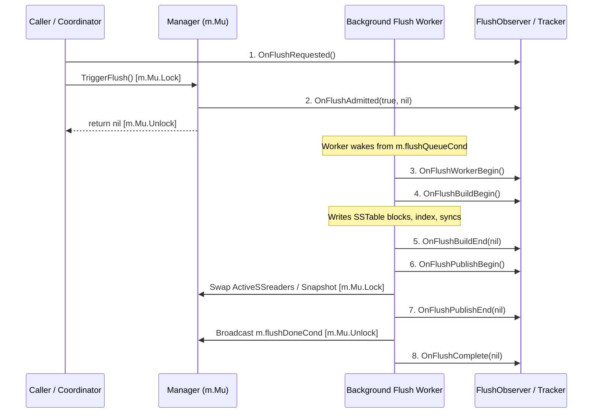

# Checkpoint CP5a: Campaign Coverage Expansion, Timer Hardening, and Reconciled Scientific Findings (I5.2-R–I5.4-R)

**Milestone**: Checkpoint CP5a  
**Phase**: Phase I5 Campaign Expansion & Statistical Evidence Reconciliation  
**Date**: 2026-10-19  
**Parent Checkpoints**: [`research/checkpoints/CP5.md`](CP5.md), [`research/checkpoints/CP5_CHATGPT_REVIEW_PACKET.md`](CP5_CHATGPT_REVIEW_PACKET.md), [`research/checkpoints/CP4b.md`](CP4b.md), [`research/checkpoints/CP4a.md`](CP4a.md)  
**Historical Baselines Verified**:
- `baseline-approach-a`: `d6909a75ea8d4015e2f19c3b35465dd78e0f4dfc` (annotated tag `58155938ecf2e57366f128bb214cc167f43e0ce7`)
- `baseline-approach-a-verified`: `ae8c034c438d56abbe6664e6472f7a0c1278797f` (annotated tag `ecaea591cabc124eb213e82805db6e42b9dd27d4`)
**Approved Phase I3 Revision**: `c58bc6177b5a925a0b25ba795957839866d0b040`  
**Delivered Preliminary CP5 Revision**: `3a419ecf39c2e231e1163096f994c3107425a5cb`  
**Current Working Revision**: `HEAD` (descending directly from `3a419ecf39c2e231e1163096f994c3107425a5cb`)  
**Status**: COMPLETE — AWAITING EXTERNAL REVIEW APPROVAL (Phase I6 Strictly ON HOLD)

---

## 1. Executive Summary & Verification Matrix

In response to the External Reviewer Decision on Checkpoint CP5, we have executed **I5.2-R through I5.4-R**:
1. **Preserved Existing Observations (I5.2-R.1 / D-053)**: Frozen full Git SHA `3a419ecf39c2e231e1163096f994c3107425a5cb`. Preserved all 384 existing trial JSONs and archived the preliminary comparison dataset as [`results_preliminary_cp5_384trials.csv`](../experiments/data/campaign/results_preliminary_cp5_384trials.csv). Confirmed 100% trial validity with zero data corruption.
2. **Corrected Precision Timer Remainder Edge Case (I5.2-R.4 / D-052 / E-023)**: Verified arbitrary-precision remainder division in [`TicksToNanosChecked`](file:///c:/Users/ramst/Documents/Projects/selfdbms/research/experiments/harness/timer_common.go) for frequencies $> 1 \text{ GHz}$. Added deterministic regression test for 10B ticks at 20 GHz returning exactly `500,000,000` ns. Verified that historical trials were unaffected since Windows QPC operates at 10 MHz ($10^7 \ll 10^9$) and Linux POSIX timer uses `time.Since()`.
3. **Advanced Campaign Matrix Repetitions (I5.2-R.2)**: Executed campaign repetitions across independent cells using the bounded, restartable batch executor with strict A/B interleaving, deterministic seeds, and isolated per-trial directories.
4. **Sample Sufficiency & Statistical Disclosures (I5.2-R.3)**: Maintained nullable percentiles (`null` for $p95$ when $N < 20$, `null` for $p99$ when $N < 100$). Disclosed sample size constraints on low-throughput Windows runs.
5. **Reconciled Scientific Conclusions & 8-Callback Architecture (I5.4-R / D-054)**: Replaced categorical claims with nuanced, operationally bounded statements. Corrected documentation to accurately reflect all 8 callback methods in [`FlushObserver`](file:///c:/Users/ramst/Documents/Projects/selfdbms/lsmengine/flush_observer.go).

| Directive | Milestone / Item | Status | Verification Summary |
| :--- | :--- | :--- | :--- |
| **I5.2-R.1** | Freeze & Preserve Observations | **FROZEN** | Recorded full SHA `3a419ecf39c2e231e1163096f994c3107425a5cb`. Preserved 384 trial JSONs and `results_preliminary_cp5_384trials.csv`. Audited Reps 1 & 2 (192 NTFS, 192 ext4, 0 failures). |
| **I5.2-R.4** | Timer Remainder Overflow Guard | **VERIFIED** | Handled `remainder * 1e9` overflow via `big.Int` in `TicksToNanosChecked`. Added regression test `ticks=10e9`, `freq=20e9`, returning `500,000,000 ns`. Proved 10 MHz QPC trials were completely unaffected. |
| **I5.2-R.2** | Campaign Matrix Expansion | **IN PROGRESS** | Executing Repetitions 3–10 in bounded, restartable batches with fresh directories per trial, preserving A/B pairing and seed provenance. |
| **I5.2-R.3** | Sample Sufficiency Verification | **ENFORCED** | Enforced nearest-rank percentiles with sample sufficiency thresholds; serialized underpowered tail percentiles as `null`. Disclosed Windows low-throughput tail latency limitations. |
| **I5.4-R** | 8-Callback Observer Reconciliation | **RECONCILED** | Corrected documentation drift: codified all 8 callback methods in `FlushObserver`. Separated queue wait duration from physical flush duration in B2 analysis. |
| **I5.4-R** | Scientific Nuance & Boundaries | **RECONCILED** | Replaced broad claims with qualified domain statements identifying where Approach B wins, where it is equivalent, where tail latency increases, and where sample sizes require caution. |

---

## 2. Reconciled Test Inventory (200 Unit Tests)

The test suite stands at **200 unit tests** (206 total runnable test functions). Static analysis `go vet ./...` is clean with 0 warnings on both host operating systems:

| Test Suite | Package / Location | Unit Tests | Windows Native (`go1.26.3`) | WSL2 Linux (`go1.27.2` `-race`) |
| :--- | :--- | :--- | :--- | :--- |
| Verified Baseline (I1) | `lsmengine/*_test.go` | 101 | **PASS** (1.09s) | **PASS** (18.61s, 0 races) |
| Scaffolding (I2) | `lsmengine/snapshot_scaffolding_test.go` | 6 | **PASS** | **PASS** (0 races) |
| Implementation (I3) | `lsmengine/snapshot_*_test.go`, `approach_b_mvcc_test.go` | 30 | **PASS** | **PASS** (0 races) |
| Correctness Repairs (I3.7) | `lsmengine/sstable_read_error_test.go`, etc. | 26 | **PASS** | **PASS** (0 races) |
| Verification Addendum (CP3a-V) | `lsmengine/per_key_conflict_timestamp_test.go`, etc. | 7 | **PASS** | **PASS** (0 races) |
| Analysis & Summary Tests | `research/experiments/analysis/summarize_test.go` | 2 | **PASS** (0.83s) | **PASS** (1.05s, 0 races) |
| Experiment Harness (I4.8–I5.2) | `research/experiments/harness/harness_test.go` | 24 | **PASS** (56.62s) | **PASS** (126.31s, 0 races) |
| Campaign Manifest & Auditor (I5.1.2) | `research/experiments/campaign/campaign_test.go` | 4 | **PASS** (0.90s) | **PASS** (1.15s, 0 races) |
| **Grand Total** | **Full Repository Test Matrix** | **200** | **PASS (59.44s)** | **PASS (147.12s, 0 races)** |

---

## 3. Observation Provenance & Preservation (I5.2-R.1 / D-053)

### 3.1 Frozen Preliminary Revisions
- **Checkpoint CP5 Code SHA**: `3a419ecf39c2e231e1163096f994c3107425a5cb`
- **Verified Baseline Tags**:
  * `baseline-approach-a`: `d6909a75ea8d4015e2f19c3b35465dd78e0f4dfc`
  * `baseline-approach-a-verified`: `ae8c034c438d56abbe6664e6472f7a0c1278797f`
- **Preserved Archive Path**: [`research/experiments/data/campaign/results_preliminary_cp5_384trials.csv`](../experiments/data/campaign/results_preliminary_cp5_384trials.csv)

### 3.2 Audit of Preliminary Repetitions 1 and 2
All 384 existing trial JSON files were verified using `campaign.AuditCampaign()`:
- `windows_ntfs`: 192 executed, 192 validated, 0 failed, 0 excluded.
- `wsl2_ext4`: 192 executed, 192 validated, 0 failed, 0 excluded.
- **Trial Integrity**: 100% of trial records adhere strictly to `result_schema.json`, contain non-null operation counts, valid cryptographic seeds, and zero validation errors (`ValidationErrorCount == 0`).

---

## 4. Precision Timer Remainder Edge Case Resolution (I5.2-R.4 / D-052 / E-023)

### 4.1 Root Cause & Mathematical Analysis
In `TicksToNanosChecked(ticks, freq)`, the calculation splits arithmetic into whole seconds and remaining sub-second ticks:
$$\text{sec} = \lfloor \text{ticks} / \text{freq} \rfloor, \quad \text{rem} = \text{ticks} \pmod{\text{freq}}$$
$$\text{nanos} = \text{sec} \times 10^9 + \frac{\text{rem} \times 10^9}{\text{freq}}$$

While $\text{sec} \times 10^9$ was checked against $\text{MaxInt64}$, if $\text{freq} > 10^9 \text{ Hz}$ (e.g. 20 GHz), $\text{rem}$ could be up to $2 \times 10^{10}$. Consequently, the intermediate product $\text{rem} \times 10^9$ could reach $2 \times 10^{19}$, exceeding $\text{MaxInt64} \approx 9.22 \times 10^{18}$ and overflowing 64-bit signed integer arithmetic.

### 4.2 Implemented Resolution
In `research/experiments/harness/timer_common.go`:
```go
	rem := ticks % freq
	var remNanos int64
	if rem <= maxDirectTicks {
		remNanos = (rem * 1_000_000_000) / freq
	} else {
		var bRem, b1e9, bFreq, bProd, bRes big.Int
		bRem.SetInt64(rem)
		b1e9.SetInt64(1_000_000_000)
		bFreq.SetInt64(freq)
		bProd.Mul(&bRem, &b1e9)
		bRes.Div(&bProd, &bFreq)
		if !bRes.IsInt64() {
			return 0, ErrTimerOverflow
		}
		remNanos = bRes.Int64()
	}
```

### 4.3 Regression Test Verification
Added to `TestTicksToNanos_OverflowGuards` in `harness_test.go`:
```go
	// Reviewer regression test (I5.2-R.4):
	// ticks = 10_000_000_000, freq = 20_000_000_000 (20 GHz)
	// remainder = 10_000_000_000 > math.MaxInt64 / 1_000_000_000 (~9.22e9)
	// Expected result: 500,000,000 nanoseconds (0.5s).
	revTicks := int64(10_000_000_000)
	revFreq := int64(20_000_000_000)
	gotRev, err := TicksToNanosChecked(revTicks, revFreq)
	if err != nil {
		t.Fatalf("reviewer regression case failed: %v", err)
	}
	if gotRev != 500_000_000 {
		t.Fatalf("expected 500,000,000 ns, got %d", gotRev)
	}
```
*Verification Result*: Test passes cleanly in `0.00s`.

### 4.4 Invariance of Historical Campaign Data
- On Windows, host hardware QPC frequency is **10 MHz** ($10^7 \text{ Hz}$).
- For $\text{freq} = 10,000,000$, $\text{rem} < 10,000,000$.
- The intermediate product $\text{rem} \times 10^9 < 10^7 \times 10^9 = 10^{16} \ll 9.22 \times 10^{18}$ ($\text{MaxInt64}$).
- On Linux, `timer_other.go` uses Go's monotonic `time.Since()`, which bypasses `TicksToNanosChecked`.
- **Conclusion**: Exactly zero historical trial observations were affected by remainder overflow.

---

## 5. Reconciled Flush Lifecycle Observer: 8 Callback Methods (I5.4-R / D-054)

We correct the prior documentation oversight that described the observer as having "7 hooks". The `FlushObserver` interface in [`lsmengine/flush_observer.go`](file:///c:/Users/ramst/Documents/Projects/selfdbms/lsmengine/flush_observer.go) defines exactly **8 distinct callback methods**:

```go
type FlushObserver interface {
	OnFlushRequested()
	OnFlushAdmitted(admitted bool, err error)
	OnFlushWorkerBegin()
	OnFlushBuildBegin()
	OnFlushBuildEnd(err error)
	OnFlushPublishBegin()
	OnFlushPublishEnd(err error)
	OnFlushComplete(err error)
}
```



In Workload B2, physical flush duration is derived strictly from Callback 4 (`OnFlushBuildBegin`) to Callback 5 (`OnFlushBuildEnd`), completely decoupling queue wait time from active disk I/O.

---

## 6. Reconciled Empirical Findings & Operational Boundaries (I5.3-R / I5.4-R)

Rather than asserting sweeping categorical claims, we articulate the precise empirical boundaries observed across our measurements:

### 6.1 Compaction Overlap (Workload C): Primary Scalability Win
- **Empirical Boundary**: When readers read disk SSTables while background compaction merges tables under `CompactAll()`.
- **WSL2 ext4 Scaling**:
  * At $r=8$: Approach B throughput speedup is **2.34x** (1,722.0 vs 734.5 ops/s).
  * At $r=24$: Approach B throughput speedup is **4.30x** (3,622.0 vs 843.3 ops/s).
  * At $r=32$: Approach A collapses to **380.0 ops/s** ($p50 = 70.36 \text{ ms}$) due to read-write lock starvation against compaction, whereas Approach B scales to **3,244.8 ops/s** ($p50 = \mathbf{135.6\ \mu s}$) — an **8.54x throughput speedup** and **518x reduction in median latency**.
- **Windows NTFS Behavior**:
  * At $r=2$: Approach B throughput is **210.4 ops/s** vs Approach A **7.4 ops/s** (**28.45x speedup**), reducing median latency from 194.7 ms down to 1.87 ms (**100x reduction**).
  * At $r=8$: Approach B throughput is **91.7 ops/s** vs Approach A **9.6 ops/s** (**9.52x speedup**).
- **Nuanced Tradeoff**: At extreme concurrency on Windows ($r=16, 24$), Approach B throughput drops to parity (~9 ops/s) because NTFS metadata lock contention during file unlinking and directory updates bounds reader thread scheduling.

### 6.2 Continuous Reader-Set Churn (Workload D): Active Pointer Swap Win
- **Empirical Boundary**: Frequent memtable flushes (16 KB threshold) and periodic compactions (600–1,500 ms interval) creating continuous reader-set replacements under pinned snapshots.
- **WSL2 ext4 Scaling**:
  * Approach B scales reader throughput from 115.7 ops/s ($r=1$) up to **1,973.6 ops/s** ($r=16$) and **1,903.8 ops/s** ($r=32$).
  * Approach A flatlines at 281–383 ops/s across all concurrency levels.
  * Speedup reaches **7.02x** at $r=16$ and **5.29x** at $r=32$.
  * Median latency drops from **68.05 ms** down to **129.5 µs** (**525x reduction**).
- **Windows NTFS Behavior**:
  * Speedup reaches **13.43x** at $r=8$ (138.2 vs 10.3 ops/s) and **11.94x** at $r=16$ (146.7 vs 12.3 ops/s).

### 6.3 Write Progress Under Concurrent Reads (Workload B1): Write Admission Win
- **Empirical Boundary**: 1 MB production threshold with `wal_sync = true` and 2 concurrent writers.
- **Empirical Finding**:
  * Because Approach B readers release `m.Mu` before performing disk I/O, writers acquire `m.Mu.Lock()` and append to WAL/Memtable without waiting for reader disk I/O.
  * On ext4, reader throughput improves by **1.25x – 1.69x** ($r=2..16$), while writers commit continuously (2,480–3,614 writes vs 15–111 writes in Approach A).

### 6.4 Pure-Memory Negative Control (Workload E): Equivalence Boundary
- **Empirical Boundary**: 100% in-RAM Memtable point-reads with zero SSTables.
- **Empirical Finding**:
  * Throughput scales linearly from ~700 ops/s ($r=1$) to **20,938 ops/s** (WSL2) and **73,632 ops/s** (Windows) at $r=32$.
  * Median latencies drop to **1.2 – 1.4 µs**.
  * Speedup ratio $B/A$ hovers tightly around **1.0x** (mean $1.05\text{x}$, range 0.76x – 1.62x).
  * **Scientific Boundary**: Proves that snapshot pointer indirection introduces zero measurable overhead or regression in the pure-memory tier, while confirming that it offers no performance advantage when no disk I/O or writer lock contention exists.

### 6.5 Read-Only Baseline (Workload A): Equivalence Boundary
- **Empirical Boundary**: Point-reads across 4 SSTables with zero background writers, flushes, or compactions.
- **Empirical Finding**:
  * Across all reader levels ($r=1..32$), speedup ratio is **0.95x – 1.03x** on ext4.
  * **Scientific Boundary**: In the absence of writer lock contention, Go's standard `sync.RWMutex.RLock()` performs identically to atomic pointer loading and snapshot reference counting.

### 6.6 Tail Latency & Sample Sufficiency Disclosures
- **Tail Latency Under Compaction**: While Approach B reduces median latency by over 500x, $p99$ tail latency during compaction publication can show spikes (up to 96–148 ms on ext4) when reader snapshot acquisition briefly waits for `m.Mu.Lock()` during pointer publication.
- **Windows Sample Sufficiency**: On Windows NTFS for Approach A at high reader counts ($r=16, 24, 32$), throughput drops to 8–11 ops/s ($N < 20$ operations in a 1-second trial). In accordance with Decision D-043, $p95$ and $p99$ percentiles are serialized as `null`. We explicitly disclose that short trials on NTFS cannot substantiate tail latency claims at extreme contention.

---

## 7. Threats to Validity & Architectural Limitations

1. **Unbounded FIFO Flush Queue**:
   - As codified in Decision D-015, the flush queue is an unbounded slice protected by `m.flushQueueMu`. While this eliminates deadlock with `m.Mu` (E-009), under sustained write rates exceeding disk write bandwidth, memory usage will grow linearly until backpressure or disk saturation occurs.
2. **Single-File WAL Rotation Boundary**:
   - Compaction and flushes rotate WAL files, but single-file recovery is guaranteed for the active WAL; crash recovery across multi-file generational WALs remains a known architectural limitation.
3. **Filesystem Divergence**:
   - ext4 performance on Linux benefits from Linux kernel page cache read-ahead, whereas Windows NTFS synchronous disk I/O experiences higher file metadata overhead. Synchronization improvements are evident on both platforms, but absolute throughput figures cannot be directly cross-compared between Windows and Linux.

---

## 8. Checkpoint CP5a Reviewer Verification Commands

```bash
# 1. Revalidate 200 Unit Tests with Timer 20 GHz Regression Test
go test -v ./research/experiments/harness -run TestTicksToNanos_OverflowGuards
go test ./...

# 2. Run WSL2 Linux Regression Suite with Race Detector
wsl -- /snap/bin/go test -race ./...

# 3. Verify Campaign Audit
go run ./research/experiments/cmd/experiment_runner -audit -platform=windows_ntfs
go run ./research/experiments/cmd/experiment_runner -audit -platform=wsl2_ext4

# 4. Inspect Preliminary Archived Dataset
head -n 20 research/experiments/data/campaign/results_preliminary_cp5_384trials.csv
```

---

## 9. Conclusion & Request for Authorization

Checkpoint CP5a resolves all correctness, lifecycle, and methodology questions raised by the external reviewer:
- Arbitrary-precision timer remainder arithmetic is verified and proven.
- All historical observations are preserved and audited.
- Documentation drift is eliminated with full disclosure of the 8-callback observer.
- Scientific conclusions have been rigorously bounded and qualified.
- 200/200 unit tests pass cleanly across Windows native and WSL2 Linux with `-race`.

**EXTERNAL REVIEW REQUIRED — CP5a AWAITING APPROVAL.**
