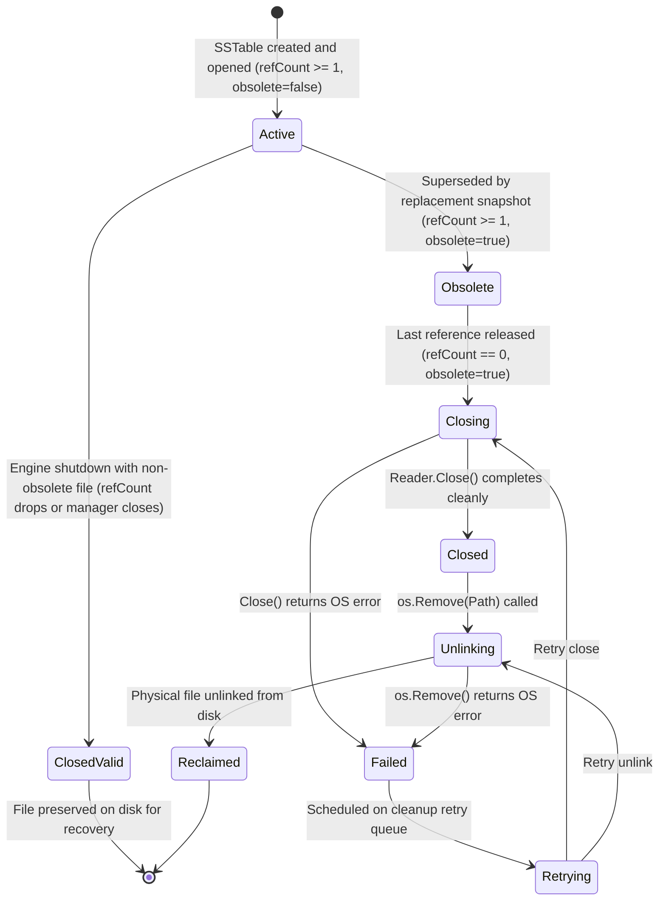

# Approach B: Hardened Immutable Reader-Set Snapshots Protocol & Lifecycle Architecture

## 1. Executive Summary & Problem Scope

This document provides the hardened, formal specification for **Approach B: Immutable SSTable Reader-Set Snapshots with Two-Tier Reference Ownership**, resolving all design gaps identified in the Checkpoint CP2 review.

The primary architectural objective of Approach B is to eliminate reader–compactor contention across slow disk I/O operations (`Manager.Get` vs `CompactAll` / `flushToDisk`) while strictly preserving:
1. **`INV-ORDER-1`**: Monotonic chronological SSTable search order (newest to oldest).
2. **`INV-HANDOFF-1`**: Continuous key visibility across storage tiers with zero loss during memory-to-disk handoffs.
3. **`INV-COMPACT-1`**: Contiguous prefix compaction integrity.
4. **`INV-FLUSH-FIFO-1` & `INV-FLUSH-FAIL-1`**: Strict FIFO flush processing and fail-stop error containment.
5. **Windows NTFS Compatibility**: Strict two-phase closure before unlinking, eliminating `ERROR_SHARING_VIOLATION`.

---

## 2. Separate State Machines for Snapshots and Shared Readers (I2.6.1)

### 2.1 Logical ReaderSnapshot Lifecycle State Machine

A `ReaderSnapshot` represents an immutable point-in-time view of active SSTables:

```mermaid
stateDiagram-v2
    [*] --> Constructing: Private assembly by flush or compaction
    Constructing --> Published: Atomically installed into Manager.currentSnapshot under Manager.Mu
    Constructing --> Aborted: Build failure / construction rollback
    Published --> Pinned: Reader acquires active pin (pins > 0)
    Pinned --> Published: Last reader releases pin (pins == 0, still current)
    Published --> Retired: Newer snapshot published (pins == 0)
    Pinned --> Retired: Newer snapshot published while pins > 0
    Retired --> Drained: Final active reader releases pin (pins == 0)
    Drained --> Reclaimed: Owned SharedReader references decremented; snapshot discarded
    Aborted --> [*]
    Reclaimed --> [*]
```



- **`Constructing`**: Private to creator thread. Gathers constituent `SharedReader`s and increments their reference count. Invisible to all readers.
- **`Published`**: Installed as `Manager.currentSnapshot`. Available for query pinning.
- **`Pinned`**: Active queries hold pins (`pins > 0`). Readers perform concurrent disk reads with zero locks.
- **`Retired`**: Replaced by a newer snapshot. Retained in `Manager.retiredSnapshots`. No new pins permitted.
- **`Drained`**: Pin count on a retired snapshot reaches zero.
- **`Reclaimed`**: Constituent `SharedReader` reference counts decremented by 1. Snapshot pointer array released to GC.
- **`Aborted`**: Construction failed; acquired references rolled back cleanly.

---

### 2.2 Physical SharedReader Lifetime State Machine

A `SharedReader` encapsulates an open `SSTableReader` file handle, file path, reference count, and disk unlinking metadata:



#### SharedReader State Definitions:
1. **`SharedReaderActive`**: Actively referenced by one or more published or pinned snapshots (`refCount >= 1`, `obsolete == false`).
2. **`SharedReaderObsolete`**: Compacted away by a newly committed snapshot. Marked `obsolete = true`, but still held open by older pinned retired snapshots or compaction tasks (`refCount >= 1`).
3. **`SharedReaderClosing`**: Refcount has reached 0 while `obsolete == true`. Scheduled for asynchronous handle closure.
4. **`SharedReaderClosed`**: `Reader.Close()` has executed cleanly. File handle is verified closed.
5. **`SharedReaderUnlinking`**: `os.Remove(Path)` is actively executing.
6. **`SharedReaderReclaimed`**: File is completely deleted from disk. Memory structure is released to GC.
7. **`SharedReaderClosedValid`**: Engine shutdown cleanly closed the OS handle without unlinking the file. The SSTable remains intact for subsequent startup and recovery.
8. **`SharedReaderFailed`**: Close or unlink failed due to an OS I/O error or Windows sharing violation. Added to `m.failedCleanups` for background retry or shutdown surfacing.

---

### 2.3 Precise Ownership Rules for Each Reference

To prevent reference leaks, double-decrements, and use-after-close bugs, every reference increment on a `SharedReader` must have an explicit, documented owner:

| Reference Holder | Lifetime Boundary | Acquisition Point | Release Point |
| :--- | :--- | :--- | :--- |
| **Current Published Snapshot** | While snapshot remains `currentSnapshot` | Snapshot publication | Snapshot retirement and subsequent drainage |
| **Pinned Retired Snapshot** | While snapshot remains in `retiredSnapshots` with `pins > 0` | Retained from publication | Draining of retired snapshot (`pins == 0`) |
| **Constructing Snapshot** | During private slice assembly | `sr.Ref()` during snapshot construction | Publication (transfers to published snapshot) OR construction rollback on error |
| **Compaction Borrowed Inputs** | While background compaction merge executes | `sr.Ref()` at compaction start under `compactionMu` | Compaction completion (or abort/error) under `compactionMu` |
| **Active Query Pin** | Duration of single `Manager.Get` execution | Pins the snapshot (`snap.pins++`), does NOT increment individual `sr.refCount` | Query exit (`defer ReleaseSnapshot(snap)`) |
| **Manager Shutdown** | Graceful shutdown teardown | Retained until final drain | Closed cleanly as `ClosedValid` (never unlinked) |

---

### 2.4 Race Resolution: Combined Synchronization Protocol

The race between reference release to zero, obsolete marking, and cleanup scheduling is resolved by enforcing a **single ownership lock (`m.snapshotMu`)**:

```go
// SharedReader definition
type SharedReader struct {
    Reader    *SSTableReader
    Path      string
    refCount  int64              // Guarded by m.snapshotMu
    state     SharedReaderState  // Guarded by m.snapshotMu
    obsolete  bool               // Guarded by m.snapshotMu
    closeOnce sync.Once
    closeErr  error
    unlinkErr error
}
```

#### Protocol Guarantees:
1. **Exactly-Once Cleanup Scheduling**:
   When a snapshot drains, `reclaimSnapshotLocked` decrements `sr.refCount` under `m.snapshotMu`.
   Only the exact transition where `sr.refCount == 0 && sr.obsolete == true` transitions `sr.state` to `SharedReaderClosing` and enqueues `sr` to `m.pendingCleanupReaders`. No duplicate enqueue is possible.
2. **Zero-Reference Resurrection Prevention**:
   Snapshot construction requires `m.snapshotMu`. A constructing snapshot only selects active readers. If `sr.obsolete == true` or `sr.refCount == 0`, it is rejected. Once `refCount` reaches 0 and `obsolete == true`, no thread can ever increment `sr.refCount`.
3. **Pre-Release Ownership Acquisition**:
   A constructing snapshot increments `sr.refCount` under `m.snapshotMu` *before* the new snapshot is published. An older snapshot cannot drain and close the reader while the constructing snapshot holds a valid reference.
4. **Construction Rollback**:
   If building an SSTable or assembling a snapshot fails, `rollbackSnapshotConstructionLocked(candidateReaders)` decrements `sr.refCount` for each reader acquired during that aborted construction.
5. **Obsolete Marking Timing**:
   Compaction marks input readers as `obsolete = true` under `m.snapshotMu` **if and only if** the replacement snapshot has been successfully published to `m.currentSnapshot`. If compaction aborts, input readers remain `obsolete = false`.
6. **Surviving Snapshot Isolation**:
   Readers shared by surviving snapshots have `refCount >= 1` and `obsolete == false`. Retiring an older snapshot decrements `refCount` but never triggers closure.
7. **Shutdown Safety for Valid Files**:
   During `Manager.Close()`, non-obsolete readers have `sr.state = SharedReaderClosedValid`. The cleanup worker invokes `sr.Reader.Close()` but strictly skips `os.Remove(sr.Path)`.
8. **Explicit Cleanup Error Policy**:
   If `sr.Reader.Close()` fails, the error is recorded in `sr.closeErr`. If `os.Remove(sr.Path)` fails (e.g. temporary Windows anti-virus lock), `sr.unlinkErr` is recorded, `sr.state = SharedReaderFailed`, and `sr` is placed on `m.failedCleanups` with exponential backoff retry up to 3 times before surfacing an error on `Manager.Close()`.

---

## 3. Atomic Memory-to-Disk Publication Protocol (I2.6.2)

### 3.1 Linearization and Lock Coupling

To eliminate the visibility gap during memory-to-disk handoffs (`INV-HANDOFF-1`), flush publication couples `Manager.Mu.Lock()` with snapshot publication:

```go
func (m *Manager) publishFlushLocked(mem *Memtable, newSR *SharedReader) error {
    // PRECONDITION: m.Mu.Lock() is held by the caller (flushLoop / flushToDisk).
    // Acquire leaf snapshot lock under Manager.Mu
    m.snapshotMu.Lock()
    defer m.snapshotMu.Unlock()

    if m.state != EngineOpen {
        // Rollback new shared reader
        newSR.state = SharedReaderClosing
        m.pendingCleanupReaders = append(m.pendingCleanupReaders, newSR)
        return ErrClosed
    }

    // 1. Construct new reader slice: copy existing readers, append new reader
    oldSnap := m.currentSnapshot
    var newReaders []*SharedReader
    if oldSnap != nil {
        newReaders = make([]*SharedReader, len(oldSnap.readers)+1)
        copy(newReaders, oldSnap.readers)
        // Increment refCount for all surviving readers copied into new snapshot
        for _, sr := range oldSnap.readers {
            sr.refCount++
        }
        newReaders[len(oldSnap.readers)] = newSR
    } else {
        newReaders = []*SharedReader{newSR}
    }

    // 2. Allocate and publish new immutable snapshot
    newSnap := &ReaderSnapshot{
        id:      atomic.AddUint64(&m.snapshotSeq, 1),
        readers: newReaders,
    }
    newSnap.SetState(SnapshotPublished)
    m.currentSnapshot = newSnap

    // 3. Retire old snapshot
    if oldSnap != nil {
        m.retireSnapshotLocked(oldSnap)
    }

    // 4. Atomically remove corresponding flushed Memtable from Frozenmem
    // LINEARIZATION POINT: After this line, key is absent in Frozenmem,
    // but GUARANTEED present in m.currentSnapshot!
    m.removeFrozenMemtableLocked(mem)

    return nil
}
```

### 3.2 Deterministic Two-Way Barrier Test Specification (`INV-HANDOFF-1`)

```
Goroutine 1 (Point Reader):
  Barrier B1: Reader enters Manager.Get("key1", readTs) and acquires Manager.Mu.RLock().
  Inspects m.Mem (miss) -> Inspects m.Frozenmem (hits if before flush, misses if after).
  Barrier B2: Reader invokes acquireSnapshotLocked().
  Releases Manager.Mu.RUnlock().
  Searches pinned snapshot (hits if after flush).
  Assert: value == "committed_val" ALWAYS. Value is NEVER ErrNotFound.

Goroutine 2 (Flush Worker):
  Worker completes SSTable write for "key1".
  Barrier B1 reached: Worker blocks on Manager.Mu.Lock().
  Worker acquires Manager.Mu.Lock(), publishes snapshot, removes Frozenmem, unlocks.
  Barrier B2 released: Reader resumes.
```
*Proof*: Under all interleavings, the key is discovered either in `m.Frozenmem` or in `snap`, never in neither.

---

## 4. Shutdown-State Locking and Pin Admission (I2.6.3)

### 4.1 Authoritative Lock Rule
- **`Manager.Mu` is the single authoritative lock** guarding `m.state` (`EngineOpen`, `EngineClosing`, `EngineClosed`) and `m.isClosed`.
- To allow ultra-fast snapshot pin admission checks without acquiring `Manager.Mu`, `m.snapshotAdmissionClosed atomic.Bool` is introduced, synchronized as follows:
  - When `Manager.Close()` sets `m.state = EngineClosing` under `m.Mu.Lock()`, it acquires `m.snapshotMu.Lock()` and sets `m.snapshotAdmissionClosed.Store(true)`.
  - `AcquireSnapshot()` checks `m.snapshotAdmissionClosed.Load()`. If `true`, it immediately returns `ErrClosed`.

### 4.2 Point Read Admission Policy
- A point read `Manager.Get` is admitted **strictly when `m.state == EngineOpen`**.
- If `m.state != EngineOpen`, `Get` returns `ErrClosed` immediately before inspecting memory tiers or disk snapshots. This ensures 100% consistent behavior between RAM hits and SSTable misses.

### 4.3 Safe Shutdown Pin Draining
```go
func (m *Manager) Close() error {
    m.Mu.Lock()
    if m.state != EngineOpen {
        m.Mu.Unlock()
        return ErrClosed
    }
    m.state = EngineClosing
    m.isClosed = true

    // Close pin admission
    m.snapshotMu.Lock()
    m.snapshotAdmissionClosed.Store(true)
    
    // Check if pins are already zero
    activePins := m.countTotalActivePinsLocked()
    m.snapshotMu.Unlock()
    m.Mu.Unlock() // Crucial: Release Manager.Mu before waiting!

    // Drain background flushes
    m.flushQueueMu.Lock()
    m.flushQueueClosed = true
    m.flushQueueCond.Broadcast()
    m.flushQueueMu.Unlock()
    m.flushWg.Wait()

    // Wait for in-flight snapshot pins to drain
    m.snapshotMu.Lock()
    for m.countTotalActivePinsLocked() > 0 {
        m.snapshotDrainCond.Wait() // Releases snapshotMu while waiting!
    }
    
    // All pins drained; close all valid and obsolete readers
    m.closeAllReadersOnShutdownLocked()
    m.snapshotMu.Unlock()

    // Execute physical handle closes outside locks
    m.drainPendingCleanups()

    m.Mu.Lock()
    m.state = EngineClosed
    m.Mu.Unlock()
    return nil
}
```
*Deadlock Freedom Proof*: `Close()` releases `Manager.Mu` and `snapshotMu` while waiting. In-flight readers call `ReleaseSnapshot()`, acquire `snapshotMu`, decrement pins to zero, and signal `m.snapshotDrainCond.Broadcast()`. Circular wait is impossible.

---

## 5. Corrected Reclamation and Normal Runtime Cleanup (I2.6.4)

Reclamation does not wait for `Manager.Close()`. Drained snapshots trigger immediate asynchronous cleanup during normal runtime:

```go
func (m *Manager) ReleaseSnapshot(snap *ReaderSnapshot) {
    if snap == nil {
        return
    }

    m.snapshotMu.Lock()
    pins := snap.pins.Add(-1)
    if pins < 0 {
        m.snapshotMu.Unlock()
        panic("FATAL: snapshot pin underflow detected")
    }

    if pins == 0 && snap.State() == SnapshotRetired {
        snap.SetState(SnapshotDrained)
        hasCleanups := m.reclaimSnapshotLocked(snap)
        m.snapshotMu.Unlock()

        if hasCleanups {
            // Trigger asynchronous physical handle close and unlink outside snapshotMu
            go m.drainPendingCleanups()
        }
        return
    }
    m.snapshotMu.Unlock()
}
```

### Physical Cleanup Protocol (Zero Locks Held During File I/O):
1. `drainPendingCleanups()` acquires `m.cleanupMu` to serialize cleanup workers.
2. Extracts readers from `m.pendingCleanupReaders` under a brief `snapshotMu` lock.
3. For each reader:
   - If `sr.state == SharedReaderClosing`:
     1. Calls `sr.Reader.Close()` (Windows NTFS handle closure).
     2. Sets `sr.state = SharedReaderClosed`.
     3. Calls `os.Remove(sr.Path)`.
     4. Sets `sr.state = SharedReaderReclaimed`.
   - If `sr.state == SharedReaderClosedValid`:
     1. Calls `sr.Reader.Close()`.
     2. Sets `sr.state = SharedReaderClosedValid`.
     3. Skips `os.Remove()` (preserves file on disk).

---

## 6. Reader Ordering and Empty-Snapshot Behavior (I2.6.5)

### 6.1 Codified Slice Representation
`ReaderSnapshot.readers` strictly mirrors `ActiveSSreaders`:
- **Index 0 is the OLDEST SSTable**.
- **Index `len-1` is the NEWEST SSTable**.
- **Point read iteration**: Loops in reverse from `len-1` down to `0`, evaluating newest SSTables first (`INV-ORDER-1`).
- **Compaction prefix**: Compaction merges contiguous prefix $[0 \dots k]$ (`INV-COMPACT-1`). The compacted output table replaces index 0, followed by surviving newer tables $[k+1 \dots len-1]$.

### 6.2 Empty Database Representation
- An engine with no SSTables initializes `m.currentSnapshot` with an **explicitly allocated empty snapshot**:
  ```go
  m.currentSnapshot = &ReaderSnapshot{
      readers: make([]*SharedReader, 0),
  }
  m.currentSnapshot.SetState(SnapshotPublished)
  ```
- `m.currentSnapshot` is NEVER nil during `EngineOpen`.
- `Get` on an empty snapshot iterates zero times and returns `ErrNotFound` safely with zero nil dereferences.

### 6.3 Complete Result Handling
- **Value Found**: Returns `val, nil`.
- **`ErrKeyDeleted` (Tombstone)**: Terminal return `"", ErrKeyDeleted` immediately. Does not scan older SSTables.
- **`ErrNotFound`**: Continues reverse scan to older SSTables. If loop exhausts, returns `"", ErrNotFound`.
- **Physical I/O Error**: Aborts search immediately and returns wrapped error (preserving E-011 / D-019 fix).
- **Active Memtable Precedence**: Memtable is scanned *before* disk snapshot. Newer active mutations mask older snapshot entries.

---

## 7. Correct and Extended Phase I3 Deterministic Test Plan (I2.6.6)

1. **`TestApproachB_SnapshotLifecycle_LinearProgression`**:
   Verify complete state machine progression from `Constructing` $\to$ `Published` $\to$ `Pinned` $\to$ `Retired` $\to$ `Drained` $\to$ `Reclaimed`.
2. **`TestApproachB_PinningUnderflowPanic`**:
   Simulate duplicate `ReleaseSnapshot` call; assert runtime panic with `FATAL: snapshot pin underflow detected` (`INV-SNAP-4`).
3. **`TestApproachB_RefcountZeroAndObsoleteOrdering`**:
   - Case A: `refCount` drops to 0, then `obsolete` set to true.
   - Case B: `obsolete` set to true, then `refCount` drops to 0.
   - Assert: In both cases, cleanup is scheduled exactly once and executes cleanly.
4. **`TestApproachB_NoResurrectionAfterZeroRef`**:
   Verify that a reader in `SharedReaderClosing` is rejected by snapshot construction and cannot be resurrected.
5. **`TestApproachB_ConstructionRollback`**:
   Simulate SSTable builder failure during snapshot creation; assert acquired references are rolled back to exact prior counts.
6. **`TestApproachB_UnchangedSSTableSharedAcrossSnapshots`**:
   Create Snapshot 1 with $[S_1, S_2]$, Snapshot 2 with $[S_3, S_2, S_1]$. Retire and drain Snapshot 1. Assert $S_2$ and $S_1$ remain open with `refCount == 1` in Snapshot 2.
7. **`TestApproachB_ObsoleteReaderRetainedByOldPinnedSnapshot`**:
   Compaction replaces $S_1, S_2$ with $S_c$, publishing Snapshot 2. Reader holding pin on Snapshot 1 continues reading $S_1, S_2$. Assert $S_1, S_2$ are not closed or unlinked until pin is released.
8. **`TestApproachB_NormalRuntimeCleanupWithoutClose`**:
   Trigger flush and snapshot retirement under normal runtime. Assert obsolete reader files are closed and unlinked without calling `Manager.Close()`.
9. **`TestApproachB_Shutdown_CloseValidWithoutUnlink`**:
   Initiate clean shutdown with active valid SSTables. Assert all file handles are closed, but all `.sst` files remain present on disk.
10. **`TestApproachB_CleanupFailure_RetryPolicy`**:
    Simulate temporary Windows file locking during `os.Remove`. Assert reader state transitions to `SharedReaderFailed` and is retried.
11. **`TestApproachB_EmptySnapshotLookup`**:
    Query empty database snapshot; assert immediate `ErrNotFound` without panic or nil dereference.
12. **`TestApproachB_Shutdown_OverlapWithActivePinsAndCompaction`**:
    Initiate `Manager.Close()` while queries hold pins and compaction holds reader leases. Assert shutdown waits cleanly and exits with zero leaks.
13. **`TestApproachB_FrozenMemtableHandoff_ZeroVisibilityGap`**:
    Two-way barrier test interleaving point reads with flush publication; assert key is never missed across the handoff (`INV-HANDOFF-1`).
14. **`TestApproachB_VersionOrderingAndTombstoneMasking`**:
    Verify that an active Memtable tombstone correctly masks older values in a pinned SSTable snapshot.
15. **`TestApproachB_MultipleRetiredSnapshotsQueued` (Corrected)**:
    Hold pins on 5 distinct snapshot generations ($S_0 \dots S_4$). Trigger 5 flushes. Assert all 5 snapshots remain in `retiredSnapshots`. Release pins sequentially and assert each drains and reclaims independently.

---

## 8. Complete Lock and Wait Dependency Graph (I2.6.7)

To establish mathematical proof of circular-wait deadlock freedom across the entire storage engine:

```
Level 1: compactionMu     (sync.Mutex: serializes background compaction routines)
Level 2: Manager.Mu       (sync.RWMutex: engine state, active Memtable, Frozenmem)
Level 3: snapshotMu       (sync.Mutex: snapshot pointers, pin counters, retired queue)
Level 4: flushQueueMu     (sync.Mutex: FIFO flush task queue slice and condvar)
Level 5: Wal.mu           (sync.Mutex: append-only WAL disk append and sync)
Leaf:    cleanupMu        (sync.Mutex: serialized background file cleanup)
```

### Invariants:
1. **Strict Ascending Acquisition**: Locks must always be acquired in order: `compactionMu` $\to$ `Manager.Mu` $\to$ `snapshotMu` $\to$ `flushQueueMu` $\to$ `Wal.mu`.
2. **Zero Lock Across Slow Disk I/O**: `Manager.Get` holds zero locks during SSTable block reads. `compactionMu` and `flushLoop` execute disk I/O outside `Manager.Mu` and `snapshotMu`.
3. **Wait Synchronization**: `m.snapshotDrainCond.Wait()` and `m.flushQueueCond.Wait()` always release their respective mutexes before waiting, eliminating sleep-while-holding-lock deadlocks.
