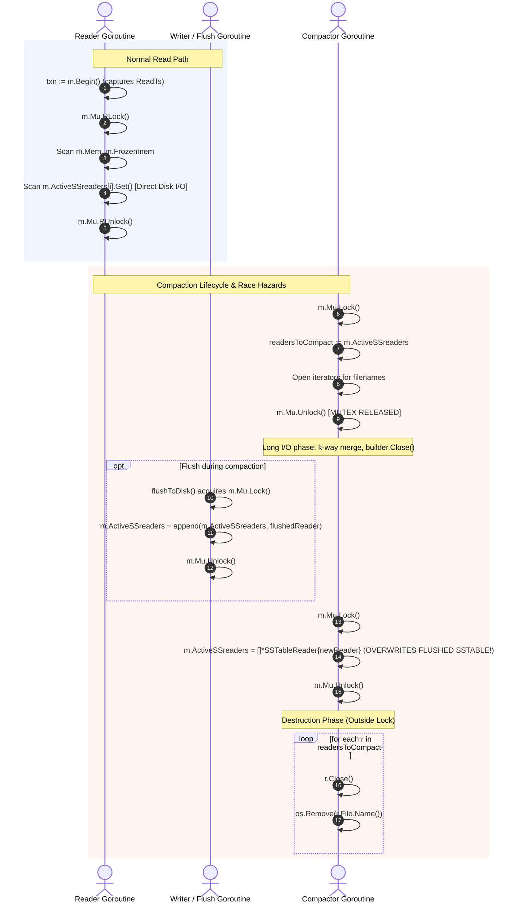

# Storage Engine Architecture & Concurrency Model

**Document Phase:** I0.2 — Baseline Reconnaissance  
**Target Git Branch:** `research/reader-compactor-sync`  
**Base Commit:** `08d3189069294e8168ebb5234a3bef1d37f1d649`  

---

## 1. Real Source Paths & Component Mapping

| Subsystem | Source File | Core Types & Functions | Description |
| :--- | :--- | :--- | :--- |
| **Manager / Engine** | [`lsmengine/manager.go`](../../lsmengine/manager.go) | `Manager`, `CreateManager`, `Get`, `LatestValue`, `Close`, `checkAndTriggerFlush`, `flushToDisk`, `RecoverFromWAL` | Coordinates tier lookups, locks, WAL rotation, Memtable flushes, and recovery. |
| **Transaction** | [`lsmengine/transaction.go`](../../lsmengine/transaction.go) | `Transaction`, `PendingWrite`, `Begin`, `Get`, `Put`, `Delete`, `Commit`, `Abort` | Transaction buffer with write-set isolation and optimistic write-write conflict detection. |
| **Memtable** | [`lsmengine/memtable.go`](../../lsmengine/memtable.go) | `Memtable`, `SkipList`, `Node`, `Put`, `Get`, `LatestValue`, `randomLevel` | In-memory sorted skiplist. Single active memtable + slice of frozen memtables. |
| **WAL** | [`lsmengine/wal.go`](../../lsmengine/wal.go) | `Wal`, `NewWal`, `Append` | Append-only write-ahead log with CRC32 checksums and synchronous `File.Sync()`. |
| **Keys & MVCC** | [`lsmengine/keys.go`](../../lsmengine/keys.go) | `EncodeInternalKey`, `DecodeInternalKey`, `CompareInternalKeys` | User key + 8-byte trailer (`seqNo << 8 \| isDelete`, bitwise inverted for descending sort). |
| **SSTable Builder**| [`lsmengine/sstableBuilder.go`](../../lsmengine/sstableBuilder.go)| `SSTableBuilder`, `IndexEntry`, `Add`, `Close` | 4 KB data block batching, trailer index, footer with index offset + magic number (`0x4C534D31`). |
| **SSTable Reader** | [`lsmengine/sstableReader.go`](../../lsmengine/sstableReader.go) | `SSTableReader`, `NewSSTableReader`, `Get`, `Close` | In-memory sparse index search + `io.SectionReader` block disk scan for point lookups. |
| **Compactor** | [`lsmengine/compaction.go`](../../lsmengine/compaction.go) | `CompactAll` | Multi-way merge of all active SSTables into a single compacted SSTable. |
| **Compaction Heap**| [`lsmengine/compactionHeap.go`](../../lsmengine/compactionHeap.go)| `CompactionHeap`, `HeapItem`, `Len`, `Less`, `Swap`, `Push`, `Pop` | Min-heap ordering keys lexicographically by user key and descending by sequence number. |
| **SSTable Iterator**| [`lsmengine/sstableIterator.go`](../../lsmengine/sstableIterator.go)| `SSTableIterator`, `NewSSTableIterator`, `Next`, `Close` | Sequential file scanner used during compaction merge. |

---

## 2. Lock Hierarchy & Mutex Ownership

There are two distinct mutexes in the engine:
1. `Manager.Mu (*sync.RWMutex)`: Guards access to `Mem`, `Frozenmem`, `ActiveSSreaders`, `Log`, and write sequencing.
2. `Wal.mu (sync.Mutex)`: Guards file writes and `Sync()` calls to the WAL file descriptor.

```
Lock Hierarchy Rule:
Manager.Mu (Exclusive Lock) ──► Wal.mu (Mutex Lock)
```

### Mutex State Matrix

| Operation | Goroutine | Lock Acquired | Lock Duration | Protected Resources |
| :--- | :--- | :--- | :--- | :--- |
| `Manager.Get` | Reader | `m.Mu.RLock()` | Entire read (Memtable + Frozen + Disk I/O across SSTables) | `m.Mem`, `m.Frozenmem`, `m.ActiveSSreaders` |
| `Transaction.Commit` | Writer | `m.Mu.Lock()` | Write-write check, WAL append, Memtable put | `m.Mu`, `m.CurrentSeqNo`, `m.Mem`, `m.Log` |
| `Wal.Append` | Writer | `w.mu.Lock()` | Byte encoding, checksum, `File.Write`, `File.Sync` | `w.File` |
| `checkAndTriggerFlush` | Writer | `m.Mu.Lock()` | Memtable size check, rotation to frozen, WAL swap | `m.Mem`, `m.Frozenmem`, `m.Log` |
| `flushToDisk` (publish) | Background Flush | `m.Mu.Lock()` | SSTable reader slice append, frozen slice remove | `m.ActiveSSreaders`, `m.Frozenmem` |
| `CompactAll` (snapshot) | Compactor | `m.Mu.Lock()` | Shallow copy `ActiveSSreaders`, collect file names | `m.ActiveSSreaders` |
| `CompactAll` (publish) | Compactor | `m.Mu.Lock()` | Replace `m.ActiveSSreaders = []*SSTableReader{newReader}` | `m.ActiveSSreaders` |
| `Manager.Close` | Closer | `m.Mu.Lock()` | Closes readers and WAL file | `m.ActiveSSreaders`, `m.Log` |

---

## 3. Reader Acquisition, Publication, and Destruction Lifecycle



### Detailed Lifecycle Stages:
1. **Reader Acquisition**:
   - Readers acquire `m.Mu.RLock()` in `Manager.Get()`.
   - Reader accesses `m.ActiveSSreaders` slice directly by index while holding `RLock()`.
   - Reader issues synchronous disk reads (`io.NewSectionReader` over `sst.File`) while holding `m.Mu.RLock()`.

2. **Publication**:
   - **Flush publication**: `flushToDisk()` completes building `.sst` file, opens `NewSSTableReader`, acquires `m.Mu.Lock()`, appends `reader` to `m.ActiveSSreaders`, removes `mem` from `m.Frozenmem`, and unlocks `m.Mu`.
   - **Compaction publication**: `CompactAll()` builds `data_compacted_*.sst`, opens `NewSSTableReader`, acquires `m.Mu.Lock()`, overwrites `m.ActiveSSreaders = []*SSTableReader{newReader}`, and unlocks `m.Mu`.

3. **Destruction & Retirement**:
   - In `CompactAll()`, after releasing `m.Mu.Unlock()`, the old readers (`readersToCompact`) are immediately closed via `r.Close()` and their files deleted via `os.Remove(r.File.Name())`.
   - In `Manager.Close()`, under `m.Mu.Lock()`, all readers currently in `m.ActiveSSreaders` are closed.

---

## 4. Key Architectural Divergences and Concurrency Flaws

1. **Self-Deadlock on `Transaction.Commit` & Cross-Tier Conflict Detection (RESOLVED in I1.1a & I1.1b)**:
   In baseline, `Transaction.Commit` acquired `t.Man.Mu.Lock()` and subsequently called `t.Man.LatestValue(key)` which attempted to acquire `m.Mu.RLock()`, causing deterministic self-deadlock. Resolved in I1.1a by extracting internal helper `latestValueLocked(userKey)` which assumes `m.Mu` is already held. In I1.1b, `latestValueLocked` was extended to inspect `m.ActiveSSreaders[i].LatestValue(userKey)` in reverse order, resolving a critical defect where flushed mutations and tombstones bypassed conflict detection.
2. **Data Loss via Compaction Overwrite (RESOLVED in I1.2)**:
   In baseline, `CompactAll` captured `readersToCompact := m.ActiveSSreaders` and released `m.Mu`. If a flush completed during compaction, it appended a new SSTable to `m.ActiveSSreaders`. When compaction finished, it blindly replaced `m.ActiveSSreaders = []*SSTableReader{newReader}`, permanently erasing the newly flushed SSTable from the read path. Resolved in Sub-phase I1.2 via `replaceCompactedReaders` under `m.Mu.Lock()`: input presence is validated, only selected inputs are replaced in-place, and all concurrently flushed SSTables are preserved in strict chronological search order (`INV-ORDER-1`).
3. **Uncoordinated SSTable File Deletion on Windows**:
   `CompactAll` calls `os.Remove(r.File.Name())` on old SSTables without verifying whether any reader or iterator still holds an open file descriptor. On Windows (NTFS), deleting an open file descriptor triggers an access violation (`ERROR_SHARING_VIOLATION` / "Access is denied"). Scheduled for ref-counted safe retirement in Sub-phase I1.3 / Phase I3.
4. **Lock Contention Under Long Disk I/O**:
   Because `Manager.Get` holds `m.Mu.RLock()` for the entire duration of index traversal and section reading, slow disk I/O in reader goroutines completely blocks writers from acquiring `m.Mu.Lock()`. Target of Approach B (Phase I2/I3).

