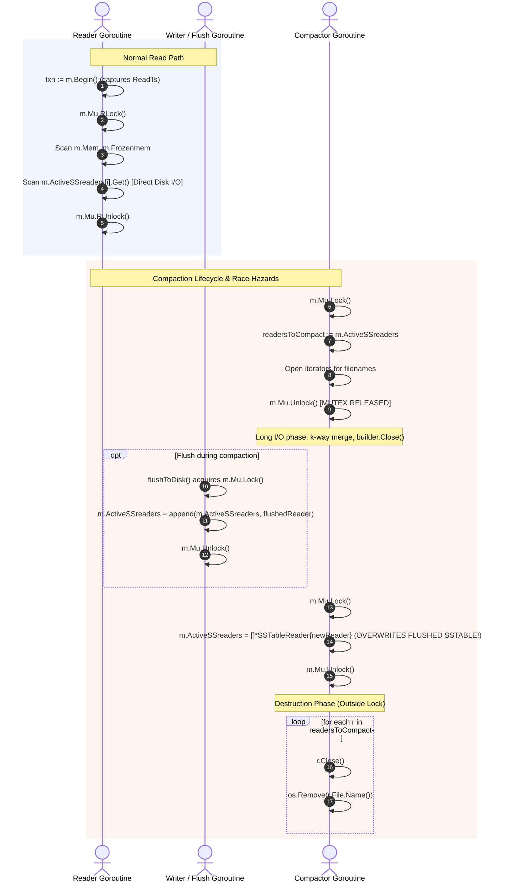

# Storage Engine Architecture & Concurrency Model

**Document Phase:** I0.2 — Baseline Reconnaissance  
**Target Git Branch:** `research/reader-compactor-sync`  
**Base Commit:** `08d3189069294e8168ebb5234a3bef1d37f1d649`  

---

## 1. Real Source Paths & Component Mapping

| Subsystem | Source File | Core Types & Functions | Description |
| :--- | :--- | :--- | :--- |
| **Manager / Engine** | [`lsmengine/manager.go`](../../lsmengine/manager.go) | `Manager`, `CreateManager`, `Get`, `LatestValue`, `Close`, `checkAndTriggerFlush`, `flushToDisk`, `RecoverFromWAL` | Coordinates tier lookups, locks, WAL rotation, Memtable flushes, and recovery. |
| **Transaction** | [`lsmengine/transaction.go`](../../lsmengine/transaction.go) | `Transaction`, `PendingWrite`, `Begin`, `Get`, `Put`, `Delete`, `Commit`, `Abort` | Transaction buffer with write-set isolation and optimistic write-write conflict detection. |
| **Memtable** | [`lsmengine/memtable.go`](../../lsmengine/memtable.go) | `Memtable`, `SkipList`, `Node`, `Put`, `Get`, `LatestValue`, `randomLevel` | In-memory sorted skiplist. Single active memtable + slice of frozen memtables. |
| **WAL** | [`lsmengine/wal.go`](../../lsmengine/wal.go) | `Wal`, `NewWal`, `Append` | Append-only write-ahead log with CRC32 checksums and synchronous `File.Sync()`. |
| **Keys & MVCC** | [`lsmengine/keys.go`](../../lsmengine/keys.go) | `EncodeInternalKey`, `DecodeInternalKey`, `CompareInternalKeys` | User key + 8-byte trailer (`seqNo << 8 \| isDelete`, bitwise inverted for descending sort). |
| **SSTable Builder**| [`lsmengine/sstableBuilder.go`](../../lsmengine/sstableBuilder.go)| `SSTableBuilder`, `IndexEntry`, `Add`, `Close` | 4 KB data block batching, trailer index, footer with index offset + magic number (`0x4C534D31`). |
| **SSTable Reader** | [`lsmengine/sstableReader.go`](../../lsmengine/sstableReader.go) | `SSTableReader`, `NewSSTableReader`, `Get`, `Close` | In-memory sparse index search + `io.SectionReader` block disk scan for point lookups. |
| **Compactor** | [`lsmengine/compaction.go`](../../lsmengine/compaction.go) | `CompactAll` | Multi-way merge of all active SSTables into a single compacted SSTable. |
| **Compaction Heap**| [`lsmengine/compactionHeap.go`](../../lsmengine/compactionHeap.go)| `CompactionHeap`, `HeapItem`, `Len`, `Less`, `Swap`, `Push`, `Pop` | Min-heap ordering keys lexicographically by user key and descending by sequence number. |
| **SSTable Iterator**| [`lsmengine/sstableIterator.go`](../../lsmengine/sstableIterator.go)| `SSTableIterator`, `NewSSTableIterator`, `Next`, `Close` | Sequential file scanner used during compaction merge. |

---

## 2. Lock Hierarchy & Mutex Ownership

There are six distinct synchronization primitives in the engine under Approach B:
1. `m.compactionMu (sync.Mutex, Level 1)`: Serializes background compactions and coordinates atomic engine shutdown. Held for the entire duration of compaction.
2. `Manager.Mu (*sync.RWMutex, Level 2)`: Guards access to `Mem`, `Frozenmem`, `ActiveSSreaders`, `Log`, and write sequencing.
3. `m.snapshotMu (sync.Mutex, Level 3)`: Guards `ReaderSnapshot` state, pinning, draining, `SharedReader.refCount`, and cleanup queues.
4. `m.flushQueueMu (sync.Mutex, Level 4)`: Guards enqueueing, dequeueing, and condition signaling for the unbounded FIFO flush queue.
5. `Wal.mu (sync.Mutex, Level 5)`: Guards file writes and `Sync()` calls to the WAL file descriptor.
6. `m.cleanupMu (sync.Mutex, Level 6)`: Leaf mutex serializing physical handle closures and file unlinks.

```
Lock Hierarchy Rule:
m.compactionMu (Level 1)
       └──► Manager.Mu (Level 2)
                 └──► m.snapshotMu (Level 3)
                           └──► m.flushQueueMu (Level 4)
                                     └──► Wal.mu (Level 5)
                                               └──► m.cleanupMu (Level 6, Leaf)
```

### Mutex State Matrix

| Operation | Goroutine | Lock Acquired | Lock Duration | Protected Resources |
| :--- | :--- | :--- | :--- | :--- |
| `Manager.Get` (Approach A) | Reader | `m.Mu.RLock()` | Entire read (Memtable + Frozen + Disk I/O across SSTables) | `m.Mem`, `m.Frozenmem`, `m.ActiveSSreaders` |
| `Manager.Get` (Approach B) | Reader | `m.Mu.RLock()` $\to$ `m.snapshotMu.Lock()` | Ultra-short memory tier check and snapshot pin; zero locks held during disk I/O | `m.Mem`, `m.Frozenmem`, `snap.pins` |
| `Transaction.Commit` | Writer | `m.Mu.Lock()` | Write-write check, WAL append, Memtable put | `m.Mu`, `m.CurrentSeqNo`, `m.Mem`, `m.Log` |
| `Wal.Append` | Writer | `w.mu.Lock()` | Byte encoding, checksum, `File.Write`, `File.Sync` | `w.File` |
| `checkAndTriggerFlush` | Writer | `m.Mu.Lock()`, then `m.flushQueueMu.Lock()` | Memtable size check, rotation to frozen, WAL swap, queue append | `m.Mem`, `m.Frozenmem`, `m.Log`, `m.flushQueue` |
| `flushLoop` (pop) | Flush Worker | `m.flushQueueMu.Lock()` | Pop FIFO task, wait on `flushQueueCond` | `m.flushQueue` |
| `flushToDisk` (publish) | Flush Worker | `m.Mu.Lock()`, then `m.snapshotMu.Lock()` | SSTable reader append, snapshot publication, frozen remove | `m.ActiveSSreaders`, `m.currentSnapshot`, `m.Frozenmem` |
| `CompactAll` (lifecycle) | Compactor | `m.compactionMu.Lock()` | Entire compaction lifecycle (merge through old file unlinking) | Compaction run serialization |
| `CompactAll` (merge phase) | Compactor | `m.compactionMu.Lock()` held; `m.Mu` and `m.snapshotMu` released | Multi-way iterator merge and new SSTable block writes | Iterators, builder |
| `CompactAll` (publish) | Compactor | `m.compactionMu.Lock()` held; `m.snapshotMu.Lock()` acquired | Atomically publish new snapshot, retire old snapshot | `m.currentSnapshot`, `m.retiredSnapshots` |
| `Manager.Close` (Approach B) | Closer | `m.compactionMu.Lock()` $\to$ `m.Mu.Lock()` $\to$ `m.snapshotMu.Lock()` $\to$ `m.flushQueueMu.Lock()` | Coordinated drain protocol, pin wait, cleanup wait, WAL close | All engine resources |

---

## 3. Reader Acquisition, Publication, and Destruction Lifecycle



### Detailed Lifecycle Stages:
1. **Reader Acquisition**:
   - Readers acquire `m.Mu.RLock()` in `Manager.Get()`.
   - Reader accesses `m.ActiveSSreaders` slice directly by index while holding `RLock()`.
   - Reader issues synchronous disk reads (`io.NewSectionReader` over `sst.File`) while holding `m.Mu.RLock()`.

2. **Publication**:
   - **Flush publication**: `flushToDisk()` completes building `.sst` file, opens `NewSSTableReader`, acquires `m.Mu.Lock()`, appends `reader` to `m.ActiveSSreaders`, removes `mem` from `m.Frozenmem`, and unlocks `m.Mu`.
   - **Compaction publication**: `CompactAll()` builds `data_compacted_*.sst`, opens `NewSSTableReader`, acquires `m.Mu.Lock()`, overwrites `m.ActiveSSreaders = []*SSTableReader{newReader}`, and unlocks `m.Mu`.

3. **Destruction & Retirement**:
   - In `CompactAll()`, after releasing `m.Mu.Unlock()`, the old readers (`readersToCompact`) are immediately closed via `r.Close()` and their files deleted via `os.Remove(r.File.Name())`.
   - In `Manager.Close()`, under `m.Mu.Lock()`, all readers currently in `m.ActiveSSreaders` are closed.

---

## 4. Key Architectural Divergences and Concurrency Flaws

1. **Self-Deadlock on `Transaction.Commit` & Cross-Tier Conflict Detection (RESOLVED in I1.1a & I1.1b)**:
   In baseline, `Transaction.Commit` acquired `t.Man.Mu.Lock()` and subsequently called `t.Man.LatestValue(key)` which attempted to acquire `m.Mu.RLock()`, causing deterministic self-deadlock. Resolved in I1.1a by extracting internal helper `latestValueLocked(userKey)` which assumes `m.Mu` is already held. In I1.1b, `latestValueLocked` was extended to inspect `m.ActiveSSreaders[i].LatestValue(userKey)` in reverse order, resolving a critical defect where flushed mutations and tombstones bypassed conflict detection.
2. **Data Loss via Compaction Overwrite (RESOLVED in I1.2)**:
   In baseline, `CompactAll` captured `readersToCompact := m.ActiveSSreaders` and released `m.Mu`. If a flush completed during compaction, it appended a new SSTable to `m.ActiveSSreaders`. When compaction finished, it blindly replaced `m.ActiveSSreaders = []*SSTableReader{newReader}`, permanently erasing the newly flushed SSTable from the read path. Resolved in Sub-phase I1.2 via `replaceCompactedReaders` under `m.Mu.Lock()`: input presence is validated, only selected inputs are replaced in-place, and all concurrently flushed SSTables are preserved in strict chronological search order (`INV-ORDER-1`).
3. **Uncoordinated SSTable File Deletion on Windows (RESOLVED in I1.3)**:
   `CompactAll` previously closed files and unlinked them with potential races. Resolved in Sub-phase I1.3: iterators and retired reader file handles are closed deterministically before `os.Remove`, preventing Windows `ERROR_SHARING_VIOLATION`. In-flight point reads drain prior to exclusive publication lock acquisition.
4. **Lock Contention Under Long Disk I/O & Publication Blocking (Approach A Baseline)**:
   Under Approach A, `Manager.Get` holds `m.Mu.RLock()` across sparse index search and block I/O, while `CompactAll` acquires exclusive `m.Mu.Lock()` for reader replacement. Point readers drain before publication lock is granted, and subsequent readers/writers block during publication. Targeted unit tests (`TestReaderLifetime_CaseC_ReaderBlockedDuringCompactionPublish`, `TestReaderLifetime_CaseD_CommitBlockedDuringCompactionPublish`) verify this blocking mechanism functionally; empirical quantification of throughput and tail-latency percentiles (p50, p99, p99.9) will be measured in Sub-phase I1.4.
5. **Background Flush vs Shutdown Race (RESOLVED in I1.3.7b, Issue E-007)**:
   In baseline, an in-flight `flushToDisk` could publish a new reader into `m.ActiveSSreaders` after `Manager.Close()` set `ActiveSSreaders = nil`, leaking an open file descriptor on Windows NTFS. Resolved in I1.3.7b via a 4-phase deadlock-free drain protocol: `Manager.Close()` transitions engine state to `EngineClosing`, closes `m.flushChan`, drains `m.flushWg.Wait()` outside `m.Mu` without holding locks, and transitions to `EngineClosed`. All completed tables are cleanly closed, post-shutdown operations return `ErrClosed`, and zero file handles are leaked on Windows NTFS.
6. **Concurrent Flush Out-of-Order Publication (RESOLVED in I1.3.7c, Issue E-008)**:
   In baseline, uncoordinated `flushToDisk` goroutines could complete out-of-order, placing an older SSTable after a newer SSTable in `m.ActiveSSreaders` and corrupting reverse iteration in `Manager.Get`. Resolved in I1.3.7c via a dedicated managed FIFO flush worker (`m.flushChan`). Memtables are enqueued under `m.Mu.Lock()` at the instant of freezing in exact chronological order. The single background worker processes and appends SSTables to `m.ActiveSSreaders` strictly in arrival order, guaranteeing `INV-ORDER-1` and eliminating stale reads.
7. **Flush Queue Deadlock on Channel Saturation (RESOLVED in I1.3.8b, Issue E-009)**:
   In I1.3.7c, `enqueueFlushLocked` sent into a bounded channel (`make(chan *Memtable, 64)`) while holding `Manager.Mu.Lock()`. Under write load exceeding disk flush bandwidth, 64 tasks saturated the channel buffer; any subsequent enqueue blocked while holding `Manager.Mu.Lock()`. Meanwhile, the flush worker finished building an SSTable and blocked attempting to acquire `Manager.Mu.Lock()` to publish, resulting in an unrecoverable circular wait deadlock. Resolved in I1.3.8b via an unbounded internal FIFO task queue slice protected by `m.flushQueueMu sync.Mutex` and `m.flushQueueCond *sync.Cond` (Decision D-015). Enqueueing under `Manager.Mu.Lock()` is an instantaneous $O(1)$ non-blocking slice append, completely eliminating lock contention and circular wait while preserving exact generation ordering and continuous key visibility in `Frozenmem`.
8. **Memory-Tier Synchronization and Immutability Verification (VERIFIED in I1.4)**:
   Audited active/frozen Memtable synchronization, proving that while SkipList is not thread-safe internally, external serialization under `Manager.Mu` (`Lock()` for writes in `Transaction.Commit()`, `RLock()` for reads in `Manager.Get()`) provides strict mutual exclusion and happens-before synchronization. Once active Memtables are frozen, they are permanently sealed against further mutations (`INV-MUTABLE-1`). Concurrent lookups under `m.Mu.RLock()` and background FIFO worker iteration in `flushToDisk()` are concurrent reads on immutable memory, proven data-race free under Go ThreadSanitizer. In `flushToDisk()`, the newly built SSTable reader is appended to `ActiveSSreaders` and the flushed Memtable is removed from `Frozenmem` within the exact same critical section under `m.Mu.Lock()`, guaranteeing zero missing values across the memory-to-disk handoff (`INV-HANDOFF-1`).
9. **Fail-Stop Flush Processing and Precedence Inversion Prevention (RESOLVED in I1.4.7c, Issue E-010, Decision D-017)**:
   If an older flush $F_0$ failed while subsequent flushes $F_1, F_2$ were queued, the background worker previously continued processing, publishing $F_1$ to `ActiveSSreaders` while $F_0$ remained in `Frozenmem`. Because `Manager.Get` and `Manager.latestValueLocked` examine `Frozenmem` before `ActiveSSreaders`, older data in $F_0$ masked newer writes and tombstones in $F_1$, causing stale reads, tombstone resurrection, and missed write-write conflicts. Resolved in I1.4.7c via Option A (Fail-stop flush processing). When `flushToDisk` encounters a fatal error, it sets `m.flushErr`, and the worker `flushLoop` immediately halts without dequeuing or publishing subsequent flushes. All unflushed Memtables remain safely in `Frozenmem` in strict chronological order ($[F_0, F_1, \dots]$), strictly preserving `INV-ORDER-1`, `INV-MVCC-6`, and `INV-FLUSH-FAIL-1`. `TriggerFlush`, `EnqueueFlush`, and `checkAndTriggerFlush` reject further flushes, and the error is surfaced explicitly via `FlushErr()` and `Close()`.
10. **Explicit Synchronization-Mode Baseline Selection Seam (ESTABLISHED in I1.5.2, Decision D-018)**:
    Introduced a strongly typed synchronization strategy abstraction in `lsmengine/manager.go` via `SyncMode` (`SyncModeApproachA`, `SyncModeApproachB`), `Config`, `DefaultConfig()`, `CreateManagerWithConfig(cfg)`, and `(m *Manager) SyncMode()`. Default configuration instantiates `SyncModeApproachA` ("ApproachA_RWMutexBaseline") preserving 100% backward compatibility for all existing callers. Explicit requests for `SyncModeApproachB` are safely rejected with `ErrUnsupportedSyncMode` until Phase I2 implementation begins. Verified by 5 targeted unit tests in `lsmengine/mode_selection_test.go` on Windows native and WSL2 with `-race`.
11. **Immutable Reader-Set Snapshot Architecture (DESIGNED in I2, Approach B)**:
    Introduced the formal architectural design for Approach B (Immutable Reader-Set Snapshots with Two-Tier Reference Ownership) to eliminate reader–compactor contention across slow disk I/O. Decoupled query pin lifetimes from physical SSTable file handle lifetimes via `ReaderSnapshot` (with active `pins` tracking) and `SharedReader` (with atomic `refCount` and `sync.Once` safe closure). Point readers acquire snapshot pins in an ultra-short in-memory critical section under `m.snapshotMu` coupled with `Manager.Mu.RLock()`, release manager locks before executing SSTable binary searches and block reads, and decrement snapshot pins upon completion. Proved strict total lock order (`compactionMu` $\to$ `Manager.Mu` $\to$ `snapshotMu` $\to$ `flushQueueMu`) to prevent deadlocks, and enforced strict two-stage closure before unlinking on Windows NTFS. Retained Approach A as verified default; minimal scaffolding declared in `lsmengine/snapshot.go` with 104 passing tests.


