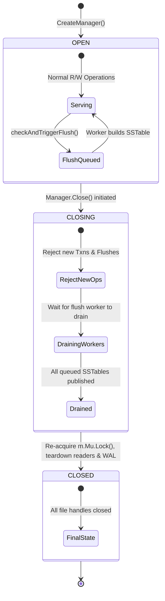
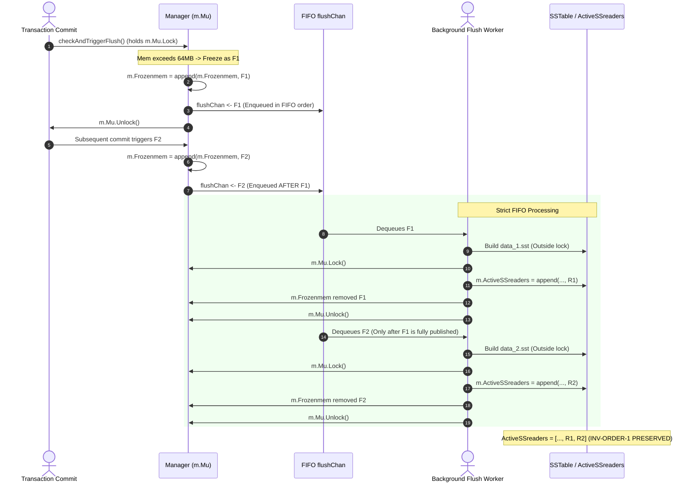

# Coordinated Flush Lifecycle and Chronological Publication Protocol

**Design Document:** Sub-phase I1.3.7a  
**Governing Architecture:** Approach A (Manager-wide Mutex Baseline)  
**Target Issues:** `E-007` (Shutdown & Flush Coordination) & `E-008` (Chronological Flush Publication Ordering)  
**Date:** 2026-10-16  
**Status:** DESIGN COMPLETE — PENDING IMPLEMENTATION AUTHORIZATION (I1.3.7b & I1.3.7c)  

---

## 1. Executive Summary & Problem Scope

During Sub-phase I1.3.6 audits, two critical correctness and lifecycle defects were identified and reproduced:

1. **Issue E-007 (Shutdown vs. In-Flight Flush Race)**:
   In baseline `owndbms/lsmengine`, `checkAndTriggerFlush()` spawns an unmanaged goroutine `go m.flushToDisk(frozen)` without tracking. When `Manager.Close()` is invoked, it sets `isClosed = true`, closes all currently active readers in `m.ActiveSSreaders`, sets `m.ActiveSSreaders = nil`, closes `m.Log.File`, and returns. When the in-flight flush completes building its SSTable, it acquires `m.Mu.Lock()` without checking `isClosed`, appending its new reader to `m.ActiveSSreaders`.
   - *Impact*: An open `SSTableReader` is published into a closed engine. The OS file descriptor is leaked indefinitely, causing Windows NTFS file sharing violations (`ERROR_SHARING_VIOLATION` / "Access is denied") during directory teardown. Committed data in `Frozenmem` can be lost if the host process terminates before the background goroutine writes to disk.

2. **Issue E-008 (Concurrent Out-of-Order Memtable Flushes)**:
   When multiple Memtables fill up in rapid succession, `checkAndTriggerFlush()` spawns multiple concurrent `go m.flushToDisk(...)` goroutines. Because Go goroutine scheduling and disk write latencies are non-deterministic, a newer Memtable ($F_2$, seq 20) can finish building and publish its SSTable before an older Memtable ($F_1$, seq 10).
   - *Impact*: $F_1$ is appended to `m.ActiveSSreaders` after $F_2$, resulting in `[..., R2, R1]`. Because `Manager.Get` iterates `m.ActiveSSreaders` in reverse order from index $\text{len}-1$ down to 0 under invariant `INV-ORDER-1`, point lookups visit $R_1$ first. Older versions in $R_1$ mask newer committed versions in $R_2$, causing silent stale reads and breaking snapshot isolation.

This document specifies the coordinated lifecycle state machine and single-worker FIFO publication architecture that resolves both defects together without introducing lock inversions, performance regressions, or Approach B snapshot complexity.

---

## 2. Frozen Memtable Multiplicity & Ownership Analysis

### Can a single `Frozenmem *Memtable` field represent all pending immutable Memtables?
**NO. A single pointer field is structurally inadequate.**

Under sustained write load:
1. Active Memtable $M_0$ exceeds the 64 MB threshold and freezes as $F_0$. Background flush of $F_0$ begins.
2. Active Memtable $M_1$ receives subsequent transaction writes. Because SSTable construction involves synchronous disk I/O (encoding keys, calculating CRC checksums, writing 4 KB data blocks, flushing sparse index, and calling `File.Sync()`), $M_1$ can easily exceed 64 MB before $F_0$ finishes flushing.
3. If only a single pointer `m.Frozenmem *Memtable` existed:
   - Freezing $M_1$ would overwrite the pointer to $F_0$.
   - $F_0$ would be detached from the manager read path while still in memory, making all data committed in $F_0$ invisible to point lookups until its SSTable was published!
   - If an error occurred in $F_0$'s flush, $F_0$ would be permanently orphaned and lost.
4. **Conclusion**: `m.Frozenmem` MUST remain an ordered slice `[]*Memtable`:
   $$\text{Frozenmem} = [F_0, F_1, F_2, \dots, F_k]$$
   where index 0 is the oldest frozen Memtable and index $k$ is the newest frozen Memtable. Point lookups ([`Manager.Get`](file:///c:/Users/ramst/Documents/Projects/selfdbms/lsmengine/manager.go#L77)) and conflict checks ([`latestValueLocked`](file:///c:/Users/ramst/Documents/Projects/selfdbms/lsmengine/manager.go#L160)) must iterate backwards ($k \to 0$) to preserve reverse-chronological search precedence.

### Eligibility and Retirement Lifecycle of Frozen Memtables:
- **Eligibility**: A Memtable becomes eligible for flushing the exact moment it is frozen in `checkAndTriggerFlush()`, at which point no further writes will ever be admitted to it.
- **Ownership**: While in memory, the Memtable is owned jointly by the manager's read path (`m.Frozenmem`) and the flush worker.
- **Retirement**: A frozen Memtable $F_j$ can only be removed from `m.Frozenmem` **simultaneously** with the publication of its replacement SSTable $R_j$ into `m.ActiveSSreaders`, atomically under `m.Mu.Lock()`. If publication fails, $F_j$ MUST remain in `m.Frozenmem` to ensure reads remain serviced from RAM.

---

## 3. Coordinated Lifecycle State Machine (Resolving E-007)

We establish three explicit lifecycle states for the storage engine:



### State Definitions & Invariants

```go
type EngineState int

const (
    EngineOpen EngineState = iota
    EngineClosing
    EngineClosed
)
```

| Lifecycle State | Admission of New Operations | In-Flight Operations | Resource Ownership & Invariants |
| :--- | :--- | :--- | :--- |
| **`EngineOpen`** | All operations permitted (`Begin`, `Commit`, `Get`, `CompactAll`, `checkAndTriggerFlush`). | Active. | All active SSTable readers, Memtables, and WAL file descriptor are open and healthy. |
| **`EngineClosing`** | **REJECTED**: New `Transaction.Commit` calls abort with `ErrClosed`. New `checkAndTriggerFlush` calls abort. New `CompactAll` calls abort with `ErrClosed`. | **DRAINING**: In-flight point reads drain. Admitted flush tasks in the flush queue are processed to completion. | `m.Mu` is **NOT** held while waiting. Flush worker possesses lock-free lease to build SSTables and acquires short `m.Mu.Lock()` to publish each completed table. |
| **`EngineClosed`** | **REJECTED**: All operations return `ErrClosed`. | **NONE**: All background workers terminated (`m.flushWg.Wait()` completed). | All file descriptors in `m.ActiveSSreaders` closed. `m.Log.File` closed. `m.ActiveSSreaders = nil`. Zero open handles. |

### Deadlock-Free Shutdown Sequence in `Manager.Close()`
A critical architectural pitfall is attempting to hold `m.Mu.Lock()` while waiting for background flushes to finish. Because `flushToDisk` requires `m.Mu.Lock()` to publish completed SSTables into `m.ActiveSSreaders`, holding `m.Mu.Lock()` during shutdown wait produces an immediate, fatal self-deadlock.

The correct, deadlock-free shutdown protocol is structured as follows:

```go
func (m *Manager) Close() error {
    // Phase 1: Block concurrent compactions from starting
    m.compactionMu.Lock()
    defer m.compactionMu.Unlock()

    // Phase 2: Synchronized transition to CLOSING
    m.Mu.Lock()
    if m.state != EngineOpen {
        m.Mu.Unlock()
        return nil // Idempotent: already closing or closed
    }
    m.state = EngineClosing

    // Close the flush task channel so the worker knows no new work will arrive
    if m.flushChan != nil {
        close(m.flushChan)
    }
    m.Mu.Unlock() // CRITICAL: Release m.Mu before waiting!

    // Phase 3: Drain in-flight flush tasks outside m.Mu
    if m.flushChan != nil {
        m.flushWg.Wait() // Worker finishes all queued Memtables and publishes them
    }

    // Phase 4: Final teardown to CLOSED
    m.Mu.Lock()
    defer m.Mu.Unlock()

    m.state = EngineClosed

    // Close all published readers (including newly drained ones)
    for _, reader := range m.ActiveSSreaders {
        if reader != nil {
            reader.Close()
        }
    }
    m.ActiveSSreaders = nil

    // Close WAL file
    if m.Log != nil && m.Log.File != nil {
        m.Log.File.Close()
    }

    return m.flushErr
}
```

---

## 4. Chronological Flush Publication Protocol (Resolving E-008)

### Comparison of Flush Architecture Alternatives

#### Alternative 1: Independent Goroutines with a `flushMu sync.Mutex`
- *Mechanism*: Each call to `checkAndTriggerFlush()` spawns `go m.flushToDisk(frozen)` which acquires `m.flushMu.Lock()`.
- *Why Rejected*: As the external reviewer correctly cautioned: *acquiring a `flushMu` inside independently scheduled goroutines does NOT guarantee generation order*. If the Go runtime schedules Goroutine 2 (newer) before Goroutine 1 (older), Goroutine 2 acquires `flushMu` first, writing and publishing $F_2$ before $F_1$. Defect E-008 remains active.

#### Alternative 2: Concurrent Multi-Threaded Build with Re-ordering Queue
- *Mechanism*: Multiple goroutines build SSTables concurrently in temporary files. Completed tables enter a priority queue ordered by `flushSeq` before sequential publication into `m.ActiveSSreaders`.
- *Why Rejected*: High complexity, substantial buffer memory, and little real-world throughput gain for a single-disk LSM storage engine where multiple concurrent sequential writes cause disk head thrashing and I/O bus contention.

#### Alternative 3: Dedicated Managed FIFO Flush Worker (SELECTED)
- *Mechanism*:
  1. `Manager` maintains a FIFO channel `flushChan chan *Memtable` and a single dedicated background worker goroutine `flushLoop()`.
  2. In `checkAndTriggerFlush()`, when a Memtable is frozen under `m.Mu.Lock()`, it is appended to `m.Frozenmem` and immediately enqueued: `m.flushChan <- frozen`.
  3. The single worker processes `m.flushChan` strictly in FIFO arrival order.
- *Why Selected*:
  1. **Strict FIFO Generation Invariant**: Because Go channels are strictly first-in, first-out, and Memtables are enqueued under `m.Mu.Lock()` at the instant of freezing, $F_0$ is guaranteed to be dequeued and processed before $F_1$.
  2. **Unconditional `INV-ORDER-1` Guarantee**: The worker builds $R_0$, acquires `m.Mu.Lock()`, appends $R_0$ to `m.ActiveSSreaders`, and removes $F_0$ from `m.Frozenmem`. Then and only then does it build $R_1$. Out-of-order publication is mathematically impossible.
  3. **Trivial Shutdown Coordination**: `close(m.flushChan)` signals the worker to finish all remaining queued items and terminate, cleanly coordinated with `m.flushWg.Wait()`.
  4. **Minimal Diff**: Replaces arbitrary `go m.flushToDisk(...)` spawns with clean channel queueing in less than 40 lines of code.



---

## 5. Interactions with Engine Tiers & Existing Invariants

### 1. Interaction with Active and Frozen Memtables
- **Monotonic Precedence**:
  $$\text{Active } M \succ \text{Frozenmem}[k] \succ \dots \succ \text{Frozenmem}[0] \succ \text{ActiveSSreaders}[\text{len}-1] \succ \dots \succ \text{ActiveSSreaders}[0]$$
- Because $F_0$ is published to `ActiveSSreaders` before $F_1$ is processed, at no point does an older Memtable linger in `Frozenmem` while a newer Memtable has already been published to disk. The multi-tier precedence remains strictly consistent at every microsecond.

### 2. Interaction with Compaction (`CompactAll` & `INV-COMPACT-1`)
- `CompactAll` acquires exclusive `m.Mu.Lock()` to capture its contiguous prefix snapshot $S_c = [R_0, \dots, R_k]$.
- While compaction is merging outside `m.Mu`, the flush worker completes and appends new tables $R_{\text{flush}}$ to `m.ActiveSSreaders`.
- When compaction publishes under `m.Mu.Lock()`, `replaceCompactedReaders` replaces the prefix $[0..k]$ with the new merged table $R_{\text{compact}}$ at index 0, and retains all newly flushed tables at indices $1, 2, \dots$:
  $$\text{ActiveSSreaders}_{\text{updated}} = [R_{\text{compact}}, R_{\text{flush}, 1}, R_{\text{flush}, 2}]$$
- Because flushes are strictly chronological, $R_{\text{flush}, 1}$ is older than $R_{\text{flush}, 2}$, and both are strictly newer than $R_{\text{compact}}$. `INV-ORDER-1` and `INV-COMPACT-1` are mutually respected without conflict.

### 3. Interaction with MVCC Version Ordering and Tombstones
- SSTable builders write records in internal key order (`userKey` ascending, `sequenceNumber` descending).
- Tombstones participate in deduplication during compaction and return `ErrKeyDeleted` on point lookups.
- Because reader order is strictly preserved, a newer tombstone in $R_2$ will always be encountered before an older Put in $R_1$, preventing resurrected deleted records.

### 4. Lock Hierarchy Verification
The complete lock acquisition hierarchy across all operations:
$$\mathbf{m.compactionMu} \longrightarrow \mathbf{Manager.Mu} \longrightarrow \mathbf{Wal.mu}$$
- `Manager.Close()`: Acquires `m.compactionMu` $\to$ acquires `m.Mu` (transitions to `CLOSING`) $\to$ releases `m.Mu` $\to$ waits on `flushWg` $\to$ acquires `m.Mu` $\to$ closes readers and WAL $\to$ releases `m.Mu` $\to$ releases `m.compactionMu`.
- `CompactAll()`: Acquires `m.compactionMu` $\to$ acquires `m.Mu` $\to$ releases `m.Mu` $\to$ merges $\to$ acquires `m.Mu` $\to$ releases `m.Mu` $\to$ releases `m.compactionMu`.
- `flushWorker`: Acquires `m.Mu` for publication. Never holds `m.Mu` while calling other locks. Never requests `compactionMu`.
- **Verdict**: Zero lock inversion cycles. Completely deadlock-free.

---

## 6. Background Error Handling & Observability

In baseline, any error during `os.Create` or `builder.Close()` inside `flushToDisk` resulted in an unlogged silent early `return`, orphaning the frozen Memtable and hiding disk full conditions from operators.

Under this protocol:
1. `Manager` maintains `flushErr error`.
2. If `flushToDisk` encounters an error during file creation, block writes, index serialization, or footer write:
   - It closes and unlinks the partially written temporary file (`os.Remove(filename)`).
   - Under `m.Mu.Lock()`, it records the error: `m.flushErr = err`.
   - **Crucial**: It does **NOT** remove `mem` from `m.Frozenmem`. The Memtable remains accessible in RAM so active queries continue to observe committed data.
3. When `Manager.Close()` completes draining, it returns `m.flushErr`.
4. A dedicated method `m.FlushError() error` allows background flush errors to be inspected asynchronously.

---

## 7. Implementation Roadmap for Sub-phases I1.3.7b & I1.3.7c

- **I1.3.7b (E-007 Repair)**:
  - Add `EngineState` enum (`EngineOpen`, `EngineClosing`, `EngineClosed`) and `state` field to `Manager`.
  - Add `flushWg sync.WaitGroup` and `flushErr error` to `Manager`.
  - Refactor `Manager.Close()` into the 4-phase deadlock-free drain protocol.
  - Add admission checks rejecting new transactions and flushes during `CLOSING` / `CLOSED`.
  - Verify with 6 deterministic tests (Cases A–F) in `flush_shutdown_test.go`.
- **I1.3.7c (E-008 Repair)**:
  - Add `flushChan chan *Memtable` and background `flushWorker()` loop to `Manager`.
  - Update `checkAndTriggerFlush()` to enqueue to `flushChan` under `m.Mu.Lock()`.
  - Convert `TestFlushOrdering_ConcurrentFlushesViolateOrder` to an assertive PASS.
  - Add multi-flush tests (3+ frozen tables, interleaved compactions, delete/put sequences).
