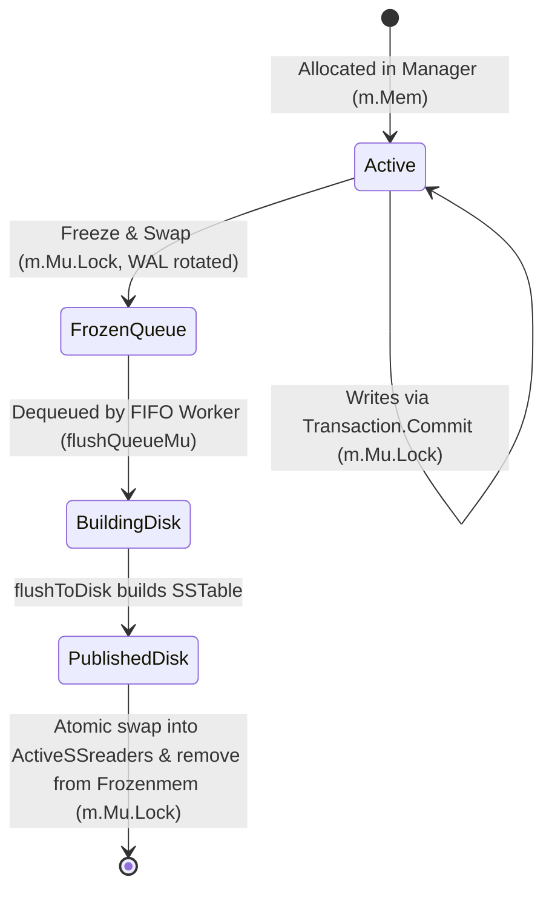

# Memory-Tier Synchronization & Concurrency Audit (Sub-phase I1.4.1)

**Milestone:** Sub-phase I1.4.1  
**Architecture:** Approach A (Manager-wide Mutex Baseline)  
**Date:** 2026-10-16  
**Auditor:** Antigravity / Pair Programmer  

---

## 1. Executive Summary

This audit evaluates the thread-safety, locking invariants, and ownership transitions governing the in-memory tier (`m.Mem`, `m.Frozenmem`, and the underlying `SkipList` / `Node` data structures) in `owndbms/lsmengine`.

### Key Audit Conclusions:
1. **SkipList Non-Thread-Safety**: The `SkipList` and `Memtable` types contain **no internal synchronization mechanisms** (no mutexes, channels, or atomic pointers). All mutations (`Put`) and lookups (`Get`, `LatestValue`) are purely sequential algorithms.
2. **External Protection of Active Memtable**: All mutations to `m.Mem` occur exclusively in `Transaction.Commit()` while holding `t.Man.Mu.Lock()`. Point reads in `Manager.Get()` acquire `m.Mu.RLock()`. Under the Go memory model, this provides valid mutual exclusion and happens-before synchronization between writers and readers on `m.Mem`.
3. **Genuine Immutability of Frozen Memtables**: When an active Memtable is frozen in `TriggerFlush()` or `checkAndTriggerFlush()`, the pointer is appended to `m.Frozenmem`, and `m.Mem` is immediately reassigned to a newly allocated `Memtable` under `m.Mu.Lock()`. No production code path ever invokes `.Put()` on a frozen Memtable. Thus, frozen Memtables are read-only (immutable).
4. **Concurrent Worker Access**: The background FIFO flush worker traverses Level 0 pointers (`curr := mem.SK.headNode.Forward[0]`) in `flushToDisk()` outside `m.Mu`. Because the frozen Memtable is strictly immutable and no concurrent writes ever occur on it, concurrent lookups (`Get` / `LatestValue` under `m.Mu.RLock()`) and worker iteration are concurrent reads on immutable shared memory, which is completely race-free under the Go memory model.
5. **Atomic Publication & Removal**: When the worker finishes writing an SSTable, it acquires `m.Mu.Lock()` to simultaneously append the new reader to `ActiveSSreaders` and remove the flushed Memtable from `Frozenmem`. There is zero observable window where a key vanishes between memory and disk tiers.

---

## 2. SkipList Internal Structure & Synchronization Contract

### 2.1 Struct Definitions (`lsmengine/memtable.go`)
```go
type Node struct {
    Key     []byte
    Value   []byte
    Forward []*Node
}

type SkipList struct {
    headNode     *Node
    maxLevel     int
    currentLevel int
}

type Memtable struct {
    SK        *SkipList
    SizeBytes int64
}
```

### 2.2 Algorithmic Properties:
1. **Forward Pointer Traversal**:
   - `Put` generates a random level using `math/rand/v2.Float64()` and splices the new node into the SkipList by rewriting `update[i].Forward[i]` and `m.SK.currentLevel`.
   - `Get` and `LatestValue` traverse `curr = curr.Forward[level]` from `currentLevel - 1` down to level 0.
   - If `Put` were called concurrently with `Get` or another `Put` without locks, memory corruption, pointer races, or stale node reads would occur immediately.
2. **Internal Lock Freedom**:
   - The SkipList struct is intentionally lock-free and non-thread-safe.
   - **Contract**: External callers MUST guarantee mutual exclusion for writes (`Manager.Mu.Lock()`) and concurrent-read safety (`Manager.Mu.RLock()`).

---

## 3. Reader & Writer Access Path Audit

| Operation | Calling Context | Lock Held | Operations on SkipList / Memtable | Concurrency Safety Rationale |
| :--- | :--- | :--- | :--- | :--- |
| **Transaction Commit** | `Transaction.Commit()` | `t.Man.Mu.Lock()` (Exclusive) | Calls `m.Mem.Put(encodedKey, data)`, updates `m.Mem.SizeBytes` | Exclusive lock prevents concurrent `Put`, `Get`, `LatestValue`, or freeze. |
| **Point Read (Active)** | `Manager.Get()` | `m.Mu.RLock()` (Shared) | Calls `m.Mem.Get(byteKey, readTs)` | `RLock` ensures no concurrent `Commit` or freeze can mutate `m.Mem`. |
| **Point Read (Frozen)** | `Manager.Get()` | `m.Mu.RLock()` (Shared) | Calls `m.Frozenmem[i].Get(byteKey, readTs)` | `Frozenmem` is immutable. `RLock` prevents concurrent slice mutation of `m.Frozenmem`. |
| **Conflict Check (Active)** | `latestValueLocked()` | `m.Mu` held (Lock or RLock) | Calls `m.Mem.LatestValue(userKey)` | Precondition: caller holds `m.Mu.Lock()` or `m.Mu.RLock()`. |
| **Conflict Check (Frozen)** | `latestValueLocked()` | `m.Mu` held (Lock or RLock) | Calls `m.Frozenmem[i].LatestValue(userKey)` | Frozenmem is immutable; slice read is guarded by `m.Mu`. |
| **Memtable Freeze** | `checkAndTriggerFlush()` / `TriggerFlush()` | `m.Mu.Lock()` (Exclusive) | Appends `m.Mem` to `Frozenmem`, creates new `m.Mem`, enqueues to worker | Atomic pointer swap under exclusive lock. Readers see either old `Mem` or new `Mem`. |
| **Worker SSTable Build** | `flushToDisk()` | **None** (No locks held) | Iterates `curr := mem.SK.headNode.Forward[0]` to end | `mem` is immutable. Concurrent readers only read; zero writers exist. |
| **Worker SSTable Publication** | `flushToDisk()` completion | `m.Mu.Lock()` (Exclusive) | Appends to `ActiveSSreaders`, removes `mem` from `m.Frozenmem` | Atomic handoff from `Frozenmem` to `ActiveSSreaders` under exclusive lock. |

---

## 4. Key Encoding & Multi-Version Ordering

### 4.1 Internal Key Layout (`lsmengine/keys.go`)
An internal key consists of:
`[ userKey bytes ] [ 8-byte inverted packed uint64 ]`
where:
$$\text{packed} = (\text{seqNo} \ll 8) \mid (\text{isDelete} \mathbin{?} 1 : 0)$$
and the 8 bytes are bitwise inverted ($\sim$).

### 4.2 Inverted Bit Ordering Rationale:
Because Go's `bytes.Compare` operates in lexicographical order (ascending byte values):
- Higher `seqNo` $\implies$ higher `packed` $\implies$ inverted value is **smaller** in byte order.
- Therefore, within the same `userKey`, versions sort in **descending order of sequence number**:
  $$\text{Version}_{50} \prec \text{Version}_{40} \prec \text{Version}_{30} \prec \text{Version}_{10}$$
- For identical `seqNo`:
  - `isDelete = true` $\implies$ lowest bit of packed is 1 $\implies$ lowest bit of inverted is 0 (smaller byte value).
  - `isDelete = false` $\implies$ lowest bit of packed is 0 $\implies$ lowest bit of inverted is 1 (larger byte value).
  - Thus, a tombstone at sequence $S$ sorts immediately **before** a non-tombstone at sequence $S$.

### 4.3 Search Mechanics in `Memtable.Get`:
- To find the visible version at `readTs`, `Get` constructs:
  $$\text{targetKey} = \text{EncodeInternalKey}(\text{userKey}, \text{readTs}, \text{true})$$
- Because `targetKey` uses `isDelete = true`, its inverted suffix is smaller than or equal to any valid version at `seqNo <= readTs`.
- SkipList search stops at `curr`, the node immediately preceding `targetKey`.
- `candidate := curr.Forward[0]` is the first version with $\text{candidateSeqNo} \le \text{readTs}$.
- If `candidate` matches `userKey`, it is guaranteed to be the **newest version visible at `readTs`**.

---

## 5. Frozen Memtable Lifecycle & Handoff Invariants



### 5.1 Invariants Preserved:
1. **INV-SYNC-1 (SkipList Mutation Safety)**: Every call to `m.Mem.Put` is serialized under `m.Mu.Lock()`.
2. **INV-MUTABLE-1 (Frozen Memtable Immutability)**: A Memtable transitioned to `m.Frozenmem` is permanently sealed; no goroutine may ever call `.Put()` on it.
3. **INV-HANDOFF-1 (Zero-Loss Memory-to-Disk Handoff)**:
   $$\forall k, \quad k \in \text{Frozenmem} \cup \text{ActiveSSreaders}$$
   During SSTable publication in `flushToDisk`, the new `SSTableReader` is appended to `m.ActiveSSreaders` before (or in the same critical section as) removing `mem` from `m.Frozenmem`. A reader holding `m.Mu.RLock()` will find $k$ either in `m.Frozenmem` (if looking before the swap) or in `m.ActiveSSreaders` (if looking during or after the swap). There is no intermediate state where $k$ is omitted.

---

## 6. Audit Conclusion & Transition to Sub-phase I1.4.2

The memory tier synchronization design under Approach A is architecturally sound.
To validate this design empirically, Sub-phase I1.4.2 will introduce a deterministic concurrency and correctness test suite covering:
1. Concurrent Put and Get on identical keys.
2. Multiple writers on overlapping keys.
3. Concurrent Put and Delete.
4. Snapshot isolation reads during concurrent writes.
5. Freeze while read is in progress.
6. Visibility across queued and in-flight flushes.
7. Multi-version frozen Memtables.
8. Cross-tier tombstones.
9. Zero-loss frozen-to-SSTable handoff.
10. Saturated read/write/flush/shutdown concurrency.
