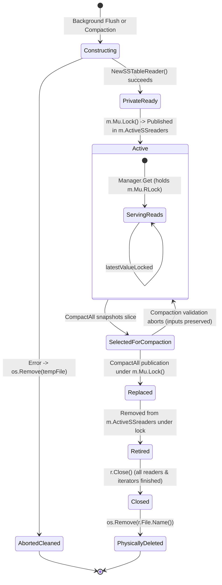

# SSTable Reader Ownership & Lifecycle Audit (Sub-phase I1.3.0)

**Sub-phase:** I1.3.0 — Audit SSTable reader ownership  
**Date:** 2026-10-16  

---

## 1. Ownership & Synchronization Matrix Across All Paths

| Component / Function | Creates Reader? | Owns Reader? | Locks Protecting Access | Can Reference Escape? | Can Reader be Closed While Reachable? | Leak Risk on Failure? |
| :--- | :--- | :--- | :--- | :--- | :--- | :--- |
| **`flushToDisk`** | Yes (`NewSSTableReader`) | Private $\to$ Published to `Manager` | `Manager.Mu.Lock()` on swap | No (local pointer passed to slice) | No (appended to active slice) | No: if builder/open fails, file is closed/orphaned |
| **`CompactAll`** | Yes (`NewSSTableReader`) | Private $\to$ Published to `Manager`; owns retired slice during cleanup | `m.Mu.Lock()` on input snapshot & publication | No (iterators and slice maintained internally) | No: retired readers removed from slice before closing | No: all error paths clean up `newFilename` & close iterators |
| **`Manager.Get`** | No | Borrowed from `m.ActiveSSreaders` | `m.Mu.RLock()` held across entire query | **No**: returns copied string (`string(val)`) | No: holds `RLock()`, blocking compaction `Lock()` | N/A (read-only) |
| **`latestValueLocked`**| No | Borrowed from `m.ActiveSSreaders` | Caller holds `m.Mu.Lock()` or `m.Mu.RLock()` | **No**: returns primitive `uint64` | No: caller holds lock | N/A (read-only) |
| **`Transaction.Commit`**| No | Indirect via `latestValueLocked` | `t.Man.Mu.Lock()` held across commit | **No**: operates under lock | No | N/A |
| **`Manager.Close`** | No | `Manager` | `m.Mu.Lock()` held during shutdown | No | No: engine shutdown closes all active readers | No |
| **`RecoverFromWAL`** | No | Reconstructs Memtable only | Operates on initial manager | No | N/A | No |

---

## 2. Reader Lifecycle State Diagram

---

## 3. Detailed Audit Findings

### 1. Reader Reference Containment (Re-examined in I1.3.1)
- In `Manager.Get(key string, readTs uint64)`, the reader pointer `m.ActiveSSreaders[i]` is used strictly within the function scope. The value read from disk is converted to a Go `string(val)` before returning.
- In `latestValueLocked(userKey []byte)`, only the decoded primitive `uint64` sequence number is returned.
- **Critical Exception**: In `CompactAll`, `readersToCompact` is captured under `m.Mu.Lock()`, but the merge loop executes **outside `m.Mu`**. Therefore, reader references **DO escape** the protection of `Manager.Mu` during compaction merges.
- Full lifetime protocol and hazards (overlapping compactions, shutdown races) are specified in [`research/design/reader_lifetime_protocol.md`](reader_lifetime_protocol.md).

### 2. Reachability vs. Closure Timing
- When `CompactAll` completes, it removes `readersToCompact` from `m.ActiveSSreaders` under `m.Mu.Lock()`.
- Once `m.Mu.Unlock()` is called, no new `Manager.Get` or `latestValueLocked` can ever obtain a reference to the retired readers.
- In Approach A, active queries hold `m.Mu.RLock()` across the entire duration of index seeking and block reads.
- Because `sync.RWMutex.Lock()` blocks until all active `RLock()` holders release the lock, publication cannot execute until all in-flight reads that borrowed the old readers have completed.
- Therefore, when `r.Close()` and `os.Remove(r.File.Name())` execute after publication, **no active read is accessing the old readers**.

### 3. Noncontiguous Compaction Ordering Hazard (Issue E-005)
- Our mathematical audit and deterministic counterexample test ([`lsmengine/noncontiguous_compaction_counterexample_test.go`](file:///c:/Users/ramst/Documents/Projects/selfdbms/lsmengine/noncontiguous_compaction_counterexample_test.go)) proved that in a single flat reader slice:
  - If compaction inputs are noncontiguous (e.g. $[R_0, R_2]$ skipping $R_1$), replacing them with a single merged table violates `INV-ORDER-1` regardless of where the output is inserted.
  - Placed at $R_0$'s position, newer updates in $R_2$ are masked by $R_1$. Placed at $R_2$'s position, updates in $R_1$ are masked by $R_0$.
- In the actual codebase, `CompactAll` always selects `readersToCompact := m.ActiveSSreaders` (a contiguous prefix), avoiding this hazard.
- However, to guarantee `INV-ORDER-1` unconditionally, compaction input selection must be formally constrained to contiguous ranges, and validated in `replaceCompactedReaders`.
- Documented as **Issue E-005**. Execution paused per prompt instructions.
