# SSTable Reader Ownership & Lifetime Protocol Specification (Sub-phases I1.3.0 & I1.3.1)

**Sub-phases:** I1.3.0 (Audit) & I1.3.1 (Complete Protocol Specification)  
**Date:** 2026-10-16  
**Status:** SPECIFIED / READY FOR DETERMINISTIC TESTS (I1.3.2)  

---

## 1. Ownership & Synchronization Matrix Across All Paths

| Component / Function | Creates Reader? | Owns Reader? | Locks Protecting Access | Can Reference Escape? | Can Reader be Closed While Reachable? | Leak Risk on Failure? |
| :--- | :--- | :--- | :--- | :--- | :--- | :--- |
| **`flushToDisk`** | Yes (`NewSSTableReader`) | Private $\to$ Published to `Manager` | `Manager.Mu.Lock()` on swap | **No**: local pointer appended to slice | **No**: appended to active slice | **No**: builder/open failure deletes temp file |
| **`CompactAll`** | Yes (`NewSSTableReader`) | Private $\to$ Published to `Manager`; owns retired slice during cleanup | `m.Mu.Lock()` on snapshot & publication | **YES (CRITICAL)**: `readersToCompact` slice and `iterators` escape `m.Mu` during unlocked merge | **YES (Before I1.3.3)**: `Manager.Close()` or competing compaction can close active files while merge is running | **No**: all error paths unlink `newFilename` and close iterators |
| **`Manager.Get`** | No | Borrowed from `m.ActiveSSreaders` | `m.Mu.RLock()` held across entire query | **No**: returns copied `string(val)` | **No**: holds `RLock()`, blocking compaction `Lock()` | N/A (read-only) |
| **`latestValueLocked`**| No | Borrowed from `m.ActiveSSreaders` | Caller holds `m.Mu.Lock()` or `m.Mu.RLock()` | **No**: returns primitive `uint64` | **No**: caller holds lock | N/A (read-only) |
| **`Transaction.Commit`**| No | Indirect via `latestValueLocked` | `t.Man.Mu.Lock()` held across commit | **No**: operates strictly under lock | **No** | N/A |
| **`Manager.Close`** | No | `Manager` | `m.Mu.Lock()` held during shutdown | **No** | **No** for point queries; **YES** for compactions merging outside `m.Mu` | **No** |
| **`RecoverFromWAL`** | No | Reconstructs Memtable only | Operates on initial manager | **No** | N/A | **No** |

---

## 2. Re-examination: Do Reader References Escape Manager Locks?

### Point Queries (`Manager.Get` & `latestValueLocked`)
- In `Manager.Get(key, readTs)`:
  - `m.Mu.RLock()` is acquired before slice access and held across index search and block read.
  - The byte slice from disk is copied to a Go `string(val)` before releasing `m.Mu.RUnlock()`.
  - **Conclusion**: Point queries never allow reader pointers or file handles to escape the lock.

### Compaction (`CompactAll`) — The Escaped Reference Window
- In `CompactAll`:
  - **Phase 1 (Capture & Open)**: Acquires `m.Mu.Lock()`, takes shallow copy `readersToCompact := make([]*SSTableReader, len(m.ActiveSSreaders))`, opens `NewSSTableIterator(fname)`, then releases `m.Mu.Unlock()`.
  - **Phase 2 (K-way Merge & Build)**: **RUNS COMPLETELY UNLOCKED OUTSIDE `m.Mu`**.
    - The goroutine holds `readersToCompact` (`*SSTableReader`) and `iterators` (`*SSTableIterator`) in local variables.
    - This phase performs disk I/O and CPU-intensive merging lasting hundreds of milliseconds or seconds.
    - **Finding**: Reader references and open file descriptors **DO ESCAPE** `Manager.Mu` lock protection.
  - **Phase 3 (Publication)**: Re-acquires `m.Mu.Lock()`, calls `replaceCompactedReaders`, updates `m.ActiveSSreaders`, and releases `m.Mu.Unlock()`.
  - **Phase 4 (Retirement)**: Runs outside `m.Mu`. Iterates `iterators.Close()`, `r.Close()`, and `os.Remove(r.File.Name())`.

---

## 3. Vulnerability Analysis of Escaped Readers During Phase 2

Without additional synchronization, holding borrowed readers outside `Manager.Mu` exposes four distinct hazards:

### Hazard 1: Concurrent Compactions (Case A)
- If Goroutines $G_1$ and $G_2$ both call `CompactAll()` concurrently:
  1. $G_1$ snapshots active readers $[R_0, R_1]$ and releases `m.Mu`.
  2. $G_2$ snapshots active readers $[R_0, R_1]$ and releases `m.Mu`.
  3. Both $G_1$ and $G_2$ actively read from $[R_0, R_1]$ via open iterators.
  4. Whichever finishes merge first ($G_1$) publishes $M_1$ and proceeds to Phase 4: calls `r.Close()` and `os.Remove(r.File.Name())` on $R_0$ and $R_1$.
  5. While $G_1$ closes and unlinks files, $G_2$ is still actively iterating!
  6. **Windows NTFS Hazard**: $G_1$'s `os.Remove` fails with `ERROR_SHARING_VIOLATION` (0x20) because $G_2$'s iterator holds an open file handle.
  7. **Data / Resource Hazard**: $G_2$ performs useless work and aborts at publication with `"compaction aborted: input reader is no longer active"`.

### Hazard 2: Shutdown During Compaction (Case B)
- If `Manager.Close()` is called while `CompactAll()` is executing Phase 2:
  1. `Manager.Close()` acquires `m.Mu.Lock()`.
  2. It iterates `m.ActiveSSreaders` (which still contains $[R_0, R_1]$) and invokes `reader.Close()` on all active readers.
  3. `Manager.Close()` releases `m.Mu.Unlock()`.
  4. Meanwhile, `CompactAll` attempts to read the next block from an iterator or file handle: it encounters `read: file already closed`.
  5. If `CompactAll` finishes before or after `Close`, it could attempt to publish into a closed manager or leave orphaned files.

### Hazard 3: Read During Retirement (Case C)
- Can an in-flight `Manager.Get` be reading an SSTable while Phase 4 closes or unlinks it?
  - Any query that started before publication holds `m.Mu.RLock()`.
  - Publication (Phase 3) requires `m.Mu.Lock()`.
  - Under `sync.RWMutex`, `Lock()` blocks until ALL active `RLock()` holders release the lock.
  - Therefore, Phase 3 publication CANNOT complete until every in-flight reader has finished.
  - Once Phase 3 releases `m.Mu.Unlock()`, the retired readers are no longer present in `m.ActiveSSreaders`.
  - Any subsequent query acquiring `m.Mu.RLock()` only accesses the updated reader set (which contains $M$, not $R_0, R_1$).
  - **Conclusion**: In Approach A, `Manager.Get` is **provably safe** from retirement races because `RLock()` spans the entire query and `Lock()` establishes a strict happens-before barrier.

### Hazard 4: Failure Paths & Leaks (Case D)
- If an iterator read fails, disk runs out of space, or `builder.Close()` fails:
  - Error paths must close all opened iterators.
  - `newFilename` must be unlinked via `os.Remove(newFilename)`.
  - Inputs $[R_0, R_1]$ must remain active in `m.ActiveSSreaders` without data loss.

---

## 4. Distinguishing Reader States: Removed vs Retired vs Quiescent

To eliminate ambiguity in the reader lifecycle, we define three explicit states:

```mermaid
stateDiagram-v2
    [*] --> Active: Published in m.ActiveSSreaders
    Active --> CompactMerging: Captured by CompactAll (borrowed outside m.Mu)
    CompactMerging --> Replaced: replaceCompactedReaders() under m.Mu.Lock()
    Replaced --> Quiescent: Publication completes; all prior RLock holders drained
    Quiescent --> Closed: r.Close() (all file descriptors released)
    Closed --> PhysicallyDeleted: os.Remove(r.File.Name())
    PhysicallyDeleted --> [*]
```

1. **Active**: Reachable in `m.ActiveSSreaders` by any new `Manager.Get`, `latestValueLocked`, or `CompactAll`.
2. **CompactMerging**: Borrowed by a compaction worker outside `m.Mu`. Still active in `m.ActiveSSreaders` for point reads, but must be protected from competing compactions and premature shutdown.
3. **Replaced**: Atomically removed from `m.ActiveSSreaders` under `m.Mu.Lock()`. No new point query or compaction can ever obtain a reference to it.
4. **Quiescent**: Guaranteed that zero point readers hold references or file handles to the reader. In Approach A, quiescence is achieved immediately upon completion of Phase 3 `m.Mu.Unlock()`, because `m.Mu.Lock()` drained all previous `RLock()` holders.
5. **Closed & Physically Deleted**: `r.Close()` followed by `os.Remove(r.File.Name())`.

---

## 5. Formal Synchronization Specification for Approach A

To resolve Hazards 1 and 2 while strictly maintaining Approach A's design boundaries (no ref-counting, no immutable snapshots):

### Rule 1: Compaction Lifetime Serialization (`compactionMu`)
- Compactions must be serialized across their full lifecycle (Capture $\to$ Merge $\to$ Publish $\to$ Cleanup).
- A dedicated `compactionMu sync.Mutex` on `Manager` guarantees that at most one compaction can execute at any time.
- Compactions acquire `compactionMu.Lock()` at entry and release `compactionMu.Unlock()` at exit (via `defer`).

### Rule 2: Shutdown Coordination (`isClosed`)
- `Manager` maintains an `isClosed bool` field protected by `m.Mu`.
- `Manager.Close()` acquires `compactionMu.Lock()` before acquiring `m.Mu.Lock()`.
  - This ensures that if a compaction is currently running, `Close()` waits for it to cleanly complete its merge, publication, and file cleanup before closing the remaining active readers and WAL.
  - Once `compactionMu.Lock()` and `m.Mu.Lock()` are held, `Close()` sets `isClosed = true`, closes all active readers, and shuts down WAL.
- At compaction start and immediately before publication, `CompactAll` checks `m.isClosed`; if true, compaction cleanly aborts.

### Rule 3: Strict Lock Hierarchy
$$\text{compactionMu} \to \text{Manager.Mu} \to \text{Wal.mu}$$

| Lock | Protects | Held Across Disk I/O? | Acquisition Context |
| :--- | :--- | :--- | :--- |
| **`compactionMu`** | Compaction lifecycle, serialization, shutdown drain | Yes (during compaction merge) | `CompactAll`, `Manager.Close` |
| **`Manager.Mu`** | Reader slices, Memtables, `isClosed` | No (short in-memory swaps only) | `Get` (RLock), `Commit`, `Close`, flush, publication |
| **`Wal.mu`** | Write-ahead log append & sync | Yes (during WAL `Sync()`) | `Transaction.Commit` under `Manager.Mu` |

### Invariant Guarantee:
- Point readers (`Manager.Get`) acquire ONLY `m.Mu.RLock()`. They **never** touch `compactionMu` or `Wal.mu`. Point read throughput is 100% unencumbered by compaction serialization.
