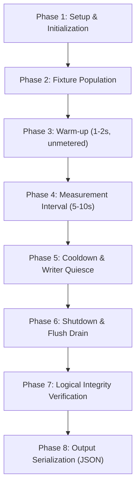

# LSM-Tree Synchronization Experiment Methodology: Approach A vs Approach B

**Protocol Version**: 1.0.0  
**Authors**: Antigravity Autonomous Engineering & Verification Agent  
**Approved Baseline Commit**: `ae8c034c438d56abbe6664e6472f7a0c1278797f` (`baseline-approach-a-verified`)  
**Approach B Implementation Revision**: `c58bc6177b5a925a0b25ba795957839866d0b040` (Phase I3 complete)  
**Target Milestone**: Phase I4 (Checkpoint CP4)

---

## 1. Executive Summary & Scientific Purpose

This document establishes the formal, controlled experimental methodology for empirically evaluating the performance and scalability trade-offs between two reader-compactor synchronization architectures in an LSM-tree storage engine:
1. **Approach A (Manager-Wide RWMutex Baseline)**: Readers acquire a shared read lock (`Manager.Mu.RLock()`) spanning in-memory lookups and all disk-tier SSTable searches. Compaction publication and Memtable-to-SSTable flush publication acquire an exclusive write lock (`Manager.Mu.Lock()`), halting all concurrent read traffic across the entire engine.
2. **Approach B (Immutable Reader-Set Snapshots with Two-Tier SharedReader Ownership)**: Readers inspect in-memory Memtables under a brief read lock, acquire an atomic pointer pin on an immutable `ReaderSnapshot` under `snapshotMu`, release `Manager.Mu`, and perform all disk-tier SSTable searches with **zero locks held**. Compaction and flush publication atomically swap the active `ReaderSnapshot` pointer without acquiring `Manager.Mu` for disk I/O and without blocking active pinned readers.

### Core Scientific Questions
- **Q1 (Read Scalability)**: Does eliminating the global read lock during disk SSTable traversal provide measurable throughput and latency improvements as reader concurrency scales to match and exceed CPU core counts?
- **Q2 (Tail Latency Under Compaction)**: Does Approach B eliminate the severe read tail-latency spikes ($p95, p99, p999$) that occur in Approach A when background compaction publishes replacement SSTables under an exclusive write lock?
- **Q3 (Negative Control & Memory Tier Overhead)**: Does Approach B introduce measurable overhead or offer zero benefit under workloads dominated by active Memtable lookups, where snapshot pinning is bypassed or redundant?
- **Q4 (Reader Churn & Physical Reclamation Cost)**: Under high write churn with frequent flushes and compactions, does Approach B's asynchronous reader retirement and cleanup pipeline maintain bounded queue depths without file descriptor leaks or CPU starvation?

---

## 2. Invariant & Structural Parity Between Modes

To ensure scientific honesty and isolate synchronization concurrency as the sole independent variable, all operational parameters between Approach A and Approach B are held strictly identical:

| Engine Component | Approach A (Baseline) | Approach B (Snapshots) | Parity Verification |
| :--- | :--- | :--- | :--- |
| **SSTable On-Disk Format** | Custom binary block format (varint index, crc32) | Identical binary block format | Verified bit-for-bit parity |
| **WAL Append & Sync** | Synchronous WAL append via `NewWal` | Identical synchronous WAL append | Byte-for-byte identical WAL records |
| **Memtable Structure** | 32-level concurrent SkipList | Identical 32-level SkipList | Identical structure and memory layout |
| **Flush Trigger Threshold** | Configurable via `MemtableThresholdBytes` (default 64MB) | Identical `MemtableThresholdBytes` | Configured identically in every trial |
| **Flush Queue Discipline** | Unbounded FIFO queue (`m.flushQueue`) | Identical unbounded FIFO queue | Synchronized via `flushQueueCond` |
| **Compaction Algorithm** | Min-heap $K$-way merge with deduplication | Identical min-heap $K$-way merge | Same deduplication and block sink |
| **Transaction Semantics** | MVCC with per-key conflict validation (`LatestValue`) | Identical MVCC with per-key conflict | Verified identical parity across 11 scenarios |
| **Engine Selection Seam** | `SyncModeApproachA` | `SyncModeApproachB` | Selected via `Config.Mode` on identical engine binary |

---

## 3. Workload Taxonomy

The evaluation defines five distinct, deterministic workloads. Each workload isolates a specific operational regime.

### 3.1 Workload A: Read-Only Baseline with Populated SSTables
- **Objective**: Measure pure read throughput and point-read latency under uncontended conditions with disk-tier SSTable traversal.
- **Fixture State**: Pre-populated with $N = 6$ SSTables, each containing 2,500 keys (15,000 total keys on disk). Active Memtable is empty.
- **Execution**: Readers execute point queries sampled from the keyspace. Zero background writes or compactions.
- **Expected Outcome**: At low concurrency ($1\text{--}4$ threads), Approach A and Approach B should show similar throughput. At high concurrency ($8\text{--}32$ threads), Approach B is expected to scale better due to zero cache-line contention on the `sync.RWMutex` reader count counter.

### 3.2 Workload B: Mixed Reads and Writes with Ongoing Flushes
- **Objective**: Measure point-read latency and throughput in the presence of continuous Memtable-to-SSTable flush publications.
- **Fixture State**: Pre-populated with 4 SSTables (10,000 keys). Background writer threads continuously insert new keys.
- **Execution**: Writer concurrency $= 2$, generating 500 writes/sec with a reduced Memtable threshold ($1\text{ MB}$) to force periodic flushes ($1\text{--}2\text{ flushes/sec}$). Readers execute continuous point queries across the combined key range.
- **Expected Outcome**: In Approach A, each flush publication acquires `m.Mu.Lock()`, creating periodic brief stalls for all readers. In Approach B, flush publication updates `m.currentSnapshot` under `m.snapshotMu` without acquiring `m.Mu` across disk I/O, yielding smoother read latencies.

### 3.3 Workload C: Reads Overlapping Forced Compaction
- **Objective**: Evaluate the impact of heavy background SSTable compaction on concurrent read tail latencies ($p95, p99, p999$).
- **Fixture State**: Pre-populated with 8 SSTables containing duplicate and obsolete key versions.
- **Execution**: A background compactor thread continuously executes `CompactAll()`, merging all SSTables into a single table. Readers execute continuous point queries across the compaction input keys.
- **Expected Outcome**: In Approach A, compaction publication holds `m.Mu.Lock()` while replacing readers and unlinking files, blocking all readers for multiple milliseconds. In Approach B, readers hold pinned snapshots and continue reading from superseded SSTables unblocked; publication occurs via atomic pointer swap. Approach B is expected to show a substantial reduction in tail latency ($p99$).

### 3.4 Workload D: Rapid Reader-Set Replacement Under Churn
- **Objective**: Stress-test Approach B's snapshot retirement, reference-counting, and asynchronous reader cleanup pipeline under continuous write, flush, and compaction churn.
- **Fixture State**: Initial 4 SSTables. Writer concurrency $= 4$ with aggressive flush threshold ($512\text{ KB}$) and periodic forced compactions every 500ms.
- **Execution**: High churn rate for 10 seconds. Monitor live physical readers, obsolete readers, pending cleanup queue depth, and memory allocations.
- **Expected Outcome**: Approach B must demonstrate that its two-tier ownership model prevents resource leaks: `PendingCleanupCount()` must remain bounded, file descriptors must not leak, and zero reader resurrection panics occur.

### 3.5 Workload E: Negative-Control Workload (Active Memtable Dominance)
- **Objective**: Verify that Approach B does **not** claim a false victory where snapshot pinning is irrelevant, and evaluate any CPU/instruction cache overhead introduced by Approach B.
- **Fixture State**: Database starts with 0 SSTables. All keys exist exclusively in the active in-memory `Memtable`.
- **Execution**: Readers query recently written keys residing 100% in `Memtable.SK`. Point reads return from the in-memory skip list under `m.Mu.RLock()` without ever descending to the disk tier or pinning snapshots.
- **Expected Outcome**: Approach B provides **zero performance advantage** over Approach A. Performance must be statistically indistinguishable, or slightly favor Approach A due to simpler code paths.

---

## 4. Deterministic Fixture Specification

| Parameter | Specification | Scientific Rationale |
| :--- | :--- | :--- |
| **PRNG Algorithm** | Linear-Congruential PRNG (`math/rand` with fixed seed) | Guaranteed identical sequence across OS platforms and Go versions |
| **Base Random Seed** | `42` (Trial seed: `42 + trial_index * 10007`) | Deterministic reproducibility; independent per-trial random streams |
| **User Key Length** | 16 bytes (Format: `user_key_%010d`) | Standard key length matching microbenchmark conventions |
| **Value Payload Length** | 128 bytes (Deterministic seeded payload + CRC) | Realistic payload size representing JSON/protobuf records |
| **Keyspace Cardinality** | 20,000 keys (Workloads A--D); 5,000 keys (Workload E) | Fits comfortably in memory to isolate synchronization from disk thrashing |
| **Initial SSTable Count** | Workload A: 6; Workload B: 4; Workload C: 8; Workload D: 4; Workload E: 0 | Enforces real multi-tier disk lookups |
| **Initial Keys per SSTable**| 2,500 keys per table | Ensures multi-block SSTables with valid index blocks |
| **Read Access Distribution**| Uniform Random AND Zipfian Skewed ($s = 0.99$, 80/20 power-law) | Evaluates both uniform scanning and hot-spot caching behavior |
| **Read Hit Ratio** | 95% target hits (existing keys), 5% target misses (`ErrNotFound`) | Evaluates full SSTable traversal on misses |
| **Fresh Database Directory**| Dedicated directory per trial (e.g. `test_data_trial_<id>`) | Prevents filesystem cross-contamination and leftover lock interference |

---

## 5. Concurrency Matrix & Hardware Manifest

### 5.1 Concurrency Matrix

Reader concurrency levels are calibrated to the host processor architecture:
- **Processor**: AMD Ryzen 7 7445HS (6 Physical Cores, 12 Logical Processors via SMT).
- **Core Allocation**:
  - `1`: Single-threaded baseline (zero contention).
  - `2`: Minimal concurrent scale.
  - `4`: Moderate concurrency (within physical cores).
  - `8`: Near physical core limit with SMT.
  - `12`: Exact match for logical processor count (`GOMAXPROCS = 12`).
  - `16, 24, 32`: Hyper-thread oversubscription to measure lock contention under CPU starvation.

### 5.2 Host Hardware & OS Manifests

```yaml
Hardware:
  CPU: AMD Ryzen 7 7445HS w/ Radeon 740M Graphics
  Physical Cores: 6
  Logical Processors: 12
  Base Clock: 3.20 GHz
  Max Boost Clock: ~4.70 GHz
  L1 Cache: 384 KB
  L2 Cache: 6 MB
  L3 Cache: 16 MB
  Total RAM: 15.23 GB (DDR5)

Environments:
  Windows 11 Native:
    OS: Microsoft Windows 11 Home Single Language (Build 26200)
    Go Version: go1.26.3 windows/amd64
    Filesystem: NTFS (C:\ drive, NVMe SSD)
    GOMAXPROCS: 12
  WSL2 Ubuntu Linux:
    OS: Ubuntu 24.04 LTS (Linux kernel 6.6.87.2-microsoft-standard-WSL2)
    Go Version: go1.27.2 linux/amd64
    Filesystem (Native Linux): ext4 (/ mounted on /dev/sdd)
    Filesystem (Windows Mount - EXCLUDED FROM EXPERIMENTS): 9P/drvfs (/mnt/c)
    GOMAXPROCS: 12
```

> [!CAUTION]
> **Filesystem Isolation Policy**: Experiments executed under WSL2 must strictly use paths on the native Linux `ext4` filesystem (`/tmp/selfdbms_bench_...`). Experiment paths under `/mnt/c/...` use the 9P/drvfs network translation layer and are strictly prohibited from official benchmark data collection. NTFS and ext4 data populations will be reported in separate tables and never pooled.

---

## 6. Operation-Level Measurement & Timing Controls (I4.4)

### 6.1 Avoiding Standard Benchmark Pitfalls
1. **Aggregate `ns/op` vs Operation-Level Latency**: Go's `testing.B` computes only `total_time / b.N`. This aggregate completely masks tail-latency spikes ($p95, p99, p999$) that occur during momentary lock acquisition stalls. The experiment harness records individual operation latencies into high-resolution sample buffers using `time.Now()` at nanosecond resolution.
2. **True Disk vs Memtable Accounting**: The harness directly tracks `m.SSTablePointReads()` and `m.MemtablePointReads()`. An in-memory Memtable hit is never reported as equivalent to a disk-tier SSTable traversal.
3. **Compaction Counter Verification**: Compaction activity is recorded via `m.CompactionsCompleted()` and `m.FlushesCompleted()`. Compaction overlap is never inferred from elapsed time.
4. **Sampling & Memory Overhead**: To prevent measurement distortion from unbounded slice allocation during high-throughput runs, the harness employs pre-allocated circular reservoir buffers and high-resolution latency histograms.

---

## 7. Experiment Execution Lifecycle



1. **Setup**: Allocate a fresh temporary directory on the verified target filesystem.
2. **Fixture Population**: Initialize engine with configured `SyncMode`. Populate seeded SSTables.
3. **Warm-up**: Run workload for $1\text{--}2$ seconds to warm CPU caches and file-system buffer caches. All warm-up metrics are discarded.
4. **Measurement**: Synchronously signal all worker goroutines via atomic barrier. Record all completed operations and individual latency samples.
5. **Cooldown**: Signal workers to halt. Wait for in-flight requests to complete.
6. **Shutdown**: Call `Manager.Close()`. Verify zero deadlocks, zero leaked goroutines, and clean error codes.
7. **Logical Verification**: Verify that expected keys exist and contain valid checksummed payloads.
8. **Serialization**: Write machine-readable JSON matching `result_schema.json`.

---

## 8. Repeatability, Statistical Analysis, and Uncertainty (I4.5)

- **Number of Trials**: In Phase I5, every cell in the concurrency matrix will be executed with $N = 10$ independent trials.
- **Interleaved Execution**: Trials alternate strictly between Approach A and Approach B (`A1, B1, A2, B2, ...`) to eliminate temporal and thermal drift.
- **Statistical Aggregation**: Results report median ($p50$), 95th percentile ($p95$), 99th percentile ($p99$), and interquartile range (IQR). Fixed $p$-values are not used as substitutes for empirical effect sizes and distributions.
- **Auditability**: Every raw JSON trial output is saved with its Git commit hash, timestamps, random seed, and system manifest.
