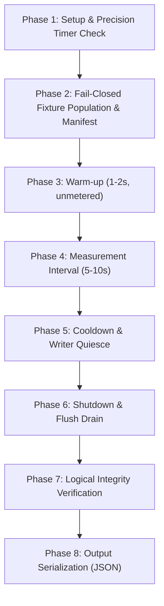

# LSM-Tree Synchronization Experiment Methodology: Approach A vs Approach B

**Protocol Version**: 2.0.0 (Phase I5-R Protocol Amendment: WSL2 Native ext4 Primary Campaign)  
**Authors**: Antigravity Autonomous Engineering & Verification Agent  
**Approved Baseline Commit**: `ae8c034c438d56abbe6664e6472f7a0c1278797f` (`baseline-approach-a-verified`)  
**Approach B Implementation Revision**: `c58bc6177b5a925a0b25ba795957839866d0b040` (Phase I3 complete)  
**Official Campaign Identifier**: `I5_WSL2_EXT4_RESTART_V1`  
**Target Milestone**: Phase I5 (Checkpoint CP5b)

---

## 1. Executive Summary & Scientific Purpose

This document establishes the formal, controlled experimental methodology for empirically evaluating the performance and scalability trade-offs between two reader-compactor synchronization architectures in an LSM-tree storage engine:
1. **Approach A (Manager-Wide RWMutex Baseline)**: Readers acquire a shared read lock (`Manager.Mu.RLock()`) spanning in-memory lookups and all disk-tier SSTable searches. Compaction publication and Memtable-to-SSTable flush publication acquire an exclusive write lock (`Manager.Mu.Lock()`), halting all concurrent read traffic across the entire engine.
2. **Approach B (Immutable Reader-Set Snapshots with Two-Tier SharedReader Ownership)**: Readers inspect in-memory Memtables under a brief read lock, acquire an atomic pointer pin on an immutable `ReaderSnapshot` under `snapshotMu`, release `Manager.Mu`, and perform all disk-tier SSTable searches with **zero locks held**. Compaction and flush publication atomically swap the active `ReaderSnapshot` pointer without acquiring `Manager.Mu` for disk I/O and without blocking active pinned readers.

### Core Scientific Questions
- **Q1 (Read Scalability)**: Does eliminating the global read lock during disk SSTable traversal provide measurable throughput and latency improvements as reader concurrency scales to match and exceed CPU core counts?
- **Q2 (Tail Latency Under Compaction)**: Does Approach B eliminate the severe read tail-latency spikes ($p95, p99, p999$) that occur in Approach A when background compaction publishes replacement SSTables under an exclusive write lock?
- **Q3 (Negative Control & Memory Tier Overhead)**: Does Approach B introduce measurable overhead or offer zero benefit under workloads dominated by active Memtable lookups, where snapshot pinning is bypassed or redundant?
- **Q4 (Reader Churn & Physical Reclamation Cost)**: Under high write churn with frequent flushes and compactions, does Approach B's asynchronous reader retirement and cleanup pipeline maintain bounded queue depths without file descriptor leaks or CPU starvation?

---

## 2. Invariant & Structural Parity Between Modes

To ensure scientific honesty and isolate synchronization concurrency as the sole independent variable, all operational parameters between Approach A and Approach B are held strictly identical:

| Engine Component | Approach A (Baseline) | Approach B (Snapshots) | Parity Verification |
| :--- | :--- | :--- | :--- |
| **SSTable On-Disk Format** | Custom binary block format (varint index, crc32) | Identical binary block format | Verified bit-for-bit parity |
| **WAL Append & Sync** | Synchronous WAL append via `NewWal` | Identical synchronous WAL append | Byte-for-byte identical WAL records |
| **Memtable Structure** | 32-level concurrent SkipList | Identical 32-level SkipList | Identical structure and memory layout |
| **Flush Trigger Threshold** | Configurable via `MemtableThresholdBytes` (default 64MB) | Identical `MemtableThresholdBytes` | Configured identically in every trial |
| **Flush Queue Discipline** | Unbounded FIFO queue (`m.flushQueue`) | Identical unbounded FIFO queue | Synchronized via `flushQueueCond` |
| **Compaction Algorithm** | Min-heap $K$-way merge with deduplication | Identical min-heap $K$-way merge | Same deduplication and block sink |
| **Transaction Semantics** | MVCC with per-key conflict validation (`LatestValue`) | Identical MVCC with per-key conflict | Verified identical parity across 11 scenarios |
| **Engine Selection Seam** | `SyncModeApproachA` | `SyncModeApproachB` | Selected via `Config.Mode` on identical engine binary |

---

## 3. Workload Taxonomy

The evaluation defines six distinct, deterministic workloads across five core workload regimes. Each workload isolates a specific operational regime.

### 3.1 Workload A: Read-Only Baseline with Populated SSTables
- **Objective**: Measure pure read throughput and point-read latency under uncontended conditions with disk-tier SSTable traversal.
- **Fixture State**: Pre-populated with $N = 6$ SSTables, dynamically partitioned across `KeyspaceCardinality` (10,000 keys). Active Memtable is empty.
- **Execution**: Readers execute point queries sampled from the keyspace. Zero background writes or compactions.
- **Expected Outcome**: At low concurrency ($1\text{--}4$ threads), Approach A and Approach B should show similar throughput. At high concurrency ($8\text{--}32$ threads), Approach B is expected to scale better due to zero cache-line contention on the `sync.RWMutex` reader count counter.

### 3.2 Workload B: Mixed Concurrent Reads and Writes

Workload B is bifurcated into two scientifically distinct variants to separate natural write progress from explicit flush publication interference:

#### 3.2.1 Workload B1: Natural Write Progress (Production Threshold, Zero Flushes Claimed)
- **Objective**: Measure point-read latency and concurrent write progress under realistic durability settings (`wal_sync=true`) with a standard Memtable threshold (1 MB).
- **Fixture State**: Pre-populated with 4 SSTables (10,000 keys).
- **Execution**: 2 writer goroutines issue serial write transactions with WAL fsync. Readers execute continuous point queries across the keyspace. In a 10-second trial, write volume does not fill the 1 MB buffer; exactly 0 flushes occur.
- **Reporting Contract**: The harness explicitly reports 0 flushes completed and `flush_latency = null`. The metric of interest is reader throughput and total completed write transactions. In Approach A, readers holding `m.Mu.RLock()` across disk I/O starve incoming writers waiting for `m.Mu.Lock()`, resulting in dramatically suppressed write throughput (e.g. 15 writes in 10s on Windows NTFS). In Approach B, readers release `m.Mu` before reading SSTables, allowing writers to make 20–240x greater progress (e.g. 3,614 writes in 10s on Windows NTFS).

#### 3.2.2 Workload B2: Controlled Flush Interference (Scheduled Flushes with Reader Overlap)
- **Objective**: Directly measure point-read latency interference during Memtable-to-SSTable flush publication.
- **Fixture State**: Pre-populated with 4 SSTables (10,000 keys). Memtable threshold set high (64 MB) to prevent untracked auto-flushes.
- **Execution**: A dedicated harness coordinator goroutine periodically injects write batches (50 keys) and triggers synchronous flushes via `man.TriggerFlush()` every 2,000 ms (pilot) / 500 ms (smoke). Readers execute continuous point queries.
- **Reporting Contract**: The harness tracks `flush_overlap_nanos`, `reads_during_flush`, `attempted_flushes`, `completed_flushes`, and `delayed_flushes`. In Approach A, `m.Mu.Lock()` blocks all readers during flush publication. In Approach B, readers continue querying pinned snapshots unblocked while the atomic snapshot swap occurs.

### 3.3 Workload C: Reads Overlapping Forced Compaction
- **Objective**: Evaluate the impact of heavy background SSTable compaction on concurrent read tail latencies ($p95, p99, p999$).
- **Fixture State**: Pre-populated with 8 SSTables containing duplicate and obsolete key versions.
- **Execution**: A background compactor thread continuously executes `CompactAll()`, merging all SSTables into a single table. Readers execute continuous point queries across the compaction input keys.
- **Expected Outcome**: In Approach A, compaction publication holds `m.Mu.Lock()` while replacing readers and unlinking files, blocking all readers for multiple milliseconds. In Approach B, readers hold pinned snapshots and continue reading from superseded SSTables unblocked; publication occurs via atomic pointer swap. Approach B is expected to show a substantial reduction in tail latency ($p99$).

### 3.4 Workload D: Rapid Reader-Set Replacement Under Churn
- **Objective**: Stress-test Approach B's snapshot retirement, reference-counting, and asynchronous reader cleanup pipeline under continuous write, flush, and compaction churn.
- **Fixture State**: Initial 4 SSTables.
- **Execution & Calibration**: Calibrated with `MemtableThresholdBytes = 16 * 1024` (16 KB, ~105 keys per flush) and `CompactionTriggerIntervalMs = 1500` (1,500 ms). 2 concurrent writer threads continuously write new keys, generating 4–23 flushes over a 10s trial. The compactor runs repeatedly, executing 4–6 completed multi-table compactions with live reader-set replacements while reader goroutines maintain active pins.
- **Expected Outcome**: Continuously produces reader-set replacements and reader overlap. Approach B must demonstrate that its two-tier ownership model prevents resource leaks: `PendingCleanupCount()` must remain bounded, file descriptors must not leak, and zero reader resurrection panics occur.

### 3.5 Workload E: Negative-Control Workload (Active Memtable Dominance)
- **Objective**: Verify that Approach B does **not** claim a false victory where snapshot pinning is irrelevant, and evaluate any CPU/instruction cache overhead introduced by Approach B.
- **Fixture State**: Database starts with 0 SSTables. All keys exist exclusively in the active in-memory `Memtable` (`TargetReadHitRatio = 1.0`).
- **Execution**: Readers query recently written keys residing 100% in `Memtable.SK`. Point reads return from the in-memory skip list under `m.Mu.RLock()` without ever descending to the disk tier or pinning snapshots.
- **Expected Outcome**: Approach B provides **zero performance advantage** over Approach A. Performance must be statistically indistinguishable, or slightly favor Approach A due to simpler code paths.

---

## 4. Deterministic Fixture Specification & Fail-Closed Invariants

| Parameter | Specification | Scientific Rationale |
| :--- | :--- | :--- |
| **PRNG Algorithm** | Linear-Congruential PRNG (`math/rand` with fixed seed) | Guaranteed identical sequence across OS platforms and Go versions |
| **Base Random Seed** | `42` (Trial seed: `42 + trial_index * 10007`) | Deterministic reproducibility; independent per-trial random streams |
| **User Key Length** | 16 bytes (Format: `user_key_%010d`) | Standard key length matching microbenchmark conventions |
| **Value Payload Length** | 128 bytes (Deterministic seeded payload + CRC) | Realistic payload size representing JSON/protobuf records |
| **Keyspace Cardinality** | 10,000 keys (Workloads A--D); 5,000 keys (Workload E) | Fits comfortably in memory to isolate synchronization from disk thrashing |
| **Initial SSTable Count** | Workload A: 6; Workload B1: 4; Workload B2: 4; Workload C: 8; Workload D: 4; Workload E: 0 | Enforces real multi-tier disk lookups |
| **Dynamic Key Partitioning**| `keysPerTable := (KeyspaceCardinality + InitialSSTableCount - 1) / InitialSSTableCount` | Guarantees 100% keyspace population without artificial misses |
| **Read Access Distribution**| Uniform Random AND Zipfian Skewed ($s = 0.99$, 80/20 power-law) | Evaluates both uniform scanning and hot-spot caching behavior |
| **Read Hit Ratio** | 95% target hits (existing keys), 5% target misses (`ErrNotFound`) | Evaluates full SSTable traversal on misses; 100% on Workload E |
| **Fresh Database Directory**| Dedicated directory per trial (e.g. `test_data_trial_<id>`) | Prevents filesystem cross-contamination and leftover lock interference |

### 4.1 Fail-Closed Fixture Contract
To prevent silent benchmark corruption, fixture population enforces strict fail-closed invariants:
1. **Transaction & Commit Verification**: Every `tx.Put()` and `tx.Commit()` return code is checked. Any failure immediately aborts the trial with an error before warmup.
2. **Synchronized Flush Drain**: Every `man.TriggerFlush()` is followed by `man.WaitForFlushCompletion()`. Any flush error immediately aborts the trial.
3. **Table Count Invariant**: After fixture population, `man.ActiveSSTableCount()` is asserted to equal `cfg.InitialSSTableCount`. Any mismatch fails closed.
4. **Boundary & Sample Readback Verification**: Before entering warmup, sample keys from every populated table (first, middle, and last keys) are read back and payload integrity is verified.
5. **Fixture Manifest**: Every trial JSON records a `FixtureManifest` capturing committed keys, expected and actual table counts, flush errors, readback status, and initialization duration.

---

## 5. Concurrency Matrix & Hardware Manifest

### 5.1 Concurrency Matrix

Reader concurrency levels are calibrated to the host processor architecture:
- **Processor**: AMD Ryzen 7 7445HS (6 Physical Cores, 12 Logical Processors via SMT).
- **Core Allocation**:
  - `1`: Single-threaded baseline (zero contention).
  - `2`: Minimal concurrent scale.
  - `4`: Moderate concurrency (within physical cores).
  - `8`: Near physical core limit with SMT.
  - `12`: Exact match for logical processor count (`GOMAXPROCS = 12`).
  - `16, 24, 32`: Hyper-thread oversubscription to measure lock contention under CPU starvation.

### 5.2 Host Hardware & OS Manifests

```yaml
Hardware:
  CPU: AMD Ryzen 7 7445HS w/ Radeon 740M Graphics
  Physical Cores: 6
  Logical Processors: 12
  Base Clock: 3.20 GHz
  Max Boost Clock: ~4.70 GHz
  L1 Cache: 384 KB
  L2 Cache: 6 MB
  L3 Cache: 16 MB
  Total RAM: 15.23 GB (DDR5)

Environments:
  Windows 11 Native:
    OS: Microsoft Windows 11 Home Single Language (Build 26200)
    Go Version: go1.26.3 windows/amd64
    Filesystem: NTFS (C:\ drive, NVMe SSD)
    GOMAXPROCS: 12
  WSL2 Ubuntu Linux:
    OS: Ubuntu 24.04 LTS (Linux kernel 6.6.87.2-microsoft-standard-WSL2)
    Go Version: go1.27.2 linux/amd64
    Filesystem (Native Linux): ext4 (/ mounted on /dev/sdd)
    Filesystem (Windows Mount - EXCLUDED FROM EXPERIMENTS): 9P/drvfs (/mnt/c)
    GOMAXPROCS: 12
```

> [!CAUTION]
> **Filesystem Isolation Policy**: Experiments executed under WSL2 must strictly use paths on the native Linux `ext4` filesystem (`/tmp/selfdbms_bench_...`). Experiment paths under `/mnt/c/...` use the 9P/drvfs network translation layer and are strictly prohibited from official benchmark data collection. NTFS and ext4 data populations will be reported in separate tables and never pooled.

---

## 6. Operation-Level Measurement & Timing Controls (I4.4)

### 6.1 Avoiding Standard Benchmark Pitfalls
1. **Aggregate `ns/op` vs Operation-Level Latency**: Go's `testing.B` computes only `total_time / b.N`. This aggregate completely masks tail-latency spikes ($p95, p99, p999$) that occur during momentary lock acquisition stalls. The experiment harness records individual operation latencies into high-resolution sample buffers using verified precision timers.
2. **True Disk vs Memtable Accounting**: The harness directly tracks `m.SSTablePointReads()` and `m.MemtablePointReads()`. An in-memory Memtable hit is never reported as equivalent to a disk-tier SSTable traversal.
3. **Compaction & Flush Counter Verification**: Compaction and flush activity are recorded via explicit lifecycle counters (`m.CompactionsCompleted()`, `m.FlushesCompleted()`). Compaction and flush overlap are tracked via nanosecond timestamps and reader counts during active windows.
4. **Sampling & Memory Overhead**: To prevent measurement distortion from unbounded slice allocation during high-throughput runs, the harness employs pre-allocated circular reservoir buffers and high-resolution latency histograms.

### 6.2 Precision Timing and Overflow Guards
- **Windows QPC Implementation**: On Windows, the timer utilizes `QueryPerformanceCounter` and `QueryPerformanceFrequency` via `kernel32.dll` (~10 MHz resolution, ~100ns per tick). `EnsurePrecisionTimer()` strictly validates API return codes and asserts `freq > 0`, eliminating silent fallbacks.
- **Tick-to-Nanosecond Overflow Protection**: `TicksToNanos(ticks, freq)` decomposes large tick values using split arithmetic: `(ticks / freq) * 1e9 + ((ticks % freq) * 1e9) / freq`, preventing 64-bit integer overflow even for trials spanning hours or billions of ticks.
- **Linux/POSIX Implementation**: On Linux/WSL2, monotonic time is recorded via `time.Now()` with `time.Since()` nanosecond resolution, backed by POSIX `CLOCK_MONOTONIC`.

### 6.3 Sample Sufficiency and Tail Latency Serialization
Tail percentiles are only reported when mathematically supported by recorded sample counts:
- $p50$: requires $N \ge 1$ sample.
- $p95$: requires $N \ge 20$ samples.
- $p99$: requires $N \ge 100$ samples.
- $p999$: requires $N \ge 1,000$ samples.
When a trial records fewer samples than required for a percentile, the field is explicitly serialized as `null` in the output JSON.

---

## 7. Experiment Execution Lifecycle



1. **Setup**: Allocate a fresh temporary directory on the verified target filesystem. Assert precision timer operational status via `EnsurePrecisionTimer()`.
2. **Fixture Population**: Initialize engine with configured `SyncMode`. Populate seeded SSTables. Verify commits, drain flushes, verify table count, verify sample key readback, and record `FixtureManifest`. Fail closed on any discrepancy.
3. **Warm-up**: Run workload for $1\text{--}2$ seconds to warm CPU caches and file-system buffer caches. All warm-up metrics are discarded.
4. **Measurement**: Synchronously signal all worker goroutines via atomic barrier. Record all completed operations, individual latency samples, and overlap counters.
5. **Cooldown**: Signal workers to halt. Wait for in-flight requests to complete.
6. **Shutdown**: Call `Manager.Close()`. Verify zero deadlocks, zero leaked goroutines, and clean error codes.
7. **Logical Verification**: Verify that expected keys exist and contain valid checksummed payloads.
8. **Serialization**: Write machine-readable JSON matching `result_schema.json`.

---

## 8. Experimental Campaign Protocol & Platform Scope Amendment (Phase I5-R)

### 8.1 Protocol Amendment: Scope & Platform Selection

Under the original Protocol 1.0.0, the measurement campaign was planned as a dual-platform evaluation:
- **Former Protocol (Dual-Platform)**: 6 workloads $\times$ 8 reader levels $\times$ 2 sync modes $\times$ 2 platforms (Windows NTFS and WSL2 ext4) $\times$ 10 repetitions = **1,920 planned trials**.

Following empirical pilot execution and partial campaign runs (Checkpoint CP5 / CP5a), the external reviewer formally approved reducing the primary empirical evaluation to **WSL2 Ubuntu on native Linux ext4 only**:
- **Revised Protocol (WSL2 Native ext4 Primary)**: 6 workloads $\times$ 8 reader levels $\times$ 2 sync modes $\times$ 1 platform (WSL2 native ext4) $\times$ 10 repetitions = **960 planned trials**.

### 8.2 Rationale for Windows NTFS Exclusion from Primary Campaign

1. **Filesystem Driver Serialization Overhead**: On Windows NTFS, synchronous file system metadata updates, mandatory locking semantics, and path resolution overhead dominate execution time during write-heavy workloads (e.g. Workload B1 completed only 15 writes in 10s under Approach A on NTFS due to OS-level write serialization). This creates an artificial bottleneck that reflects Windows NTFS kernel I/O characteristics rather than LSM-tree reader-compactor synchronization concurrency.
2. **Excessive Wall-Clock Trial Cost**: Windows NTFS trials required 30–100 seconds per trial under load, projecting to >30–36 hours for remaining repetitions. By contrast, WSL2 native ext4 executes cleanly at ~10–12 seconds wall-clock per 10s trial, permitting complete, statistically robust 10-repetition coverage within ~3.2 hours.
3. **Preservation of Scientific Integrity**: Windows NTFS exploratory data collected during Phase I4/I5 (including 314 raw trial JSONs and preliminary CP5 CSV records) is permanently archived in `research/experiments/data/campaign/windows_ntfs/` and documented as exploratory evidence. It is not deleted, but is excluded from the primary statistical comparison.

### 8.3 Prospective & Independent Campaign Execution Contract

- **Campaign Identifier**: `I5_WSL2_EXT4_RESTART_V1`
- **Output Destination**: All official measurement records are written to a fresh, isolated directory:
  `research/experiments/data/campaign_wsl2_ext4_restart_v1/wsl2_ext4/`
- **Clean Baseline from Repetition 1**: The official campaign executes all 10 independent repetitions prospectively ($rep = 1 \dots 10$). Old observations are never mixed into this fresh dataset.
- **Anti-Cherry-Picking Invariant**: Substituting, interpolating, or cherry-picking previous favorable measurements into the official dataset is strictly prohibited. Every cell must be measured afresh under identical, controlled conditions.
- **Single Frozen Source Revision**: All 960 trials are executed using the exact frozen Git commit SHA recorded in the trial manifest.

### 8.4 Virtualization & Threats to External Validity

> [!WARNING]
> **WSL2 Virtualization Boundary Limitation**:
> Measurements are collected inside a WSL2 virtual machine running Ubuntu 24.04.3 LTS (Linux kernel 6.6.87.2-microsoft-standard-WSL2) backed by a virtual disk mounted on ext4 (`/dev/sdd`).
> - WSL2 ext4 is **virtualized Linux**, not bare-metal Linux. Virtualized page cache interactions, Hyper-V memory ballooning, and virtual disk I/O scheduling differ from bare-metal physical NVMe storage.
> - Conclusions apply strictly to the evaluated WSL2 Linux environment and cannot establish universal filesystem or operating-system performance claims across bare-metal Linux, macOS APFS, or physical server environments.

### 8.5 Workload & Concurrency Matrix Dimensions

The 960 official trials explore the full Cartesian product:

| Dimension | Values | Count |
| :--- | :--- | :---: |
| **Workloads** | A (Read-Only), B1 (Natural Write Progress), B2 (Controlled Flush Interference), C (Compaction Overlap), D (Reader Churn), E (Negative Control Memtable) | 6 |
| **Reader Concurrency** | 1, 2, 4, 8, 12, 16, 24, 32 goroutines | 8 |
| **Sync Modes** | Approach A (`SyncModeApproachA`), Approach B (`SyncModeApproachB`) | 2 |
| **Platform** | WSL2 Ubuntu Native Linux ext4 | 1 |
| **Repetitions** | 10 independent trials per cell ($rep = 1 \dots 10$) | 10 |
| **Total Official Trials** | $6 \times 8 \times 2 \times 1 \times 10$ | **960** |

### 8.6 Invariant Timing & Workload Parameters

All trials adhere strictly to the frozen calibrated parameters:
- **Measurement Duration**: Exactly 10,000 ms (10 seconds) per trial.
- **Warmup Duration**: 2,000 ms unmetered warmup preceding measurement.
- **Durability**: `wal_sync = true` synchronously enforced on all writes.
- **SSTable Counts**: 4 initial SSTables (Workloads A, B1, B2, D); 8 tables (Workload C); 0 tables (Workload E).
- **Keyspace Cardinality**: 10,000 keys (Workloads A–D); 2,000 keys (Workload E).
- **Target Hit Rate**: 95% (Workloads A–D); 100% (Workload E).
- **PRNG Seeds**: Deterministically derived per trial: `42000000 + (wIdx * 100000) + (readers * 1000) + (rep * 10) + mIdx`.

### 8.7 Statistical Aggregation & Uncertainty Reporting

- **Sample Sufficiency Rules (D-043)**: $p50$ requires $N \ge 1$; $p95$ requires $N \ge 20$; $p99$ requires $N \ge 100$; $p999$ requires $N \ge 1,000$. Underpowered percentiles are serialized strictly as `null`.
- **Effect Sizes & 95% Confidence Intervals**: For each configuration cell, the 10 independent trial observations are aggregated using non-parametric medians, interquartile ranges (IQR), and 95% bootstrap confidence intervals over trial medians.
- **Paired A/B Comparisons**: Measured B/A throughput speedup ratios and tail-latency reduction factors are evaluated with paired statistical tests across identical random seeds.
- **No Claims of Universal Superiority**: Findings will report both operational regimes where Approach B demonstrates marked superiority (Workloads C, D) and regimes of equivalence or minor tradeoff (Workloads A, E, publication critical section variance).
