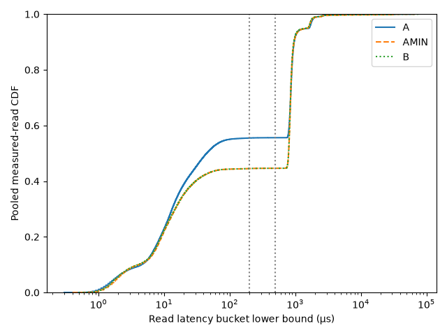
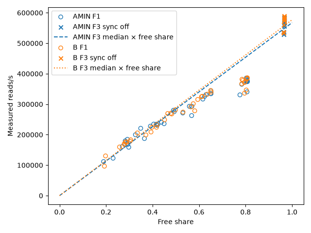

# X-followup-v1 analysis

## Provenance

| Field | Value |
| --- | --- |
| campaign_id | X-followup-v1 |
| master_seed | 20261108 |
| settle_ms | 20000 |
| plan_sha256 | 394675b73698ef4afeed5af747b59970bc57cec03c66bc9c7642322ff2e04f51 |
| ledger_sha256 | 1efd08e4bb13169c96e26cc9303a2192d67fcc3b9bdf57e05cb91b58e17a225f |
| runner_sha256 | 6d065832f6398dd66e79eb56e9fc961c091e139cf50abfa63c160b45770e2c77 |
| git_revision | fc7998c5d5266b690a6e6276267ff34102c63e49 |
| platform | {"allow_dirty": false, "campaign_id": "X-followup-v1", "checked_utc": "2026-11-04T06:52:25.6527181Z", "data_root": "C:\\Users\\ramst\\Documents\\Projects\\selfdbms\\research\\experiments\\phase_i7\\X_READCOST\\followup\\data", "free_disk_bytes": 150588502016, "git_dirty": false, "git_head": "fc7998c5d5266b690a6e6276267ff34102c63e49", "git_status": "", "goarch": "amd64", "goos": "windows", "plan_sha256": "394675b73698ef4afeed5af747b59970bc57cec03c66bc9c7642322ff2e04f51", "power_scheme": "Power Scheme GUID: 381b4222-f694-41f0-9685-ff5bb260df2e  (Balanced)", "runner_path": "C:\\Users\\ramst\\Documents\\Projects\\selfdbms\\research\\experiments\\phase_i7\\X_READCOST\\followup_bin\\i7trial.exe", "runner_sha256": "6d065832f6398dd66e79eb56e9fc961c091e139cf50abfa63c160b45770e2c77", "selftest": {"affinity": {"actual": "0xfff", "actual_cores": [0, 1, 2, 3, 4, 5, 6, 7, 8, 9, 10, 11], "expected": "unset", "match": true}, "cgo_enabled": "", "protocol": "1.2.0-windows", "runtime": {"affinity_mask": "0xfff", "exe_path": "C:\\Users\\ramst\\Documents\\Projects\\selfdbms\\research\\experiments\\phase_i7\\X_READCOST\\followup_bin\\i7trial.exe", "exe_sha256": "6d065832f6398dd66e79eb56e9fc961c091e139cf50abfa63c160b45770e2c77", "go_version": "go1.26.3", "goarch": "amd64", "gomaxprocs": 12, "goos": "windows", "num_cpu": 12, "protocol_version": "1.2.0-windows"}, "schedule": {"clock": "QueryPerformanceCounter", "interval_us": 5000, "max_abs_err_us": 54.3, "n": 200, "p50_abs_err_us": 0.3, "p95_abs_err_us": 3, "p99_abs_err_us": 9.4}, "schema": "i7.selftest.v1", "separate": ["E7"], "supported": ["E1", "E2", "E3", "E4", "E5", "D3", "PF", "SMOKE", "X1", "X2", "X3", "X4", "ANCHOR"], "timers": {"now_distinct_values": 61, "now_effective_hz": 1126.3465380538946, "now_min_positive_delta_ns": 322800, "now_window_ns": 54157400, "qpc_burst_ns": 1498100, "qpc_freq_hz": 10000000, "qpc_min_positive_delta_ns": 100, "sleep1ms_max_abs_err_ns": 801900, "sleep1ms_mean_ns": 1461438}, "tmp_dir": "C:\\Users\\ramst\\AppData\\Local\\Temp"}, "trial_timeout": "2m0s"} |
| counts | {"attempted": 150, "attempts": 150, "dropped_units": 0, "failed": 0, "failed_attempts": 0, "missing": 0, "planned": 150, "successful": 150} |

## H_F1: primary, 90% Student t CI

| Arm | n | Mean slope | CI | Bootstrap CI | Rounds | Excluded | Supported |
| --- | --- | --- | --- | --- | --- | --- | --- |
| AMIN | 10 | 0.76834 | [0.7311610847361273, 0.8055197930922072] | [0.7353977408524616, 0.7992125182674644] | [1, 2, 3, 4, 5, 6, 7, 8, 9, 10] | [] | False |
| B | 10 | 0.778796 | [0.7447996222665053, 0.8127920664029454] | [0.7529652519091813, 0.810329256262479] | [1, 2, 3, 4, 5, 6, 7, 8, 9, 10] | [] | False |

## H_F2: Page trend, Holm family of two

| Arm | Result |
| --- | --- |
| AMIN | {"L": 299.0, "cells": ["F1_w0732_m16", "F1_w0549_m16", "F1_w0366_m16", "F1_w0183_m16"], "excluded_rounds": [], "family": "H-F2 (2)", "holm_p": 9.778658339033623e-13, "mean_ranks": [1.0, 2.1, 2.9, 4.0], "method": "exact", "n": 10, "p": 4.889329169516812e-13, "predicted_ranks": [1, 2, 3, 4], "rounds": [1, 2, 3, 4, 5, 6, 7, 8, 9, 10], "supported": true} |
| B | {"L": 299.0, "cells": ["F1_w0732_m16", "F1_w0549_m16", "F1_w0366_m16", "F1_w0183_m16"], "excluded_rounds": [], "family": "H-F2 (2)", "holm_p": 9.778658339033623e-13, "mean_ranks": [1.0, 2.1, 2.9, 4.0], "method": "exact", "n": 10, "p": 4.889329169516812e-13, "predicted_ranks": [1, 2, 3, 4], "rounds": [1, 2, 3, 4, 5, 6, 7, 8, 9, 10], "supported": true} |

## H_F3: read equivalence, Holm family of three

| Cell | Result |
| --- | --- |
| F1_w0183_m16 | {"bootstrap_ci": [0.9807979754289917, 1.003738138456942], "classification": "equivalent", "excluded_rounds": [], "family": "H-F3 (3)", "geometric_mean_ratio": 0.9924433571216694, "holm_p": 5.036487359346344e-07, "level": 0.9, "mean_log": -0.007585338959554733, "median_ratio": 0.993472725569363, "n": 10, "numerator_lower": false, "p_lower": 1.6788291197821145e-07, "p_tost": 1.6788291197821145e-07, "p_upper": 4.8214621161498644e-08, "rounds": [1, 2, 3, 4, 5, 6, 7, 8, 9, 10], "sd_log": 0.02338505365272492, "supported": true, "t_ci": [0.9790806938290372, 1.0059883963628804], "t_ci_log": [-0.021141215099598515, 0.0059705371804890505], "undefined_n": 0, "zero_adjusted_W_rounds": []} |
| F1_w0366_m16 | {"bootstrap_ci": [0.9261757897122043, 1.0593563198329634], "classification": "equivalent", "excluded_rounds": [], "family": "H-F3 (3)", "geometric_mean_ratio": 0.9921427849969578, "holm_p": 0.047533609849625, "level": 0.9, "mean_log": -0.007888245566257978, "median_ratio": 1.00075344605858, "n": 10, "numerator_lower": false, "p_lower": 0.0237668049248125, "p_tost": 0.0237668049248125, "p_upper": 0.012932655252893999, "rounds": [1, 2, 3, 4, 5, 6, 7, 8, 9, 10], "sd_log": 0.13441867271649008, "supported": true, "t_ci": [0.9177702205691873, 1.0725422156441753], "t_ci_log": [-0.08580822408388247, 0.07003173295136653], "undefined_n": 0, "zero_adjusted_W_rounds": []} |
| F1_w0549_m16 | {"bootstrap_ci": [0.8851118612119016, 1.0872638403873474], "classification": "inconclusive", "excluded_rounds": [], "family": "H-F3 (3)", "geometric_mean_ratio": 0.9827991186417685, "holm_p": 0.10645031638771281, "level": 0.9, "mean_log": -0.0173505351184124, "median_ratio": 0.975654081822664, "n": 10, "numerator_lower": false, "p_lower": 0.10645031638771281, "p_tost": 0.10645031638771281, "p_upper": 0.04720966469776159, "rounds": [1, 2, 3, 4, 5, 6, 7, 8, 9, 10], "sd_log": 0.20760054172093415, "supported": false, "t_ci": [0.8713664495390403, 1.1084820951208332], "t_ci_log": [-0.13769266783133233, 0.10299159759450753], "undefined_n": 0, "zero_adjusted_W_rounds": []} |

## H_F4: arithmetic trial region shares, 95% Student t CI

| Region | Result |
| --- | --- |
| fast | {"bootstrap_ci": [0.5522606394270931, 0.5567446103023728], "level": 0.95, "max": 0.557737356152635, "mean": 0.5550528196719428, "min": 0.5431211747344994, "n": 10, "predicted": "at_least", "supported": true, "t_ci": [0.5520011477673902, 0.5581044915764953], "t_ci_95": [0.5520011477673902, 0.5581044915764953], "threshold": 0.2, "undefined_n": 0, "values": [0.5431211747344994, 0.5554161386250424, 0.557737356152635, 0.5556457065584854, 0.5555881303217254, 0.5561962221882796, 0.5560064935064936, 0.5565529847756411, 0.5575383087956733, 0.5567256810609525]} |
| valley | {"bootstrap_ci": [0.0009274783840668732, 0.001327599386499841], "level": 0.95, "max": 0.0019715992936110505, "mean": 0.0011008204090125595, "min": 0.0008238030626090328, "n": 10, "predicted": "at_most", "supported": true, "t_ci": [0.0008520348291263153, 0.0013496059888988036], "t_ci_95": [0.0008520348291263153, 0.0013496059888988036], "threshold": 0.1, "undefined_n": 0, "values": [0.0019715992936110505, 0.0009912543759489066, 0.001280065539355615, 0.0011678652652283483, 0.000981491867638811, 0.0008400794256911562, 0.0008238030626090328, 0.001214443108974359, 0.00090138342760846, 0.000836218723459855]} |
| blocked | {"bootstrap_ci": [0.4422185829862396, 0.44645975344681604], "level": 0.95, "max": 0.4549072259718896, "mean": 0.4438463599190447, "min": 0.44098257830800935, "n": 10, "predicted": "at_least", "supported": true, "t_ci": [0.44100219825090087, 0.4466905215871885], "t_ci_95": [0.44100219825090087, 0.4466905215871885], "threshold": 0.2, "undefined_n": 0, "values": [0.4549072259718896, 0.44359260699900877, 0.44098257830800935, 0.4431864281762862, 0.4434303778106358, 0.4429636983860292, 0.44316970343089745, 0.44223257211538464, 0.4415603077767182, 0.44243810021558766]} |

## H_F4: frozen lower-bound decision and boundary description

| Field | Value |
| --- | --- |
| supported | True |
| bucket_convention | lower_ns |
| boundary_trials | ["F4_r04_d0000_t01_A", "F4_r04_d0000_t01_AMIN", "F4_r04_d0000_t01_B", "F4_r04_d0000_t02_AMIN", "F4_r04_d0000_t03_A", "F4_r04_d0000_t03_AMIN", "F4_r04_d0000_t04_A", "F4_r04_d0000_t04_AMIN", "F4_r04_d0000_t04_B", "F4_r04_d0000_t05_B", "F4_r04_d0000_t06_A", "F4_r04_d0000_t06_AMIN", "F4_r04_d0000_t06_B", "F4_r04_d0000_t08_A", "F4_r04_d0000_t08_AMIN", "F4_r04_d0000_t08_B", "F4_r04_d0000_t09_A", "F4_r04_d0000_t09_AMIN", "F4_r04_d0000_t10_A", "F4_r04_d0000_t10_AMIN", "F4_r04_d0000_t10_B"] |

## H_X: flush check and H-F1 sensitivity

| Field | Value |
| --- | --- |
| supported | True |
| violations | [] |
| rounds | [] |
| frozen_H_F1 | H_F1 includes all complete rounds |
| H_F1_without_flush_rounds | NA |

## Per-arm quantities

| Cell | Arm | Metric | Summary |
| --- | --- | --- | --- |
| F1_w0183_m16 | AMIN | R | {"bootstrap_ci": [356727.56374526664, 377716.44461770885], "level": 0.95, "max": 385987.4729808769, "mean": 368195.1279885588, "min": 330617.2, "n": 10, "t_ci": [355204.4949748842, 381185.76100223337], "t_ci_95": [355204.4949748842, 381185.76100223337], "undefined_n": 0} |
| F1_w0183_m16 | AMIN | W | {"bootstrap_ci": [182.9995428696742, 182.9999950590002], "level": 0.95, "max": 183, "mean": 182.99984243822522, "min": 182.99850307224486, "n": 10, "t_ci": [182.99950573504714, 183.0001791414033], "t_ci_95": [182.99950573504714, 183.0001791414033], "undefined_n": 0} |
| F1_w0183_m16 | AMIN | hold_share | {"bootstrap_ci": [0.194012985064014, 0.2067814103314822], "level": 0.95, "max": 0.22436714, "mean": 0.19955322067401737, "min": 0.19186208056818096, "n": 10, "t_ci": [0.19150366314339476, 0.20760277820464], "t_ci_95": [0.19150366314339476, 0.20760277820464], "undefined_n": 0} |
| F1_w0183_m16 | AMIN | free_share | {"bootstrap_ci": [0.7932185896685179, 0.805987014935986], "level": 0.95, "max": 0.808137919431819, "mean": 0.8004467793259826, "min": 0.77563286, "n": 10, "t_ci": [0.79239722179536, 0.8084963368566053], "t_ci_95": [0.79239722179536, 0.8084963368566053], "undefined_n": 0} |
| F1_w0183_m16 | AMIN | flushes | {"bootstrap_ci": [0.0, 0.0], "level": 0.95, "max": 0, "mean": 0.0, "min": 0, "n": 10, "t_ci": [0.0, 0.0], "t_ci_95": [0.0, 0.0], "undefined_n": 0} |
| F1_w0183_m16 | AMIN | largest_fsync_ns | {"bootstrap_ci": [7986460.0, 19603550.0], "level": 0.95, "max": 31360500, "mean": 12960810.0, "min": 6496000, "n": 10, "t_ci": [5948384.4119152, 19973235.588084802], "t_ci_95": [5948384.4119152, 19973235.588084802], "undefined_n": 0} |
| F1_w0183_m16 | AMIN | fsync_count_ge_25ms | {"bootstrap_ci": [0.0, 2.7], "level": 0.95, "max": 6, "mean": 1.1, "min": 0, "n": 10, "t_ci": [-0.5674620133199171, 2.7674620133199173], "t_ci_95": [-0.5674620133199171, 2.7674620133199173], "undefined_n": 0} |
| F1_w0183_m16 | AMIN | log_R | {"bootstrap_ci": [12.782875481063659, 12.841813880447724], "excluded_rounds": [], "level": 0.95, "max": 12.863560194502927, "mean": 12.815226837728924, "min": 12.708716489633993, "n": 10, "sd": 0.05089550867053769, "t_ci": [12.778818384118564, 12.851635291339283], "t_ci_95": [12.778818384118564, 12.851635291339283], "undefined_n": 0} |
| F1_w0183_m16 | AMIN | round_R | [[1, 330617.2], [2, 340459.46595405345], [3, 375948.2812025859], [4, 375990.34736135136], [5, 378240.3962175961], [6, 381446.29237107415], [7, 373553.8850578446], [8, 365470.8], [9, 385987.4729808769], [10, 374237.1387402051]] |
| F1_w0183_m16 | AMIN | log_R_slope_per_round | 0.0111608 |
| F1_w0183_m16 | B | R | {"bootstrap_ci": [360045.5892082598, 379900.61589174543], "level": 0.95, "max": 386730.0922653981, "mean": 370938.3181416606, "min": 336154.8, "n": 10, "t_ci": [358772.5701537747, 383104.0661295465], "t_ci_95": [358772.5701537747, 383104.0661295465], "undefined_n": 0} |
| F1_w0183_m16 | B | W | {"bootstrap_ci": [182.99955622367162, 182.999990122579], "level": 0.95, "max": 183, "mean": 182.9998369480887, "min": 182.9985945707937, "n": 10, "t_ci": [182.9995236351911, 183.0001502609863], "t_ci_95": [182.9995236351911, 183.0001502609863], "undefined_n": 0} |
| F1_w0183_m16 | B | hold_share | {"bootstrap_ci": [0.19798397529484224, 0.20869920453083377], "level": 0.95, "max": 0.2163898774772637, "mean": 0.20316114497045734, "min": 0.19257859614842807, "n": 10, "t_ci": [0.19667097069106093, 0.20965131924985375], "t_ci_95": [0.19667097069106093, 0.20965131924985375], "undefined_n": 0} |
| F1_w0183_m16 | B | free_share | {"bootstrap_ci": [0.7913007954691662, 0.8020160247051578], "level": 0.95, "max": 0.8074214038515719, "mean": 0.7968388550295427, "min": 0.7836101225227363, "n": 10, "t_ci": [0.7903486807501463, 0.803329029308939], "t_ci_95": [0.7903486807501463, 0.803329029308939], "undefined_n": 0} |
| F1_w0183_m16 | B | flushes | {"bootstrap_ci": [0.0, 0.0], "level": 0.95, "max": 0, "mean": 0.0, "min": 0, "n": 10, "t_ci": [0.0, 0.0], "t_ci_95": [0.0, 0.0], "undefined_n": 0} |
| F1_w0183_m16 | B | largest_fsync_ns | {"bootstrap_ci": [21763951.25, 43460728.0], "level": 0.95, "max": 56084700, "mean": 32767240.0, "min": 4378100, "n": 10, "t_ci": [19440535.77202203, 46093944.22797797], "t_ci_95": [19440535.77202203, 46093944.22797797], "undefined_n": 0} |
| F1_w0183_m16 | B | fsync_count_ge_25ms | {"bootstrap_ci": [0.8, 3.8], "level": 0.95, "max": 6, "mean": 2.2, "min": 0, "n": 10, "t_ci": [0.4219706925816351, 3.9780293074183652], "t_ci_95": [0.4219706925816351, 3.9780293074183652], "undefined_n": 0} |
| F1_w0183_m16 | B | log_R | {"bootstrap_ci": [12.792649475544641, 12.847509408477896], "excluded_rounds": [], "level": 0.95, "max": 12.865482292683563, "mean": 12.822812176688478, "min": 12.725327047134815, "n": 10, "sd": 0.04704334608889148, "t_ci": [12.789159394183821, 12.856464959193135], "t_ci_95": [12.789159394183821, 12.856464959193135], "undefined_n": 0} |
| F1_w0183_m16 | B | round_R | [[1, 346539.93857327173], [2, 336154.8], [3, 383199.18850402435], [4, 381733.0809133459], [5, 370875.92568831495], [6, 378338.7], [7, 386730.0922653981], [8, 373611.4925277701], [9, 385221.1537734615], [10, 366978.80917101924]] |
| F1_w0183_m16 | B | log_R_slope_per_round | 0.00849528 |
| F1_w0366_m16 | AMIN | R | {"bootstrap_ci": [293182.7337095008, 326536.18840490247], "level": 0.95, "max": 344203.0931159381, "mean": 310745.3733263017, "min": 262730.9, "n": 10, "t_ci": [290192.77695203933, 331297.96970056405], "t_ci_95": [290192.77695203933, 331297.96970056405], "undefined_n": 0} |
| F1_w0366_m16 | AMIN | W | {"bootstrap_ci": [363.4799495610547, 365.7599348612092], "level": 0.95, "max": 366, "mean": 364.6999367050591, "min": 361.3999819300009, "n": 10, "t_ci": [363.2880549918615, 366.1118184182567], "t_ci_95": [363.2880549918615, 366.1118184182567], "undefined_n": 0} |
| F1_w0366_m16 | AMIN | hold_share | {"bootstrap_ci": [0.37069865550060466, 0.4225863709802552], "level": 0.95, "max": 0.47005686, "mean": 0.3953149484170989, "min": 0.34851208651487914, "n": 10, "t_ci": [0.3634670137142806, 0.42716288311991724], "t_ci_95": [0.3634670137142806, 0.42716288311991724], "undefined_n": 0} |
| F1_w0366_m16 | AMIN | free_share | {"bootstrap_ci": [0.5774136290197448, 0.6293013444993953], "level": 0.95, "max": 0.6514879134851208, "mean": 0.6046850515829011, "min": 0.52994314, "n": 10, "t_ci": [0.5728371168800828, 0.6365329862857194], "t_ci_95": [0.5728371168800828, 0.6365329862857194], "undefined_n": 0} |
| F1_w0366_m16 | AMIN | flushes | {"bootstrap_ci": [0.0, 0.0], "level": 0.95, "max": 0, "mean": 0.0, "min": 0, "n": 10, "t_ci": [0.0, 0.0], "t_ci_95": [0.0, 0.0], "undefined_n": 0} |
| F1_w0366_m16 | AMIN | largest_fsync_ns | {"bootstrap_ci": [20360380.0, 34139198.75], "level": 0.95, "max": 36068600, "mean": 27678820.0, "min": 9585300, "n": 10, "t_ci": [19394924.610271797, 35962715.3897282], "t_ci_95": [19394924.610271797, 35962715.3897282], "undefined_n": 0} |
| F1_w0366_m16 | AMIN | fsync_count_ge_25ms | {"bootstrap_ci": [5.6, 20.8], "level": 0.95, "max": 36, "mean": 12.7, "min": 0, "n": 10, "t_ci": [3.452169203646516, 21.947830796353482], "t_ci_95": [3.452169203646516, 21.947830796353482], "undefined_n": 0} |
| F1_w0366_m16 | AMIN | log_R | {"bootstrap_ci": [12.584438250776145, 12.69470540457657], "excluded_rounds": [], "level": 0.95, "max": 12.748987149110652, "mean": 12.642734801064302, "min": 12.478885593423312, "n": 10, "sd": 0.09510954375352873, "t_ci": [12.574697532116495, 12.710772070012109], "t_ci_95": [12.574697532116495, 12.710772070012109], "undefined_n": 0} |
| F1_w0366_m16 | AMIN | round_R | [[1, 262730.9], [2, 334707.8698762917], [3, 293114.58534427074], [4, 293079.7], [5, 334609.69665390305], [6, 331135.29601493885], [7, 271254.2], [8, 325729.2], [9, 344203.0931159381], [10, 316889.1922576746]] |
| F1_w0366_m16 | AMIN | log_R_slope_per_round | 0.0131365 |
| F1_w0366_m16 | B | R | {"bootstrap_ci": [297611.8534129681, 327513.46546758164], "level": 0.95, "max": 344993.2, "mean": 312896.45009261864, "min": 274078.37259216275, "n": 10, "t_ci": [294810.87118398224, 330982.02900125505], "t_ci_95": [294810.87118398224, 330982.02900125505], "undefined_n": 0} |
| F1_w0366_m16 | B | W | {"bootstrap_ci": [365.03979991367385, 365.99999451000014], "level": 0.95, "max": 366, "mean": 365.67989609463706, "min": 362.7999564640052, "n": 10, "t_ci": [364.9560209467511, 366.403771242523], "t_ci_95": [364.9560209467511, 366.403771242523], "undefined_n": 0} |
| F1_w0366_m16 | B | hold_share | {"bootstrap_ci": [0.37598370939229264, 0.4227131452515646], "level": 0.95, "max": 0.4690822330917767, "mean": 0.3992557232483599, "min": 0.34812021, "n": 10, "t_ci": [0.37129087578010694, 0.42722057071661285], "t_ci_95": [0.37129087578010694, 0.42722057071661285], "undefined_n": 0} |
| F1_w0366_m16 | B | free_share | {"bootstrap_ci": [0.5772868547484352, 0.6240162906077075], "level": 0.95, "max": 0.65187979, "mean": 0.6007442767516401, "min": 0.5309177669082232, "n": 10, "t_ci": [0.5727794292833872, 0.628709124219893], "t_ci_95": [0.5727794292833872, 0.628709124219893], "undefined_n": 0} |
| F1_w0366_m16 | B | flushes | {"bootstrap_ci": [0.0, 0.0], "level": 0.95, "max": 0, "mean": 0.0, "min": 0, "n": 10, "t_ci": [0.0, 0.0], "t_ci_95": [0.0, 0.0], "undefined_n": 0} |
| F1_w0366_m16 | B | largest_fsync_ns | {"bootstrap_ci": [20694716.25, 34209960.0], "level": 0.95, "max": 36179200, "mean": 28428070.0, "min": 7131400, "n": 10, "t_ci": [20284965.25019598, 36571174.74980402], "t_ci_95": [20284965.25019598, 36571174.74980402], "undefined_n": 0} |
| F1_w0366_m16 | B | fsync_count_ge_25ms | {"bootstrap_ci": [7.6, 19.9], "level": 0.95, "max": 29, "mean": 13.8, "min": 0, "n": 10, "t_ci": [6.50632133258243, 21.09367866741757], "t_ci_95": [6.50632133258243, 21.09367866741757], "undefined_n": 0} |
| F1_w0366_m16 | B | log_R | {"bootstrap_ci": [12.600501061972196, 12.69797611371413], "excluded_rounds": [], "level": 0.95, "max": 12.751279985674321, "mean": 12.65062304663056, "min": 12.521169375829295, "n": 10, "sd": 0.08217563961839296, "t_ci": [12.591838135326986, 12.709407957934134], "t_ci_95": [12.591838135326986, 12.709407957934134], "undefined_n": 0} |
| F1_w0366_m16 | B | round_R | [[1, 278428.1927923903], [2, 274078.37259216275], [3, 325849.59674150404], [4, 344993.2], [5, 301615.7939676841], [6, 315561.6], [7, 339734.7], [8, 291221.79126334627], [9, 324668.4935066301], [10, 332812.7600624688]] |
| F1_w0366_m16 | B | log_R_slope_per_round | 0.0135084 |
| F1_w0549_m16 | AMIN | R | {"bootstrap_ci": [223612.64731649443, 253104.42489625598], "level": 0.95, "max": 280063.59719936404, "mean": 238343.15964223686, "min": 187405.07188923922, "n": 10, "t_ci": [219953.04752613942, 256733.2717583343], "t_ci_95": [219953.04752613942, 256733.2717583343], "undefined_n": 0} |
| F1_w0549_m16 | AMIN | W | {"bootstrap_ci": [547.799900631118, 548.9999862750012], "level": 0.95, "max": 549, "mean": 548.5999044741169, "min": 545, "n": 10, "t_ci": [547.6950656025192, 549.5047433457146], "t_ci_95": [547.6950656025192, 549.5047433457146], "undefined_n": 0} |
| F1_w0549_m16 | AMIN | hold_share | {"bootstrap_ci": [0.5464657081068696, 0.5940309089056213], "level": 0.95, "max": 0.6350160247475963, "mean": 0.5709570655768201, "min": 0.50676104, "n": 10, "t_ci": [0.542004539750415, 0.5999095914032253], "t_ci_95": [0.542004539750415, 0.5999095914032253], "undefined_n": 0} |
| F1_w0549_m16 | AMIN | free_share | {"bootstrap_ci": [0.4059690910943787, 0.45353429189313055], "level": 0.95, "max": 0.49323896, "mean": 0.4290429344231799, "min": 0.36498397525240367, "n": 10, "t_ci": [0.4000904085967747, 0.45799546024958515], "t_ci_95": [0.4000904085967747, 0.45799546024958515], "undefined_n": 0} |
| F1_w0549_m16 | AMIN | flushes | {"bootstrap_ci": [0.0, 0.0], "level": 0.95, "max": 0, "mean": 0.0, "min": 0, "n": 10, "t_ci": [0.0, 0.0], "t_ci_95": [0.0, 0.0], "undefined_n": 0} |
| F1_w0549_m16 | AMIN | largest_fsync_ns | {"bootstrap_ci": [31538488.25, 55218550.0], "level": 0.95, "max": 81182900, "mean": 43125790.0, "min": 11190200, "n": 10, "t_ci": [28876909.09686482, 57374670.90313518], "t_ci_95": [28876909.09686482, 57374670.90313518], "undefined_n": 0} |
| F1_w0549_m16 | AMIN | fsync_count_ge_25ms | {"bootstrap_ci": [11.4, 24.9], "level": 0.95, "max": 35, "mean": 18.4, "min": 0, "n": 10, "t_ci": [10.200568728038943, 26.599431271961052], "t_ci_95": [10.200568728038943, 26.599431271961052], "undefined_n": 0} |
| F1_w0549_m16 | AMIN | log_R | {"bootstrap_ci": [12.31094367263492, 12.437730751686654], "excluded_rounds": [], "level": 0.95, "max": 12.542771989215497, "mean": 12.376111891844143, "min": 12.141027712930569, "n": 10, "sd": 0.10989819221949232, "t_ci": [12.297495461086237, 12.45472832260205], "t_ci_95": [12.297495461086237, 12.45472832260205], "undefined_n": 0} |
| F1_w0549_m16 | AMIN | round_R | [[1, 236097.2576589764], [2, 187405.07188923922], [3, 234526.59530946807], [4, 280063.59719936404], [5, 241009.29517981407], [6, 227837.79772162205], [7, 275696.4], [8, 235418.2], [9, 234663.19530673607], [10, 230714.18615714883]] |
| F1_w0549_m16 | AMIN | log_R_slope_per_round | 0.00777088 |
| F1_w0549_m16 | B | R | {"bootstrap_ci": [225715.07662644648, 259562.89028234436], "level": 0.95, "max": 281685.99718314, "mean": 242780.13377177855, "min": 199153.59800846403, "n": 10, "t_ci": [222175.6041591653, 263384.6633843918], "t_ci_95": [222175.6041591653, 263384.6633843918], "undefined_n": 0} |
| F1_w0549_m16 | B | W | {"bootstrap_ci": [547.679894591568, 548.9999651247861], "level": 0.95, "max": 549, "mean": 548.5599105174585, "min": 544.5999945540001, "n": 10, "t_ci": [547.5645824818208, 549.5552385530963], "t_ci_95": [547.5645824818208, 549.5552385530963], "undefined_n": 0} |
| F1_w0549_m16 | B | hold_share | {"bootstrap_ci": [0.5372454916808574, 0.5882495697071047], "level": 0.95, "max": 0.628786893712131, "mean": 0.5626188787458185, "min": 0.5012900749870992, "n": 10, "t_ci": [0.5314135491795383, 0.5938242083120987], "t_ci_95": [0.5314135491795383, 0.5938242083120987], "undefined_n": 0} |
| F1_w0549_m16 | B | free_share | {"bootstrap_ci": [0.41175043029289526, 0.4627545083191425], "level": 0.95, "max": 0.4987099250129008, "mean": 0.4373811212541815, "min": 0.37121310628786897, "n": 10, "t_ci": [0.40617579168790124, 0.46858645082046174], "t_ci_95": [0.40617579168790124, 0.46858645082046174], "undefined_n": 0} |
| F1_w0549_m16 | B | flushes | {"bootstrap_ci": [0.0, 0.0], "level": 0.95, "max": 0, "mean": 0.0, "min": 0, "n": 10, "t_ci": [0.0, 0.0], "t_ci_95": [0.0, 0.0], "undefined_n": 0} |
| F1_w0549_m16 | B | largest_fsync_ns | {"bootstrap_ci": [27180842.5, 44256440.99999999], "level": 0.95, "max": 67190300, "mean": 35160580.0, "min": 9497500, "n": 10, "t_ci": [25262161.04946106, 45058998.95053894], "t_ci_95": [25262161.04946106, 45058998.95053894], "undefined_n": 0} |
| F1_w0549_m16 | B | fsync_count_ge_25ms | {"bootstrap_ci": [9.6, 23.0], "level": 0.95, "max": 31, "mean": 16.3, "min": 0, "n": 10, "t_ci": [8.136359860315302, 24.4636401396847], "t_ci_95": [8.136359860315302, 24.4636401396847], "undefined_n": 0} |
| F1_w0549_m16 | B | log_R | {"bootstrap_ci": [12.321631191998774, 12.462844780664676], "excluded_rounds": [], "level": 0.95, "max": 12.548548244368904, "mean": 12.393462426962556, "min": 12.201831655272919, "n": 10, "sd": 0.12027149885313233, "t_ci": [12.307425379666524, 12.479499474258587], "t_ci_95": [12.307425379666524, 12.479499474258587], "undefined_n": 0} |
| F1_w0549_m16 | B | round_R | [[1, 199153.59800846403], [2, 281685.99718314], [3, 248770.6], [4, 224572.528136791], [5, 268062.197319378], [6, 269442.4], [7, 208889.92897742413], [8, 224462.593494414], [9, 232670.2], [10, 270091.2945981741]] |
| F1_w0549_m16 | B | log_R_slope_per_round | 0.00410792 |
| F1_w0732_m16 | AMIN | R | {"bootstrap_ci": [148289.91828352862, 187076.45399144653], "level": 0.95, "max": 220904.49558191007, "mean": 168003.89751070837, "min": 111715.92300150661, "n": 10, "t_ci": [144682.63679686168, 191325.15822455505], "t_ci_95": [144682.63679686168, 191325.15822455505], "undefined_n": 0} |
| F1_w0732_m16 | AMIN | W | {"bootstrap_ci": [722.7594450687284, 731.999952420018], "level": 0.95, "max": 732, "mean": 728.9194836727113, "min": 701.1998948200157, "n": 10, "t_ci": [721.9521428841603, 735.8868244612623], "t_ci_95": [721.9521428841603, 735.8868244612623], "undefined_n": 0} |
| F1_w0732_m16 | AMIN | hold_share | {"bootstrap_ci": [0.6928401746818704, 0.7461347920309289], "level": 0.95, "max": 0.8106960571818935, "mean": 0.7179752102224304, "min": 0.6510426869791461, "n": 10, "t_ci": [0.6856163135212386, 0.7503341069236221], "t_ci_95": [0.6856163135212386, 0.7503341069236221], "undefined_n": 0} |
| F1_w0732_m16 | AMIN | free_share | {"bootstrap_ci": [0.2538652079690711, 0.3071598253181295], "level": 0.95, "max": 0.34895731302085387, "mean": 0.28202478977756956, "min": 0.18930394281810647, "n": 10, "t_ci": [0.2496658930763778, 0.31438368647876136], "t_ci_95": [0.2496658930763778, 0.31438368647876136], "undefined_n": 0} |
| F1_w0732_m16 | AMIN | flushes | {"bootstrap_ci": [0.0, 0.0], "level": 0.95, "max": 0, "mean": 0.0, "min": 0, "n": 10, "t_ci": [0.0, 0.0], "t_ci_95": [0.0, 0.0], "undefined_n": 0} |
| F1_w0732_m16 | AMIN | largest_fsync_ns | {"bootstrap_ci": [26599749.0, 39191263.25], "level": 0.95, "max": 52785000, "mean": 33140150.0, "min": 9419000, "n": 10, "t_ci": [25630641.14099528, 40649658.85900472], "t_ci_95": [25630641.14099528, 40649658.85900472], "undefined_n": 0} |
| F1_w0732_m16 | AMIN | fsync_count_ge_25ms | {"bootstrap_ci": [11.897500000000022, 27.6], "level": 0.95, "max": 47, "mean": 19.4, "min": 0, "n": 10, "t_ci": [10.029097572748999, 28.770902427251], "t_ci_95": [10.029097572748999, 28.770902427251], "undefined_n": 0} |
| F1_w0732_m16 | AMIN | log_R | {"bootstrap_ci": [11.8854093042662, 12.129571381517511], "excluded_rounds": [], "level": 0.95, "max": 12.30548574040941, "mean": 12.013376994123268, "min": 11.623714526388452, "n": 10, "sd": 0.20666940741154746, "t_ci": [11.865534606278553, 12.161219381967983], "t_ci_95": [11.865534606278553, 12.161219381967983], "undefined_n": 0} |
| F1_w0732_m16 | AMIN | round_R | [[1, 122919.53976942551], [2, 158855.86505170967], [3, 220904.49558191007], [4, 179624.99101875044], [5, 168256.89831743104], [6, 184641.89815358102], [7, 111715.92300150661], [8, 161346.7], [9, 171985.97420210388], [10, 199786.69001066548]] |
| F1_w0732_m16 | AMIN | log_R_slope_per_round | 0.012271 |
| F1_w0732_m16 | B | R | {"bootstrap_ci": [145066.41578210815, 180813.64188332544], "level": 0.95, "max": 205733.9, "mean": 164335.84327810752, "min": 96642.78453715448, "n": 10, "t_ci": [142551.2556183412, 186120.43093787384], "t_ci_95": [142551.2556183412, 186120.43093787384], "undefined_n": 0} |
| F1_w0732_m16 | B | W | {"bootstrap_ci": [725.6299272773142, 731.9999846280019], "level": 0.95, "max": 732, "mean": 729.3499652732056, "min": 713.3998430520345, "n": 10, "t_ci": [724.9651068878139, 733.7348236585973], "t_ci_95": [724.9651068878139, 733.7348236585973], "undefined_n": 0} |
| F1_w0732_m16 | B | hold_share | {"bootstrap_ci": [0.7025497378017024, 0.7556537859200556], "level": 0.95, "max": 0.8070448608728223, "mean": 0.7278940356013723, "min": 0.6653473100000001, "n": 10, "t_ci": [0.6954925807951267, 0.760295490407618], "t_ci_95": [0.6954925807951267, 0.760295490407618], "undefined_n": 0} |
| F1_w0732_m16 | B | free_share | {"bootstrap_ci": [0.2443462140799444, 0.29745026219829773], "level": 0.95, "max": 0.33465268999999986, "mean": 0.27210596439862755, "min": 0.19295513912717766, "n": 10, "t_ci": [0.2397045095923819, 0.3045074192048732], "t_ci_95": [0.2397045095923819, 0.3045074192048732], "undefined_n": 0} |
| F1_w0732_m16 | B | flushes | {"bootstrap_ci": [0.0, 0.0], "level": 0.95, "max": 0, "mean": 0.0, "min": 0, "n": 10, "t_ci": [0.0, 0.0], "t_ci_95": [0.0, 0.0], "undefined_n": 0} |
| F1_w0732_m16 | B | largest_fsync_ns | {"bootstrap_ci": [32113590.0, 36512723.25], "level": 0.95, "max": 43494200, "mean": 34086470.0, "min": 31294600, "n": 10, "t_ci": [31309794.04585873, 36863145.954141274], "t_ci_95": [31309794.04585873, 36863145.954141274], "undefined_n": 0} |
| F1_w0732_m16 | B | fsync_count_ge_25ms | {"bootstrap_ci": [15.6, 31.9], "level": 0.95, "max": 48, "mean": 23.4, "min": 3, "n": 10, "t_ci": [13.521050341414748, 33.27894965858525], "t_ci_95": [13.521050341414748, 33.27894965858525], "undefined_n": 0} |
| F1_w0732_m16 | B | log_R | {"bootstrap_ci": [11.851852749745623, 12.101228592013554], "excluded_rounds": [], "level": 0.95, "max": 12.234338865173834, "mean": 11.990987762728796, "min": 11.478776826258864, "n": 10, "sd": 0.2142415988883839, "t_ci": [11.837728555417794, 12.144246970039799], "t_ci_95": [11.837728555417794, 12.144246970039799], "undefined_n": 0} |
| F1_w0732_m16 | B | round_R | [[1, 178283.69821716304], [2, 96642.78453715448], [3, 130273.39218359647], [4, 176256.69823743304], [5, 159605.9], [6, 175873.09648253807], [7, 205733.9], [8, 167621.8631231901], [9, 169846.4], [10, 183220.7]] |
| F1_w0732_m16 | B | log_R_slope_per_round | 0.0364503 |
| F2_w0732_m01 | AMIN | R | {"bootstrap_ci": [141272.79177537787, 162791.93813110894], "level": 0.95, "max": 186514.9, "mean": 151864.41233736888, "min": 119999.4, "n": 10, "t_ci": [138859.61095314362, 164869.21372159413], "t_ci_95": [138859.61095314362, 164869.21372159413], "undefined_n": 0} |
| F2_w0732_m01 | AMIN | W | {"bootstrap_ci": [719.4299548160072, 731.6399985543001], "level": 0.95, "max": 732, "mean": 725.8899638294093, "min": 705.9998870400182, "n": 10, "t_ci": [718.7207905933496, 733.059137065469], "t_ci_95": [718.7207905933496, 733.059137065469], "undefined_n": 0} |
| F2_w0732_m01 | AMIN | hold_share | {"bootstrap_ci": [0.7115605409751619, 0.7461192625915883], "level": 0.95, "max": 0.7771045822289542, "mean": 0.728911919505589, "min": 0.68958797, "n": 10, "t_ci": [0.7076129201790279, 0.7502109188321501], "t_ci_95": [0.7076129201790279, 0.7502109188321501], "undefined_n": 0} |
| F2_w0732_m01 | AMIN | free_share | {"bootstrap_ci": [0.25388073740841166, 0.2884394590248381], "level": 0.95, "max": 0.31041202999999995, "mean": 0.27108808049441097, "min": 0.22289541777104582, "n": 10, "t_ci": [0.24978908116784984, 0.2923870798209721], "t_ci_95": [0.24978908116784984, 0.2923870798209721], "undefined_n": 0} |
| F2_w0732_m01 | AMIN | flushes | {"bootstrap_ci": [1.0, 1.0], "level": 0.95, "max": 1, "mean": 1.0, "min": 1, "n": 10, "t_ci": [1.0, 1.0], "t_ci_95": [1.0, 1.0], "undefined_n": 0} |
| F2_w0732_m01 | AMIN | largest_fsync_ns | {"bootstrap_ci": [32283450.0, 35023152.5], "level": 0.95, "max": 36035700, "mean": 33658770.0, "min": 31264400, "n": 10, "t_ci": [31957046.32530393, 35360493.674696065], "t_ci_95": [31957046.32530393, 35360493.674696065], "undefined_n": 0} |
| F2_w0732_m01 | AMIN | fsync_count_ge_25ms | {"bootstrap_ci": [15.9, 28.2], "level": 0.95, "max": 42, "mean": 22.0, "min": 8, "n": 10, "t_ci": [14.497273474183437, 29.502726525816563], "t_ci_95": [14.497273474183437, 29.502726525816563], "undefined_n": 0} |
| F2_w0732_m01 | AMIN | log_R | {"bootstrap_ci": [11.851925545819318, 11.994939979287572], "excluded_rounds": [], "level": 0.95, "max": 12.136266407636144, "mean": 11.924248317946743, "min": 11.695242021751683, "n": 10, "sd": 0.12054624711536917, "t_ci": [11.838014727583918, 12.010481908309568], "t_ci_95": [11.838014727583918, 12.010481908309568], "undefined_n": 0} |
| F2_w0732_m01 | AMIN | round_R | [[1, 157573.09842426903], [2, 119999.4], [3, 134592.79865407202], [4, 186514.9], [5, 145602.3], [6, 143651.3], [7, 150548.55182446341], [8, 152636.7], [9, 167968.1], [10, 159556.9744708841]] |
| F2_w0732_m01 | AMIN | log_R_slope_per_round | 0.0147847 |
| F2_w0732_m01 | B | R | {"bootstrap_ci": [148770.94882519887, 163772.15782162943], "level": 0.95, "max": 175214.39824785604, "mean": 156634.75599187205, "min": 132955.3, "n": 10, "t_ci": [147571.86981996647, 165697.64216377764], "t_ci_95": [147571.86981996647, 165697.64216377764], "undefined_n": 0} |
| F2_w0732_m01 | B | W | {"bootstrap_ci": [717.0599985360001, 731.9999311920155], "level": 0.95, "max": 732, "mean": 725.1399817000039, "min": 697.9, "n": 10, "t_ci": [716.465227583703, 733.8147358163047], "t_ci_95": [716.465227583703, 733.8147358163047], "undefined_n": 0} |
| F2_w0732_m01 | B | hold_share | {"bootstrap_ci": [0.7145734960519182, 0.7322376666952927], "level": 0.95, "max": 0.7524148300000001, "mean": 0.723411591011722, "min": 0.6936640130633599, "n": 10, "t_ci": [0.7127799191389013, 0.7340432628845428], "t_ci_95": [0.7127799191389013, 0.7340432628845428], "undefined_n": 0} |
| F2_w0732_m01 | B | free_share | {"bootstrap_ci": [0.2677623333047072, 0.28542650394808183], "level": 0.95, "max": 0.3063359869366401, "mean": 0.2765884089882779, "min": 0.2475851699999999, "n": 10, "t_ci": [0.26595673711545714, 0.2872200808610987], "t_ci_95": [0.26595673711545714, 0.2872200808610987], "undefined_n": 0} |
| F2_w0732_m01 | B | flushes | {"bootstrap_ci": [1.0, 1.0], "level": 0.95, "max": 1, "mean": 1.0, "min": 1, "n": 10, "t_ci": [1.0, 1.0], "t_ci_95": [1.0, 1.0], "undefined_n": 0} |
| F2_w0732_m01 | B | largest_fsync_ns | {"bootstrap_ci": [32895464.0, 35507386.75], "level": 0.95, "max": 36040400, "mean": 34227140.0, "min": 31367000, "n": 10, "t_ci": [32638963.422773886, 35815316.57722611], "t_ci_95": [32638963.422773886, 35815316.57722611], "undefined_n": 0} |
| F2_w0732_m01 | B | fsync_count_ge_25ms | {"bootstrap_ci": [18.1, 25.5], "level": 0.95, "max": 31, "mean": 21.8, "min": 11, "n": 10, "t_ci": [17.2907919413695, 26.309208058630503], "t_ci_95": [17.2907919413695, 26.309208058630503], "undefined_n": 0} |
| F2_w0732_m01 | B | log_R | {"bootstrap_ci": [11.90629548997314, 12.004574654880617], "excluded_rounds": [], "level": 0.95, "max": 12.07376563588769, "mean": 11.958635677402203, "min": 11.797768260487349, "n": 10, "sd": 0.08281251999411371, "t_ci": [11.89939516932358, 12.017876185480826], "t_ci_95": [11.89939516932358, 12.017876185480826], "undefined_n": 0} |
| F2_w0732_m01 | B | round_R | [[1, 141217.7], [2, 175214.39824785604], [3, 159773.96325198846], [4, 158112.39841887602], [5, 165376.3], [6, 169201.3], [7, 152105.7], [8, 152092.4], [9, 132955.3], [10, 160298.1]] |
| F2_w0732_m01 | B | log_R_slope_per_round | -0.00685499 |
| F3_w0732_m16_syncoff | AMIN | R | {"bootstrap_ci": [552195.8527155888, 573335.227442386], "level": 0.95, "max": 582868.576685257, "mean": 563434.6220192647, "min": 529195.3750023362, "n": 10, "t_ci": [550394.1806151731, 576475.0634233564], "t_ci_95": [550394.1806151731, 576475.0634233564], "undefined_n": 0} |
| F3_w0732_m16_syncoff | AMIN | W | {"bootstrap_ci": [731.994659420767, 731.9999575440038], "level": 0.95, "max": 732, "mean": 731.9980294934743, "min": 731.9836035672802, "n": 10, "t_ci": [731.994370382097, 732.0016886048516], "t_ci_95": [731.994370382097, 732.0016886048516], "undefined_n": 0} |
| F3_w0732_m16_syncoff | AMIN | hold_share | {"bootstrap_ci": [0.03333251208815139, 0.03463557965293813], "level": 0.95, "max": 0.035852470882114885, "mean": 0.03395190484652098, "min": 0.032638696736130325, "n": 10, "t_ci": [0.03315365042137903, 0.03475015927166294], "t_ci_95": [0.03315365042137903, 0.03475015927166294], "undefined_n": 0} |
| F3_w0732_m16_syncoff | AMIN | free_share | {"bootstrap_ci": [0.9653644203470619, 0.9666674879118488], "level": 0.95, "max": 0.9673613032638697, "mean": 0.966048095153479, "min": 0.9641475291178851, "n": 10, "t_ci": [0.9652498407283371, 0.9668463495786209], "t_ci_95": [0.9652498407283371, 0.9668463495786209], "undefined_n": 0} |
| F3_w0732_m16_syncoff | AMIN | flushes | {"bootstrap_ci": [0.0, 0.0], "level": 0.95, "max": 0, "mean": 0.0, "min": 0, "n": 10, "t_ci": [0.0, 0.0], "t_ci_95": [0.0, 0.0], "undefined_n": 0} |
| F3_w0732_m16_syncoff | AMIN | largest_fsync_ns | {"bootstrap_ci": [0.0, 0.0], "level": 0.95, "max": 0, "mean": 0.0, "min": 0, "n": 10, "t_ci": [0.0, 0.0], "t_ci_95": [0.0, 0.0], "undefined_n": 0} |
| F3_w0732_m16_syncoff | AMIN | fsync_count_ge_25ms | {"bootstrap_ci": [0.0, 0.0], "level": 0.95, "max": 0, "mean": 0.0, "min": 0, "n": 10, "t_ci": [0.0, 0.0], "t_ci_95": [0.0, 0.0], "undefined_n": 0} |
| F3_w0732_m16_syncoff | AMIN | log_R | {"bootstrap_ci": [13.22101646786222, 13.25910832322089], "excluded_rounds": [], "level": 0.95, "max": 13.275717013994583, "mean": 13.241327359816705, "min": 13.179112971582208, "n": 10, "sd": 0.0327750227334224, "t_ci": [13.217881520961006, 13.264773198672403], "t_ci_95": [13.217881520961006, 13.264773198672403], "undefined_n": 0} |
| F3_w0732_m16_syncoff | AMIN | round_R | [[1, 537047], [2, 529195.3750023362], [3, 582868.576685257], [4, 574744.136778145], [5, 566923.1672612783], [6, 582673.194173268], [7, 560268.7439731256], [8, 575918.3], [9, 556607.1320002432], [10, 568100.5943189941]] |
| F3_w0732_m16_syncoff | AMIN | log_R_slope_per_round | 0.00454744 |
| F3_w0732_m16_syncoff | B | R | {"bootstrap_ci": [557398.2949748999, 580084.0420492019], "level": 0.95, "max": 588571.0882285782, "mean": 569639.8897558041, "min": 533956.3946604361, "n": 10, "t_ci": [555685.8184980649, 583593.9610135433], "t_ci_95": [555685.8184980649, 583593.9610135433], "undefined_n": 0} |
| F3_w0732_m16_syncoff | B | W | {"bootstrap_ci": [731.9995483565506, 731.9999553480171], "level": 0.95, "max": 732, "mean": 731.9997825962158, "min": 731.998894681669, "n": 10, "t_ci": [731.999531709191, 732.0000334832406], "t_ci_95": [731.999531709191, 732.0000334832406], "undefined_n": 0} |
| F3_w0732_m16_syncoff | B | hold_share | {"bootstrap_ci": [0.03324308289751586, 0.03504663801201019], "level": 0.95, "max": 0.03691371889258843, "mean": 0.034081938025673, "min": 0.03266832934663341, "n": 10, "t_ci": [0.03297235378666137, 0.035191522264684624], "t_ci_95": [0.03297235378666137, 0.035191522264684624], "undefined_n": 0} |
| F3_w0732_m16_syncoff | B | free_share | {"bootstrap_ci": [0.9649533619879898, 0.9667569171024841], "level": 0.95, "max": 0.9673316706533666, "mean": 0.965918061974327, "min": 0.9630862811074116, "n": 10, "t_ci": [0.9648084777353153, 0.9670276462133386], "t_ci_95": [0.9648084777353153, 0.9670276462133386], "undefined_n": 0} |
| F3_w0732_m16_syncoff | B | flushes | {"bootstrap_ci": [0.0, 0.0], "level": 0.95, "max": 0, "mean": 0.0, "min": 0, "n": 10, "t_ci": [0.0, 0.0], "t_ci_95": [0.0, 0.0], "undefined_n": 0} |
| F3_w0732_m16_syncoff | B | largest_fsync_ns | {"bootstrap_ci": [0.0, 0.0], "level": 0.95, "max": 0, "mean": 0.0, "min": 0, "n": 10, "t_ci": [0.0, 0.0], "t_ci_95": [0.0, 0.0], "undefined_n": 0} |
| F3_w0732_m16_syncoff | B | fsync_count_ge_25ms | {"bootstrap_ci": [0.0, 0.0], "level": 0.95, "max": 0, "mean": 0.0, "min": 0, "n": 10, "t_ci": [0.0, 0.0], "t_ci_95": [0.0, 0.0], "undefined_n": 0} |
| F3_w0732_m16_syncoff | B | log_R | {"bootstrap_ci": [13.230165559330102, 13.270874569492488], "excluded_rounds": [], "level": 0.95, "max": 13.285452994017813, "mean": 13.25221966876895, "min": 13.188069456668883, "n": 10, "sd": 0.03484142749089637, "t_ci": [13.22729561299946, 13.277143724538439], "t_ci_95": [13.22729561299946, 13.277143724538439], "undefined_n": 0} |
| F3_w0732_m16_syncoff | B | round_R | [[1, 533956.3946604361], [2, 537437.2838768815], [3, 580569.1941943081], [4, 573759.6], [5, 579566.097151866], [6, 588571.0882285782], [7, 560378.6861879358], [8, 586000.4], [9, 581611.52082647], [10, 574548.632431565]] |
| F3_w0732_m16_syncoff | B | log_R_slope_per_round | 0.00729425 |
| F4_r04_d0000 | A | R | {"bootstrap_ci": [7817.439071271103, 8076.920045780253], "level": 0.95, "max": 8267.398181172399, "mean": 7943.529152835776, "min": 7653.5, "n": 10, "t_ci": [7784.89985490447, 8102.158450767081], "t_ci_95": [7784.89985490447, 8102.158450767081], "undefined_n": 0} |
| F4_r04_d0000 | A | W | {"bootstrap_ci": [972.7496492252559, 1005.0698513174343], "level": 0.95, "max": 1028.3999794320005, "mean": 988.4398946037343, "min": 952.099790538046, "n": 10, "t_ci": [968.6892051618856, 1008.1905840455829], "t_ci_95": [968.6892051618856, 1008.1905840455829], "undefined_n": 0} |
| F4_r04_d0000 | A | flushes | {"bootstrap_ci": [1.0, 1.0], "level": 0.95, "max": 1, "mean": 1.0, "min": 1, "n": 10, "t_ci": [1.0, 1.0], "t_ci_95": [1.0, 1.0], "undefined_n": 0} |
| F4_r04_d0000 | A | fast_share | {"bootstrap_ci": [0.5522606394270931, 0.5567446103023728], "level": 0.95, "max": 0.557737356152635, "mean": 0.5550528196719428, "min": 0.5431211747344994, "n": 10, "t_ci": [0.5520011477673902, 0.5581044915764953], "t_ci_95": [0.5520011477673902, 0.5581044915764953], "undefined_n": 0} |
| F4_r04_d0000 | A | valley_share | {"bootstrap_ci": [0.0009274783840668732, 0.001327599386499841], "level": 0.95, "max": 0.0019715992936110505, "mean": 0.0011008204090125595, "min": 0.0008238030626090328, "n": 10, "t_ci": [0.0008520348291263153, 0.0013496059888988036], "t_ci_95": [0.0008520348291263153, 0.0013496059888988036], "undefined_n": 0} |
| F4_r04_d0000 | A | blocked_share | {"bootstrap_ci": [0.4422185829862396, 0.44645975344681604], "level": 0.95, "max": 0.4549072259718896, "mean": 0.4438463599190447, "min": 0.44098257830800935, "n": 10, "t_ci": [0.44100219825090087, 0.4466905215871885], "t_ci_95": [0.44100219825090087, 0.4466905215871885], "undefined_n": 0} |
| F4_r04_d0000 | A | log_R | {"bootstrap_ci": [8.963878607246269, 8.996439002299276], "excluded_rounds": [], "level": 0.95, "max": 9.020075129227937, "mean": 8.97976327838214, "min": 8.942918338531761, "n": 10, "sd": 0.027855085839796605, "t_ci": [8.959836950360236, 8.999689606404045], "t_ci_95": [8.959836950360236, 8.999689606404045], "undefined_n": 0} |
| F4_r04_d0000 | A | round_R | [[1, 8267.398181172399], [2, 7969.699920303001], [3, 7812.099921879001], [4, 8134.499267895066], [5, 7845.2], [6, 7856.4], [7, 8254.399834912003], [8, 7987.196086273917], [9, 7654.89831592237], [10, 7653.5]] |
| F4_r04_d0000 | A | log_R_slope_per_round | -0.00497191 |
| F4_r04_d0000 | AMIN | R | {"bootstrap_ci": [6334.628966317139, 6737.024524429308], "level": 0.95, "max": 7184.2, "mean": 6535.909758221138, "min": 6040.9992750800875, "n": 10, "t_ci": [6290.887436968098, 6780.932079474178], "t_ci_95": [6290.887436968098, 6780.932079474178], "undefined_n": 0} |
| F4_r04_d0000 | AMIN | W | {"bootstrap_ci": [955.7576738446958, 1017.8702471879503], "level": 0.95, "max": 1085.3, "mean": 986.7999633778057, "min": 909.6998908360131, "n": 10, "t_ci": [949.0359571935433, 1024.5639695620682], "t_ci_95": [949.0359571935433, 1024.5639695620682], "undefined_n": 0} |
| F4_r04_d0000 | AMIN | flushes | {"bootstrap_ci": [1.0, 1.0], "level": 0.95, "max": 1, "mean": 1.0, "min": 1, "n": 10, "t_ci": [1.0, 1.0], "t_ci_95": [1.0, 1.0], "undefined_n": 0} |
| F4_r04_d0000 | AMIN | fast_share | {"bootstrap_ci": [0.4419422366544612, 0.44768179621051524], "level": 0.95, "max": 0.45058518628567656, "mean": 0.4452415085243375, "min": 0.43220545648529185, "n": 10, "t_ci": [0.4416326427764669, 0.44885037427220814], "t_ci_95": [0.4416326427764669, 0.44885037427220814], "undefined_n": 0} |
| F4_r04_d0000 | AMIN | valley_share | {"bootstrap_ci": [0.0009347538117317337, 0.0012323201846819224], "level": 0.95, "max": 0.001661332114007011, "mean": 0.0010697293677556315, "min": 0.0007263243038016474, "n": 10, "t_ci": [0.0008862196852129219, 0.001253239050298341], "t_ci_95": [0.0008862196852129219, 0.001253239050298341], "undefined_n": 0} |
| F4_r04_d0000 | AMIN | blocked_share | {"bootstrap_ci": [0.5513531744392448, 0.5568283055784077], "level": 0.95, "max": 0.5661332114007012, "mean": 0.5536887621079069, "min": 0.5486884894105218, "n": 10, "t_ci": [0.5502375032293119, 0.5571400209865018], "t_ci_95": [0.5502375032293119, 0.5571400209865018], "undefined_n": 0} |
| F4_r04_d0000 | AMIN | log_R | {"bootstrap_ci": [8.752584080545917, 8.814204921805079], "excluded_rounds": [], "level": 0.95, "max": 8.879639449238173, "mean": 8.78383313084344, "min": 8.706324720138749, "n": 10, "sd": 0.05234875678103488, "t_ci": [8.74638508616115, 8.821281175525732], "t_ci_95": [8.74638508616115, 8.821281175525732], "undefined_n": 0} |
| F4_r04_d0000 | AMIN | round_R | [[1, 6560.99862219029], [2, 6057.899818263006], [3, 6800.3], [4, 6040.9992750800875], [5, 6666.099866678002], [6, 7184.2], [7, 6299.4], [8, 6504.4], [9, 6659.7], [10, 6585.1]] |
| F4_r04_d0000 | AMIN | log_R_slope_per_round | 0.00408511 |
| F4_r04_d0000 | B | R | {"bootstrap_ci": [6574.312484143304, 6816.739237688268], "level": 0.95, "max": 6918.397855296665, "mean": 6701.619414566735, "min": 6308.9, "n": 10, "t_ci": [6552.574047278675, 6850.664781854795], "t_ci_95": [6552.574047278675, 6850.664781854795], "undefined_n": 0} |
| F4_r04_d0000 | B | W | {"bootstrap_ci": [992.9786789159002, 1031.529864326498], "level": 0.95, "max": 1048.0996750891006, "mean": 1013.0299114202204, "min": 951.9, "n": 10, "t_ci": [989.3268527383223, 1036.7329701021185], "t_ci_95": [989.3268527383223, 1036.7329701021185], "undefined_n": 0} |
| F4_r04_d0000 | B | flushes | {"bootstrap_ci": [1.0, 1.0], "level": 0.95, "max": 1, "mean": 1.0, "min": 1, "n": 10, "t_ci": [1.0, 1.0], "t_ci_95": [1.0, 1.0], "undefined_n": 0} |
| F4_r04_d0000 | B | fast_share | {"bootstrap_ci": [0.44305827209827, 0.44741041417892913], "level": 0.95, "max": 0.45090487238979116, "mean": 0.44525999456904347, "min": 0.4390305758531598, "n": 10, "t_ci": [0.44256920065799793, 0.447950788480089], "t_ci_95": [0.44256920065799793, 0.447950788480089], "undefined_n": 0} |
| F4_r04_d0000 | B | valley_share | {"bootstrap_ci": [0.0008621926725466825, 0.0010588828278393235], "level": 0.95, "max": 0.0013314523926516509, "mean": 0.0009494445029988663, "min": 0.0008004268943436499, "n": 10, "t_ci": [0.0008273960654863238, 0.0010714929405114088], "t_ci_95": [0.0008273960654863238, 0.0010714929405114088], "undefined_n": 0} |
| F4_r04_d0000 | B | blocked_share | {"bootstrap_ci": [0.5516870394518514, 0.5559337588610388], "level": 0.95, "max": 0.5596379717541885, "mean": 0.5537905609279576, "min": 0.5482753286929621, "n": 10, "t_ci": [0.5511686796060931, 0.5564124422498222], "t_ci_95": [0.5511686796060931, 0.5564124422498222], "undefined_n": 0} |
| F4_r04_d0000 | B | log_R | {"bootstrap_ci": [8.790451087781912, 8.826990888910593], "excluded_rounds": [], "level": 0.95, "max": 8.841939498004882, "mean": 8.809662417132445, "min": 8.749716613872707, "n": 10, "sd": 0.03147011197223013, "t_ci": [8.78715005520144, 8.83217477906345], "t_ci_95": [8.78715005520144, 8.83217477906345], "undefined_n": 0} |
| F4_r04_d0000 | B | round_R | [[1, 6308.9], [2, 6710.799731568011], [3, 6486.898248537474], [4, 6818.7], [5, 6881.099931189001], [6, 6816.9], [7, 6918.397855296665], [8, 6464.999612100023], [9, 6746.399865072002], [10, 6863.098901904176]] |
| F4_r04_d0000 | B | log_R_slope_per_round | 0.0049217 |

## Read ratios (descriptive, including 732 writes/s)

| Cell | Result |
| --- | --- |
| F1_w0183_m16 | {"bootstrap_ci": [0.9786978520923718, 1.0057617573858841], "excluded_rounds": [], "geometric_mean_ratio": 0.9924433571216694, "level": 0.95, "mean_log": -0.007585338959554733, "median_ratio": 0.993472725569363, "n": 10, "rounds": [1, 2, 3, 4, 5, 6, 7, 8, 9, 10], "sd_log": 0.02338505365272492, "t_ci": [0.9759792055484624, 1.0091852485129837], "t_ci_log": [-0.02431399858652602, 0.009143320667416554], "undefined_n": 0, "zero_adjusted_W_rounds": []} |
| F1_w0366_m16 | {"bootstrap_ci": [0.9136462267016412, 1.0725103710368513], "excluded_rounds": [], "geometric_mean_ratio": 0.9921427849969578, "level": 0.95, "mean_log": -0.007888245566257978, "median_ratio": 1.00075344605858, "n": 10, "rounds": [1, 2, 3, 4, 5, 6, 7, 8, 9, 10], "sd_log": 0.13441867271649008, "t_ci": [0.9011842282716311, 1.0922819940040294], "t_ci_log": [-0.10404557138540971, 0.08826908025289376], "undefined_n": 0, "zero_adjusted_W_rounds": []} |
| F1_w0549_m16 | {"bootstrap_ci": [0.8674839695573544, 1.1059086339530821], "excluded_rounds": [], "geometric_mean_ratio": 0.9827991186417685, "level": 0.95, "mean_log": -0.0173505351184124, "median_ratio": 0.975654081822664, "n": 10, "rounds": [1, 2, 3, 4, 5, 6, 7, 8, 9, 10], "sd_log": 0.20760054172093415, "t_ci": [0.8471656623016668, 1.140147848980088], "t_ci_log": [-0.16585901632173372, 0.13115794608490894], "undefined_n": 0, "zero_adjusted_W_rounds": []} |
| F1_w0732_m16 | {"bootstrap_ci": [0.8304738819552924, 1.2472641829622086], "excluded_rounds": [], "geometric_mean_ratio": 1.0226417512897246, "level": 0.95, "mean_log": 0.022389231394472908, "median_ratio": 1.0344844208865718, "n": 10, "rounds": [1, 2, 3, 4, 5, 6, 7, 8, 9, 10], "sd_log": 0.34101239697408287, "t_ci": [0.8012707758362957, 1.30517196310998], "t_ci_log": [-0.22155634180254705, 0.26633480459149284], "undefined_n": 0, "zero_adjusted_W_rounds": []} |
| F2_w0732_m01 | {"bootstrap_ci": [0.8656232144824199, 1.0743397695221544], "excluded_rounds": [], "geometric_mean_ratio": 0.9661971665321906, "level": 0.95, "mean_log": -0.03438735945545961, "median_ratio": 0.9925696512551245, "n": 10, "rounds": [1, 2, 3, 4, 5, 6, 7, 8, 9, 10], "sd_log": 0.18195552880865218, "t_ci": [0.8482749149524301, 1.100512284590173], "t_ci_log": [-0.16455050356827317, 0.09577578465735394], "undefined_n": 0, "zero_adjusted_W_rounds": []} |
| F3_w0732_m16_syncoff | {"bootstrap_ci": [0.9798692563997526, 0.9973809455812319], "excluded_rounds": [], "geometric_mean_ratio": 0.9891667974485354, "level": 0.95, "mean_log": -0.010892308952243291, "median_ratio": 0.9893782556758146, "n": 10, "rounds": [1, 2, 3, 4, 5, 6, 7, 8, 9, 10], "sd_log": 0.015098846530979593, "t_ci": [0.9785402358231631, 0.9999087593485656], "t_ci_log": [-0.021693373090370754, -9.124481411582584e-05], "undefined_n": 0, "zero_adjusted_W_rounds": []} |
| F4_r04_d0000 | {"bootstrap_ci": [0.9374612202811923, 1.0104169296860253], "excluded_rounds": [], "geometric_mean_ratio": 0.974501436166065, "level": 0.95, "mean_log": -0.025829286289004116, "median_ratio": 0.977951853576349, "n": 10, "rounds": [1, 2, 3, 4, 5, 6, 7, 8, 9, 10], "sd_log": 0.06385091475375525, "t_ci": [0.9309911765772193, 1.0200451658211351], "t_ci_log": [-0.07150547911064714, 0.019846906532638906], "undefined_n": 0, "zero_adjusted_W_rounds": []} |

## R against F3 median times free share; undershoot across rate (descriptive)

| Arm | Result |
| --- | --- |
| AMIN | {"F1": {"F1_w0183_m16": {"excluded_rounds": [], "trials": [{"R": 330617.2, "R_off_times_free": 440180.86318123236, "free_share": 0.77563286, "round": 1, "undershoot_log": 0.2862244844860591}, {"R": 340459.46595405345, "R_off_times_free": 457514.6789869849, "free_share": 0.806176389382361, "round": 2, "undershoot_log": 0.29551289363426214}, {"R": 375948.2812025859, "R_off_times_free": 457243.99870911596, "free_share": 0.8056994297150285, "round": 3, "undershoot_log": 0.19576557850124487}, {"R": 375990.34736135136, "R_off_times_free": 456705.20725391514, "free_share": 0.8047500373349947, "round": 4, "undershoot_log": 0.19447465089042915}, {"R": 378240.3962175961, "R_off_times_free": 457979.3648359373, "free_share": 0.806995201930048, "round": 5, "undershoot_log": 0.1912941658490812}, {"R": 381446.29237107415, "R_off_times_free": 457418.3293722528, "free_share": 0.8060066138798677, "round": 6, "undershoot_log": 0.1816282930869466}, {"R": 373553.8850578446, "R_off_times_free": 456274.2900945194, "free_share": 0.8039907278403708, "round": 7, "undershoot_log": 0.20003187730617}, {"R": 365470.8, "R_off_times_free": 444611.8256928776, "free_share": 0.7834405600000001, "round": 8, "undershoot_log": 0.1960152142383258}, {"R": 385987.4729808769, "R_off_times_free": 456074.1433555403, "free_share": 0.8036380537453363, "round": 9, "undershoot_log": 0.16685047585438895}, {"R": 374237.1387402051, "R_off_times_free": 458627.87059457914, "free_share": 0.808137919431819, "round": 10, "undershoot_log": 0.2033494845026187}], "undershoot_log": {"bootstrap_ci": [0.18866525186867392, 0.23995424920413394], "level": 0.95, "max": 0.29551289363426214, "mean": 0.21111471183495265, "min": 0.16685047585438895, "n": 10, "t_ci": [0.18010695642200217, 0.24212246724790312], "t_ci_95": [0.18010695642200217, 0.24212246724790312], "undefined_n": 0, "values": [0.2862244844860591, 0.29551289363426214, 0.19576557850124487, 0.19447465089042915, 0.1912941658490812, 0.1816282930869466, 0.20003187730617, 0.1960152142383258, 0.16685047585438895, 0.2033494845026187]}}, "F1_w0366_m16": {"excluded_rounds": [], "trials": [{"R": 262730.9, "R_off_times_free": 322354.3415977623, "free_share": 0.56801338, "round": 1, "undershoot_log": 0.20452106580785312}, {"R": 334707.8698762917, "R_off_times_free": 368746.7475304568, "free_share": 0.6497604015215639, "round": 2, "undershoot_log": 0.09685196619323833}, {"R": 293114.58534427074, "R_off_times_free": 322958.8731559491, "free_share": 0.5690786115460693, "round": 3, "undershoot_log": 0.09696137859824994}, {"R": 293079.7, "R_off_times_free": 316767.5843897, "free_share": 0.55816908, "round": 4, "undershoot_log": 0.0777237470228691}, {"R": 334609.69665390305, "R_off_times_free": 369727.13109398243, "free_share": 0.6514879134851208, "round": 5, "undershoot_log": 0.09980048206259973}, {"R": 331135.29601493885, "R_off_times_free": 357341.22874668986, "free_share": 0.62966299181115, "round": 6, "undershoot_log": 0.07616410694006248}, {"R": 271254.2, "R_off_times_free": 300749.02809323044, "free_share": 0.52994314, "round": 7, "undershoot_log": 0.10321973463359768}, {"R": 325729.2, "R_off_times_free": 353881.30073570274, "free_share": 0.6235663300000001, "round": 8, "undershoot_log": 0.08289518693049835}, {"R": 344203.0931159381, "R_off_times_free": 369419.11600469146, "free_share": 0.6509451669810967, "round": 9, "undershoot_log": 0.07069994509221011}, {"R": 316889.1922576746, "R_off_times_free": 349714.15774676175, "free_share": 0.6162235004840098, "round": 10, "undershoot_log": 0.09856396712424242}], "undershoot_log": {"bootstrap_ci": [0.08381599072416163, 0.12599473323116905], "level": 0.95, "max": 0.20452106580785312, "mean": 0.10074015804054212, "min": 0.07069994509221011, "n": 10, "t_ci": [0.07337913469012945, 0.12810118139095478], "t_ci_95": [0.07337913469012945, 0.12810118139095478], "undefined_n": 0, "values": [0.20452106580785312, 0.09685196619323833, 0.09696137859824994, 0.0777237470228691, 0.09980048206259973, 0.07616410694006248, 0.10321973463359768, 0.08289518693049835, 0.07069994509221011, 0.09856396712424242]}}, "F1_w0549_m16": {"excluded_rounds": [], "trials": [{"R": 236097.2576589764, "R_off_times_free": 255128.72755904292, "free_share": 0.4495566281428892, "round": 1, "undershoot_log": 0.07752440288314766}, {"R": 187405.07188923922, "R_off_times_free": 207132.74225375213, "free_share": 0.36498397525240367, "round": 2, "undershoot_log": 0.10008742071950039}, {"R": 234526.59530946807, "R_off_times_free": 236388.15360372094, "free_share": 0.4165342816693144, "round": 3, "undershoot_log": 0.007906178327786506}, {"R": 280063.59719936404, "R_off_times_free": 277938.6514065235, "free_share": 0.48974948510250516, "round": 4, "undershoot_log": -0.00761629928958385}, {"R": 241009.29517981407, "R_off_times_free": 248531.85771277625, "free_share": 0.4379324312413513, "round": 5, "undershoot_log": 0.030735535413443316}, {"R": 227837.79772162205, "R_off_times_free": 221735.6349654329, "free_share": 0.39071540609284605, "round": 6, "undershoot_log": -0.027148123500481347}, {"R": 275696.4, "R_off_times_free": 279918.96986857074, "free_share": 0.49323896, "round": 7, "undershoot_log": 0.015199907687270198}, {"R": 235418.2, "R_off_times_free": 240231.09340784847, "free_share": 0.42330584000000004, "round": 8, "undershoot_log": 0.020237842215257373}, {"R": 234663.19530673607, "R_off_times_free": 229774.6313327283, "free_share": 0.4048807419023852, "round": 9, "undershoot_log": -0.021052309881428144}, {"R": 230714.18615714883, "R_off_times_free": 238089.1644317829, "free_share": 0.4195315948281044, "round": 10, "undershoot_log": 0.031465588896583796}], "undershoot_log": {"bootstrap_ci": [0.0005127126700667171, 0.0479212144417324], "level": 0.95, "max": 0.10008742071950039, "mean": 0.02273401434714959, "min": -0.027148123500481347, "n": 10, "t_ci": [-0.006211453800666962, 0.05167948249496614], "t_ci_95": [-0.006211453800666962, 0.05167948249496614], "undefined_n": 0, "values": [0.07752440288314766, 0.10008742071950039, 0.007906178327786506, -0.00761629928958385, 0.030735535413443316, -0.027148123500481347, 0.015199907687270198, 0.020237842215257373, -0.021052309881428144, 0.031465588896583796]}}, "F1_w0732_m16": {"excluded_rounds": [], "trials": [{"R": 122919.53976942551, "R_off_times_free": 130577.46209119544, "free_share": 0.23008762725706267, "round": 1, "undershoot_log": 0.06043663679908029}, {"R": 158855.86505170967, "R_off_times_free": 168846.9432190562, "free_share": 0.29752142454528663, "round": 2, "undershoot_log": 0.06099536115465298}, {"R": 220904.49558191007, "R_off_times_free": 198037.42102793706, "free_share": 0.34895731302085387, "round": 3, "undershoot_log": -0.1092744534994683}, {"R": 179624.99101875044, "R_off_times_free": 160266.03948632703, "free_share": 0.28240120587993967, "round": 4, "undershoot_log": -0.11403611320882412}, {"R": 168256.89831743104, "R_off_times_free": 166549.04364291072, "free_share": 0.2934723470652766, "round": 5, "undershoot_log": -0.010202145623969372}, {"R": 184641.89815358102, "R_off_times_free": 165472.48496605502, "free_share": 0.29157536708424636, "round": 6, "undershoot_log": -0.10961333654756622}, {"R": 111715.92300150661, "R_off_times_free": 107432.236629692, "free_share": 0.18930394281810647, "round": 7, "undershoot_log": -0.0390989555301573}, {"R": 161346.7, "R_off_times_free": 153269.08569411008, "free_share": 0.27007203, "round": 8, "undershoot_log": -0.05136035919163362}, {"R": 171985.97420210388, "R_off_times_free": 164874.9399804926, "free_share": 0.29052244642163316, "round": 9, "undershoot_log": -0.04222568114480474}, {"R": 199786.69001066548, "R_off_times_free": 185198.53202333665, "free_share": 0.3263341936832903, "round": 10, "undershoot_log": -0.07582185169143862}], "undershoot_log": {"bootstrap_ci": [-0.07920758218763259, -0.0029212230136108045], "level": 0.95, "max": 0.06099536115465298, "mean": -0.0430200898484129, "min": -0.11403611320882412, "n": 10, "t_ci": [-0.08927530355007507, 0.0032351238532492624], "t_ci_95": [-0.08927530355007507, 0.0032351238532492624], "undefined_n": 0, "values": [0.06043663679908029, 0.06099536115465298, -0.1092744534994683, -0.11403611320882412, -0.010202145623969372, -0.10961333654756622, -0.0390989555301573, -0.05136035919163362, -0.04222568114480474, -0.07582185169143862]}}}, "F3_median_R": 567511.8807901362, "inference": "descriptive only; no constant-undershoot test or tolerance is preregistered", "mean_log_undershoot_range": 0.25413480168336555, "mean_log_undershoot_slope_per_write_per_sec": -0.00045924073701829993, "undershoot_log_definition": "ln(R_off * free_share / R)"} |
| B | {"F1": {"F1_w0183_m16": {"excluded_rounds": [], "trials": [{"R": 346539.93857327173, "R_off_times_free": 463334.5426051896, "free_share": 0.8029263135259121, "round": 1, "undershoot_log": 0.29045127256704717}, {"R": 336154.8, "R_off_times_free": 459183.6457635426, "free_share": 0.7957331, "round": 2, "undershoot_log": 0.3118784615920305}, {"R": 383199.18850402435, "R_off_times_free": 465321.6813522824, "free_share": 0.8063698858089035, "round": 3, "undershoot_log": 0.19417402585495402}, {"R": 381733.0809133459, "R_off_times_free": 452798.1486889433, "free_share": 0.784667480766626, "round": 4, "undershoot_log": 0.17072481498740366}, {"R": 370875.92568831495, "R_off_times_free": 458477.1409176496, "free_share": 0.794508776580875, "round": 5, "undershoot_log": 0.21204285965612435}, {"R": 378338.7, "R_off_times_free": 454885.70519885304, "free_share": 0.78828507, "round": 6, "undershoot_log": 0.18425636386163724}, {"R": 386730.0922653981, "R_off_times_free": 465928.46758301556, "free_share": 0.8074214038515719, "round": 7, "undershoot_log": 0.1863051056006828}, {"R": 373611.4925277701, "R_off_times_free": 460623.1696238623, "free_share": 0.7982276940354461, "round": 8, "undershoot_log": 0.20936382179063884}, {"R": 385221.1537734615, "R_off_times_free": 465476.80440953514, "free_share": 0.8066387032033556, "round": 9, "undershoot_log": 0.18924467131107114}, {"R": 366978.80917101924, "R_off_times_free": 452187.99232708354, "free_share": 0.7836101225227363, "round": 10, "undershoot_log": 0.20879389988368402}], "undershoot_log": {"bootstrap_ci": [0.19125438441784895, 0.2465567838139872], "level": 0.95, "max": 0.3118784615920305, "mean": 0.21572352971052738, "min": 0.17072481498740366, "n": 10, "t_ci": [0.18201979947585953, 0.24942725994519524], "t_ci_95": [0.18201979947585953, 0.24942725994519524], "undefined_n": 0, "values": [0.29045127256704717, 0.3118784615920305, 0.19417402585495402, 0.17072481498740366, 0.21204285965612435, 0.18425636386163724, 0.1863051056006828, 0.20936382179063884, 0.18924467131107114, 0.20879389988368402]}}, "F1_w0366_m16": {"excluded_rounds": [], "trials": [{"R": 278428.1927923903, "R_off_times_free": 335411.80819701974, "free_share": 0.5812451736372589, "round": 1, "undershoot_log": 0.18619886453417323}, {"R": 274078.37259216275, "R_off_times_free": 306370.00749316154, "free_share": 0.5309177669082232, "round": 2, "undershoot_log": 0.11137944945638978}, {"R": 325849.59674150404, "R_off_times_free": 353958.3570160511, "free_share": 0.6133850438661496, "round": 3, "undershoot_log": 0.08274335544734868}, {"R": 344993.2, "R_off_times_free": 375117.0575040647, "free_share": 0.65005159, "round": 4, "undershoot_log": 0.08371342391268044}, {"R": 301615.7939676841, "R_off_times_free": 331779.0733162525, "free_share": 0.574949898501002, "round": 5, "undershoot_log": 0.09531530356375306}, {"R": 315561.6, "R_off_times_free": 342934.0316062815, "free_share": 0.5942806600000001, "round": 6, "undershoot_log": 0.08318419242496411}, {"R": 339734.7, "R_off_times_free": 376172.0337783769, "free_share": 0.65187979, "round": 7, "undershoot_log": 0.10188155649189135}, {"R": 291221.79126334627, "R_off_times_free": 325926.73326809757, "free_share": 0.564808203055754, "round": 8, "undershoot_log": 0.11258746537364672}, {"R": 324668.4935066301, "R_off_times_free": 352345.28197463223, "free_share": 0.6105896977882062, "round": 9, "undershoot_log": 0.0818069677405795}, {"R": 332812.7600624688, "R_off_times_free": 366624.7084061269, "free_share": 0.6353349437598068, "round": 10, "undershoot_log": 0.09675868220500483}], "undershoot_log": {"bootstrap_ci": [0.08917814352070944, 0.12385184193143119], "level": 0.95, "max": 0.18619886453417323, "mean": 0.10355692611504316, "min": 0.0818069677405795, "n": 10, "t_ci": [0.08118245209201966, 0.12593140013806667], "t_ci_95": [0.08118245209201966, 0.12593140013806667], "undefined_n": 0, "values": [0.18619886453417323, 0.11137944945638978, 0.08274335544734868, 0.08371342391268044, 0.09531530356375306, 0.08318419242496411, 0.10188155649189135, 0.11258746537364672, 0.0818069677405795, 0.09675868220500483]}}, "F1_w0549_m16": {"excluded_rounds": [], "trials": [{"R": 199153.59800846403, "R_off_times_free": 214211.25689062467, "free_share": 0.37121310628786897, "round": 1, "undershoot_log": 0.07288633351951646}, {"R": 281685.99718314, "R_off_times_free": 287784.23512341856, "free_share": 0.4987099250129008, "round": 2, "undershoot_log": 0.021418050371659447}, {"R": 248770.6, "R_off_times_free": 260554.61481711327, "free_share": 0.45152289999999995, "round": 3, "undershoot_log": 0.046281306347472295}, {"R": 224572.528136791, "R_off_times_free": 229245.0246057283, "free_share": 0.3972655728750166, "round": 4, "undershoot_log": 0.02059268777639467}, {"R": 268062.197319378, "R_off_times_free": 278407.75127872947, "free_share": 0.4824611351753887, "round": 5, "undershoot_log": 0.03786773717500935}, {"R": 269442.4, "R_off_times_free": 268418.49290868064, "free_share": 0.46515045, "round": 6, "undershoot_log": -0.003807335099768494}, {"R": 208889.92897742413, "R_off_times_free": 226982.94437880433, "free_share": 0.3933455462625143, "round": 7, "undershoot_log": 0.0830674221408767}, {"R": 224462.593494414, "R_off_times_free": 240548.70911388754, "free_share": 0.4168540664942588, "round": 8, "undershoot_log": 0.06921352984322304}, {"R": 232670.2, "R_off_times_free": 241776.56225655784, "free_share": 0.41898185, "round": 9, "undershoot_log": 0.03839200297008816}, {"R": 270091.2945981741, "R_off_times_free": 276010.3810322931, "free_share": 0.4783066604338668, "round": 10, "undershoot_log": 0.02167844745834202}], "undershoot_log": {"bootstrap_ci": [0.02470199870804433, 0.05710724711209653], "level": 0.95, "max": 0.0830674221408767, "mean": 0.040759018250281366, "min": -0.003807335099768494, "n": 10, "t_ci": [0.021085237204565746, 0.060432799295996986], "t_ci_95": [0.021085237204565746, 0.060432799295996986], "undefined_n": 0, "values": [0.07288633351951646, 0.021418050371659447, 0.046281306347472295, 0.02059268777639467, 0.03786773717500935, -0.003807335099768494, 0.0830674221408767, 0.06921352984322304, 0.03839200297008816, 0.02167844745834202]}}, "F1_w0732_m16": {"excluded_rounds": [], "trials": [{"R": 178283.69821716304, "R_off_times_free": 174958.32652202027, "free_share": 0.3031905269680947, "round": 1, "undershoot_log": -0.018828280328124336}, {"R": 96642.78453715448, "R_off_times_free": 111346.18410774798, "free_share": 0.19295513912717766, "round": 2, "undershoot_log": 0.14162257648827925}, {"R": 130273.39218359647, "R_off_times_free": 114118.49406796023, "free_share": 0.19775935813443857, "round": 3, "undershoot_log": -0.13239792878946943}, {"R": 176256.69823743304, "R_off_times_free": 165920.17717749887, "free_share": 0.2875280471247196, "round": 4, "undershoot_log": -0.06043463282465211}, {"R": 159605.9, "R_off_times_free": 148833.6314472645, "free_share": 0.25791825999999995, "round": 5, "undershoot_log": -0.06987853709940062}, {"R": 175873.09648253807, "R_off_times_free": 163291.2580223729, "free_share": 0.2829723143405537, "round": 6, "undershoot_log": -0.07422722694266604}, {"R": 205733.9, "R_off_times_free": 193113.7994118588, "free_share": 0.33465268999999986, "round": 7, "undershoot_log": -0.06330393679445301}, {"R": 167621.8631231901, "R_off_times_free": 161861.2025113222, "free_share": 0.2804941282912917, "round": 8, "undershoot_log": -0.03497143439964567}, {"R": 169846.4, "R_off_times_free": 160318.47525601616, "free_share": 0.2778206900000001, "round": 9, "undershoot_log": -0.05773219198712809}, {"R": 183220.7, "R_off_times_free": 176445.95907574205, "free_share": 0.30576849000000006, "round": 10, "undershoot_log": -0.03767678850693734}], "undershoot_log": {"bootstrap_ci": [-0.07573033093884228, 0.0063211099951121655], "level": 0.95, "max": 0.14162257648827925, "mean": -0.04078283811841974, "min": -0.13239792878946943, "n": 10, "t_ci": [-0.09155483951637848, 0.009989163279538998], "t_ci_95": [-0.09155483951637848, 0.009989163279538998], "undefined_n": 0, "values": [-0.018828280328124336, 0.14162257648827925, -0.13239792878946943, -0.06043463282465211, -0.06987853709940062, -0.07422722694266604, -0.06330393679445301, -0.03497143439964567, -0.05773219198712809, -0.03767678850693734]}}}, "F3_median_R": 577057.3647917155, "inference": "descriptive only; no constant-undershoot test or tolerance is preregistered", "mean_log_undershoot_range": 0.25650636782894715, "mean_log_undershoot_slope_per_write_per_sec": -0.0004548180389899469, "undershoot_log_definition": "ln(R_off * free_share / R)"} |

## F2 against F1 at 732 writes/s

| Arm | Result |
| --- | --- |
| AMIN | {"flushes": {"F1_w0732_m16": {"bootstrap_ci": [0.0, 0.0], "level": 0.95, "max": 0, "mean": 0.0, "min": 0, "n": 10, "t_ci": [0.0, 0.0], "t_ci_95": [0.0, 0.0], "undefined_n": 0, "values": [0, 0, 0, 0, 0, 0, 0, 0, 0, 0]}, "F2_w0732_m01": {"bootstrap_ci": [1.0, 1.0], "level": 0.95, "max": 1, "mean": 1.0, "min": 1, "n": 10, "t_ci": [1.0, 1.0], "t_ci_95": [1.0, 1.0], "undefined_n": 0, "values": [1, 1, 1, 1, 1, 1, 1, 1, 1, 1]}}, "hold_share": {"F1_w0732_m16": {"bootstrap_ci": [0.6928401746818704, 0.7461347920309289], "level": 0.95, "max": 0.8106960571818935, "mean": 0.7179752102224304, "min": 0.6510426869791461, "n": 10, "t_ci": [0.6856163135212386, 0.7503341069236221], "t_ci_95": [0.6856163135212386, 0.7503341069236221], "undefined_n": 0, "values": [0.7699123727429373, 0.7024785754547134, 0.6510426869791461, 0.7175987941200603, 0.7065276529347234, 0.7084246329157536, 0.8106960571818935, 0.72992797, 0.7094775535783668, 0.6736658063167097]}, "F2_w0732_m01": {"bootstrap_ci": [0.7115605409751619, 0.7461192625915883], "level": 0.95, "max": 0.7771045822289542, "mean": 0.728911919505589, "min": 0.68958797, "n": 10, "t_ci": [0.7076129201790279, 0.7502109188321501], "t_ci_95": [0.7076129201790279, 0.7502109188321501], "undefined_n": 0, "values": [0.6961458530385415, 0.7605945, 0.7771045822289542, 0.68958797, 0.74974568, 0.7467061800000001, 0.7357676945543378, 0.71886349, 0.6973161, 0.7172871452340568]}}, "read_ratio_F2_F1": {"bootstrap_ci": [0.7936542857716776, 1.0567985937732094], "excluded_rounds": [], "geometric_mean_ratio": 0.9147278623174121, "level": 0.95, "mean_log": -0.08912867617652634, "median_ratio": 0.9056869799277399, "n": 10, "sd_log": 0.24380459332475088, "t_ci": [0.7683299807187176, 1.0890204509748327], "t_ci_log": [-0.2635359757187563, 0.0852786233657036], "undefined_n": 0}, "rounds": [1, 2, 3, 4, 5, 6, 7, 8, 9, 10]} |
| B | {"flushes": {"F1_w0732_m16": {"bootstrap_ci": [0.0, 0.0], "level": 0.95, "max": 0, "mean": 0.0, "min": 0, "n": 10, "t_ci": [0.0, 0.0], "t_ci_95": [0.0, 0.0], "undefined_n": 0, "values": [0, 0, 0, 0, 0, 0, 0, 0, 0, 0]}, "F2_w0732_m01": {"bootstrap_ci": [1.0, 1.0], "level": 0.95, "max": 1, "mean": 1.0, "min": 1, "n": 10, "t_ci": [1.0, 1.0], "t_ci_95": [1.0, 1.0], "undefined_n": 0, "values": [1, 1, 1, 1, 1, 1, 1, 1, 1, 1]}}, "hold_share": {"F1_w0732_m16": {"bootstrap_ci": [0.7025497378017024, 0.7556537859200556], "level": 0.95, "max": 0.8070448608728223, "mean": 0.7278940356013723, "min": 0.6653473100000001, "n": 10, "t_ci": [0.6954925807951267, 0.760295490407618], "t_ci_95": [0.6954925807951267, 0.760295490407618], "undefined_n": 0, "values": [0.6968094730319053, 0.8070448608728223, 0.8022406418655614, 0.7124719528752804, 0.74208174, 0.7170276856594463, 0.6653473100000001, 0.7195058717087083, 0.7221793099999999, 0.6942315099999999]}, "F2_w0732_m01": {"bootstrap_ci": [0.7145734960519182, 0.7322376666952927], "level": 0.95, "max": 0.7524148300000001, "mean": 0.723411591011722, "min": 0.6936640130633599, "n": 10, "t_ci": [0.7127799191389013, 0.7340432628845428], "t_ci_95": [0.7127799191389013, 0.7340432628845428], "undefined_n": 0, "values": [0.72587212, 0.6936640130633599, 0.7202705043377841, 0.728392302716077, 0.72042188, 0.71343974, 0.73388437, 0.72398859, 0.7524148300000001, 0.72176756]}}, "read_ratio_F2_F1": {"bootstrap_ci": [0.8440492752097808, 1.151769187224258], "excluded_rounds": [], "geometric_mean_ratio": 0.9681656451459058, "level": 0.95, "mean_log": -0.03235208532659382, "median_ratio": 0.9022058606236248, "n": 10, "sd_log": 0.2651175496950731, "t_ci": [0.8009107547636527, 1.1703485199388997], "t_ci_log": [-0.22200575539498524, 0.15730158474179762], "undefined_n": 0}, "rounds": [1, 2, 3, 4, 5, 6, 7, 8, 9, 10]} |

## Unavailable diagnostics

| Cell | Reason |
| --- | --- |
| F4_r04_d0000 | {"free_share": "no diag_trace in the frozen mixed specification", "fsync_count_ge_25ms": "no diag_trace in the frozen mixed specification", "hold_share": "no diag_trace in the frozen mixed specification", "largest_fsync_ns": "no diag_trace in the frozen mixed specification"} |

## Inter-attempt gaps

| Field | Value |
| --- | --- |
| n | 149 |
| min_ms | 20003.2 |
| median_ms | 20008.3 |
| max_ms | 22462.6 |
| mean_ms | 20024.5 |
| gaps | [{"attempt": 1, "below_settle": false, "first_attempt": true, "gap_ms": 20011.518, "previous_trial_id": "F1_w0183_m16_t01_B", "trial_id": "F1_w0183_m16_t01_AMIN"}, {"attempt": 1, "below_settle": false, "first_attempt": true, "gap_ms": 20012.218, "previous_trial_id": "F1_w0183_m16_t01_AMIN", "trial_id": "F3_w0732_m16_syncoff_t01_AMIN"}, {"attempt": 1, "below_settle": false, "first_attempt": true, "gap_ms": 20008.042, "previous_trial_id": "F3_w0732_m16_syncoff_t01_AMIN", "trial_id": "F3_w0732_m16_syncoff_t01_B"}, {"attempt": 1, "below_settle": false, "first_attempt": true, "gap_ms": 20009.483, "previous_trial_id": "F3_w0732_m16_syncoff_t01_B", "trial_id": "F1_w0366_m16_t01_AMIN"}, {"attempt": 1, "below_settle": false, "first_attempt": true, "gap_ms": 20007.911, "previous_trial_id": "F1_w0366_m16_t01_AMIN", "trial_id": "F1_w0366_m16_t01_B"}, {"attempt": 1, "below_settle": false, "first_attempt": true, "gap_ms": 20005.185, "previous_trial_id": "F1_w0366_m16_t01_B", "trial_id": "F4_r04_d0000_t01_A"}, {"attempt": 1, "below_settle": false, "first_attempt": true, "gap_ms": 20011.31, "previous_trial_id": "F4_r04_d0000_t01_A", "trial_id": "F4_r04_d0000_t01_B"}, {"attempt": 1, "below_settle": false, "first_attempt": true, "gap_ms": 20005.038, "previous_trial_id": "F4_r04_d0000_t01_B", "trial_id": "F4_r04_d0000_t01_AMIN"}, {"attempt": 1, "below_settle": false, "first_attempt": true, "gap_ms": 20006.435, "previous_trial_id": "F4_r04_d0000_t01_AMIN", "trial_id": "F2_w0732_m01_t01_B"}, {"attempt": 1, "below_settle": false, "first_attempt": true, "gap_ms": 20003.957, "previous_trial_id": "F2_w0732_m01_t01_B", "trial_id": "F2_w0732_m01_t01_AMIN"}, {"attempt": 1, "below_settle": false, "first_attempt": true, "gap_ms": 20008.743, "previous_trial_id": "F2_w0732_m01_t01_AMIN", "trial_id": "F1_w0732_m16_t01_AMIN"}, {"attempt": 1, "below_settle": false, "first_attempt": true, "gap_ms": 20004.88, "previous_trial_id": "F1_w0732_m16_t01_AMIN", "trial_id": "F1_w0732_m16_t01_B"}, {"attempt": 1, "below_settle": false, "first_attempt": true, "gap_ms": 20009.529000000002, "previous_trial_id": "F1_w0732_m16_t01_B", "trial_id": "F1_w0549_m16_t01_B"}, {"attempt": 1, "below_settle": false, "first_attempt": true, "gap_ms": 20007.831, "previous_trial_id": "F1_w0549_m16_t01_B", "trial_id": "F1_w0549_m16_t01_AMIN"}, {"attempt": 1, "below_settle": false, "first_attempt": true, "gap_ms": 20008.446, "previous_trial_id": "F1_w0549_m16_t01_AMIN", "trial_id": "F1_w0183_m16_t02_AMIN"}, {"attempt": 1, "below_settle": false, "first_attempt": true, "gap_ms": 20008.837, "previous_trial_id": "F1_w0183_m16_t02_AMIN", "trial_id": "F1_w0183_m16_t02_B"}, {"attempt": 1, "below_settle": false, "first_attempt": true, "gap_ms": 20009.606, "previous_trial_id": "F1_w0183_m16_t02_B", "trial_id": "F3_w0732_m16_syncoff_t02_B"}, {"attempt": 1, "below_settle": false, "first_attempt": true, "gap_ms": 20009.647, "previous_trial_id": "F3_w0732_m16_syncoff_t02_B", "trial_id": "F3_w0732_m16_syncoff_t02_AMIN"}, {"attempt": 1, "below_settle": false, "first_attempt": true, "gap_ms": 20006.123, "previous_trial_id": "F3_w0732_m16_syncoff_t02_AMIN", "trial_id": "F1_w0732_m16_t02_B"}, {"attempt": 1, "below_settle": false, "first_attempt": true, "gap_ms": 20008.309, "previous_trial_id": "F1_w0732_m16_t02_B", "trial_id": "F1_w0732_m16_t02_AMIN"}, {"attempt": 1, "below_settle": false, "first_attempt": true, "gap_ms": 20008.914999999997, "previous_trial_id": "F1_w0732_m16_t02_AMIN", "trial_id": "F1_w0549_m16_t02_AMIN"}, {"attempt": 1, "below_settle": false, "first_attempt": true, "gap_ms": 20004.813, "previous_trial_id": "F1_w0549_m16_t02_AMIN", "trial_id": "F1_w0549_m16_t02_B"}, {"attempt": 1, "below_settle": false, "first_attempt": true, "gap_ms": 20004.86, "previous_trial_id": "F1_w0549_m16_t02_B", "trial_id": "F2_w0732_m01_t02_AMIN"}, {"attempt": 1, "below_settle": false, "first_attempt": true, "gap_ms": 20009.514, "previous_trial_id": "F2_w0732_m01_t02_AMIN", "trial_id": "F2_w0732_m01_t02_B"}, {"attempt": 1, "below_settle": false, "first_attempt": true, "gap_ms": 20008.523, "previous_trial_id": "F2_w0732_m01_t02_B", "trial_id": "F4_r04_d0000_t02_AMIN"}, {"attempt": 1, "below_settle": false, "first_attempt": true, "gap_ms": 20008.606, "previous_trial_id": "F4_r04_d0000_t02_AMIN", "trial_id": "F4_r04_d0000_t02_A"}, {"attempt": 1, "below_settle": false, "first_attempt": true, "gap_ms": 20004.17, "previous_trial_id": "F4_r04_d0000_t02_A", "trial_id": "F4_r04_d0000_t02_B"}, {"attempt": 1, "below_settle": false, "first_attempt": true, "gap_ms": 20007.829999999998, "previous_trial_id": "F4_r04_d0000_t02_B", "trial_id": "F1_w0366_m16_t02_B"}, {"attempt": 1, "below_settle": false, "first_attempt": true, "gap_ms": 20005.267, "previous_trial_id": "F1_w0366_m16_t02_B", "trial_id": "F1_w0366_m16_t02_AMIN"}, {"attempt": 1, "below_settle": false, "first_attempt": true, "gap_ms": 20005.493000000002, "previous_trial_id": "F1_w0366_m16_t02_AMIN", "trial_id": "F3_w0732_m16_syncoff_t03_AMIN"}, {"attempt": 1, "below_settle": false, "first_attempt": true, "gap_ms": 20009.874, "previous_trial_id": "F3_w0732_m16_syncoff_t03_AMIN", "trial_id": "F3_w0732_m16_syncoff_t03_B"}, {"attempt": 1, "below_settle": false, "first_attempt": true, "gap_ms": 20008.272999999997, "previous_trial_id": "F3_w0732_m16_syncoff_t03_B", "trial_id": "F1_w0549_m16_t03_B"}, {"attempt": 1, "below_settle": false, "first_attempt": true, "gap_ms": 20005.145, "previous_trial_id": "F1_w0549_m16_t03_B", "trial_id": "F1_w0549_m16_t03_AMIN"}, {"attempt": 1, "below_settle": false, "first_attempt": true, "gap_ms": 20008.095, "previous_trial_id": "F1_w0549_m16_t03_AMIN", "trial_id": "F2_w0732_m01_t03_B"}, {"attempt": 1, "below_settle": false, "first_attempt": true, "gap_ms": 20004.488999999998, "previous_trial_id": "F2_w0732_m01_t03_B", "trial_id": "F2_w0732_m01_t03_AMIN"}, {"attempt": 1, "below_settle": false, "first_attempt": true, "gap_ms": 20003.212, "previous_trial_id": "F2_w0732_m01_t03_AMIN", "trial_id": "F4_r04_d0000_t03_AMIN"}, {"attempt": 1, "below_settle": false, "first_attempt": true, "gap_ms": 20008.741, "previous_trial_id": "F4_r04_d0000_t03_AMIN", "trial_id": "F4_r04_d0000_t03_B"}, {"attempt": 1, "below_settle": false, "first_attempt": true, "gap_ms": 20009.38, "previous_trial_id": "F4_r04_d0000_t03_B", "trial_id": "F4_r04_d0000_t03_A"}, {"attempt": 1, "below_settle": false, "first_attempt": true, "gap_ms": 20009.726000000002, "previous_trial_id": "F4_r04_d0000_t03_A", "trial_id": "F1_w0183_m16_t03_B"}, {"attempt": 1, "below_settle": false, "first_attempt": true, "gap_ms": 20007.943, "previous_trial_id": "F1_w0183_m16_t03_B", "trial_id": "F1_w0183_m16_t03_AMIN"}, {"attempt": 1, "below_settle": false, "first_attempt": true, "gap_ms": 20007.881, "previous_trial_id": "F1_w0183_m16_t03_AMIN", "trial_id": "F1_w0366_m16_t03_AMIN"}, {"attempt": 1, "below_settle": false, "first_attempt": true, "gap_ms": 20007.219, "previous_trial_id": "F1_w0366_m16_t03_AMIN", "trial_id": "F1_w0366_m16_t03_B"}, {"attempt": 1, "below_settle": false, "first_attempt": true, "gap_ms": 20004.996, "previous_trial_id": "F1_w0366_m16_t03_B", "trial_id": "F1_w0732_m16_t03_AMIN"}, {"attempt": 1, "below_settle": false, "first_attempt": true, "gap_ms": 20005.944, "previous_trial_id": "F1_w0732_m16_t03_AMIN", "trial_id": "F1_w0732_m16_t03_B"}, {"attempt": 1, "below_settle": false, "first_attempt": true, "gap_ms": 20008.751, "previous_trial_id": "F1_w0732_m16_t03_B", "trial_id": "F2_w0732_m01_t04_AMIN"}, {"attempt": 1, "below_settle": false, "first_attempt": true, "gap_ms": 20007.646, "previous_trial_id": "F2_w0732_m01_t04_AMIN", "trial_id": "F2_w0732_m01_t04_B"}, {"attempt": 1, "below_settle": false, "first_attempt": true, "gap_ms": 20005.682, "previous_trial_id": "F2_w0732_m01_t04_B", "trial_id": "F1_w0732_m16_t04_B"}, {"attempt": 1, "below_settle": false, "first_attempt": true, "gap_ms": 20005.457, "previous_trial_id": "F1_w0732_m16_t04_B", "trial_id": "F1_w0732_m16_t04_AMIN"}, {"attempt": 1, "below_settle": false, "first_attempt": true, "gap_ms": 20008.621000000003, "previous_trial_id": "F1_w0732_m16_t04_AMIN", "trial_id": "F1_w0549_m16_t04_AMIN"}, {"attempt": 1, "below_settle": false, "first_attempt": true, "gap_ms": 20008.739999999998, "previous_trial_id": "F1_w0549_m16_t04_AMIN", "trial_id": "F1_w0549_m16_t04_B"}, {"attempt": 1, "below_settle": false, "first_attempt": true, "gap_ms": 20009.279, "previous_trial_id": "F1_w0549_m16_t04_B", "trial_id": "F1_w0183_m16_t04_AMIN"}, {"attempt": 1, "below_settle": false, "first_attempt": true, "gap_ms": 20006.287, "previous_trial_id": "F1_w0183_m16_t04_AMIN", "trial_id": "F1_w0183_m16_t04_B"}, {"attempt": 1, "below_settle": false, "first_attempt": true, "gap_ms": 20008.177, "previous_trial_id": "F1_w0183_m16_t04_B", "trial_id": "F1_w0366_m16_t04_B"}, {"attempt": 1, "below_settle": false, "first_attempt": true, "gap_ms": 20008.199, "previous_trial_id": "F1_w0366_m16_t04_B", "trial_id": "F1_w0366_m16_t04_AMIN"}, {"attempt": 1, "below_settle": false, "first_attempt": true, "gap_ms": 20006.723, "previous_trial_id": "F1_w0366_m16_t04_AMIN", "trial_id": "F3_w0732_m16_syncoff_t04_B"}, {"attempt": 1, "below_settle": false, "first_attempt": true, "gap_ms": 20008.321, "previous_trial_id": "F3_w0732_m16_syncoff_t04_B", "trial_id": "F3_w0732_m16_syncoff_t04_AMIN"}, {"attempt": 1, "below_settle": false, "first_attempt": true, "gap_ms": 20005.224, "previous_trial_id": "F3_w0732_m16_syncoff_t04_AMIN", "trial_id": "F4_r04_d0000_t04_B"}, {"attempt": 1, "below_settle": false, "first_attempt": true, "gap_ms": 20006.424, "previous_trial_id": "F4_r04_d0000_t04_B", "trial_id": "F4_r04_d0000_t04_A"}, {"attempt": 1, "below_settle": false, "first_attempt": true, "gap_ms": 20008.949999999997, "previous_trial_id": "F4_r04_d0000_t04_A", "trial_id": "F4_r04_d0000_t04_AMIN"}, {"attempt": 1, "below_settle": false, "first_attempt": true, "gap_ms": 20009.054, "previous_trial_id": "F4_r04_d0000_t04_AMIN", "trial_id": "F4_r04_d0000_t05_B"}, {"attempt": 1, "below_settle": false, "first_attempt": true, "gap_ms": 20009.41, "previous_trial_id": "F4_r04_d0000_t05_B", "trial_id": "F4_r04_d0000_t05_AMIN"}, {"attempt": 1, "below_settle": false, "first_attempt": true, "gap_ms": 20008.758, "previous_trial_id": "F4_r04_d0000_t05_AMIN", "trial_id": "F4_r04_d0000_t05_A"}, {"attempt": 1, "below_settle": false, "first_attempt": true, "gap_ms": 20007.876, "previous_trial_id": "F4_r04_d0000_t05_A", "trial_id": "F1_w0366_m16_t05_AMIN"}, {"attempt": 1, "below_settle": false, "first_attempt": true, "gap_ms": 20010.051, "previous_trial_id": "F1_w0366_m16_t05_AMIN", "trial_id": "F1_w0366_m16_t05_B"}, {"attempt": 1, "below_settle": false, "first_attempt": true, "gap_ms": 20003.731, "previous_trial_id": "F1_w0366_m16_t05_B", "trial_id": "F1_w0732_m16_t05_AMIN"}, {"attempt": 1, "below_settle": false, "first_attempt": true, "gap_ms": 20003.94, "previous_trial_id": "F1_w0732_m16_t05_AMIN", "trial_id": "F1_w0732_m16_t05_B"}, {"attempt": 1, "below_settle": false, "first_attempt": true, "gap_ms": 20007.757999999998, "previous_trial_id": "F1_w0732_m16_t05_B", "trial_id": "F2_w0732_m01_t05_B"}, {"attempt": 1, "below_settle": false, "first_attempt": true, "gap_ms": 20005.345999999998, "previous_trial_id": "F2_w0732_m01_t05_B", "trial_id": "F2_w0732_m01_t05_AMIN"}, {"attempt": 1, "below_settle": false, "first_attempt": true, "gap_ms": 20008.448, "previous_trial_id": "F2_w0732_m01_t05_AMIN", "trial_id": "F3_w0732_m16_syncoff_t05_AMIN"}, {"attempt": 1, "below_settle": false, "first_attempt": true, "gap_ms": 20004.057, "previous_trial_id": "F3_w0732_m16_syncoff_t05_AMIN", "trial_id": "F3_w0732_m16_syncoff_t05_B"}, {"attempt": 1, "below_settle": false, "first_attempt": true, "gap_ms": 20008.727, "previous_trial_id": "F3_w0732_m16_syncoff_t05_B", "trial_id": "F1_w0549_m16_t05_B"}, {"attempt": 1, "below_settle": false, "first_attempt": true, "gap_ms": 20006.060999999998, "previous_trial_id": "F1_w0549_m16_t05_B", "trial_id": "F1_w0549_m16_t05_AMIN"}, {"attempt": 1, "below_settle": false, "first_attempt": true, "gap_ms": 20004.938, "previous_trial_id": "F1_w0549_m16_t05_AMIN", "trial_id": "F1_w0183_m16_t05_B"}, {"attempt": 1, "below_settle": false, "first_attempt": true, "gap_ms": 20009.379, "previous_trial_id": "F1_w0183_m16_t05_B", "trial_id": "F1_w0183_m16_t05_AMIN"}, {"attempt": 1, "below_settle": false, "first_attempt": true, "gap_ms": 20008.725, "previous_trial_id": "F1_w0183_m16_t05_AMIN", "trial_id": "F1_w0732_m16_t06_B"}, {"attempt": 1, "below_settle": false, "first_attempt": true, "gap_ms": 20008.371, "previous_trial_id": "F1_w0732_m16_t06_B", "trial_id": "F1_w0732_m16_t06_AMIN"}, {"attempt": 1, "below_settle": false, "first_attempt": true, "gap_ms": 20004.405, "previous_trial_id": "F1_w0732_m16_t06_AMIN", "trial_id": "F2_w0732_m01_t06_AMIN"}, {"attempt": 1, "below_settle": false, "first_attempt": true, "gap_ms": 20008.961, "previous_trial_id": "F2_w0732_m01_t06_AMIN", "trial_id": "F2_w0732_m01_t06_B"}, {"attempt": 1, "below_settle": false, "first_attempt": true, "gap_ms": 20008.272, "previous_trial_id": "F2_w0732_m01_t06_B", "trial_id": "F1_w0183_m16_t06_AMIN"}, {"attempt": 1, "below_settle": false, "first_attempt": true, "gap_ms": 20009.385000000002, "previous_trial_id": "F1_w0183_m16_t06_AMIN", "trial_id": "F1_w0183_m16_t06_B"}, {"attempt": 1, "below_settle": false, "first_attempt": true, "gap_ms": 20004.674000000003, "previous_trial_id": "F1_w0183_m16_t06_B", "trial_id": "F1_w0549_m16_t06_AMIN"}, {"attempt": 1, "below_settle": false, "first_attempt": true, "gap_ms": 20009.639, "previous_trial_id": "F1_w0549_m16_t06_AMIN", "trial_id": "F1_w0549_m16_t06_B"}, {"attempt": 1, "below_settle": false, "first_attempt": true, "gap_ms": 20008.264, "previous_trial_id": "F1_w0549_m16_t06_B", "trial_id": "F3_w0732_m16_syncoff_t06_B"}, {"attempt": 1, "below_settle": false, "first_attempt": true, "gap_ms": 20005.754, "previous_trial_id": "F3_w0732_m16_syncoff_t06_B", "trial_id": "F3_w0732_m16_syncoff_t06_AMIN"}, {"attempt": 1, "below_settle": false, "first_attempt": true, "gap_ms": 20004.078, "previous_trial_id": "F3_w0732_m16_syncoff_t06_AMIN", "trial_id": "F4_r04_d0000_t06_A"}, {"attempt": 1, "below_settle": false, "first_attempt": true, "gap_ms": 20020.841999999997, "previous_trial_id": "F4_r04_d0000_t06_A", "trial_id": "F4_r04_d0000_t06_AMIN"}, {"attempt": 1, "below_settle": false, "first_attempt": true, "gap_ms": 22462.625, "previous_trial_id": "F4_r04_d0000_t06_AMIN", "trial_id": "F4_r04_d0000_t06_B"}, {"attempt": 1, "below_settle": false, "first_attempt": true, "gap_ms": 20009.742, "previous_trial_id": "F4_r04_d0000_t06_B", "trial_id": "F1_w0366_m16_t06_B"}, {"attempt": 1, "below_settle": false, "first_attempt": true, "gap_ms": 20005.030000000002, "previous_trial_id": "F1_w0366_m16_t06_B", "trial_id": "F1_w0366_m16_t06_AMIN"}, {"attempt": 1, "below_settle": false, "first_attempt": true, "gap_ms": 20007.882999999998, "previous_trial_id": "F1_w0366_m16_t06_AMIN", "trial_id": "F1_w0183_m16_t07_B"}, {"attempt": 1, "below_settle": false, "first_attempt": true, "gap_ms": 20008.762000000002, "previous_trial_id": "F1_w0183_m16_t07_B", "trial_id": "F1_w0183_m16_t07_AMIN"}, {"attempt": 1, "below_settle": false, "first_attempt": true, "gap_ms": 20005.711000000003, "previous_trial_id": "F1_w0183_m16_t07_AMIN", "trial_id": "F1_w0732_m16_t07_AMIN"}, {"attempt": 1, "below_settle": false, "first_attempt": true, "gap_ms": 20005.544, "previous_trial_id": "F1_w0732_m16_t07_AMIN", "trial_id": "F1_w0732_m16_t07_B"}, {"attempt": 1, "below_settle": false, "first_attempt": true, "gap_ms": 20005.101, "previous_trial_id": "F1_w0732_m16_t07_B", "trial_id": "F3_w0732_m16_syncoff_t07_AMIN"}, {"attempt": 1, "below_settle": false, "first_attempt": true, "gap_ms": 20005.582000000002, "previous_trial_id": "F3_w0732_m16_syncoff_t07_AMIN", "trial_id": "F3_w0732_m16_syncoff_t07_B"}, {"attempt": 1, "below_settle": false, "first_attempt": true, "gap_ms": 20008.863999999998, "previous_trial_id": "F3_w0732_m16_syncoff_t07_B", "trial_id": "F1_w0366_m16_t07_AMIN"}, {"attempt": 1, "below_settle": false, "first_attempt": true, "gap_ms": 20025.157, "previous_trial_id": "F1_w0366_m16_t07_AMIN", "trial_id": "F1_w0366_m16_t07_B"}, {"attempt": 1, "below_settle": false, "first_attempt": true, "gap_ms": 20009.048, "previous_trial_id": "F1_w0366_m16_t07_B", "trial_id": "F4_r04_d0000_t07_A"}, {"attempt": 1, "below_settle": false, "first_attempt": true, "gap_ms": 20007.466999999997, "previous_trial_id": "F4_r04_d0000_t07_A", "trial_id": "F4_r04_d0000_t07_B"}, {"attempt": 1, "below_settle": false, "first_attempt": true, "gap_ms": 20004.221999999998, "previous_trial_id": "F4_r04_d0000_t07_B", "trial_id": "F4_r04_d0000_t07_AMIN"}, {"attempt": 1, "below_settle": false, "first_attempt": true, "gap_ms": 20008.614999999998, "previous_trial_id": "F4_r04_d0000_t07_AMIN", "trial_id": "F1_w0549_m16_t07_B"}, {"attempt": 1, "below_settle": false, "first_attempt": true, "gap_ms": 20007.542, "previous_trial_id": "F1_w0549_m16_t07_B", "trial_id": "F1_w0549_m16_t07_AMIN"}, {"attempt": 1, "below_settle": false, "first_attempt": true, "gap_ms": 20008.459, "previous_trial_id": "F1_w0549_m16_t07_AMIN", "trial_id": "F2_w0732_m01_t07_B"}, {"attempt": 1, "below_settle": false, "first_attempt": true, "gap_ms": 20009.139000000003, "previous_trial_id": "F2_w0732_m01_t07_B", "trial_id": "F2_w0732_m01_t07_AMIN"}, {"attempt": 1, "below_settle": false, "first_attempt": true, "gap_ms": 20008.423, "previous_trial_id": "F2_w0732_m01_t07_AMIN", "trial_id": "F3_w0732_m16_syncoff_t08_B"}, {"attempt": 1, "below_settle": false, "first_attempt": true, "gap_ms": 20009.181, "previous_trial_id": "F3_w0732_m16_syncoff_t08_B", "trial_id": "F3_w0732_m16_syncoff_t08_AMIN"}, {"attempt": 1, "below_settle": false, "first_attempt": true, "gap_ms": 20008.503, "previous_trial_id": "F3_w0732_m16_syncoff_t08_AMIN", "trial_id": "F1_w0549_m16_t08_AMIN"}, {"attempt": 1, "below_settle": false, "first_attempt": true, "gap_ms": 20007.950999999997, "previous_trial_id": "F1_w0549_m16_t08_AMIN", "trial_id": "F1_w0549_m16_t08_B"}, {"attempt": 1, "below_settle": false, "first_attempt": true, "gap_ms": 20009.007, "previous_trial_id": "F1_w0549_m16_t08_B", "trial_id": "F1_w0732_m16_t08_B"}, {"attempt": 1, "below_settle": false, "first_attempt": true, "gap_ms": 20009.027, "previous_trial_id": "F1_w0732_m16_t08_B", "trial_id": "F1_w0732_m16_t08_AMIN"}, {"attempt": 1, "below_settle": false, "first_attempt": true, "gap_ms": 20008.769, "previous_trial_id": "F1_w0732_m16_t08_AMIN", "trial_id": "F1_w0183_m16_t08_AMIN"}, {"attempt": 1, "below_settle": false, "first_attempt": true, "gap_ms": 20005.789, "previous_trial_id": "F1_w0183_m16_t08_AMIN", "trial_id": "F1_w0183_m16_t08_B"}, {"attempt": 1, "below_settle": false, "first_attempt": true, "gap_ms": 20008.602, "previous_trial_id": "F1_w0183_m16_t08_B", "trial_id": "F2_w0732_m01_t08_AMIN"}, {"attempt": 1, "below_settle": false, "first_attempt": true, "gap_ms": 20008.023999999998, "previous_trial_id": "F2_w0732_m01_t08_AMIN", "trial_id": "F2_w0732_m01_t08_B"}, {"attempt": 1, "below_settle": false, "first_attempt": true, "gap_ms": 20009.407, "previous_trial_id": "F2_w0732_m01_t08_B", "trial_id": "F1_w0366_m16_t08_B"}, {"attempt": 1, "below_settle": false, "first_attempt": true, "gap_ms": 20006.036, "previous_trial_id": "F1_w0366_m16_t08_B", "trial_id": "F1_w0366_m16_t08_AMIN"}, {"attempt": 1, "below_settle": false, "first_attempt": true, "gap_ms": 20007.926, "previous_trial_id": "F1_w0366_m16_t08_AMIN", "trial_id": "F4_r04_d0000_t08_AMIN"}, {"attempt": 1, "below_settle": false, "first_attempt": true, "gap_ms": 20008.544, "previous_trial_id": "F4_r04_d0000_t08_AMIN", "trial_id": "F4_r04_d0000_t08_A"}, {"attempt": 1, "below_settle": false, "first_attempt": true, "gap_ms": 20008.851, "previous_trial_id": "F4_r04_d0000_t08_A", "trial_id": "F4_r04_d0000_t08_B"}, {"attempt": 1, "below_settle": false, "first_attempt": true, "gap_ms": 20009.092, "previous_trial_id": "F4_r04_d0000_t08_B", "trial_id": "F4_r04_d0000_t09_AMIN"}, {"attempt": 1, "below_settle": false, "first_attempt": true, "gap_ms": 20012.441, "previous_trial_id": "F4_r04_d0000_t09_AMIN", "trial_id": "F4_r04_d0000_t09_B"}, {"attempt": 1, "below_settle": false, "first_attempt": true, "gap_ms": 20005.945, "previous_trial_id": "F4_r04_d0000_t09_B", "trial_id": "F4_r04_d0000_t09_A"}, {"attempt": 1, "below_settle": false, "first_attempt": true, "gap_ms": 20005.978, "previous_trial_id": "F4_r04_d0000_t09_A", "trial_id": "F3_w0732_m16_syncoff_t09_AMIN"}, {"attempt": 1, "below_settle": false, "first_attempt": true, "gap_ms": 20005.841, "previous_trial_id": "F3_w0732_m16_syncoff_t09_AMIN", "trial_id": "F3_w0732_m16_syncoff_t09_B"}, {"attempt": 1, "below_settle": false, "first_attempt": true, "gap_ms": 20008.017, "previous_trial_id": "F3_w0732_m16_syncoff_t09_B", "trial_id": "F1_w0549_m16_t09_B"}, {"attempt": 1, "below_settle": false, "first_attempt": true, "gap_ms": 20008.713, "previous_trial_id": "F1_w0549_m16_t09_B", "trial_id": "F1_w0549_m16_t09_AMIN"}, {"attempt": 1, "below_settle": false, "first_attempt": true, "gap_ms": 20008.923, "previous_trial_id": "F1_w0549_m16_t09_AMIN", "trial_id": "F1_w0732_m16_t09_AMIN"}, {"attempt": 1, "below_settle": false, "first_attempt": true, "gap_ms": 20024.477000000003, "previous_trial_id": "F1_w0732_m16_t09_AMIN", "trial_id": "F1_w0732_m16_t09_B"}, {"attempt": 1, "below_settle": false, "first_attempt": true, "gap_ms": 20009.184, "previous_trial_id": "F1_w0732_m16_t09_B", "trial_id": "F1_w0366_m16_t09_AMIN"}, {"attempt": 1, "below_settle": false, "first_attempt": true, "gap_ms": 20007.587, "previous_trial_id": "F1_w0366_m16_t09_AMIN", "trial_id": "F1_w0366_m16_t09_B"}, {"attempt": 1, "below_settle": false, "first_attempt": true, "gap_ms": 20005.362999999998, "previous_trial_id": "F1_w0366_m16_t09_B", "trial_id": "F1_w0183_m16_t09_B"}, {"attempt": 1, "below_settle": false, "first_attempt": true, "gap_ms": 20008.524999999998, "previous_trial_id": "F1_w0183_m16_t09_B", "trial_id": "F1_w0183_m16_t09_AMIN"}, {"attempt": 1, "below_settle": false, "first_attempt": true, "gap_ms": 20008.936999999998, "previous_trial_id": "F1_w0183_m16_t09_AMIN", "trial_id": "F2_w0732_m01_t09_B"}, {"attempt": 1, "below_settle": false, "first_attempt": true, "gap_ms": 20008.417999999998, "previous_trial_id": "F2_w0732_m01_t09_B", "trial_id": "F2_w0732_m01_t09_AMIN"}, {"attempt": 1, "below_settle": false, "first_attempt": true, "gap_ms": 20009.607, "previous_trial_id": "F2_w0732_m01_t09_AMIN", "trial_id": "F3_w0732_m16_syncoff_t10_B"}, {"attempt": 1, "below_settle": false, "first_attempt": true, "gap_ms": 20009.257, "previous_trial_id": "F3_w0732_m16_syncoff_t10_B", "trial_id": "F3_w0732_m16_syncoff_t10_AMIN"}, {"attempt": 1, "below_settle": false, "first_attempt": true, "gap_ms": 20008.734, "previous_trial_id": "F3_w0732_m16_syncoff_t10_AMIN", "trial_id": "F1_w0183_m16_t10_AMIN"}, {"attempt": 1, "below_settle": false, "first_attempt": true, "gap_ms": 20008.043, "previous_trial_id": "F1_w0183_m16_t10_AMIN", "trial_id": "F1_w0183_m16_t10_B"}, {"attempt": 1, "below_settle": false, "first_attempt": true, "gap_ms": 20007.511000000002, "previous_trial_id": "F1_w0183_m16_t10_B", "trial_id": "F2_w0732_m01_t10_AMIN"}, {"attempt": 1, "below_settle": false, "first_attempt": true, "gap_ms": 20007.84, "previous_trial_id": "F2_w0732_m01_t10_AMIN", "trial_id": "F2_w0732_m01_t10_B"}, {"attempt": 1, "below_settle": false, "first_attempt": true, "gap_ms": 20009.423000000003, "previous_trial_id": "F2_w0732_m01_t10_B", "trial_id": "F1_w0366_m16_t10_B"}, {"attempt": 1, "below_settle": false, "first_attempt": true, "gap_ms": 20005.373, "previous_trial_id": "F1_w0366_m16_t10_B", "trial_id": "F1_w0366_m16_t10_AMIN"}, {"attempt": 1, "below_settle": false, "first_attempt": true, "gap_ms": 20007.752, "previous_trial_id": "F1_w0366_m16_t10_AMIN", "trial_id": "F1_w0549_m16_t10_AMIN"}, {"attempt": 1, "below_settle": false, "first_attempt": true, "gap_ms": 20009.048, "previous_trial_id": "F1_w0549_m16_t10_AMIN", "trial_id": "F1_w0549_m16_t10_B"}, {"attempt": 1, "below_settle": false, "first_attempt": true, "gap_ms": 20010.445, "previous_trial_id": "F1_w0549_m16_t10_B", "trial_id": "F4_r04_d0000_t10_B"}, {"attempt": 1, "below_settle": false, "first_attempt": true, "gap_ms": 20008.201, "previous_trial_id": "F4_r04_d0000_t10_B", "trial_id": "F4_r04_d0000_t10_A"}, {"attempt": 1, "below_settle": false, "first_attempt": true, "gap_ms": 20008.822, "previous_trial_id": "F4_r04_d0000_t10_A", "trial_id": "F4_r04_d0000_t10_AMIN"}, {"attempt": 1, "below_settle": false, "first_attempt": true, "gap_ms": 20005.281, "previous_trial_id": "F4_r04_d0000_t10_AMIN", "trial_id": "F1_w0732_m16_t10_B"}, {"attempt": 1, "below_settle": false, "first_attempt": true, "gap_ms": 20009.246, "previous_trial_id": "F1_w0732_m16_t10_B", "trial_id": "F1_w0732_m16_t10_AMIN"}] |
| first_attempt_below_settle | [] |
| unpaired_starts | [{"attempt": 1, "reason": "no preceding FINISHED timestamp", "trial_id": "F1_w0183_m16_t01_B"}] |
| first_trial_pause | not observable from ledger; verified by driver unit tests |

## Failures and exclusions

| Kind | Detail |
| --- | --- |

## Full F4 histograms

Every trial histogram is in x_followup_results.json (F4_histograms).

Complete cell-round units supply cell summaries and paired tests; successful trials in dropped units remain visible.
No outcome-based exclusions. Nonpositive R/free share excludes only the affected logarithmic calculation; Page retains zeros.
H-F1 uses per-round OLS with intercept, then an arithmetic mean and two-sided 90% Student t CI. Both arms must pass; no multiplicity adjustment.
H-F2 Holm family=2; H-F3 Holm family=3; untestable hypotheses remain in their family as p=1.
H-F4 uses arithmetic mean trial shares, two-sided 95% Student t CIs, all three required. The frozen rule assigns histogram buckets to the region containing their lower bound; boundary buckets remain descriptive and do not suspend the decision.
Hold=(validate+wal_write+wal_sync+apply phase means)*commit_count/measured_window_ns. Phase arrival-window selection includes drain. Free share is not clamped.
F3 medians use complete units; capacity and undershoot constancy across rate are descriptive only. F1 at 732 writes/s has no equivalence prediction.
Largest fsync comes from the full phase histogram. >=25ms counts use retained traces and are undefined if traces were dropped.
Bootstrap sensitivity uses 10000 paired round resamples, seed 20261108, at the corresponding CI level.
Mixed F4 has no diag_trace and supplies no hold/free or largest-fsync duration; those quantities are unavailable, not inferred.
